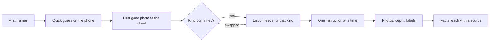

# From camera to facts

This document explains how one capture session turns a few photos of an item into a list of facts, each of which points back to the place it came from.

Status: explanation of the current design (agent proposal). Written 2026-11-14.

Nothing here is built yet. "The current design" means what the specs propose today, not what has been decided.

## The idea in one paragraph

You point your phone at a thing and tap what kind of thing it is. The app suggests the kind from the first frame, so one tap usually confirms it. It then asks for the few views that kind needs, reads and measures what it can, and marks the rest unknown. Every fact shows where it came from. A fact it cannot find stays empty. It is never guessed.

We follow three items: a jacket, a chair and a trading card.

## What the camera records

One session records several things at once.

- Photos, kept only when they are sharp enough.
- Depth, on phones with a LiDAR sensor. This is a map of how far away each point is.
- Where the phone was and which way it faced for every photo.
- An outline of the item, so the room around it can be cut away.
- Any text it can read, such as a care label, and any barcode.

Each answers a different question later. Photos show the item. Depth and camera position give real size. The outline keeps your room out of the data. The text gives exact names and numbers without guessing.

Your location stays on the phone. Faces and screens are blurred, and the photo's hidden metadata is removed, before anything leaves it.

## Working out what kind of thing it is

Capture opens on the type pick: the kinds sit over the live camera, and the phone's suggestion comes first. When the suggestion is clearly ahead of the next one it is already selected, so one tap confirms it, and a confident enough suggestion may skip the tap entirely; both ways will be tried. When it is not clearly ahead, nothing is selected and you choose ([Nate](../../product/words.md#2026-11-14-nate-capture-opens-on-the-type-pick-a-confident-suggestion-may-skip-the-tap-and-the-tutorial-is-animated-steps)). The first time you open the camera, a short animated tutorial shows how to pick a type and that each type has its own short process. You can skip it and replay it later.

The pick chooses the process before the first shot. Each kind has its own steps, and an input for every detail that kind needs, such as size and fabric for a jacket or set and number for a card ([Nate](../../product/words.md#2026-11-14-nate-each-type-gets-its-own-select-for-every-field-its-process-needs)). These work without a signal, from a copy kept on the phone. *Agent proposal* on this wording; Ben's agreement not recorded, and how capture opens is still for Ben and Nate together ([capture spec](../../spec/features/capture.md)).

The first few frames give the phone a quick guess, such as "clothing" or "furniture", from its built-in image recognition and the shape it sees: flat or tall, soft or hard edges, how big.

The first good photo then goes to the cloud for a second opinion, which confirms your pick or swaps it. It picks from 13 kinds: clothing, shoes, bags, watches, cameras, phones and electronics, vinyl, books, trading cards, LEGO and games, furniture, tools and bikes, and baby gear. If the guess changes, every photo already taken is kept. If the check is unsure, the app says so.

The kind sets the mode.

- A jacket is a flat garment. The app asks for a few still shots: laid flat, the tag, the care label, any flaws.
- A chair is a rigid thing. The app asks you to walk around it while a ring on screen fills as each side is covered.
- A card is small. What it needs is a readable view of the printed set name and card number, and a view of any wear. The spec does not yet fix a mode for cards.

## What it still needs to see

Each kind comes with a short list of things to find out, and how each one is found. A thing is found by:

- reading a label,
- measuring,
- seeing it in a photo,
- looking it up, or
- asking you.

The first three need a view of the item. The session gives one instruction at a time, such as "Closer on the tag" or "Turn it over". Lookups run in the background. Questions are covered in [clarifying-questions.md](clarifying-questions.md).

Before the listing is written, the app offers one free note, typed or spoken: where you got it, how long you had it, why you are selling, anything else, even things the app already found ([Nate](../../product/words.md#2026-11-14-nate-pricing-weighs-every-platforms-top-listings-official-listings-and-credible-discounts-with-a-slider-and-a-free-note)). The note is read into facts. Something that matches a fact confirms it, something that contradicts one is marked for you to settle, and something new fills its place or goes into the description. Nothing in the note is asked again, and a home address, phone number or payment detail in it never reaches a listing. *Agent proposal.*

There is no fixed number of photos. The session ends when every need a view can settle is met, or when you tap Done. Anything left is marked "not visible" on the item card. A shutter button is always there, and each kept shot can be undone for 3 seconds.

## How each photo is processed

On the phone, each frame is checked for sharpness and for the item being in view (this is the live feedback you see). The item is cut out from the background, text and barcodes are read, faces and screens are blurred, and hidden metadata is stripped.

In the cloud, the upload starts a job. The job stores the cutouts, the text it read and a "fingerprint" of each image. A fingerprint is a list of numbers that is close for similar-looking things. It is how the app finds matching products and finds similar items.

From the first good photo, searches run at once: the product catalogue, items already confirmed in the app, a vision model, an outside image search, and any code that was read.

Outside services get the cutout of the item, not your room. Raw room frames and scans are deleted after the cutouts exist, unless you choose to keep them.

The current design runs on a free tier with no graphics processors, so some steps are slower and use simpler tools.

## How each fact is found

**Brand, model and size.** A code beats everything. If the app reads a barcode, model number or style number, it looks that code up. Without a code, it trusts a catalogue match over an image-search match, and that over a model's guess. Image results alone never earn "exact model". For a jacket, the tag gives the brand and size. For a card, the set name and card number print on the card.

Before a candidate is shown, the app checks it again against its own photos and its text, and asks a vision model whether the two look the same. If a code or catalogue entry and that check agree, the identity is marked Confirmed with no tap. Otherwise you get one tap.

**Measurements.** Real size needs a scale. The current design tries, in order: LiDAR plus the item's key points, or a card or marker placed beside the item, then a published length for that model, then the floor plane. The order of the floor plane is still open. Depth from a single photo is only used as a cross-check.

For the jacket, the app finds the points for pit to pit and for length, then lets you drag them if they are off. In a published test, the LiDAR method was off by about 8 to 10 millimetres on a 50 centimetre garment. Flat cloth is hard for LiDAR, and items under 10 centimetres give no usable depth, so a reference card or marker placed beside the item carries the scale. For the chair, the scan gives a box: width, depth, height and seat height. If that fails, you tap two points with the floor as reference.

A measurement is Confirmed when two methods agree, or when you drag, type or tap Looks right. A number you typed is never changed by the app.

**Flaws.** A pass over every photo looks for marks, stains, tears and dents, each typed and sized. A flaw is unconfirmed until you confirm it, and only you can remove one. A flaw visible from a distance caps condition at fair. Condition maps to each marketplace's own scale when you list.

## What every fact points back to

Each fact carries its source and its evidence:

- a spot in a photo (the exact image and a box around the region),
- two measured points and the depth at each,
- a piece of label text with a crop of the tag,
- a catalogue entry or web page, or
- your own tap or words.

Tap "Why?" on any field and you see that evidence and the history of changes. A fact you edit is pinned, and no model rewrites it.

## Why listing photos are real frames

The listing photos are real frames from the session: the sharpest one for each angle, with the background cut away. The phone's 3D model is small, so it loses tags, logos and the weave of cloth, and some marketplaces require an unedited real photo.

The 3D model is used to measure, to power the spin view, and to pick which frames to keep. Studio then tidies the real frames. It keeps the item's pixels exactly as shot and cleans only what is around it. It never hides wear, changes colors or invents anything. Flaw photos and close-ups are never touched.

## What a capture cannot tell

Some things cannot be seen from outside.

- Whether it works. That is always your yes or no.
- Whether it is authentic. The app does not claim this. A serial number is not proof.
- Hidden condition, such as battery wear, smell or the inside of a bag. These show as "Not checked".

A match against a safety recall list, such as a recalled crib, blocks the listing.

## The same process for buyers

When you point the camera at something you do not own, using Find this, the same engine runs: the same labels, searches and candidates. You can also paste a link or a listing. A link or receipt is evidence, but does not prove the exact variant. Measurements you save for what you want are used later to check fit.

## Where to read more

- [Capture spec](../../spec/features/capture.md): the session, the kinds and the privacy rules.
- [Identify spec](../../spec/features/identify.md): the searches, the evidence order and the match labels.
- [Measure spec](../../spec/features/measure.md): the scale methods and how error is shown.
- [Item card spec](../../spec/features/item-card.md): the record for each kind and what each fact points to.
- [Studio spec](../../spec/features/studio.md): the touch-up rules.
- [Product spec](../../spec/product.md): the data model and the capture to item card flow.
- [Adaptive capture research](../../research/capture/nate/adaptive-capture.md) and [scan to images research](../../research/capture/nate/scan-to-images.md): the evidence behind the session.
