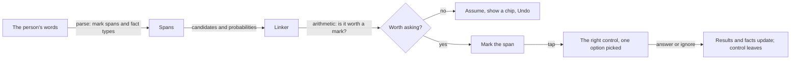

# Asking without questions

This document explains how the app finds out what it does not know without ever putting a question to the person: it highlights the unclear words, and a tap opens the right control under the input. It also explains how the app decides what is worth highlighting, what to pick in advance, and when to stop.

Status: explanation of the current design (agent proposal). Written 2026-11-14.

Nothing here is built yet. This describes the design in [spec/](../../spec/product.md), mainly [assist.md](../../spec/features/assist.md) and [asking-and-intent.md](../../spec/determinations/asking-and-intent.md), not what has been decided. Every weight and threshold below is a starting value, to be tuned on real data.

## The idea in one paragraph

The assistant never sends a message the person has to answer. The person types or says what they want, and results start at once on the app's best reading. Words it cannot settle are marked in the person's own sentence. A tap on a mark opens a small control under the input, with one option already picked and an Other row that opens a text box. If the person ignores the mark, nothing stops: the app goes on with its best reading, shows what it assumed, and lets the person undo it. A control leaves as soon as it is no longer needed. The same mechanism serves the buy search, the sell sheet, the market chat and capture.

## Two worked examples

**Buying.** Someone types "north face puffer for my son, under 100" ([assist.md](../../spec/features/assist.md#what-the-person-does-and-sees)).

1. Results start at once. "North face puffer" and "my son" are marked. "Under 100" is plain, because the app read it with certainty.
2. The person does nothing. The results stand on "Nuptse 700, kids' sizes", and a chip under the input says "Kids' sizes" with Undo.
3. The person taps "my son". A size picker opens under the input, which stays on screen. "Boys' 10 to 12" is already picked, from his last purchase.
4. They pick "Boys' 14 to 16". The mark becomes a settled chip, the picker leaves, and the results change in place.

**Selling.** Someone photographs a jacket and adds the note "barely worn". The tag gives brand and size. "Barely worn" is a condition word the app cannot place on its scale, so it is marked, and a tap opens a condition picker with the grade the photos suggest already picked. Whether the jacket is new with tags is a different kind of gap: a photo cannot tell, and it changes the price class, so capture decides it is worth one control ([how capture chooses](#how-capture-uses-the-same-mechanism)). The illustration is made up; the mechanism is the design's.

## What a mark means

Every unclear stretch of words, called a span, is in one of three states, shown by its mark and never by a number.

| State | Meaning | What the person can do |
|---|---|---|
| Open | needs a look | tap it, or ignore it |
| Assumed | read one way, shown as a chip with Undo | tap to change, or leave it |
| Settled | the person said it, or it was read with certainty | nothing |

Three rules hold everywhere ([assist.md](../../spec/features/assist.md#what-the-person-does-and-sees)). A span never blocks the results, the send button or another span. Only one control is open at a time, and it closes when answered, when the person taps outside, or when its span goes. And a control is never left on screen unused.

## How it decides what to mark

The decision is arithmetic, not the model's judgement ([asking-and-intent.md](../../spec/determinations/asking-and-intent.md)). The model has two jobs only: a parse step with typed output (a schema checked by zod, through the Databricks gateway) marks where each mention sits and what kind of fact it is, and later it writes the words on a control. In between, a linker (Databricks AI Search, the eBay Catalog and the person's own items) gives each mention a list of candidates with probabilities.

From there the rules are plain.

| Question | Rule | Starting value |
|---|---|---|
| Is the span unresolved? | The probability of its top candidate is under the open line. A conformal set at 90% coverage decides how many candidates stay; a set of one means it is settled ([card 1](../../spec/determinations/asking-and-intent.md#1-whether-a-span-is-unresolved)). | 0.8 |
| Would resolving it change anything? | The chance the answers differ, times how much the results move: one minus the overlap of the top 20 results, or the change in the middle price when selling ([card 3](../../spec/determinations/asking-and-intent.md#3-whether-resolving-a-span-would-change-anything)). Under the floor, nothing is marked. | 0.15 |
| Which option is picked in advance? | The top candidate, when it leads the second by the margin and has at least half the weight. A thing the person said always wins. With no clear lead, nothing is picked and the assumption is the broadest reading ("Any") ([cards 7 and 8](../../spec/determinations/asking-and-intent.md#7-which-option-is-preselected-and-when-none-is)). | margin 0.2 |
| When does it stop? | After 3 spans answered in one prompt, when nothing is above the floor, when the person moves on, or after a refusal. A refused slot is not raised again that session ([card 9](../../spec/determinations/asking-and-intent.md#9-when-inputs-leave-and-when-to-stop)). | 3 |

The cap of 3 has no source in research. A test decides it. A weekly job refits the other three numbers on real answers, and a person approves each change.

Two reasons for arithmetic rather than a model. The research behind the design ([assist.md](../../spec/features/assist.md#design-choices)) reports that unneeded questions cut task success from 65% to 27%, and that models ask about three times less often than they should. A rule that can be read and tested avoids both failures.

## Which control opens

The control comes from the kind of fact that is missing, by a fixed table, so the controls look familiar and nothing is generated ad hoc. The table is in [assist.md](../../spec/features/assist.md#widget-vocabulary).

| Missing fact | Control |
|---|---|
| One of two to five named choices | tap chips |
| One of many | a list with its own search |
| Yes or no | two buttons, and "Not sure" |
| A number with a unit | a number with a unit toggle |
| A budget | a range slider with two thumbs |
| Two dimensions | a grid to drag, height by width |
| A size | system first, then size |
| A colour | swatches with names |
| A place or a date | a place picker, a date picker with "Any time" |
| Which product | candidate cards with photos, and "None of these" |
| A spot in a photo | the app circles the spot and asks yes or no |
| A condition | the one condition scale |
| Anything else | a text box, as the last resort |

Each control has the full set of actions: the picked option as the main one, the other options, Other, and a named way out. These controls are a proposal for the json-render catalog of the screen framework (entries 54 to 67; Ben's own run 1 to 53), and the server checks every one before it is sent, so an unknown control cannot appear.

## How the app infers why the person wants it

Before it marks anything, the app tries to know the purpose behind the words. The buyer's purpose is a set of slots ([card 10](../../spec/determinations/asking-and-intent.md#10-the-buyers-purpose-slots-and-what-is-inferred-before-asking)): what it is for, for whom, budget, size, compatibility, deadline and condition tolerance. Each slot takes a weighted vote across what the app knows.

| Source | Weight (starting value) |
|---|---|
| The person said it | 1.0, final |
| Stated in the prompt ("size 10") | 0.95 |
| Implied by the prompt ("for my son" suggests kids' sizes) | 0.7 |
| Their past orders and wants, halved per year of age | 0.8 |
| What they follow | 0.4 |
| Demand across all buyers for the query | 0.3 |

The winner's share is its confidence. A slot the prompt never mentions is never marked. It is assumed, and the chip names its source in four words, such as "From his last order". Research on query histories supports putting the person's own past above the crowd: it predicted size and gender far better than population demand ([arXiv 2607.01530](https://arxiv.org/abs/2607.01530)).

## How capture uses the same mechanism

In capture there is often no typed prompt, only photos and the facts an item kind still needs. The mechanism is the same, with one extra rule for choosing which gap deserves a control ([seeing-the-item.md, card 17](../../spec/determinations/seeing-the-item.md#17-which-question-to-ask-next-and-when-to-stop)).

When the app is unsure which product an item is, it has a short list of candidates. The fact worth asking is the one whose answer cuts that list the most, which is called information gain: the entropy of the list before the answer, minus what is left after each possible answer. The eBay Catalog's counts of listings per value show how the market splits, so the app can compute this. Other gaps, such as damage or missing parts, are valued by how they change the listing. If two are about equal, the one that takes least effort goes first: a tap, then a chip, then a photo, then typing. It stops when one candidate is left, when no gap is worth more than the floor, at 3, or when the person refuses. The model writes the words on the control and does nothing else.

What this looks like for the items the old page used:

- **The jacket.** The tag gives brand and size, and a style code points to the model. A photo cannot say whether it is new with tags, or whether the belt and spare buttons are there, so those are the candidates for a control, and only when they change the price class or the listing.
- **The chair.** The scan gives size and shape. A maker's mark may need one more photo. A wobble cannot be seen at all, and missing parts such as a hardware bag are known only to the person.
- **The trading card.** The set and number are printed, so the app reads them. Condition and whether it is in a slab need the person.

**What it never asks.** What was paid, since price does not depend on it. Anything a photo, tag or lookup settles. Anything it could only guess, in which case the field stays unknown. Three things are the person's alone and locked: whether an item is counterfeit (the app never says "authentic"), whether it works, and removing a flaw.

## What happens to an answer

An answer becomes a fact marked as from the person, with their tap as the evidence, and no model rewrites it later. It is also kept as a label: a plain statement, or a correction when it differs from what the app had guessed. Each answer is traced in MLflow with the decision the person made.

The design says in its own words that "an owner's correction is useful but not automatically ground truth". So a tap is weighted by how it was made: a fast unchanged tap, under 600 ms, counts 0.1, and a confirmation that took longer counts 0.5. Those are starting values. A choice of "None of these" counts as an answer, because it says the candidate list was wrong. The app updates what it believes about the person at once, and refits the thresholds weekly.

A visitor gets the same marks, but nothing is stored. The spans travel on the search reply, the answers come back with the next search, and saving a thing needs an account.

## What is not settled

- **Inline marks or chips below the input.** No shipped product was found that marks unclear words inline inside the search box. Google's retail guide keeps the free-text bar always active and shows refinements beneath it. Marking words in place is therefore a bet, and a test will decide between it and chips under the input, by comparing how many reformulations each causes.
- **Ben's reaction.** The design depends on a pending open question for Ben ([assist.md](../../spec/features/assist.md#open-for-ben-and-nate)), and the controls are a proposal until his catalog takes them.
- **The cap of 3** and every threshold above are starting values.
- **Old text still around.** [assist.md](../../spec/features/assist.md#design-choices) still lists "one question at a time" among the options, and [watch.md](../../spec/features/watch.md) still says Watch asks "up to 3 tap questions". Both predate this design.
- **Slot names.** The comparison cards on the buy side read `keep_for` and `must_have[]`, which the purpose slots do not include (see [search and shopping](search-and-shopping.md#what-is-not-settled)).
- **Cannot be known.** What the person means by "barely worn" or "for travel" is not in the words. The design never claims to know it. It shows what it assumed, and the person decides.

## Where to read more

- [spec/features/assist.md](../../spec/features/assist.md): the surfaces, the control table and the choices behind them.
- [spec/determinations/asking-and-intent.md](../../spec/determinations/asking-and-intent.md): the nineteen cards, from "is this span unresolved" to what a visitor gets.
- [spec/determinations/seeing-the-item.md](../../spec/determinations/seeing-the-item.md#17-which-question-to-ask-next-and-when-to-stop): which gap capture asks about.
- [Identify spec](../../spec/features/identify.md): the candidate set and how answers become labels.
- [Capture spec](../../spec/features/capture.md): how a missing view becomes a request for one more photo.
- [Item card spec](../../spec/features/item-card.md): what the record holds for each kind.
- [Product spec](../../spec/product.md): the locked claims.
- [Clarifying inputs research](../../research/identify/nate/clarifying-inputs.md): the input kinds and the ordering.
- [What identifies each kind](../../research/item-card/nate/identity-schema-by-kind.md): the unknowns per kind.
