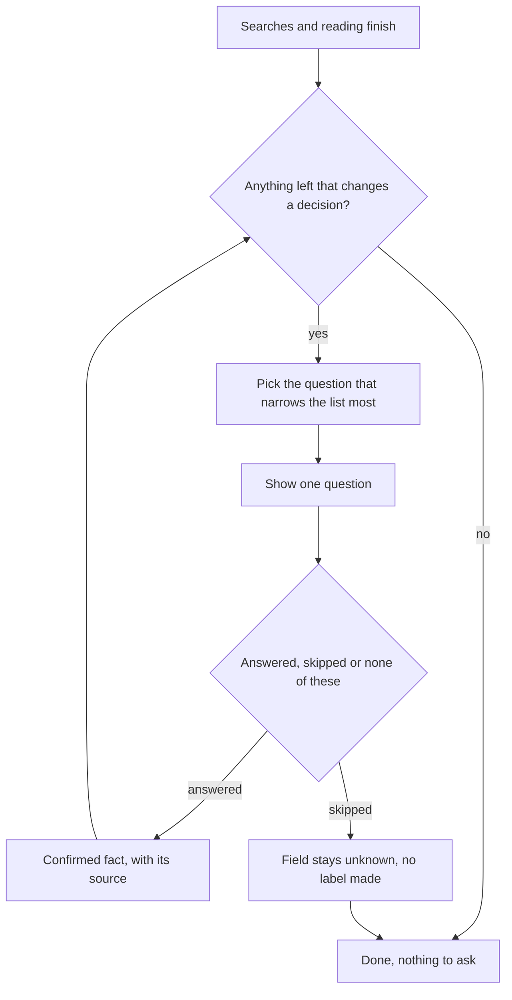

# How the app decides what to ask

This document explains why the app sometimes asks you a question, how it decides which one, and what it does with your answer.

Status: explanation of the current design (agent proposal). Written 2026-11-14.

Nothing here is built yet. "The current design" means what the specs propose today, not what has been decided.

## Why it asks, and why so little

The app would rather read, measure and look things up than ask you. Every question costs you a moment, and a needless one makes the app feel like a form.

So the rule is simple: resolve the most useful uncertainty for the least effort from you. The app asks only when your answer changes one of these:

- what the item is,
- what it is worth,
- what a listing may claim,
- how it ships, or
- whether it may be sold at all.

It does not ask when a photo, a tag, a lookup or the marketplace you chose already settles it. It also does not ask when the gap is the app's own, such as a search that failed. That is the app's problem, not yours.

## What the app cannot tell on its own

Each kind of item has a list of things the app needs to know. Some it reads, some it measures, some it looks up. A few it can only get from you. Those are the source of questions.

**The jacket.** The tag usually gives brand and size. A hidden care label may hold a registration number that confirms the maker, and a style code on the tag points to the exact model. What a photo cannot say is whether it is new with tags or new without tags, whether the spare buttons and the belt are still there, and whether the hangtag exists. The app asks about these only if they change the price class or the listing.

**The chair.** The scan gives size and shape. A maker's mark is often underneath or inside, and may need one more photo. Damage such as water rings, lifted veneer or a wobble is hard to see in a scan, and a wobble cannot be seen at all. Missing parts, such as a hardware bag, keys or table leaves, are also only known to you.

**The trading card.** The set name and card number are printed on the card, so the app reads them. What decides its price is condition, from near mint down to heavily played, or a professional grade with a certificate number if the card is in a slab. The app can show you what it sees, but the final condition and whether the card is in a sleeve or slab may need your word.

In each case the question is not "tell me about your item". It is one narrow thing the app could not settle.

## Which question comes first

Often the app does not yet know exactly which product you have. It has a short list of candidates. The question it picks is the one that cuts that list down the most. This is called information gain, which here just means "the answer that tells us the most".

Suppose the app is choosing between three versions of the same jacket that differ only in color and size. Asking "is it the blue one?" removes more than asking something that all three share. Where the marketplace shows how many listings have each value, the app uses those counts to see which question splits the list best.

If two questions are about equal, the one that takes less effort goes first: a tap before typing.

## When it stops

Only one question is on screen at a time. The app stops asking when:

- one candidate is left, or
- two independent signals agree, or
- it reaches the cap.

The current design caps questions at 3 per item. That number is not sourced from research. A test will decide it, by comparing how long it takes to reach a confirmed identity with caps of 1, 2 and 3.

Questions arrive as the background searches finish. You never wait on a spinner for one. A field shows its guess until a question replaces it. You can skip any question. Skipping teaches the system nothing and does not bring the question back.

## The kinds of question

Each kind of input exists for one reason.

- **Pick the matching product.** Two to four photo cards, plus None of these. Use this when the question is which product it is. Recognizing a photo is easier than describing it. If there is only one candidate it reads "Is it this?". If there are none, you get a text box and Find this.
- **A single choice.** A few chips, such as a color or an edition. Use this when one value splits the list. Chips are made large enough to tap easily.
- **A size.** The app reads the size from the tag photo first, then asks you to confirm. Use this when it could not read the size with confidence.
- **Yes or no on a pointed-at region.** The app circles a spot, such as a scratch, and asks "Is this a defect?". Use this when one place in the photo decides a field.
- **One more photo.** "Show me the tag." Use this when the answer is visible if shot, so a photo is cheaper than a question.

A candidate never shows a percentage. It reads "same model, size not read yet".

## Things the app never asks

- **How much you paid.** Someone clearing a closet often has no cost, and price does not depend on it. Cost is entered only if you want profit shown.
- **Anything a photo, tag or lookup could settle.**
- **Anything it could only guess.** If a photo cannot settle it and no answer would change a decision, the field stays unknown.

Three things are never decided by the app, and they are yours alone. Whether an item is counterfeit is your claim, because the app never says "authentic". Whether it works is your yes or no, never inferred. Removing a flaw is your tap. The app records each of these as yours and locks it.

## What happens to an answer

Your answer becomes a confirmed fact. It is marked as coming from you, with your tap as evidence. A fact you give is pinned, and no model rewrites it later.

The answer also teaches the system. It is stored as a label: a plain answer, or a correction when it differs from what the app had guessed. Later, a return marked "not as described" or an expert's review can add stronger labels. Each search route has a bar for how sure it must be before the app stops asking. Those bars are recomputed each night from the labels.

One caution is written into the design. "An owner's correction is useful but not automatically ground truth." People tap fast, mistake things, and sometimes do not know. So an answer is a strong signal, not the final word. An answer that comes after a very short look and changes nothing is flagged, not trusted as a label. A choice of None of these counts as an answer in its own right, because it tells the system its candidate list was wrong.

## Where to read more

- [Identify spec](../../spec/features/identify.md): the question rules, the candidate set and how answers become labels.
- [Capture spec](../../spec/features/capture.md): how a missing view becomes a request for one more photo.
- [Item card spec](../../spec/features/item-card.md): what the record holds for each kind, and the kinds' completeness items.
- [Product spec](../../spec/product.md): the question as a decision and the locked claims.
- [Clarifying inputs research](../../research/identify/nate/clarifying-inputs.md): the input kinds and the ordering.
- [What identifies each kind](../../research/item-card/nate/identity-schema-by-kind.md): the unknowns per kind.
