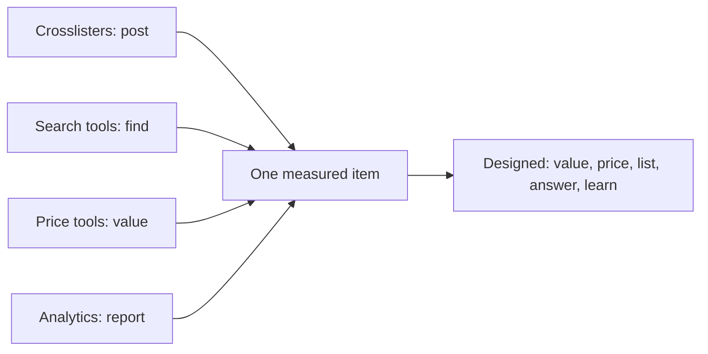

# How the app's design compares with tools that already exist

This document explains, group by group, what existing tools do today, what the secondhand design does differently, and where the existing tool is ahead of us.

Status: explanation of the current design (agent proposal). Written 2026-11-14.

Nothing here is built yet. "The current design" means what the specs propose today, not what has been decided. It describes the design in [spec/](../../spec/), mainly [connect](../../spec/features/connect.md), [list](../../spec/features/list.md), [price](../../spec/features/price.md), [market](../../spec/features/market.md) and [insights](../../spec/features/insights.md). Every weight below is a starting value to be tuned against real sales. Our side is written as "designed". The other products are described only as strongly as the research note behind each claim, and the mark in brackets says how that claim was learned: observed (read at the source), vendor's own claim (asserted), or a third party's report.

## The idea in one paragraph

Most tools below do one job well: post one item to many sites, search many sites, chart a price, or report sales. The design here joins them around one measured item, so that the value, the price per site, the listing, the buyer messages and the sales reports all start from the same facts and sold prices, and a person approves anything with a cost or risk. That join is the bet, and it is untested. Every tool below is live and has users, and ours has none.

## Crosslisting tools

| Tool | What it does today | What our design does differently | Where it is ahead of us |
|---|---|---|---|
| Vendoo, List Perfectly, Flyp | Fill each marketplace's own listing form through a browser extension or the person's session (inferred from help pages and reviews). Vendoo polls for sales every 10 minutes (observed, help article, date not captured) | Designed to start from a measured item and a routed price per site ([list](../../spec/features/list.md), [connect](../../spec/features/connect.md)), with a check of the live form's limits first | They work today, with import, bulk edit and years of fixes. Our adapters do not exist |
| Nifty | Runs automation on vendor servers, so the person's device need not be on (the vendor's own claim). A $39.99 monthly price appears in a roundup (asserted, from a search snippet) | Designed to run sharing and offers inside pace limits and account-risk notes, and to stop when a site warns ([listing and marketing D26](../../spec/determinations/listing-and-marketing.md#d26-engagement-levers-the-agent-runs-on-its-own)) | Always-on cloud automation is shipped and sold now |
| OneShop | A phone app for listing and sharing (the app is a mobile-first product; no primary source was opened) | Designed as one account across sites, with no phone-only path | Its phone-first flow exists. We have not checked how well it works |

Failures are reported by users: undetected sales and double sales on Vendoo (third party, Trustpilot reviews, July to October 2026), sale detection that depends on the device being awake on Flyp (third party, store reviews), and detection that only alerts on a lower List Perfectly tier (observed, help page, 2025-09-11). Vendoo's "33% more sales" for auto-sharing is a vendor claim, not checked. The detail is in the [crosslister teardown](../../research/cross-cutting/nate/crosslister-teardown.md) and the [Shopify suite map](../../research/cross-cutting/nate/shopify-suite-map.md). Our design aims at the same weak spot with checks on the live site and a reconcile pass ([how-we-prove-it.md](how-we-prove-it.md)), but a design does not show a fix.

## Marketplace-native AI

| Tool | What it does today | What our design does differently | Where it is ahead of us |
|---|---|---|---|
| Meta AI on Facebook Marketplace | Since 2026-03-12 sellers can have Meta AI draft or send replies to availability questions, suggest a price and draft a listing; buyers get an AI seller summary (observed, about.fb.com). No adoption or safety numbers were found | Designed so the app drafts but a message with a commitment waits for the person's approval ([messages](../../spec/features/messages.md)) | It is inside the marketplace: no login to keep alive, no ban risk, no cost to the seller, and it ships to every Facebook seller |
| eBay's drafting tools | Draft listings; a note in the teardown records no auto-send (observed, [teardown](../../research/cross-cutting/nate/crosslister-teardown.md)) | Designed to carry one measured item to several sites | eBay has first-party access to its own sold data and its own category rules |

Evidence for why approval matters is one incident. A YouTuber let Meta's Muse agent handle Marketplace messages ("Allow Always"). It accepted a lowball offer, sent his home address as the pickup spot and wrote "Yep I'm here!"; the buyer left a negative rating, and a Meta executive said the agent was "following direct instructions and correctly asked for permission" (observed, from the [Gadget Review](https://www.gadgetreview.com/meta-responds-after-muse-ai-sent-stranger-to-youtubers-home) and [Proton](https://proton.me/blog/meta-muse-ai-home-address) summaries dated 2026-09-28 and 2026-09-30). The TechRepublic fetch failed and the original Guardian report was not opened. It is one anecdote. The [pitch sources](../../research/cross-cutting/ben/pitch-sources.md) call it a strong point for human-approval gating. Separately, eBay's user agreement bars "buy-for-me agents, LLM-driven bots, or any end-to-end flow that attempts to place orders without human review", effective 2026-02-20 (observed, a third-party site quoting it).

## Cross-marketplace search and similar-item finders

| Tool | What it does today | What our design does differently | Where it is ahead of us |
|---|---|---|---|
| ThriftX | Searches Depop, Poshmark, Vinted, eBay, Mercari and ThredUp live by text or photo, removes duplicate cross-posts, and watches across six marketplaces; it calls itself the search layer, not the checkout (asserted: vendor-sourced) | Designed to search the same sites and to compare an item with a measured one, with sold-price ranges and a relaxable similar-and-cheaper view ([search and shopping](search-and-shopping.md)) | It is live, with real users. Its cross-site watch overlaps with what we only plan |
| Phia, Encore, Gem, Beni | Aggregators; Phia reports 350M items and a $35M Series A (asserted); Encore earns through affiliate links and a $3 monthly plan (asserted, 2024-11) | Designed to chart sold against asking prices beside the cross-marketplace grid | They have funding and traffic. We found no traction or complaint data beyond funding news |
| Dupe.com | Finds look-alikes, strongest on furniture and home decor from retailer feeds; no used items found (not-found); look-alike matching ignores material and build and no similarity scale was seen (observed) | Designed to assess an item by facts such as material and build, and to show a similarity with the reason ([identify-and-similar-items.md](identify-and-similar-items.md)) | It covers a large new-goods catalogue today. Ours covers used items only in design |

What no existing product was found to do, with all three marked inferred and "not found rather than proven absent": a relaxable similar-and-cheaper view over used listings; one price-history panel with sold against asking labels and a sample-size confidence beside a cross-marketplace grid; and an item-level cross-site list with price follow. See the [buy-side note](../../research/watch/nate/buy-side-products-and-search-experience.md). These are gaps in what we could find. They are not evidence that the gap matters to buyers.

## Price tools for cards, watches and sneakers

| Tool | What it does today | What our design does differently | Where it is ahead of us |
|---|---|---|---|
| Card Ladder | 100M+ sales and a CL Value with a 1 to 5 confidence, the only user-visible uncertainty mark found (observed) | Designed to show a range for any item, with a confidence from sample size ([value-and-price-history.md](value-and-price-history.md)) | Deep, trusted data for cards. We have no sales yet |
| eBay Price Guide, WatchCharts, StockX | A median of sold prices refreshed every 24 hours, US only (observed); a 30-day weighted window falling back to asking prices, from $39 a month (observed); bid and ask (observed) | Designed to mix many sites and to separate sold from asking | Each has cleaner single-market data than a multi-site blend can have |
| FlipTip and similar | A photo to a value range (FlipTip's own pitch; see [valuation engine](../../research/price/ben/valuation-engine.md)) | Designed to carry the range into price per site, listing and offers | They are live, and they publish an accuracy test (not relied on here; see [the note](../../research/price/nate/published-price-tests-and-their-flaws.md)) |

Used prices for the same item vary from sale to sale. That is a limit on any price tool, ours included, and it is why the design shows ranges; our own backtest decides how wide ([money.md D6](../../spec/determinations/money.md#d6-range-calibration-and-display-state)). FlipTip and Underpriced AI publish accuracy tests, but they are not relied on here: each vendor tests its own product, after the sale, with no price bands and no unsold items ([published-price-tests-and-their-flaws](../../research/price/nate/published-price-tests-and-their-flaws.md)). eBay's sold search needs a login, and a search API dropped its sold filter on 2026-09-28, so sold prices now come from paid scrapers whose claims are the vendors' own (asserted, packet 21).

## Catalogs and shopping assistants

| Tool | What it does today | What our design does differently | Where it is ahead of us |
|---|---|---|---|
| Shopify Catalog | Over 1 billion products with search, get-product and lookup calls; a condition filter with a "secondhand" value; display and link only, with indicative prices, for US shoppers (observed) | Designed to rely on measured used listings and sold prices rather than indicative new prices | Reach and a documented interface, which we do not have |
| Google (Merchant Center, AI Mode, Universal Cart) | Carries a `condition` of new, refurbished or used; a cart across merchants with price drops and back-in-stock alerts (observed, Google blog 2026-05-19) | Designed to follow a price per item across used sites | Google has the audience and the cart. Third-party read access to its Shopping Graph was not found |
| ChatGPT shopping, Amazon Rufus | ChatGPT draws on merchant feeds and "other available retail and public web sources". Amazon reports Rufus users convert 60% more (the vendor's own figure, aboutamazon.com page, 2025-11-18) | Designed with a person's approval before any buy or send | Their user bases are far larger than ours will be. A study found full success in 28.2% of 100 scenarios on five AI shopping platforms (third party, a single author, not peer reviewed) |
| Klarna | Not checked | Not compared | Not checked |

See the [catalog note](../../research/watch/nate/shopify-catalog-and-agentic-commerce.md). Of these, only Shopify's Catalog was found with a documented read interface a third party can call. An eye-tracking study found that acting for the user lowered trust, and that a preview with a reason reduced the penalty (third party, as recorded in the buy-side note). That supports the preview-then-approve design but is one study.

## Analytics

| Tool | What it does today | What our design does differently | Where it is ahead of us |
|---|---|---|---|
| Shopify Analytics and Sidekick | 200+ real-time reports on all plans; Sidekick turns a plain question into a ShopifyQL report (observed, changelog 2025-10-08). Sell-through is per product or variant | Designed to give sell-through per market and per site, with profit when the item's cost is known ([insights](../../spec/features/insights.md)) | A mature reporting layer, with a query language. Insights as designed has fewer reports |
| eBay Seller Hub and Terapeak, Poshmark, Depop | eBay gives impressions, views and click-through (observed) and three years of sales; Poshmark shows impressions, clicks and likes per listing (observed, 2026-04-06); Depop shows a shop dashboard (observed, 2025-06-25) | Designed to read these and compare a listing with similar ones | They have the first-party numbers directly. We read what a site exposes, and Poshmark has no API |
| Vendoo, List Perfectly, Nifty | Profit, revenue and slow-mover reports (asserted, from search results; vendor pages not opened) | Designed to tie profit to the same facts used to price | They already have bookkeeping features that we have not designed in depth |

Mercari's seller statistics are asserted only, from one third-party blog, and Facebook Marketplace's were not searched. See the [analytics note](../../research/data/nate/shopify-analytics-and-seller-analytics.md).

## General tool routers

| Tool | What it does today | What our design does differently | Where it is ahead of us |
|---|---|---|---|
| treg.to | One token in front of about 4,100 endpoints across about 127 providers, with measured success rates per endpoint, and routed calls that fail over (observed, fetched 2026-11-14). Depop, Poshmark, Mercari, Grailed, OfferUp, Vinted and StockX return nothing in its catalogue search; Facebook Marketplace has seven endpoints | Designed to use a router for data reads and to measure each source ([connect](../../spec/features/connect.md)) | A catalogue of data sources exists today. Its published rates expire within days, so none are quoted here |

The [routing note](../../research/cross-cutting/nate/treg-tool-routing.md) records the router as an input to the design, not a rival to the product.

## The differences that matter most

1. **A human gate on actions with a cost.** The Muse incident is the only evidence we have that an unchecked agent can do real harm in this market, and it is one report. It supports the design but does not prove it.
2. **A range, not a number.** Used prices for the same item vary, so the design shows ranges, sized by our own backtest, and hides weak ones. That is honest about the limit, but it also gives the person less than a single confident figure would.
3. **One measured item behind every step.** No tool above was found to carry the same item facts from capture through value, price, listing and sales report. Not found is not proof of absence, and the join is also the most work to build.
4. **Ranges and ranking rest on evidence tiers.** The market page grades ranking beliefs by source and drops folklore ([how-we-market.md](how-we-market.md)). Crosslisters sell sharing on a vendor's 33% claim.

## What we could not check

- Klarna's shopping surface, and Amazon's Auto Buy and Buy for Me scope (asserted, unopened).
- How well any crosslister works today. We have only their own pages and reviews.
- OneShop, beyond its own description; Mercari's seller statistics; Facebook's seller analytics.
- The Guardian original of the Muse report, and any safety data on Meta's tools.
- Traction and complaints for Gem, Beni and Phia, and whether a used filter exists on Google Shopping.
- Pricing pages of the crosslisters and bookkeeping apps (asserted, from search results).

## Where to read more

- [how-we-price.md](how-we-price.md), [how-we-market.md](how-we-market.md) and [how-we-prove-it.md](how-we-prove-it.md)
- [Crosslister teardown](../../research/cross-cutting/nate/crosslister-teardown.md), [pitch sources](../../research/cross-cutting/ben/pitch-sources.md) and [buy-side note](../../research/watch/nate/buy-side-products-and-search-experience.md)
- [Range calibration](../../research/price/nate/range-calibration.md) and [valuation engine](../../research/price/ben/valuation-engine.md)
