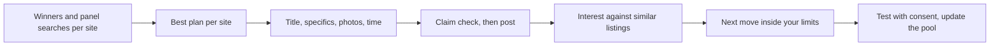

# How the app writes and times a listing so the right buyers see it

This document explains what each site's search seems to respond to and how the app knows, how it picks the best plan and each part of a listing per site, and what it does on its own after the listing is live.

Status: explanation of the current design (agent proposal). Written 2026-11-14.

Nothing here is built yet. "The current design" means what the specs propose today, not what has been decided. It describes the design in [spec/](../../spec/), mainly the [List spec](../../spec/features/list.md) and the [listing and marketing determinations](../../spec/determinations/listing-and-marketing.md). Every weight below is a starting value to be tuned against real sales. The price side is in [how-we-price.md](how-we-price.md).

## The idea in one paragraph

No site publishes how its search ranks listings, so the app does not assume an algorithm. It rests on three kinds of evidence, in this order: what similar listings did (their position and sales), controlled tests on listings of people who agreed to them, and what the sites themselves say, graded by how reliable the source is. Seller folklore is shown only as "what sellers say" and is never used to choose anything. From that evidence the app picks a best plan for each site, then each part of the listing, and after posting it keeps a small set of low-risk actions running inside your limits.

We follow one item across two sites: a tan leather crossbody bag, listed on eBay and on Poshmark.

## What each site's search responds to, and how we know

The spec grades each belief by its source ([card D11](../../spec/determinations/listing-and-marketing.md#d11-what-each-ranking-is-believed-to-reward)). Tier 1 is a controlled experiment, tier 2 a company engineering post or patent, tier 3 a company help page, tier 4 an independent observational study and tier 5 seller folklore.

| Site | What is believed to count | Tier |
|---|---|---|
| eBay | Relevance, predicted then observed conversion, and price and shipping against comparable listings | 2 (patents) |
| eBay | A full title, item specifics, the right category, up to 24 photos | 3 (eBay's Best Match help page) |
| eBay | A new-listing boost, a relist refresh, free shipping as a rank factor | 5 (folklore) |
| Poshmark | Keyword and image matching; stuffing keywords is marked down | 3 (Poshmark blog) |
| Poshmark | Sharing raises rank | 5 (folklore) |

Facebook, Depop and Mercari have rows of their own in the card. Facebook's ranking predicts clicks, saves and messages (tier 3), and a boost sits outside it. The table shows only the two sites in our example.

Since the published tiers are weak, the app builds a stand-in. Each day it runs a fixed panel of searches per site, signed out from a fixed place, and records the order of results ([card D12](../../spec/determinations/listing-and-marketing.md#d12-stand-in-ranker-factors)). A model for ranked lists (Plackett-Luce) is fitted weekly on that order, with paid results removed and one listing per seller. It says which factors, such as free shipping or photo count, tend to sit higher. It reproduces the order, not the site's real model, and seller and position effects remain. A belief that our own data contradicts is shown as "our tests disagree". A site's search can also change. If a daily comparison of the panel against its own baseline moves ([card D24](../../spec/determinations/listing-and-marketing.md#d24-whether-a-site-changed-its-ranking)), a notice pauses the visibility estimates until the model is re-learned.

Controlled tests run only on listings of people who turned on `experiments_consent` ([D22](../../spec/determinations/listing-and-marketing.md#d22-test-design-for-a-change)). One change at a time, price kept on its path, the same product in matched pairs where possible. The result is "helped", "hurt" or "cannot tell" ([D23](../../spec/determinations/listing-and-marketing.md#d23-whether-a-change-helped)); a before-and-after result never says "caused". A test of a sale rate needs about 1,500 listings per arm, so for one person it often ends in "cannot tell".

## The best plan, and why you can pick another

[Card D3](../../spec/determinations/listing-and-marketing.md#d3-best-plan-per-site) chooses a start price rung, a markdown path and a shipping option per site over 7, 30 and 90 days, with the highest expected keep after the chance of selling at each step. Every price stays at or above your floor. It uses what winners on that site did ([D2](../../spec/determinations/listing-and-marketing.md#d2-winners-on-a-site)): the fastest quarter of sold listings plus the top ten live listings at half weight, promoted ones left out. With fewer than ten winners it uses no pattern. The best plan comes preselected, labelled by its sample line, "Start at $48, drop to $42 after 9 days, never below $35. Most like it sold within a month." The best plan for the other horizons and the next start rung are shown as alternatives, and you pick. Every part can be changed because the plan is a recommendation and you hold the final say.

## How each part of the listing is chosen

| Part | How it is chosen | Evidence |
|---|---|---|
| Title | Each candidate word scores 0.5 for how often winners use it, 0.3 for appearing in the site's search suggestions, 0.2 for appearing in all comparable listings (starting values), in the site's slot order. Only words backed by a fact are used | [D4](../../spec/determinations/listing-and-marketing.md#d4-title-per-site) |
| Item specifics and attributes | Filled in order of how the value was learned: measured, label, spec sheet, what you said, inferred, marketplace | [D6](../../spec/determinations/listing-and-marketing.md#d6-attributes-per-site) |
| Photo order and crops | The coverage set first, flaws before extras, then by a quality score. One portrait capture is cropped per site | [D8](../../spec/determinations/listing-and-marketing.md#d8-photo-choice-and-order) |
| Time of posting | Now, unless a site is known to favour new listings and enough pooled data shows a better hour | [D14](../../spec/determinations/listing-and-marketing.md#d14-when-to-post) |
| Paid promotion | Never on its own | [D18](../../spec/determinations/listing-and-marketing.md#d18-promoted-listing) |

For the bag, the eBay title runs brand, model, type, model number, size, colour, within 80 characters of which about the first 60 show. The Poshmark title runs brand, style, item, colour, size. The same facts, in a different order, because the slots differ. On eBay the photo limit is 24 and the crop is square. On Poshmark the limit is 16 and the crop is 3:4. Both get the lightest touch-up, level 1. The listing's tag, label, serial and flaw photos are never touched up. Photos with higher quality matter: a study of listings found odds ratios of 1.17 for shoes and 1.25 for handbags (arXiv 1811.10648, observed), so the bag's best photo leads. The description states the must-know facts first and the flaws in the first third, and a missing fact holds the post ([D5](../../spec/determinations/listing-and-marketing.md#d5-description-and-the-facts-it-must-state)). Each claim is checked against a fact before posting ([D25](../../spec/determinations/listing-and-marketing.md#d25-claim-check)).

**Timing is the least supported part.** The default is to post now. A delay applies only when the site favours recency at tier 3 or better and the pooled curve of consenting users' listings has 200 or more listings, and only if the better hour beats posting now by more than the usual spread. The popular advice about evenings and weekends has weight 0 because no study was found.

**Promotion** is a spend, so it asks. It pays only if the lift in sale chance beats the break-even; the break-even lift is shown, and the spec recommends promoting only when a measured lift clears it. The lift for used goods is not published. The sample line is "Promoting at 5% pays only if it makes a sale about 7% more likely."

**One open proposal on titles.** Ben's [search strategy note](../../research/list/ben/listing-seo-strategy.md) proposes scoring a word by the buyer demand it adds, not by winners' share, and not filling titles to the limit. His evidence is a tool vendor's own data on 33,638 eBay listings (observed, correlation only): titles of 76 to 80 characters against under 70 gave +0.8 points of 30-day sell-through, with an interval of -1.2 to +2.2, which includes zero. The spec's D4 as written uses winners' share. The two are not reconciled, and his proposed first test, a lean title against a filled one on eBay, has not been run.

## What the agent does on its own after posting

The agent follows a fixed order and takes the first rule that matches ([card D16](../../spec/determinations/listing-and-marketing.md#d16-next-move-on-a-live-listing)): answer your own pending messages, hold if interest is ahead of plan, make a price drop or an offer to likers or watchers if one is due, fix the listing if it is behind plan, promote if the budget and break-even allow, offer a bundle, otherwise hold. Interest is compared with the band that similar listings reach at the same age ([D15](../../spec/determinations/listing-and-marketing.md#d15-interest-against-plan)).

The levers it runs on its own ([D26](../../spec/determinations/listing-and-marketing.md#d26-engagement-levers-the-agent-runs-on-its-own), an agent proposal) have a pace limit and an account-risk note each.

| Site | Lever | Pace limit (starting value) | Account risk |
|---|---|---|---|
| Poshmark | Share your own listings | 1 share per live listing a day, spread out | High: Poshmark's policy against unauthorised automation (observed in the crosslister teardown) |
| Poshmark, Mercari, eBay | Offer to likers or watchers, at or above always-accept | A 7-day cooldown | Low |
| Depop | Refresh by editing | Once a week per listing | Medium: no rule found |
| Grailed, Facebook | Bump or renew | The site's own interval | Low |
| eBay | Promoted Listings | Never on its own | None |

Poshmark retired its Excessive Listing Removal policy on 2026-07-23; its Seller Cancellation Policy (3% of orders in a rolling 90 days) still applies ([claims validated](../../research/cross-cutting/nate/claims-validated-papers-and-docs.md)).

The offer to likers uses the site minimum (Poshmark 10%, eBay 5%, Mercari 10%). The eBay case rests on a study that Best Offer raised the sale chance by 3.17% (observed abstract, tier 4). If an account's health is not fine, or a site shows its risk flag, every lever on that site stops and you are told. Each lever turns off by default if matched pairs show no lift after 200 pairs. For the bag on Poshmark, the app shares it once a day if you switched sharing on, and the sample line reads "Shared your 24 Poshmark listings today, 1 each. Paused if Poshmark warns." Relisting to gain rank is used only after the price path reaches the floor and interest is behind plan for 14 days, never on Poshmark, and only as a test with your consent ([D21](../../spec/determinations/listing-and-marketing.md#d21-edit-refresh-or-relist)).

The claim that sharing helps is a vendor's: Vendoo says auto-sharing brings "33% more sales" (asserted, not checked; see the [Shopify suite map](../../research/cross-cutting/nate/shopify-suite-map.md)). No controlled test was found.

## What cannot be known

[The spec lists what cannot be made credibly](../../spec/determinations/listing-and-marketing.md#what-cannot-be-made-credibly).

- A site's real ranking weights.
- Where a listing sits on Facebook, Depop, Poshmark and Mercari with paid slots separated (no promoted flag found).
- What a given buyer sees, which is personal.
- The effect of sharing, relisting for rank, or posting time, from published evidence.
- A per-person verdict on sale rate, until about 1,500 listings per arm exist.
- The lift from promotion on used goods, before pooled tests exist.
- Facebook's title limit is three surfaces, not three values: the partner catalog takes 200 (65 recommended), the consumer form about 99 with a warning at 100, and 150 has no source ([settled note, row 11](../../research/watch/nate/open-items-settled-sites-and-rivals.md)). D4 uses 60.

## What is not settled

- Ben's proposals on titles and on filling only required fields (D6) against D4 and D6 as written.
- The spec has no decision kind for promotion spend, and the sharing lever needs a job kind that does not exist yet.

## Where to read more

- [List spec](../../spec/features/list.md), [price spec](../../spec/features/price.md) and [listing and marketing determinations](../../spec/determinations/listing-and-marketing.md)
- [Ranking algorithms](../../research/list/nate/ranking-algorithms.md), [observing rank and performance](../../research/list/nate/observing-rank-and-performance.md) and [platform levers](../../research/list/nate/platform-levers.md)
- [Search strategy](../../research/list/ben/listing-seo-strategy.md) and [platform fit](../../research/list/ben/platform-fit.md)
- [selling-runs-itself.md](selling-runs-itself.md) and [how-we-prove-it.md](how-we-prove-it.md)
