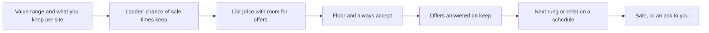

# How the app moves from a value to a price on each site

This document explains how a value range becomes a list price on each site, the lowest price the app will take, how that price steps down if nothing sells, how offers are answered, and how likely and how fast a sale is.

Status: explanation of the current design (agent proposal). Written 2026-11-14.

Nothing here is built yet. "The current design" means what the specs propose today, not what has been decided. It describes the design in [spec/](../../spec/), mainly the [Price spec](../../spec/features/price.md) and the [money determinations](../../spec/determinations/money.md). Every weight below is a starting value to be tuned against real sales. How the value range itself is found, and the fee tables, are in [value-and-price-history.md](value-and-price-history.md) and are not repeated here.

## The idea in one paragraph

A value says what similar items sold for. A price is a decision: what to ask on this site, what to accept, and when to lower the ask. The app makes that decision with arithmetic on what you keep after fees and shipping, not on the sticker price. It picks the rung of a price ladder where the chance of a sale times the amount kept is highest, adds room for offers on sites where buyers expect to haggle, sets a floor, and answers each offer by comparing what you would keep with what waiting is likely to bring. Anything under the floor goes to you. Chance and time are shown as ranges, and are hidden when there are too few sales to say.

We follow one item: a wool coat in good condition, with a target of $40 in your pocket.

## One target, a different price on each site

The same coat costs a different amount to sell on each site, and buyers on some sites expect to negotiate. Two things set the list price. The fee is what the site and the label take out ([card D9](../../spec/determinations/money.md#d9-what-you-keep-per-site)). The padding is extra room in the ask so that a typical offer still lands on your target.

The padding below is Ben's proposal (agent proposal, inferred from each site's offer rules), written in [packet 31](../../.agents/team/packets/list/31-platform-fit.md) and the [platform-fit summary](../../research/list/ben/platform-fit.md). The list-price column is what those multipliers produce for a $40 target, an illustration and not a quote from the spec. The last column is Ben's own worked example of what a $40 sale leaves after fee and label (inferred).

| Site | Padding rule | List price it produces | Keeps on a $40 sale |
|---|---|---|---|
| eBay | target plus 10%, Best Offer on, auto-decline under 80% | $44.00 | about $32.91 |
| Facebook Marketplace | target plus 10% at $50 and up | $40.00 (below the $50 trigger) | $40.00 local |
| Depop | target divided by 0.85 | about $47.06 | about $37.91 |
| Poshmark | target divided by 0.85, never under $15 | about $47.06 | $32.00 |
| Mercari | target times 1.18 | $47.20 (the packet writes $47) | about $35.20 |

The spec has a second route to the same number. [Card D13](../../spec/determinations/money.md#d13-listing-price) learns the room instead of fixing it. It picks the start rung with the best chance times keep, then on offer-heavy sites (eBay Best Offer, Poshmark, Mercari) lists at `start / (1 - d)`, where `d` is the median gap between ask and sold price on that site and category. It caps the result at the top of the value range and rounds to the site's most common price ending. The screen says "List at $45: you keep the most for a sale within a month", and a tap shows the ladder with the chance and the keep for each rung. How the learned discount and Ben's fixed multipliers relate is not written down, and is listed at the end.

## The floor and who can go below it

The floor is the lowest price the app will take without asking you. [Card D14](../../spec/determinations/money.md#d14-floor-and-always-accept) writes it once: the largest of the lowest rung the path has reached, your cost plus the profit you asked for, and what the best route that is not a sale would keep (bundling, trading in, donating). A casual seller's profit target is zero.

Two numbers are filled in when you list, and you can change both. One is the floor. The other is "Always accept $X or more", the lowest rung where what you keep is at least what the markdown path is worth, never below the floor. Only approvals you accept without editing count toward more automation ([decision](../../product/decisions.md#2026-11-14-always-accept-is-offered-at-listing-and-only-unedited-approvals-count)). Where a site has its own floor tool, such as eBay auto-decline, it is set to the same number ([Price spec](../../spec/features/price.md)).

For the coat the spec's sample line reads: "We'll accept $38 or more right away; we won't go under $30 without asking you." A sale under the floor always asks, with the reason `price_below_floor`. With no ladder, for example when value was hidden, you set both by hand.

## What happens when it does not sell

The path is a ladder of prices from the 10th to the 90th percentile of the comparable sales, in 5-point steps, scaled by the 30-day price trend ([card D15](../../spec/determinations/money.md#d15-markdown-path-stale-and-relist)). Each rung gets a chance of sale, and the next rung starts after that rung's median days. "Stale" means no sale by the plan's median days and interest below that of similar listings at the same age. A fixed 10% weekly cut is rejected because it gives away margin on items that were only buried.

At stale, the first question is whether price or visibility is the problem. If the current price is already at or below the median, the app relists. Otherwise it moves to the next rung, never below the floor. The later steps are a schedule where `m` is the plan's median days to sell. The multiples are starting values and an agent proposal.

| Age | Step |
|---|---|
| m | Relist or next rung, plus the site's own levers ([how-we-market.md](how-we-market.md)) |
| 1.5 m | Offer to watchers or likers at or above the always-accept price |
| 2 m | Add the next site that the item is not on |
| 3 m, or the floor is reached | Ask you: end, bundle, trade in or donate, with what each would keep |

Poshmark relists are never automatic, so the first step there always asks. The sample line is "No sale in 12 days and fewer views than similar listings; dropping to $40." Without a ladder there is no automatic markdown, and you are reminded at day 14 with the comparable sales.

## How an offer is answered

[Card D16](../../spec/determinations/money.md#d16-offer-response) works on what you keep, not on the offer's face value, because the same $5 off costs more on a site that takes a fee on the item. It runs four rules in order.

1. If what you keep at the offer is at least what you keep at always-accept: accept, on its own inside your limits.
2. If it is between the floor and always-accept: accept when it beats the value of waiting, which is the expected keep of the rest of the plan. Otherwise counter at the midpoint of the offer and the current price, rounded to the site's ending. The midpoint is an asserted starting rule until real counter data exists.
3. If it keeps less than the floor: counter at the floor, automatically. Below the floor always asks.
4. A bundle is judged on the summed keep against the summed value of waiting.

Take the coat on Poshmark at $45, where the fee is 20%. An offer of $35 would keep you $28, less than waiting is likely to bring, so the app counters at $40. The spec's sample line is "Offer $35: you'd keep $28, less than waiting is likely to bring; we countered at $40." With no chance estimate, only rules 1 and 3 run, on your own lines.

## The chance of selling, and how long it takes

[Card D10](../../spec/determinations/money.md#d10-chance-of-sale-within-a-period-at-a-price) gives the chance that the item sells within 7, 30 or 90 days at a price. It blends a survival curve from similar listings, binned by price against the median sold price, with a model of the share that never sell (a cure model; the method is from arXiv 2605.07087, run on Mercari data, observed). Listings that ended unsold or are still live are kept as rows, because dropping them would make everything look faster than it is. The result is re-fitted to held-out sales so that "6 in 10" really is about 6 in 10 (the check allows 5 points). The sample line is "About 6 in 10 like this sell within a month at $40."

[Card D11](../../spec/determinations/money.md#d11-time-to-sell-range) shows the days where the chance reaches 25% and 75%, for example "Most sell in about 9 days at this price." It reads those days off the curve, which includes unsold items. If fewer than half sell within 90 days, no time is shown.

## What is shown as a range, and why

Every estimate here is shown as a range or hidden. Used prices for the same item vary from sale to sale, so a single number would claim more than we know. Our own backtest decides how wide the range is and whether it is shown ([money.md D6](../../spec/determinations/money.md#d6-range-calibration-and-display-state)). Vendors publish accuracy tests, but they are not relied on here: their methods are not sound ([published-price-tests-and-their-flaws](../../research/price/nate/published-price-tests-and-their-flaws.md)). The chance is hidden when there are fewer than 30 sale events in the group, or when the calibration is off by more than 5 points in that price bin, and the screen reads "Not enough sales to say how fast." A price is exact only where you choose it.

## What is not settled

- Ben's fixed multipliers and D13's learned discount are two routes to a list price, and the spec does not say which wins.
- D15's ladder and stale schedule against the three fixed plans on the [selling page](selling-runs-itself.md).
- D16 counters at the midpoint (asserted, no data yet); the selling page counters at the floor.
- D15 ends an unsold item with a decision kind the product spec lacks.
- Whether relisting lifts a sale is not proven anywhere.
- What a promotion returns is measured after the fact in [card D33](../../spec/determinations/money.md#d33-promotion-return), and is hidden until a lift can be told from noise.
- The coat figures are an illustration pieced from Ben's examples and the spec's sample lines, not a computed result.

## Where to read more

- [Price spec](../../spec/features/price.md) and [money determinations](../../spec/determinations/money.md)
- [Listing and marketing determinations](../../spec/determinations/listing-and-marketing.md#d3-best-plan-per-site), for the best plan per site
- [value-and-price-history.md](value-and-price-history.md) and [selling-runs-itself.md](selling-runs-itself.md)
- [Range calibration research](../../research/price/nate/range-calibration.md) and [fees and taxes](../../research/price/nate/fees-and-taxes.md)
- [Platform fit research](../../research/list/ben/platform-fit.md) and [packet 31](../../.agents/team/packets/list/31-platform-fit.md)
