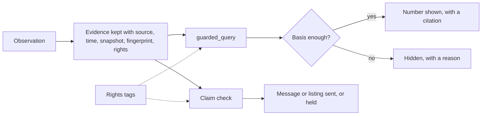

# How we prove what the app says

This document explains why a person can trust a number, a fact or a message from the app: where each one comes from, how it hides when the basis is weak, and how you can check it yourself.

Status: explanation of the current design (agent proposal). Written 2026-11-14.

Nothing here is built yet. This describes the design in [spec/](../../spec/product.md), not what has been decided. Every weight and threshold below is a starting value, to be tuned on real data.

## The idea in one paragraph

The app never shows a figure it cannot back. Each figure comes with the evidence it was made from, and the evidence is kept. If the evidence is too thin, too old or in conflict, the figure hides itself and says why. Every message and listing the app writes is checked against the recorded facts before it goes out. Four parts do this, called [the proof layer](../../spec/product.md#the-proof-layer-agent-proposal).

## The four parts

| Part | What it does | Technology |
|---|---|---|
| Collection | Keeps every observation as evidence: its source, when it was read, a snapshot, a fingerprint and its rights tags. | Databricks Volumes for snapshots, append-only Delta tables for prices and fact history |
| Analysis | Turns evidence into a shown number through one path. The number hides when the basis is too thin and carries a citation anyone can recompute. | Metric views, `guarded_query`, Lakeflow jobs, MLflow 3 |
| Governance | Rights travel with the data as tags, and each use is checked against them. | Unity Catalog tags and lineage |
| Output | Checks every claim in an outgoing message or listing against the recorded facts, and holds what is unbacked. | A claim check in the send step, Lakebase for results, a Unity Gateway service policy as the platform hook |

## One number, end to end: "You keep about $16 on eBay"

Take a shirt listed at $20 with $6 of buyer-paid shipping. The [what-you-keep card](../../spec/determinations/money.md#d9-what-you-keep-per-site) works this exact case: about $16.06 on eBay and $18.69 on Depop. You tap the number. Here is what is behind it.

**1. The fee, with its date.** The fee table has one row per site, with a start date and a source note. eBay's row is 13.6% up to $7,500, then 2.35%, plus a small per-order fee, charged on item, shipping and tax. A flat 13.6% would give $16.88, which is right only with no shipping in the base. A row older than 30 days shows "fees may have changed".

**2. The price it assumes.** A you-keep number rests on a fair-value range. A model predicts the 10th, 50th and 90th percentile of what similar items sold for, with a correction on top ([D5](../../spec/determinations/money.md#d5-fair-value-range-overall-and-per-site)). The card reads "Most sell for $32 to $48 on eBay, based on 14 sales, last 90 days." If the range hides, the keep line hides too.

**3. The sales behind the range.** Each past sale is a comparable, and each gets a weight ([D1](../../spec/determinations/money.md#d1-comparable-set-and-weights)) that multiplies four things. These are starting values.

| Factor | Starting values |
|---|---|
| Kind of record | A sold item 1.0, one of our own completed orders 1.2, an eBay Best Offer sale with the amount unknown 0.6, a live asking price 0 |
| Match to your item | Same product and variant 1.0, same product other variant 0.5, same family 0.25 |
| Age | Halves every 90 days, or every 30 for fast categories. Over 365 days is dropped. |
| How the fact was read | Measured or from a label 1.0, a marketplace field 0.9, inferred by a model 0.7 |

The tap shows each comparable with its photo, site, date and its weight in words: "counts a lot", "counts some" or "counts a little". Adjustments are written out, such as "This one sold for $40; yours has its box, so we count it as $44."

**4. How sure the range is.** Ranges are checked against sales they did not see, by category ([D6](../../spec/determinations/money.md#d6-range-calibration-and-display-state)). "Checked" needs at least 30 held-out sales and a lower bound of 70%, and reads "Ranges like this held 8 in 10 sales last quarter." Otherwise it says "not checked yet" and shows a wider range.

**5. The citation.** Every shown number carries a record of its filters, the version of each table read, the definition and code versions, the time computed and the ids of the rows used. `GET /v1/citations/:id` opens it. The spec's test: recompute 20 shown numbers from their citations a week later and match them exactly. That works because observation rows are only ever added to.

## When a number hides

A guarded number is a value or range, a row count, an as-of time, a citation id, and a state of shown or hidden with a reason. The [rules](../../spec/features/data.md#the-proof-layer) are fixed in code, not chosen per screen.

| Number | Hides when |
|---|---|
| Sold range | Under 5 sales. The sales are shown instead. |
| Asking range | Under 6 live listings. Always labelled as asking, never as sold. |
| Price history | Under 3 snapshots on different days |
| Any read | Older than two weeks is dropped. Before that, it is marked "OLD DATA" with its date. |

## Rights

Each observation carries tags: may store, may model, may show, may share, and a time to live. A gate checks them before a number is shown, before a model reads the data and before anything is shared. eBay content never gets permission to train or to compare across sites. During the build the gate only logs what it would refuse. For a public launch the same code is switched to refuse.

## The evidence gate on messages

Every outgoing message, automatic or the seller's own, passes the [evidence gate](../../spec/features/messages.md#evidence-gate). A model only splits the draft into typed claims. Plain code then matches each claim to a recorded fact.

| Claim | Backed when | Checked by |
|---|---|---|
| Money | Equals the offer, the listing price or the limit | Code |
| Time and place | Inside the pickup windows, at the saved spot | Code and a date parser |
| Item fact | Matches a confirmed attribute that has evidence | Code |
| Free text ("barely worn") | Entailed by the facts, at or above a calibrated bar | An entailment model |
| Authenticity, working, hidden condition | Only as the seller's own quoted words | Always held otherwise |

If every claim is backed, the message goes. Otherwise it is held: "Held: the reply says it works, and that was never checked." Tapping opens each claim next to the fact it matched, or the gap. You can send anyway, edit, or add the fact. The bar for free text is the lowest score reaching 98% precision on labelled claims, a proposal recomputed as labels arrive ([card](../../spec/determinations/managing-and-buyers.md#4-whether-a-drafted-reply-may-be-sent)). A Unity Gateway service policy can hold a response before release, but it is in beta and cannot match claims to our tables ([research](../../research/messages/nate/evidence-gate.md)).

## The scoring engine

A [score](../../spec/features/score.md) has four axes, each shown alone with its range. No source gives correct weights across axes, so one combined line shows only when all four axes show.

| Axis | Hides when |
|---|---|
| Financial | The price range hides |
| Quality | The listing check fails |
| Visibility | The ranking stand-in does not beat the noise floor, the search panel is over a day old, or a change notice is up |
| Trend | The series is too short, or a change notice is up |

Sites do not publish how they rank, so the app does not assume. A fixed set of searches runs on each site daily, logged out, and the result order is recorded. A Plackett-Luce model fitted to those orders is a stand-in: it reproduces order and is never the site's real weights. A new fit replaces the old one only if it agrees better on held-out days and beats the noise floor, set by running two identical searches side by side.

To go beyond correlation, the app tests changes on listings of people who opt in to "Help test what sells" (off by default). A test never prices below your floor and is logged and undoable. A before-and-after test is labelled so, never called randomised. A sale-rate move from 5% to 7.5% needs about 1,500 listings per arm, so one person gets a verdict only through a prior pooled across sellers. Three signals watch for a ranking change; when they agree, visibility and trend hide for that site and tests pause. The cost is a hidden line, never a wrong one.

## What the system will not state

Each [determinations](../../spec/determinations/money.md) file ends with a list of things it cannot make credibly. A sample:

| It will not state | Why |
|---|---|
| Facebook Marketplace sale prices or days to sell | Listings vanish with no sold mark. Only our own orders count. |
| An accepted eBay Best Offer price, when hidden | Only a learned discount, never the real figure |
| That an item is authentic, works, or has no hidden condition | A capture cannot check these. They show as "Not checked" or "you said". |
| A site's real ranking weights | Only a stand-in is learned |
| A scam, no-show, ban or dispute probability | No base rate found. Reasons are shown instead. |

## What is not settled or cannot be known

- Two rules for the sold range coexist. The [data spec](../../spec/features/data.md#the-proof-layer) hides it under 5 sales. The [money cards](../../spec/determinations/money.md#d1-comparable-set-and-weights) hide it by effective sample size under 6. The spec does not say which wins.
- Sell-through is sold over sold plus active in the money and insight specs. The market-insight card proposes a cohort definition and asks for a decision.
- The date the rights gate starts refusing is not fixed. Whether the Unity Gateway hook can read our tables was not found.
- Visibility describes a logged-out view. A given buyer sees a different order.
- Some starting values have no source, such as the condition priors and the tax rate. They will be refit.

## Where to read more

- [Product spec](../../spec/product.md): the proof layer, the evidence gate and the scoring loop.
- [Data spec](../../spec/features/data.md#the-proof-layer): the guard rules, the citation and the rights tags.
- [Score spec](../../spec/features/score.md): the four axes, the stand-in and the tests.
- [Money cards](../../spec/determinations/money.md): comparables, ranges, calibration and fees.
- [Scoring research](../../research/price/nate/scoring-and-ranker-inference.md), [calibration research](../../research/price/nate/range-calibration.md) and [provenance research](../../research/data/nate/port-provenance-and-evidence.md): the evidence behind the design.
