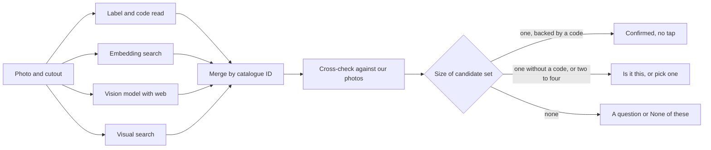

# How the app knows what it is looking at, and finds similar items

This document explains how the app works out exactly which product something is, and how the same machinery finds the same product elsewhere and cheaper alternatives to it.

Status: explanation of the current design (agent proposal). Written 2026-11-14.

Nothing here is built yet. "The current design" means what the specs propose today, not what has been decided. It describes the design in [spec/](../../spec/), mainly the [Identify spec](../../spec/features/identify.md). Every weight quoted below is a starting value that a labelled test set will tune.

## The idea in one paragraph

The app trusts evidence in a fixed order. A printed code beats a catalogue match, a catalogue match beats an image-search match, and an image-search match beats a model's guess. It runs every route at once, then checks each candidate against your own photos. If the evidence is strong it says so with one line. If not, it shows two to four cards and you tap one. It never shows a percentage. The same engine serves a seller with an item in hand and a buyer typing, photographing or pasting a link.

We follow one item: a wool jacket with a tag and a care label.

## The ladder of evidence

The jacket's tag gives a brand and a style code. The care label gives a registration number (RN) and the fibre content. The app reads these on the phone with Apple Vision OCR. Other routes start at the same moment from the first good photo.

| Rung | Evidence | Why it ranks here |
|---|---|---|
| 1 | A decoded barcode (GTIN) or a model plate, looked up in a catalogue | An identifier names one product |
| 2 | A catalogue text match on a printed style code or model number, or a kind specialist | A printed code, though it can be partial |
| 3 | Image search and embedding retrieval | Resemblance, not identity. Capped at "likely same model" |
| 4 | A vision model with web search | A model's guess, which may be invented |

Each route's score is multiplied by a rung factor of 1.0, 0.8, 0.5 and 0.3. Candidates from all routes merge by catalogue ID, and each keeps its best product of score and factor. These are starting values ([card 9, which product it is](../../spec/determinations/seeing-the-item.md#9-which-product-it-is-and-when-identity-is-confirmed)).

Lookups by code cover GTIN (GS1 and the eBay catalogue), ISBN, IMEI, style codes, model numbers, watch references, sneaker SKUs, LEGO set numbers and RN or CA numbers. Some kinds also get a photo specialist: CardOS for cards, FindWatch or WatchID for watches, Brickognize for LEGO, Vaultik for luxury bags and Numista for coins. Nobody has tested these independently, so our own labelled set decides which stay ([routes table](../../spec/features/identify.md#the-routes)).

## Five routes at once

The routes run in parallel, so the wait is the slowest one, not the sum.

- **Crop.** SAM 3 cuts the item out so the room stays out of every search.
- **Embedding.** SigLIP 2 or Marqo turns the cutout into a fingerprint, a list of numbers that is close for similar-looking things. AI Search or pgvector compares it with catalogue products and items people already confirmed.
- **Vision model with web search.** A model reached through Unity Gateway names candidates.
- **Visual search.** eBay `search_by_image`, an Amazon wrapper, Yandex, Google Lens through SerpApi, and Cloud Vision Web Detection. Nothing depends on Google, so those two can drop out without loss.
- **Label read.** Apple Vision OCR and barcode reading on the phone, PP-OCRv5 on the server.

Lens gets 4 seconds, eBay 3 seconds, and the whole step 15 seconds. The target median is 9 seconds, so the answer is ready as capture ends.

## The cross-check

A candidate that looks right can still be the wrong variant. So before it is shown, the app re-embeds the candidate's own catalogue photos and compares them with your cutouts. It compares the candidate's text with the label it read. Then one vision-model call says same or different. Code combines the three. The cross-check can veto a match from any route.

## From scores to cards

The app does not show a fixed top four. It keeps every product whose score clears a bar, and the bar is calibrated on held-out labelled items so that the right product is in the set 90% of the time. This is a conformal-style set. In a pre-registered trial such sets beat fixed top-k lists at the same coverage, and one-card sets were the most accurate (Cresswell 2024, an excerpt we observed).

- **One card.** "Is it this?"
- **Two to four cards.** Pick one, plus None of these.
- **None.** One question, or a text box and Find this. See [clarifying-questions.md](clarifying-questions.md).

Each candidate also gets a match label that decides what it unlocks ([match labels](../../spec/features/identify.md#match-labels-and-what-each-unlocks)).

| Label | Meaning |
|---|---|
| exact | Same product and variant. Needs a code or catalogue match that passed the cross-check, or your tap |
| likely_same_model | Model matches, variant not settled. The ceiling for image search alone |
| same_family_other_variant | Same line, a known difference such as size or year |
| comparable | Another product a buyer would weigh against it |
| unresolved | Candidates shown, no identity written |

The jacket's style code finds one catalogue entry, the cross-check agrees, and the label is exact. That is **Confirmed** with no tap. Without the code, an image match alone stops at likely_same_model and you get one tap. The bar for untapped Confirmed is 99% precision on 500 labelled items, and the design is wrong if it falls below that.

## The same product elsewhere

Once the product is known, the same engine links listings to it ([card M1, same product](../../spec/determinations/market-insight.md#m1-same-product)). An identifier on both sides decides alone. Otherwise a listing gets a score:

`s = 0.30 x field agreement + 0.50 x text similarity + 0.20 x image similarity`

Text similarity is the overlap of word sets (a token-set Jaccard). A score of 0.85 or more with matching variant words is "likely same model". A score of 0.70 or more is "same family". A conflict in a variant word, such as a colour or size run, makes it a different variant. A product page forms only once there is one exact observation or three likely-same-model ones. These weights are starting values.

## Cheaper alternatives

The app keeps what makes the jacket the jacket and relaxes the brand ([card M17, a cheaper equivalent](../../spec/determinations/market-insight.md#m17-a-cheaper-equivalent-of-similar-quality-and-material)). Two hard filters come first: same category and same function. Then a model step reads the composition and specs from listing text into fixed fields. After that it is plain arithmetic over five facets:

| Facet | Weight | Measured by |
|---|---|---|
| Material composition | 0.35 | One minus half the summed gap between fibre shares |
| Build specs | 0.25 | `1 - abs(a-b)/max(a,b)` for numbers, equality for classes |
| Revealed quality | 0.20 | How well the product holds its price used, and the score's quality axis |
| Fit and function | 0.15 | Fit and use fields (the card gives no formula) |
| Image embedding | 0.05 | Fingerprint similarity |

A pair counts as an equivalent when similarity is 0.75 or more and the alternative's used median price is at most 75% of the target's. Results rank by similarity, then price. The explanation reads "Similar wool and weight, sells used for about half", and a tap opens the facet-by-facet comparison. The top 20 neighbours per product refresh weekly.

Image weight is only 0.05 on purpose. An image-only "dupe" search matches colour and shape, not quality. When material or condition is unknown for either side, when either price is hidden, or when similarity is under the bar, the alternative is not shown. The check is 100 pairs judged by people who know the category. The design is wrong if fewer than 70% agree the pair is of similar quality.

## The buying side

A buyer starts with text, a photo or a link ([buy spec](../../spec/features/buy.md)). The app identifies the product first with the engine above. It then searches retail and used sites in parallel and streams results back in batches. Ranking is delivered total against the fair price range, then match label, then the quality axis, in plain code. A referral tag, such as eBay's partner program, never changes the order. A "Similar for less" shelf shows only comparable substitutes with known material and condition.

People without an account can search and follow links out, with rate limits. Signed-in people can also save, follow, make an offer (asked every time) and set a want. A want has one ceiling, the delivered price. An alert fires only when `total <= ceiling AND fits AND live AND match is exact or likely_same_model` ([watch spec](../../spec/features/watch.md)). A follow is interest and never alerts. We never take payment. Background reading is in [buy side research](../../research/watch/nate/buy-side-products-and-search-experience.md).

## What is not settled

- **The question cap.** Three questions per item has no source. A test of caps 1, 2 and 3 decides it.
- **Specialists.** No independent test of any exists.
- **Every weight.** The rung factors, the M1 and M17 weights and thresholds are starting values.
- **Label names differ.** [identify.md](../../spec/features/identify.md) has five labels. [buy.md](../../spec/features/buy.md) shows buyers six, with different words, such as "looks similar but unverified". The spec does not map one list to the other.
- **Two scores, two jobs.** The conformal set in card 9 picks a product for one captured item. The M1 score links many listings into one product page. The two use different thresholds, and the spec does not say how a disagreement is settled.

## Where to read more

- [Identify spec](../../spec/features/identify.md): the routes, the labels and the failure cases.
- [Card 9, which product it is](../../spec/determinations/seeing-the-item.md#9-which-product-it-is-and-when-identity-is-confirmed): the ladder, the set and the check.
- [Card 17, which question next](../../spec/determinations/seeing-the-item.md#17-which-question-to-ask-next-and-when-to-stop): how a question is picked.
- [Market insight cards](../../spec/determinations/market-insight.md): same product (M1) and cheaper equivalent (M17).
- [Buy spec](../../spec/features/buy.md) and [Watch spec](../../spec/features/watch.md): search, saving and alerts.
- [Identification technologies](../../research/identify/nate/identification-technologies.md) and [identification stack](../../research/identify/nate/identification-stack.md): the evidence behind the routes.
