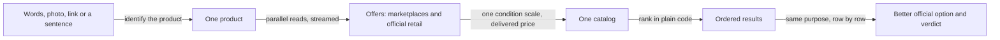

# Search and shopping

This document explains the buying side of the app as one experience: what happens between typing a few words and seeing what to buy, why the order of results can be trusted, and what the app can and cannot know.

Status: explanation of the current design (agent proposal). Written 2026-11-14.

Nothing here is built yet. This describes the design in [spec/](../../spec/product.md), mainly [buy.md](../../spec/features/buy.md) and [market.md](../../spec/features/market.md), not what has been decided. Every weight and threshold below is a starting value, to be tuned on real data. The prices in the example are made up to show the mechanism.

## The idea in one paragraph

Buying used means searching five apps that describe the same thing differently, then guessing whether a price is fair and whether new would have been smarter. The app turns that into one search. It first works out what the thing is, then asks eBay, Facebook Marketplace, Depop, Poshmark, Mercari and official retail at once, and lays every offer under one product: new, refurbished and used, each with its condition on one scale and what it costs to your door. Next to any used result it shows the best official option for the same purpose, compares the two row by row, and says which is the better buy for you, or that it is a close call. The app never takes payment. It ends at the seller's own page.

## A worked example

Someone types "14 inch laptop for travel, under 500" into the search box. A visitor without an account can do this.

1. The assistant reads the sentence. "Under 500" is a budget it can use. "For travel" suggests a light machine, but it is not a product yet. Words it cannot settle are highlighted, and a tap opens a small control under the box ([asking without questions](clarifying-questions.md)). The person ignores them, so the search runs on the best reading and says what it assumed.
2. The search finds a product, groups its offers, and shows a used listing at $412 delivered from an eBay seller.
3. Beside it sits the maker's refurbished option at $489 delivered, with a one-year warranty. The comparison says it is a close call, and that the warranty is where they differ most.
4. The person taps Open on site. eBay opens with a referral tag, and the line "We may earn a referral fee. It never changes the order or the verdict." sits next to the link.

The rest of this page follows that search.

## How a search runs

**Identify first.** The same engine that identifies an item for selling ([how identification works](identify-and-similar-items.md)) reads the words, the photo or the pasted link and names the product. This is a design choice recorded in [buy.md](../../spec/features/buy.md#design-choices): one identity gives one fair price range, one product page and a way to tell that two listings on different sites are the same thing. If the engine is unsure, the person sees two or three candidate chips and one tap settles it.

**Then fan out.** The search runs as a job on Databricks with three stages, `identify`, `fanout` and `rank`. It reads eBay through its Browse API, the other marketplaces through ScrapeCreators and Firecrawl, and retail through retail search. Each site's results stream to the screen as they arrive on `GET /v1/stream`, so a slow site shows greyed out ("Depop: no answer") instead of holding up the page. Every result read is stored as a `comp` row in Delta with its source link, read time and a snapshot, which is what lets a price be traced later ([how we prove what the app says](how-we-prove-it.md)). The shape of this step borrows from open projects that already do it in parts: a connector per source with one common result model, and a merge rule for the same listing seen twice ([research note](../../research/data/nate/port-aggregated-search.md#the-answer)). No open project does the whole job.

## One catalog

One `product` id groups every offer for the same thing, as [market.md](../../spec/features/market.md#one-catalog) describes. Official offers come from the Shopify Catalog (which already groups merchants' offers under a Universal Product ID) and Klarna's product feed, plus the maker's and authorised retailers' pages. Shopify's terms allow a 10-minute cache and no redistribution, so those prices are fetched when needed and never kept.

Two things make offers comparable.

| Part | What the person sees | How it works |
|---|---|---|
| Condition | One row of chips: New, Refurbished, Like new, Good, Fair, For parts, and "from the maker or brand" | Each site's own grade is mapped onto one scale, and the offer also says who stands behind it (the maker, an authorised retailer, a refurbisher, a brand, or a marketplace seller). Where the seller's grade and the app's own reading of the photos differ, the offer takes the lower one and shows both ([M25](../../spec/determinations/market-insight.md#m25-one-condition-scale)). |
| Delivered price | "$412 to your door by Thursday: $389, $0 shipping, $23 tax" | Item price plus shipping plus a tax estimate for the person's destination, with the delivery window from the offer itself. Unknown shipping shows "plus shipping" rather than a guessed total ([M26](../../spec/determinations/market-insight.md#m26-delivered-price)). |

A filter that would leave nothing says how many results it hid, with one tap to clear it.

## The better official option

On any used result, and on a link pasted from any site, the app looks for the best new, officially refurbished or brand-resale option that serves the same purpose. Three relations are possible ([M24](../../spec/determinations/market-insight.md#m24-same-purpose-match)): the same product, its newer model, or another product that does the same job for this person. The first is found by identifier, the second needs two sources to agree, and the third by comparing attributes such as capacity, size and material. The first is offered only when the used item is an exact or likely-same-model match; when none of the three is found, the person sees "No official option found".

The comparison has these rows, each tappable down to its source:

| Row | What it holds |
|---|---|
| Delivered price | to the door, from the section above |
| Condition | on the one scale, with who stands behind it |
| Warranty and returns | the programme's terms against the site's buyer protection |
| Authenticity risk | from the app's score; none for the maker, stated for others |
| Recall status | checked on both options |
| Delivery time | the window, against any date the person needs it by |
| Value kept | the share of today's used price expected after the person's horizon ([M27](../../spec/determinations/market-insight.md#m27-value-it-will-keep)) |
| Cost to own | delivered price minus what it should resell for, with a range ([M28](../../spec/determinations/market-insight.md#m28-net-cost-of-ownership)) |

The person's purpose arrives as slots the assistant has filled or assumed, such as what it is for, how long they will keep it, and a deadline. The comparison reads them and does not decide what to ask.

**The verdict** ([M29](../../spec/determinations/market-insight.md#m29-new-against-used-verdict)) is plain arithmetic in three steps. First, gates: an option with an open recall, one that arrives too late, or a used item with high authenticity risk or priced above the most a buyer should pay is out, and the other option wins. Second, money: the gap in cost to own, including an average cost of a used item turning out bad, taken as a range. Third, a band: used is better only if the whole range sits below a margin (the larger of 5% of the official delivered price or $10, a starting value), official is better only if it sits above, and anything between is a close call that names the row that differs most. In the example, the two ranges overlap, so the answer is a close call and the named row is warranty.

**When no verdict shows.** There is no official option, or either cost to own is hidden because its inputs are too thin, or the match is "another product that does the same job" and the person's purpose is not yet filled in, or the verdict turns on how long they will keep it and they have not said they are buying for themselves (a default horizon is then named in the sentence). The rows still show without a sentence above them, and the page says why none is shown.

## Who can do what

| | Visitor (no account) | Signed in |
|---|---|---|
| Search by text, photo or link | Yes, rate limited at the edge | Yes |
| Open product pages and trends | Yes | Yes |
| Follow a referral link out to a site | Yes, the only action on a result | Yes |
| Save, follow, set a want with alerts | No, sign-up opens and the search carries over | Yes |
| Recommendations (For you) | No | Opt in, with each card saying what it inferred |
| Offers and questions to sellers | No | Drafted by the agent, sent only when the person approves |

In Nate's words, visitors "can just search, but not sell, they can get linked with our referral though" ([words](../../product/words.md#2026-11-14-nate-visitors-and-full-users)). The For you shelf is off until the person turns it on, because an inferred size or taste is personal data they can see and edit.

## How results are ordered, and what a referral cannot touch

The order is plain code a person can check ([buy.md](../../spec/features/buy.md#design-choices)): first where the delivered total sits in the guarded fair price range for the product, then the match label (exact, likely the same model, same family, comparable), then the quality axis of the app's score. A learned ranker was considered and left out because nobody could check it.

A referral fee, a commission or a paid placement is not an input to the order or the verdict. The verdict code has no access to referral fields, and a check runs it with and without them and requires the same answer. On eBay the link is the Partner Network URL, elsewhere a tagged plain link, and every tap is recorded as a `referral_click`. A link that earns a fee carries the disclosure line beside it, visible without a tap. The reason is the US Endorsement Guides, which require a material connection to be disclosed where it cannot be missed and treat a ranking set by payment as deceptive even when disclosed ([research note](../../research/watch/nate/buy-side-products-and-search-experience.md#6-referral-and-affiliate-programmes)). Facebook and Vinted have no programme, so those links carry no line.

## Also a research tool

The same pages work for someone who never buys. Market is "what secondhand knows about products and how their markets move, for anyone" ([market.md](../../spec/features/market.md)): a product's used price per site over time, how many are for sale, how fast they sell, what is rising, and when a new model lands. Every number opens the rows and sources behind it, and a signed-in person can follow a product to hear of a real move, at most weekly. The search is also exposed to other software as `search`, `product` and `compare` tools over MCP, from the same handlers, with the disclosure in every result and offers from Shopify's catalog left out because its terms bar redistribution.

## What is not settled

- **Order, written two ways.** `market.md` says listings are ordered by the `score` only, and `buy.md` says by the delivered total's place in the fair range, then match label, then the score's quality axis. The intent is the same, and the wording needs one owner.
- **Purpose slot names.** The comparison cards read `use`, `keep_for`, `needed_by`, `budget`, `size` and `must_have[]`. The assistant's own list names use, for whom, budget, size, compatibility, deadline and condition tolerance. `keep_for` is now defined there (card 10), `must_have[]` does not appear, and `needed_by` only roughly matches deadline ([asking-and-intent](../../spec/determinations/asking-and-intent.md)).
- **Evidence limits.** Much of the buy-side research is search highlights, not read in full, and the shopper-behaviour figures in it are not about used goods. Search speed has no published figure for resale across sites, so the design sets bars (p95 under 3 s to the first batch) and a 50-search test decides.
- **Cannot be known.** True views and search volume on the five marketplaces, full sold counts on Facebook, Poshmark, Mercari and Depop (shown as "at least"), whether a listing is authentic, and any hidden condition. The app states these as not known instead of estimating them. The full list is in [market-insight](../../spec/determinations/market-insight.md#what-cannot-be-made-credibly).
- **Do referrals pay?** Unknown. The plan is to measure qualifying eBay purchases per 100 link-outs before the business leans on it.

## Where to read more

- [spec/features/buy.md](../../spec/features/buy.md): search, saves, offers, purchases and the better official option.
- [spec/features/market.md](../../spec/features/market.md): the catalog, product pages and follows.
- [spec/features/watch.md](../../spec/features/watch.md): wants, matches and alerts.
- [spec/determinations/market-insight.md](../../spec/determinations/market-insight.md#the-better-official-option-m24-to-m29): the six cards behind the comparison.
- [research/watch/nate/buy-side-products-and-search-experience.md](../../research/watch/nate/buy-side-products-and-search-experience.md): what buyers' tools do today, and the referral rules.
- [research/data/nate/port-aggregated-search.md](../../research/data/nate/port-aggregated-search.md): what open projects already do for aggregated search.
