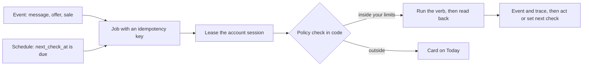

# How selling runs itself

This document explains what happens after capture: how one item becomes a listing on each site, how the app picks a plan, how it acts on the marketplaces, what it does without asking, and what happens when the item sells.

Status: explanation of the current design (agent proposal). Written 2026-11-14.

Nothing here is built yet. "The current design" means what the specs in [spec/](../../spec/product.md) propose today, not what has been decided. Every number below that comes from a determinations card is a starting value, to be tuned on real sales.

## The idea in one paragraph

You finish a capture and set one thing: the lowest price you will take. The app writes a listing for each site from the item card, works out a price plan from similar listings, and posts. After that, a background agent watches for buyers and acts inside the limits you set. When the item sells it takes the other listings down. Anything outside your limits becomes a card on your Today screen.

We follow one item: a vintage denim jacket, listed on eBay, Depop and Poshmark, with a floor of $35 and pickup hours on weekday evenings.

## One listing per site

The item card holds the facts. Each site gets its own listing, because the sites reward different things. The [list spec](../../spec/features/list.md) and the [listing determinations](../../spec/determinations/listing-and-marketing.md) set how each part is built.

| Part | Source | Weight, as a starting value | Why |
|---|---|---|---|
| Title ([D4](../../spec/determinations/listing-and-marketing.md#d4-title-per-site)) | Terms the item card backs, scored by the titles of winning listings, the site's own search suggestions and all similar listings | 0.5, 0.3 and 0.2 | No study of title words was found, so the app copies what sells and what buyers type. A term the card does not back never enters. |
| Photos ([D8](../../spec/determinations/listing-and-marketing.md#d8-photo-choice-and-order)) | The capture's real frames: cover first, then flaws, then extras by quality | Site limits: eBay 24, Poshmark 16, Depop 8 | Photo quality has a measured link to sale odds in published shoe and handbag studies. |
| Shipping ([D9](../../spec/determinations/listing-and-marketing.md#d9-shipping-offer)) | The plan's expected return, with free shipping priced at the price plus 0.75 of the postage | 0.75, the midpoint of a 70 to 80% range | Free shipping is linked to about 14% higher sale likelihood, but the data is observational. |

A model only joins the chosen terms into a title. Before anything posts, a [claim check](../../spec/determinations/listing-and-marketing.md#d25-claim-check) splits the text into single claims and matches each to a fact. A claim with no fact behind it holds the post and asks you.

## The best plan for each site

The plan is plain code over similar listings on that site: the same product and condition, live now or sold in the last 90 days. [D3](../../spec/determinations/listing-and-marketing.md#d3-best-plan-per-site) tries each time window (7, 30 or 90 days), each starting price from the 10th to the 90th percentile of those listings, and each shipping option. For each candidate it adds up the chance of selling at each step times what you would net at that price. The best plan is the one with the highest expected return. Every price stays at or above your floor.

For the jacket on eBay the app says: "Start at $48, drop to $42 after 9 days, never below $35. Most like it sold within a month."

Three plans are offered, and you can pick another at any time ([price spec](../../spec/features/price.md)).

| Plan | Shown as | Start (no study behind it yet) |
|---|---|---|
| quick | Sell this week | 25th percentile |
| balanced | Typical | median |
| max_return | Get the most | 75th percentile |

The three plans differ only in where they start and how long they run; the later steps are the same for all ([D15](../../spec/determinations/money.md#d15-markdown-path-stale-and-relist)). When a listing has gone stale (no sale by the plan's median days, and less interest than similar listings) it moves to the next price rung, or relists if the price is already at or below the middle of similar listings. After that the app offers watchers a deal, adds another site, and then asks what to do, and a step below your floor always asks. The default is 30 days. A plan is recomputed when its comparable set goes stale, when interest moves, or when you edit the item. A sold range built on fewer than 5 sales is hidden, and so is an asking range on fewer than 6 listings. A hidden number is better than a shaky one.

The same logic picks the sites. [D1](../../spec/determinations/listing-and-marketing.md#d1-platform-fit) ranks them in a fixed order: a site's own rule is a veto, then sold comparables, then a researched fit table, then your setting, which always wins. With 10 or more sales the measured rank replaces the table.

## How the agent reaches each site

On every site the app first uses its own adapter over your signed-in session ([connect spec](../../spec/features/connect.md)). You link eBay through eBay's own sign-in. Every other site is linked once: you get a sign-in link that opens the site's real login in a page we host, and you sign in yourself. After that the app is your own agent, acting on your session because you signed off on it ([Nate](../../product/words.md#2026-11-14-nate-the-person-signs-off-so-it-is-their-own-agent-acting)). If a session expires, the app asks you to sign in again. It keeps no password unless you turn on saved passwords, which are off by default: then the password is stored encrypted, only the sign-in job can read it, every read is recorded, and one tap deletes it ([Nate](../../product/words.md#2026-11-14-nate-passwords-are-kept-opt-in-as-encrypted-secrets-we-cannot-see)). A site's official API is the last fallback, used only where ours cannot be made to work.

The session runs in one of four places, and we run every one of them ourselves, with no browser vendor and no paid fetcher ([Nate](../../product/words.md#2026-11-14-nate-host-all-engines-ourselves-and-can-the-persons-own-device-do-the-work), [Nate](../../product/words.md#2026-11-14-nate-we-do-not-pay-for-apify-priced-tools-prove-it-can-be-done-and-ours-is-free)): the phone's own web view while the app is open; a browser we host on our own computers, with one steady US address per account; plain requests that carry the session; and an optional browser extension.

| Site | Route | Sale signal |
|---|---|---|
| eBay | Signed-in session; official API through eBay's sign-in as last fallback | A signed push from eBay, checked before it is trusted, in seconds; whether to use it is still open |
| Depop | Signed-in session; Depop gives us no partner access, so there is no API fallback ([Nate](../../product/words.md#2026-11-14-nate-no-depop-partner-access-so-build-an-ai-driven-workaround)) | Watchers on your notifications, inbox, offers and orders |
| Poshmark | Signed-in session | The public listing page, checked every 1 to 2 minutes, shows it sold; the signed-in read confirms |
| Mercari | Signed-in session | The public listing page, checked every 1 to 2 minutes, shows it sold; the signed-in read confirms |
| Facebook Marketplace | Signed-in session | Watchers, paced by how busy the item is |

Each site has its own harness with the same verbs: post, revise, end, relist, read the inbox, send a message, read and answer offers, read orders and read stats. A watcher is a signed-in read on a timer: every 1 to 2 minutes while something is happening, every 15 minutes while the item is live, hourly when it is quiet. Sale email is not used. *Agent proposal* from the [protocol](../../spec/engines/protocol-and-adapters.md#36-how-every-event-reaches-the-system-agent-proposal) and Ben's [packet 44](../../.agents/team/packets/sold/44-cheap-sale-detection.md); Ben's agreement not recorded on this wording.

The browser is slow, so the harness records the site's own calls once and later repeats them from inside your session ([replay spec](../../spec/features/replay.md)). A delist then takes about 3 seconds instead of 1 to 4 minutes (asserted, and timed runs will decide). If a site changes and a call fails, the harness drives the browser again under the same key.

The terms of eBay, Poshmark and Mercari ban automated means whatever the route. The app acts as your own agent on your own session after your sign-off, and a risk line is shown for each site until it gives a written allowance.

## One loop, two triggers

All background work is one loop. Something wakes it, and it either acts or decides to look later.

An event is a signed push from a site, a watcher that saw something change, or a public listing page that shows the item sold. A schedule is a sweep of listings whose next check is due. Starting values: a pending offer, minutes; a waiting buyer, 15 to 60 minutes; a quiet listing, 6 to 24 hours. Every job carries a key such as `delist:{item}:{site}`, so a retry never acts twice. After any outward action the harness reads the site to confirm it happened, because an accepted call may have changed nothing.

## What runs without a tap

The policy check runs in code before anything else, and replay cannot widen it ([decision](../../product/decisions.md#2026-11-14-automation-runs-in-tiers-that-learn)).

| Always automatic | Always asks | Locked |
|---|---|---|
| Delist after a sale | First post, until promoted | Sharing your home address (only on your tap) |
| A markdown on the path, at or above the floor | Any price below the floor | Moving the chat off the site |
| Answer a question from confirmed facts | A relist (never on Poshmark) | A refund |
| Accept an offer at or above your "always accept" price | Pickup outside your hours | |
| Counter an offer at or above your floor | A scam warning, an unbacked claim | |
| Book a pickup inside your hours | A cancelled sale, a no-show, a double sale, a dispute | |

After 3 unedited approvals of one kind of action, the app offers "Always do this". It never offers it for the locked actions, a below-floor price, an out-of-hours pickup or an unbacked claim. Any undo demotes the rule that did it.

The Today screen shows only decisions outside your limits, ordered by deadline, then money at stake ([today spec](../../spec/features/today.md)). What the agent already did sits in a log, with Undo while the site allows it.

## Buyers, offers and pickups

Offers are decided by plain code against your limits ([messages spec](../../spec/features/messages.md)). A model only words the reply, and it never sees your floor or your address. A buyer offers $30 for the jacket. Your floor is $35 and $30 is below it, so the app asks you and proposes a counter at the midpoint between the offer and the current price, never below the floor. A buyer offers $44, above your always-accept price of $42, so the app accepts. Buyer text is treated as data, never as an instruction.

Every outgoing text passes an evidence gate. Money, times, places and item facts are checked by plain code against confirmed facts. Free text goes through an entailment check, which asks whether a fact supports the sentence. The threshold is set so that passed claims reach 98% precision on labelled examples. Authenticity, whether it works and hidden condition are held unless they are your own words.

When a buyer asks to collect, the app offers a slot inside your pickup hours at your saved spot and books it ([decision](../../product/decisions.md#2026-11-14-the-agent-books-pickups-inside-your-hours)). A request outside those hours asks you. With an open offer the app checks messages every 2 minutes, because Depop's own auto-reply answers within 60 seconds.

## When it sells

A paid order, read back from the site, is the only trigger. A public page or a push only wakes the check, it never proves a sale, and an unpaid offer pauses the item without delisting it ([sold spec](../../spec/features/sold.md)).

1. **Delist everywhere else.** One job per other listing, with in-flight posts and revisions cancelled first. Retries back off from 5 seconds to 2 minutes, then use our hosted browser. A delist counts only after read-back. A listing still buyable after 5 minutes turns red, and then the app asks you.
2. **Shipping.** One card carries the site's label, the box and the weight from your measurements. Buying the label asks until you have approved it 3 times unedited.
3. **Pickup instead.** The booked slot at the saved spot, closed by a buyer code or your tap.
4. **After handover.** Delivered, "Money arrives Tue", a request for a review, then Done.

If two buyers pay on two sites, a `double_sale` card names both and the cost of cancelling, and suggests cancelling the later paid order. The costs, inferred from site terms, run from a transaction defect on eBay to up to 5% on Mercari. The target is a median of under 10 minutes from sale to every other listing down.

## What is not settled or cannot be known

- **Starting values.** The title weights, the three price paths and the free-shipping figure have no study behind them. Sell-through per plan on our own sales will decide.
- **What no source can tell.** The sites' real ranking weights, whether sharing or relisting helps, the best hour to post, and the lift from promotion. The app shows none of these as fact.
- **Sale detection.** The 1 to 2 minute public-page check on Poshmark and Mercari is a starting value, whether eBay's push is used is open, and Facebook has no event source of its own. Facebook's title limit is three surfaces, not three values: the partner catalog takes 200 (65 recommended), the consumer form about 99 with a warning at 100, and 150 has no source ([settled note, row 11](../../research/watch/nate/open-items-settled-sites-and-rivals.md)), so the app aims for 60.
- **The spec disagrees with itself in places.** Cadences now sit in one place: `reconcile` runs nightly ([connect](../../spec/features/connect.md#read-back-and-reconcile)) and every other check follows `next_check_at` at the tiers in card 15. The delist bar is one value, owned by [sold](../../spec/features/sold.md#how-we-will-know-it-works). The site clocks for cancelling and shipping conflict, and the plan recommends the shorter one.
- **Open choices.** Whether buyers are told an assistant is answering (one study found disclosure cut purchases by about 80%, against California and EU rules), and whether replay keeps its own spec.

## Where to read more

- [List spec](../../spec/features/list.md): the plans, the per-site listing and who may act.
- [Listing determinations](../../spec/determinations/listing-and-marketing.md): every source, weight and reason above.
- [Connect spec](../../spec/features/connect.md): the harnesses, the loop and account health.
- [Replay spec](../../spec/features/replay.md): the recorded calls and how drift is caught.
- [Messages spec](../../spec/features/messages.md): offers, limits and the evidence gate.
- [Today spec](../../spec/features/today.md): the cards and the log.
- [Sold spec](../../spec/features/sold.md): detection, delist, shipping and double sales.
- [Crossposting research](../../research/list/ben/crosspost-and-delist.md) and [platform access research](../../research/connect/nate/platform-access.md): the evidence behind the routes.
