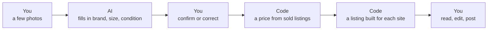
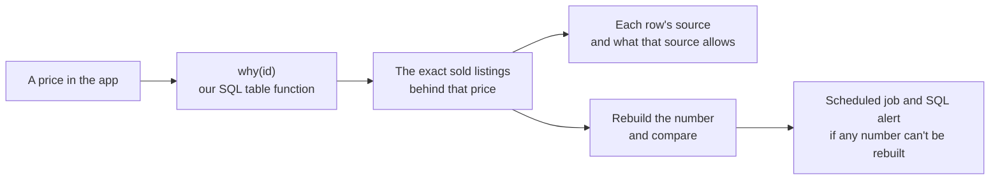
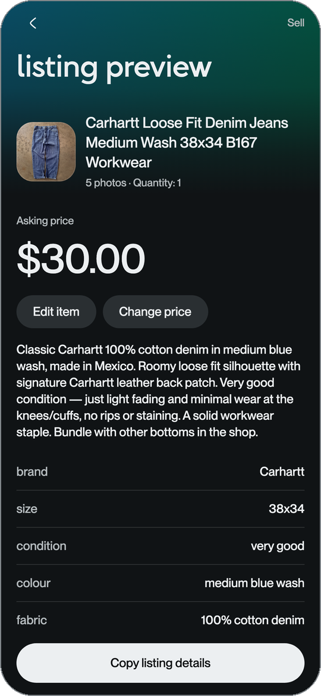

<!-- Devpost write-up. Agent proposal until Ben and Nate approve it; every benchmark number needs both of them before it is published. -->

# secondhand

Your second hand for buying and selling used things.

## The problem

Ben thrifts most of his clothes. Over time he grew out of a lot of them. They still have value, so he always means to sell them, and they pile up in his room. He has hundreds of photos of clothes from different angles. Getting a single listing up took hours. He had to shoot it, sort the photos, write it, note every flaw and work out a price. If you want more buyers to see it, you do much of that again on the next site, where a good title reads differently and the fees leave you with a different amount.

Buying has its own versions of this:

- You have something and no idea what it is or what it costs.
- Someone who isn't comfortable with technology sells something valuable for hundreds less than it's worth, because looking it up was too hard.
- You want one specific thing. Ben is a Brewers fan and wants a jersey, but jerseys are overpriced. He'd like to set his price and hear about it when one comes up.

## Let's dig in

For us, digging in meant not stopping at the first answer. At each step of selling and buying, the first idea we had was usually a chatbot or a guess, so we kept reading and testing until we understood the step.

That changed where we use AI. Most of secondhand isn't a language model: prices come from sales records, fees come from a table, and listing titles are assembled by rules. A model reads your photos and answers follow-up questions, and when it does, it works through the app's own interface. It fills in facts as small labels you confirm, asks by offering options to tap, and answers with a table or a price range. A person confirms every step.

## What is the item?

An upload button would have been simpler. The trouble is that a model can't report a stain it was never shown, and condition is what buyers and sellers argue about later. So the camera asks what kind of thing you're selling and then asks only for the shots that kind needs. A t-shirt and a pair of headphones get different steps. The app has 14 kinds of item, and each one opens with its own shot list. The camera is a native Swift module inside an Expo app, which lets it guide each shot.

AI reads the photos and fills in the brand, the model and the size. You confirm each one or fix it, and you set the condition yourself, because you're the one who knows about the loose button.

*One of Ben's own listings. Left: the brand, model and size the AI read from the tag. Right: Ben confirms the condition.*

## What is it worth?

We price from what sold. In one run, the app priced an item we had just photographed in 3.6 seconds, from 31 sold listings on Poshmark. If it can't tell what the item is, it doesn't give a price.

To know whether the prices are any good, we backtested the pricing code. A backtest hides a real sale, prices the item using only the sales that came before it, and compares the estimate with what the buyer paid. We did that for 41.9k StockX sneaker sales, because StockX publishes real sale prices.

The median error was 3.89%, and 96.0% of estimates landed within 20% of the sale price, against 89.1% for the 90-day median price. In plain terms, on a $100 pair the typical estimate is off by about $4. It misses by more than $20 about once in 25 tries, where the 90-day median misses about once in 9.

We haven't run a backtest that size on clothes yet. Clothes are priced the same way, from sold listings.

## Why that price?

A seller's next question is "why that number?", and we wanted a real answer. This is where we used Databricks.

Unity Catalog can tell you which tables and columns a number came from. A seller is asking about rows: which sales? So we wrote a SQL table function, `why(id)`. Give it any price or figure the app shows, and it returns the exact sales behind it and rebuilds the number from them. We ran that rebuild on all 42,405 figures in the workspace. 42,399 came back exactly. The other six are five asking-price figures and one sold-price figure, and the workspace lists them.

Here is the path one sale record takes to make that possible.

It arrives in a Unity Catalog volume, one of six public datasets of sold items we loaded. A Lakeflow Declarative Pipeline checks it and drops it if it's bad. A Unity Catalog tag records which dataset it came from and what that dataset's terms let us do with it.

Delta Lake keeps every version of the table, so the backtest above can name the exact data it ran on. MLflow stores that backtest as a run.

A metric view defines each measure once. The AI/BI dashboard and Genie both read it, so anyone with the workspace can ask a question in plain words and see the SQL behind the answer. When there are too few sales to say, Genie answers "too few" and gives the count.

Row filters and column masks are set up so one person's rows are visible only to that person, and buyer and seller handles are hidden.

Two things didn't work the way we expected. Delta wouldn't accept a CHECK constraint on a row-filtered table. So our rule that every figure has its sales behind it is held another way: a Lakeflow job checks 18 rules on a schedule, and a SQL alert is set to fire if one breaks. On the last run, none had. Genie can't call a table function, so the rows behind `why(id)` are also a view it can read.

## Where should it go?

Each marketplace is its own search engine with its own form, so the same listing doesn't fit every site. We built this part as tables and rules.

- **Which sites.** A fit table scores each kind of product against each marketplace, from vintage clothing to fan apparel to furniture. An item goes only where that kind of thing sells.
- **Which fields.** For each kind of item, a requirements table lists the fields every site has, what the site calls each one, its length limit, and how much it matters in that site's search.
- **The title.** Code puts the fields in the order that site's search rewards and shortens whole words to fit the limit. Then a check rejects any word that a confirmed fact doesn't support.
- **The price.** The engine starts from the amount you'd keep, and solves for the asking price on each site that leaves you that amount after that site's fees.
- **The photos.** Scored, then cut to each site's limit.

The same confirmed facts come out differently on each site:

| eBay | Depop | Poshmark |
|---|---|---|
| Carhartt Detroit Jacket Men's L Brown | Vintage 90s Carhartt Detroit Jacket Brown Size L | Carhartt Detroit Jacket Brown Size L |

"Vintage 90s" leads on Depop because the seller confirmed it and our Depop rules put the era first.

What you get is a draft for each site. We chose drafts over posting for you, because it's your account and your name on the listing. The same code can start from listings you already have. Ben's Depop listings, with the photos he already took, can become drafts for the other sites.

*One of Ben's own listings, in the listing preview. Every field can be edited before anything is posted.*

## Where is the one you want?

For buyers we built one search that reads the marketplaces at once. Our rule was to use a site's own API wherever it offers one. eBay does, so we use it. Other sites turn away ordinary automated requests, so we read those pages through Browser Use Cloud, which runs a real browser for us, with Playwright driving it. Treg puts specialist data tools behind one account, and we used it for Google Shopping, to see what an item costs new. A small model answers one narrow question through OpenRouter's Decisions API: are these two results the same product? A price comparison is only worth showing if the answer is yes.

We ran 16 test searches. All 16 returned results, and the first ones usually showed up in about 0.6 seconds.

You can ask a follow-up question about the results. The app answers in the shape that fits the question, such as a table or a price range, built from the same parts as the rest of the app. Before it reaches you, every price in it is checked against a listing the search found. We planted 20 false prices to test that check. The first version stopped 2. The current one stops all 20.

*For these two screenshots we loaded Ben's own Depop listings in as the results, so the data here is sample data and the screens are the app's. Left: one search. Right: a follow-up answer drawn as a table and a range, with the app's note that these are asking prices.*

If the thing you want isn't there at your price, you can track it. The app keeps the search and shows you new matches when you open it.

## Challenges

**The same item, listed twice.** People post one item on several marketplaces. If we counted each post as its own sale, popular items would look like they sell more often, and for different prices, than they do. Our pricing code compares the photos with a perceptual hash and the titles by text similarity, and treats matching posts as one item.

**Two buyers at the same moment.** If your jacket is up on four sites, two people can pay for it before any listing comes down. We wrote out our rules for that case and checked them with a model that walks through every order of events for one item on four sites, 931,406 states in all. In every state where two buyers had paid, the seller sees both and chooses which buyer to refund. To make sure the check could fail, we broke the refund rule on purpose, and it found the double sale in six steps. This tests our rules. We haven't run it against live sales.

**Sites that turn automation away.** Depop and Mercari answered a plain headless browser with a 403. That is why the search uses a site's own API where there is one, and a real browser through Browser Use Cloud where there isn't.

## Ideas we tried and left out

*One of Ben's own shirts. The original photo, the outline we gave the model, and the result.*

This one worked, and we still left it out. We gave an image model (Seedream 5.0 Pro, through Higgsfield) Ben's photo of a shirt and a second image with the outline of one laid flat. The outline tells the model where the body and sleeves go. It came back laid out evenly, with the same graphic and the same wrinkles.

Then we talked it through with a mentor. A listing photo shows one specific used item. If an edit changes that item even a little, the seller has posted something they don't own, and the buyer finds out when the box arrives. A nicer photo isn't worth that risk, so we decided it doesn't belong in the product yet.

We had already started on the check it would need. It compares an edited photo to the original with plain image math, and we tested it by planting 174 false edits in our own photos. It caught 173. Along the way we found a hole in our own check: lining the two photos up before comparing them hid a stretch. We fixed that. We've only run it on our own photos, so for now the original photo is the listing photo.

Other ideas we set aside for later:

- Video capture, where a short scan picks the useful photos for you.
- More marketplaces. The item facts carry over, and each new site needs its own rows in the tables above.
- Posting for you through each site's official partner program.
- A pricing model that keeps learning from the sales the app sees.
- Push notifications when a tracked item shows up at your price.

## If this scaled

This part is hypothetical. We'd want the app to be free. By our estimate from the list prices of the tools we use, it costs 2 to 8 cents to identify, price and draft one item, and that cost is about the same for a $5 shirt as for a $200 bag.

The money would come from buyers. When someone buys an item we helped them find, the marketplace pays a referral fee. On eBay's published rates we estimate about $0.71 per purchase. At those numbers, the app covers the cost of a seller who also buys one thing through it every two months. A referral fee can't move a listing up. The search already ranks results without looking at referral fees.

More sales would also mean better prices, for more kinds of things. That is what would help the person who has something and doesn't know what it is.

We'd start small. We'd list 100 real items with students during move-out week and publish how long it took and how much they kept.

## Built with

Expo and React Native, Swift, TypeScript, Python, Databricks (Lakeflow Declarative Pipelines, Delta Lake, Unity Catalog, Databricks SQL, MLflow, metric views, AI/BI dashboards, Genie, Lakeflow Jobs), Browser Use Cloud, Playwright, Treg, OpenRouter, the eBay API.

Built by Ben Verhaalen and Nate Garelik at MadHacks 2026.
