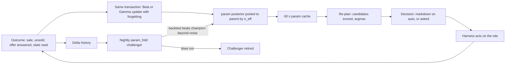

# How collected data is used

*agent proposal*: this whole file. Nothing here is Decided until Ben or Nate moves it.

Every kind of data secondhand collects, what it is used for, how fast it changes anything, what the person sees, and the rule on whose it is. Nate asked for this in full: "we still need to have a clear way to weigh and realtime determine marketing strategies, how our data we collect will be usedd. all should be specced in full" ([words](../product/words.md#2026-11-14-nate-spec-in-full-how-marketing-strategies-are-weighed-in-real-time-and-how-collected-data-is-used)). The stores are those of [data.md](features/data.md) (Lakebase for live rows, Delta for history, Volume for files, AI Search for indexes); the privacy rules are those of the [privacy and data research](../research/cross-cutting/nate/privacy-and-data.md); the rights tags are `may_store`, `may_model`, `may_show`, `may_share` and `ttl`, enforced by `rights_gate(basis, use)` before every query, model call and share ([data.md](features/data.md)). The strategy calculation that reads most of it is [marketing-engine.md](marketing-engine.md).

"Can it train" below means it may fit a param or model used for this person's own results. Training anything shared across people from a person's labels or listings needs their opt-in. "Aggregate" means it may leave only inside an anonymous dataset that passes [M20](determinations/market-insight.md#m20-making-an-anonymous-dataset-safe-to-share).

## Person capture

| Data | Collected by | Stored where, how long | Used for | How fast it takes effect | What the person sees | Rights and privacy |
|---|---|---|---|---|---|---|
| Raw photos and room scans | [capture](features/capture.md) | device; uploaded to Volume only for the model step, deleted after cutouts | identify, cutouts in [studio](features/studio.md) | seconds | their photos, then the cutouts | theirs; never trained on, never shown to others, never in an aggregate |
| EXIF and GPS | the camera | device only, dropped at export | nothing | never | nothing | never leaves the device |
| Cutouts and listing photos | [studio](features/studio.md) | Volume `raw.photos`, item life plus audit | [D8 photo order](determinations/listing-and-marketing.md#d8-photo-choice-and-order), listings | on the next plan | the listing photos | theirs; shown on the listing they approve; train only their own results |
| Measurements, depth, RoomPlan exports | [measure](features/measure.md) | measurements in `attribute`; depth on Volume; RoomPlan on device | facts in [D5](determinations/listing-and-marketing.md#d5-description-and-the-facts-it-must-state) and [D6](determinations/listing-and-marketing.md#d6-attributes-per-site) | on confirm | the facts on the item card | theirs; RoomPlan never leaves the device |
| Facts and answers (brand, size, condition) | [identify](features/identify.md), [item card](features/item-card.md) | `item`, `attribute`, item life plus audit | comp matching ([money D1](determinations/money.md#d1-comparable-set-and-weights)), titles, attributes | on confirm, re-plan now | the item card | theirs; condition, size and authenticity only from the person or evidence |
| Voice and typed asks | [assist](features/assist.md) | the turn as an `event` with ids only; text not kept | the [asking-and-intent](determinations/asking-and-intent.md) cards | in the turn | the answer | text not logged; never trained on |

## The protocol reading the person's own sites

| Data | Collected by | Stored where, how long | Used for | How fast it takes effect | What the person sees | Rights and privacy |
|---|---|---|---|---|---|---|
| Their listings | `read_listings` | `listing`, `observation` in Delta | sync, delist on sale ([managing 13](determinations/managing-and-buyers.md#13-which-listings-come-down-in-what-order-and-when-a-failed-delist-turns-red)), D15 interest | on the read | their listings in [list](features/list.md) | theirs; eBay rows carry `may_model` and `may_share` false |
| Views, likes, watchers, saves, bags | `read_stats` | `observation`, rollups in Delta | the view-rate update and [D15](determinations/listing-and-marketing.md#d15-interest-against-plan), [D16](determinations/listing-and-marketing.md#d16-next-move-on-a-live-listing), [D17](determinations/listing-and-marketing.md#d17-offer-to-likers-or-watchers) | per event, same transaction | interest against plan on the item | theirs; trains their own scope; leaves only in an aggregate; eBay never |
| Messages | `read_inbox` | `conversation`, `message` in Lakebase, deleted with the thread; never in `event` or a span | replies in [messages](features/messages.md), meaning and scam cards ([managing 1](determinations/managing-and-buyers.md#1-what-a-message-means)) | in seconds | the thread | buyer text is the buyer's: never trained on, never shown elsewhere, never in an aggregate |
| Offers | `read_offers` | `offer`, item life plus audit | [answering an offer](determinations/managing-and-buyers.md#7-how-to-answer-an-offer), the `offer_accept` Beta | per offer | the offer and the suggested answer | amounts train the person's own scope; buyer identity reduced to `buyer_ref_hash` |
| Orders and sales | `read_orders` | `order`, `sale_receipt`, item life plus audit | [sold](features/sold.md), delist, ledger, outcomes below | on the read | the sale, payout and next steps | buyer name and ship-to shown, not copied; short cache; deleted on the eBay notice and when the order closes |
| Sessions and tokens | [connect](features/connect.md) | Keychain; server vault for eBay only; deleted on unlink | every harness call | always | which sites are connected | never in a prompt, a log or a file; passwords never held |

## Other people's listings and sold prices

| Data | Collected by | Stored where, how long | Used for | How fast it takes effect | What the person sees | Rights and privacy |
|---|---|---|---|---|---|---|
| Active comps (price, age, title, photos, attributes) | `search`, information engines | `comp` in Delta, append-only, no user id; page snapshots on Volume until `ttl`, then fingerprint and parsed fields only | [money D1](determinations/money.md#d1-comparable-set-and-weights), [D2 winners](determinations/listing-and-marketing.md#d2-winners-on-a-site), [D4](determinations/listing-and-marketing.md#d4-title-per-site), [D8](determinations/listing-and-marketing.md#d8-photo-choice-and-order) | on the next plan; hourly refresh for live items | counts and ranges, with links out | the seller's; shown as counts and ranges, not copied; shared only as aggregates; eBay rows never train or share |
| Sold prices and dates | `search` with sold filters, standing index | `comp` in Delta | [money D5](determinations/money.md#d5-fair-value-range-overall-and-per-site), [D10](determinations/money.md#d10-chance-of-sale-within-a-period-at-a-price), [M6](determinations/market-insight.md#m6-sell-through), [M7](determinations/market-insight.md#m7-days-to-sell) | re-plan on the event | "38 sold in 90 days", the range | aggregate only; a range hidden below its n_eff minimum |
| Rank order for a query | `search`, `observe_rank` | `rank_observation` in Delta | the [D12 ranker](determinations/listing-and-marketing.md#d12-stand-in-ranker-factors), [D13](determinations/listing-and-marketing.md#d13-predicted-visibility-per-site), [D24](determinations/listing-and-marketing.md#d24-whether-a-site-changed-its-ranking) | daily fit; a change flag on detection | predicted position, why a title helps | trains the stand-in ranker; never presented as the site's real weights |
| Seller standing, promoted markers | page reads | `comp` fields | a control factor in D12, D18 lift pairs | nightly | nothing directly | the seller's; never shown per seller |

## Information engines on the open web

| Data | Collected by | Stored where, how long | Used for | How fast it takes effect | What the person sees | Rights and privacy |
|---|---|---|---|---|---|---|
| Product facts and specs | gatherers on Firecrawl and treg | `observation`, the product index in AI Search, change-only | identify, attributes, [market](features/market.md) | first cited findings in 3 s, complete in 20 s | cited facts with sources | public sources; used under each source's terms |
| Search interest and trends | gatherers, site search suggestions | `observation` series | [M8](determinations/market-insight.md#m8-demand-and-whether-it-is-rising), the `suggest` term in D4 | daily | rising or falling demand | public; aggregate |
| What each site says it rewards, fees and rules | gatherers, research notes | research notes, `observation` | [D11 beliefs](determinations/listing-and-marketing.md#d11-what-each-ranking-is-believed-to-reward), fee tables in [money D9](determinations/money.md#d9-what-you-keep-per-site) | weekly diff; a site change review | the fee in "what you keep" | public |
| Retail and new prices | gatherers | `observation` | the value ceiling in price, [watch](features/watch.md) and [buy](features/buy.md) | on the next plan | "new costs $x" | public |

## In-app actions

| Data | Collected by | Stored where, how long | Used for | How fast it takes effect | What the person sees | Rights and privacy |
|---|---|---|---|---|---|---|
| Taps, opens, dwell | the app | `event` with ids only | [Today](features/today.md) order, notification batching ([managing 20](determinations/managing-and-buyers.md#20-what-to-notify-now-in-a-batch-or-not-at-all)) | next render | nothing directly | theirs; trains only their own scope |
| Edits to drafts and titles | [list](features/list.md) | `event`, `label` | per-person D4 slot weights, approved-example index in AI Search | per event | their edit kept | theirs; trains shared models only with opt-in |
| Corrections (identity, condition, a fact) | [identify](features/identify.md), [item card](features/item-card.md) | `label` | identification thresholds and condition priors ([product.md](product.md), the learning loop in §10) | per event; nightly refit | the corrected card | theirs; shared training only with opt-in |
| Approvals and declines | the act endpoint | `decision`, HMAC token in memory 15 min | whether an action kind has earned auto ([managing 18](determinations/managing-and-buyers.md#18-whether-an-action-kind-has-earned-auto)) | per decision | the decision log | theirs |
| Strategy picks and limits | `POST /v1/items/:id/strategy` | `strategy`, `limits` | the holding cost `c` and `p_min` ([marketing-engine.md](marketing-engine.md)) | per pick, re-plan now | the chosen plan | theirs |
| Experiment consent | `POST /v1/experiments/consent` | `experiment`, `arm` | the bandit over variations | per listing | which listings are in a test | theirs; revocable; arms end on revoke |

## Outcomes

| Data | Collected by | Stored where, how long | Used for | How fast it takes effect | What the person sees | Rights and privacy |
|---|---|---|---|---|---|---|
| Sold (price, site, days) | `read_orders`, [sold](features/sold.md) | `sale_receipt`, history in Delta | `sale_rate` Gamma, arm Betas, money D10 calibration, the ranker on sales | per event; nightly and weekly folds | the sale and what changed ("1 new sale weighed") | theirs; trains their own scope; leaves only as an aggregate; eBay sales never train shared models |
| Unsold at horizon, ended | `end_unsold`, delist | `listing` state, Delta history | censoring in D10, the `sale_rate` exposure | per event | the end-of-plan prompt | theirs |
| Offer accepted or declined | `answer_offer` | `offer` | `offer_accept` Beta | per offer | the outcome | theirs |
| Returned, with reason | `read_orders`, disputes | `order`, `label` | return rate monthly, condition priors | monthly fold | the return and its steps | theirs; buyer text never kept |
| Time to sell | derived from listing and sale dates | Delta | [money D11](determinations/money.md#d11-time-to-sell-range), [M7](determinations/market-insight.md#m7-days-to-sell) | weekly | the time-to-sell range | aggregate |

## System records

| Data | Collected by | Stored where, how long | Used for | How fast it takes effect | What the person sees | Rights and privacy |
|---|---|---|---|---|---|---|
| Route calls | every harness call | `route_call`, `route_truth` in Delta | the source router Beta per route ([managing 16](determinations/managing-and-buyers.md#16-which-route-to-use)), `adapter_author` repair | per call | nothing, unless a site turns red | no message text, addresses or tokens; ids only |
| Traces | every job | MLflow, short window, scanned for text | speed budgets, debugging, replay in [replay](features/replay.md) | at once | nothing | no personal text; no per-trace delete by API, so text must never enter |
| Param versions | `param_fold`, per-event updates | `param` in Lakebase, history in Delta | every determination; rollback in one UPDATE | 60 s cache | "fitted on 214 sales, v37" in a basis | internal |
| Citations | every published number | `citation` | recompute, the basis view ([M21](determinations/market-insight.md#m21-the-citation-attached-to-every-published-number)) | at write | the basis behind each number | inherits the strictest rights of its basis rows |
| Rights decisions | `rights_gate` | `event` `rights.would_block` | enforcement at public launch | per call | nothing | internal |
| Export and delete | `export_user`, `delete_user` | the jobs' records | `POST /v1/me/export`, `DELETE /v1/me` within 45 days | per request | the export file, the confirmation | test: a zero-row scan by user id in every store |

## The loops

## Never collected, never used that way

- Passwords are never held. Tokens never enter a prompt, a log or a file.
- Raw EXIF and GPS never leave the device. RoomPlan exports stay on the device.
- The home address never enters a prompt except as the guard's token list, and `share_address` is locked.
- Message text, addresses, tokens and payment details never enter `event` or a trace span; only ids do.
- Buyer messages and buyer identities are never trained on, never shown outside their thread, and never in an aggregate.
- eBay content never trains a model and never leaves in a share, per eBay's terms.
- A person's labels, edits and listings never train anything shared without their opt-in, and data never goes to a third-party AI without the explicit permission Apple 5.1.2(i) requires.
- Condition, size and authenticity are never inferred.
- The stand-in ranker is never presented as a site's real ranking.
- The public API never serves people's listings, only rows with `may_share`.

## Data nobody uses yet

| Data | Collected by | The determination that should use it |
|---|---|---|
| Buyer question topics per product | `read_inbox` | [D5](determinations/listing-and-marketing.md#d5-description-and-the-facts-it-must-state): a fact buyers keep asking about goes into the description and a D4 slot |
| Offer amounts, accepted or not | `read_offers` | [money D13](determinations/money.md#d13-listing-price): the offer distribution as a demand signal for the start rung, beside the accept Beta |
| Wants and watches from buyers in the app | [watch](features/watch.md), [buy](features/buy.md) | [M8](determinations/market-insight.md#m8-demand-and-whether-it-is-rising): in-app demand for a product as a seller-side demand input |
| Search suggestions over time | information engines | [D14](determinations/listing-and-marketing.md#d14-when-to-post): seasonal interest for timing, beyond the hourly views curve |
| Return reasons | `read_orders` | [money D2](determinations/money.md#d2-condition-variant-completeness-and-size-adjustment): a return for condition moves the person's condition prior |
| The person's title edits | [list](features/list.md) | [D4](determinations/listing-and-marketing.md#d4-title-per-site): per-person slot weights as a param scope |
