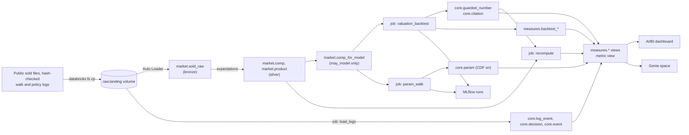

# Databricks: what is built, and how it fits together

Status: build design, 2026-11-15. Owner: the Databricks lead. Product choices are marked *agent proposal*; the why and the platform tour are in [databricks.md](databricks.md). This page is the one place for tables, lineage, the pipeline, parity, governance and the demo path. Nate's ask: [words](../product/words.md#2026-11-15-nate-official-apis-where-they-exist-the-browser-design-as-specced-ranking-systems-accounted-for-databricks-perfected).

Marks: *observed* (read in a doc or seen on the workspace, source named), *inferred* (our reasoning).

## 1. The workspace we build on

Nate's workspace (`--profile Nate`, id 7474651613371474) is Free Edition (*observed*, [workspace checks](../research/data/nate/workspace-checks.md)). Its limits shape the build (*observed*, [Free Edition limitations](https://docs.databricks.com/aws/en/getting-started/free-edition-limitations)):

| Limit | What we do |
|---|---|
| Serverless only; outbound internet limited to trusted domains | Public sold files are fetched off the workspace, hash-checked, and uploaded to a volume. No job fetches the web. |
| One SQL warehouse, 2X-Small | Every query, the dashboard and Genie use the existing Serverless Starter Warehouse. No warehouse is created. |
| 5 concurrent job tasks | Job tasks run in a chain or at most 4 wide. |
| One active pipeline per type | One pipeline, `secondhand-market`, owns bronze to silver for market data. |
| Apps: 3, 24 h each; Lakebase: one project | Not used by this layer. An App or Lakebase needs Nate's go. |

Nothing on this page creates a paid resource.

## 2. Audit, 2026-11-15

| Piece | State | Evidence |
|---|---|---|
| Catalog `secondhand`, schemas `core`, `governance`, `measures` | real, empty | `databricks tables list secondhand core --profile Nate` lists 11 tables, `SELECT count(*) FROM secondhand.core.observation` is 0 |
| Row filter `owner_only`, mask `mask_handle`, retention and rights tags | real, per table | [databricks/sql/02_governance.sql](../databricks/sql/02_governance.sql), run by `node databricks/run-sql.mjs` |
| Bundle [deploy/databricks.yml](../deploy/databricks.yml): schema, two volumes, secret scope, `nightly_fits`, `purge_user` | validates, never deployed; targets catalog `workspace`, not `secondhand`; `nightly_fits` runs 9 tasks at once, over Free Edition's 5 | `databricks bundle validate --target dev --profile Nate`; `workspace.secondhand` does not exist |
| Nightly folds in `jobs/<engine>/` | stubs on the workspace: `valuation/fit.py` reads a `comp` table nobody fills, the rest train on fixtures | [jobs/valuation/fit.py](../jobs/valuation/fit.py) skips "no comp table yet" |
| Real sold rows | real off the workspace: StockX 2019 (99,956 dated sales) on the Mac, the rest rebuildable by `fetch.sh` | [jobs/valuation/data/](../jobs/valuation/data/README.md) |
| `param` registry | real in memory (TS and Python); no Delta store | [jobs/param/registry.py](../jobs/param/registry.py) `MemoryStore` |
| Proof layer (guarded numbers, citations, basis hash) | real in TS only | [app/src/engines/proof/proof.ts](../app/src/engines/proof/proof.ts) |
| MLflow experiments, dashboards, Genie over our data, metric views, pipelines | missing | `databricks experiments list-experiments`, `databricks lakeview list` return none of ours |
| System tables | readable: lineage and audit return rows | `SELECT count(*) FROM system.access.table_lineage` |
| Governed tags | the workspace has the system classification tags (`class.credit_card`, ...) | `databricks tag-policies list-tag-policies --profile Nate` |
| Gateway with Claude, Agent Bricks | missing on the workspace | workspace checks |

## 3. Layout and lineage

Catalog `secondhand` (one catalog, one owner, one place a judge opens):

| Schema | Holds | Written by |
|---|---|---|
| `raw` | volume `landing`: `sold/<source>/rows.csv.gz` with `manifest.json`, `logs/*.jsonl` | upload from Windows |
| `market` | `sold_raw` (bronze streaming table), `comp`, `product` (silver), `comp_for_model` (view) | the pipeline |
| `core` | the canon rows of [product.md §3](product.md#3-the-data-model): `observation`, `evidence`, `citation`, `guarded_number`, `claim_check`, `param`, `event`, `job`, `decision`, `storefront_snapshot`, `log_event` | jobs |
| `measures` | `backtest_run`, `backtest_estimate`, `recompute_check`, `parity_check`, `rights_audit`, and the gold views the dashboard and Genie read | jobs and views |
| `governance` | `principal_map`, `owner_only`, `mask_handle`, policies | SQL setup task |

`market.comp` carries the comp shape `fit.py` already reads (`comp_id, site, price_cents, price_type, sold_at, observed_at, condition, product_id, url_ref, lot_parts`) plus its evidence and rights (`source, licence, source_sha256, extractor_version, may_store, may_model, may_show, may_share`). Public market rows have no owner; they are not in `core.observation`, whose `user_id` is required. *agent proposal*.

Lineage is Unity Catalog's own: every table above is written by a job or the pipeline, so `system.access.table_lineage` draws the graph (*observed*: the table returns rows on the workspace). What lineage cannot show, which rows fed one number, is the citation's job (§5).

## 4. The pipeline and the jobs

All in the one bundle in `deploy/`, which includes one resource file per piece (`deploy/resources/*.yml`) so two builders never edit the same file. Deploy only through `node deploy/deploy.mjs deploy --target dev --profile Nate`.

| Resource | Kind | Does | Proof |
|---|---|---|---|
| `setup` | job, SQL file tasks | runs `databricks/sql/*.sql` in order: schemas, tables, governance, views | the tables exist with their filters, masks and tags |
| `secondhand-market` | pipeline, serverless, triggered | Auto Loader from `raw.landing/sold/`, expectations: `price_cents > 0` dropped, `may_model IS NOT NULL` failed, `price_type IN ('sold','asking')` dropped; one comp per `row_id` | pipeline event log shows each expectation's pass and drop counts |
| `valuation_backtest` | job, Python | the engines lead's runner over `comp_for_model`, frozen per test sale; writes `measures.backtest_*`, one `core.guarded_number` and one `core.citation` per estimate, one MLflow run per run | rows in each table; the MLflow run |
| `param_walk` | job, Python | the `param` registry over real months (§6): each month a challenger is fitted on the past and scored on the next month; promoted only on a held-out win; rolled back when a promoted champion loses its next month | `core.param` versions with `moved_by`; `table_changes` on `core.param` |
| `recompute` | job, Python | recomputes each citation's `basis_hash` from `market.comp` by `basis_ids`; writes `measures.recompute_check` | every row `equal = true` |
| `parity` | job, Python | runs the Python twins on the shared fixtures and compares with the TypeScript outputs committed beside them (§5) | every row `equal = true` |
| `load_logs` | job, Python | reads `raw.landing/logs/*.jsonl` (walk and policy sweep logs) into `core.log_event`, and the `decision.answer` lines into `core.decision` | row counts match the files' lines |
| `rights_audit` | job, SQL | every fit's and citation's basis rows checked against `may_model`; lineage edges into `core.param` and `core.citation` | `measures.rights_audit` violations = 0 |
| `nightly_fits` | job (existing) | each engine's fold, now in a chain of at most 4 at once | runs green or skips with its reason |
| `purge_user` | job (existing) | the Delta half of delete_user | unchanged |

## 5. Parity: each calculation once, in two languages, checked

Where a number is computed in the app (TypeScript) and in a job (Python), both read one fixture and must agree exactly (*agent proposal*):
- A fixture is a JSON file of inputs beside the TS engine (as `app/src/engines/param/row.json` already is). A small node script writes the TS outputs next to it (`*.ts-out.json`), committed. The Python test asserts equality locally; the `parity` job reruns it on the workspace's Python and writes `measures.parity_check (engine, case, ts_value, py_value, equal, code_sha)`.
- Money is integer cents on both sides, so equality is exact; a ratio is compared after rounding to 6 places.
- First pairs: `basisHash` (proof.ts) and its Python twin `databricks/proof.py`; `scopeKey` and promote/rollback (param.ts and `jobs/param/registry.py`); the valuation estimate on the engines lead's fixtures once the TS engine reads the same rows.

## 6. The `param` walk over real months

The registry's rule (30-day half-life, promote only on a held-out win, rollback) has only run on fixtures. The walk runs it on StockX 2017-09 to 2019-02 (*agent proposal*):
- Each month m: fit the valuation params that are `param` rows on sales before m minus the 7-day gap; score on month m. Write the challenger with `held_out_score`, `n_eff` (30-day half-life weights) and `fitted_on_ids_hash`.
- Promote when the challenger beats the champion on m by more than the noise (the bootstrap interval of the score difference); otherwise it stays a challenger.
- After a promotion, the champion is scored on m+1 against the previous champion; if it is worse by more than the noise, `rollback` restores the previous version, `moved_by = rollback`.
- Every move is one MLflow run (params, held-out score, the decision) and one `core.param` row; Delta's change feed keeps the history.

## 7. Governance, ours beside theirs

The centrepiece. Each row is a promise the app makes, the Databricks feature it rests on, and what we add.

| Our promise | Databricks built-in we use | What we add on top | Shown by |
|---|---|---|---|
| A person sees only their own rows and linked accounts | Unity Catalog row filters (*observed*, [filters and masks](https://docs.databricks.com/data-governance/unity-catalog/filters-and-masks)); ABAC row filter policies on governed tags at catalog level (*observed*, [ABAC policies](https://docs.databricks.com/aws/en/data-governance/unity-catalog/abac/policies), needs serverless or DBR 16.4) | The same rule as the app's Postgres RLS (`user_id` is the caller), so both stores agree; `principal_map` from workspace principal to person | `governance_coverage` view: every `core` table has a filter |
| Buyer and seller handles are not shown | Column masks; governed tags (system `class.*` tags exist on the workspace, *observed*) | One mask policy matched by the tag `personal`, so any newly tagged column is masked without a new ALTER | the dashboard reads a masked handle |
| Every row carries the rights of its source | Tags on catalogs, tables and columns (*observed*); tags do not follow lineage (*observed*, [settled](../research/data/nate/open-items-settled-databricks.md) row 18) | Rights per row (`may_store`, `may_model`, `may_show`, `may_share`), pipeline expectations that refuse a row without them, `comp_for_model` as the only table a fit reads | `rights_audit`: 0 rows with `may_model = false` in any fit or citation basis |
| Every shown number is guarded | Metric views define a measure once (*observed*, [business semantics](https://docs.databricks.com/uc-semantics/)); no minimum-count rule was found on a measure (*observed*, [databricks.md §5.1](databricks.md#51-one-idea-in-three-places)) | `guarded_number` with `state` and `hide_reason`; gold views and the Genie instructions return the hide reason, never a thin number | the refusals tile; Genie answering a thin question with its count |
| Every number can be recomputed | Delta time travel and change data feed (*observed*, [CDF](https://docs.databricks.com/tables/features/change-data-feed)); table-level lineage | A `citation` per number with `basis_ids` and `basis_hash`, and a job that recomputes them | `recompute_check` all equal |
| What leaves the system is backed by evidence | Unity Gateway service policies, Beta: ON CALL and ON RESULT, ALLOW/DENY/ASK, fail closed, built-ins `block_hallucination` and `detect_sensitive_data` (*observed*, [service policies](https://docs.databricks.com/data-governance/unity-catalog/service-policies/)) | `claim_check` checks each claim against `attribute` and `evidence` rows; the built-ins are a second layer when the gateway carries our models | designed; built when Claude is on the gateway (§9) |
| Some actions are never automated; writes are dry by default | Grants decide who may call a service; service-policy ASK pauses only MCP calls (*observed*, same page) | `policy.ts check()` answers every verb `auto`, `ask`, `locked` or `never`; each answer is a `decision` row with its policy version | refused and held tiles, from the policy sweep and the walk |
| Every change has a why | `system.access.audit` records who touched which table (*observed*: rows on the workspace) | `decision` and `event` rows carry the why, the actor and the trace id | the audit tile joins both |
| A learned weight changes only on evidence | MLflow tracking; Delta CDF | `param` versions with held-out scores, promote on a win beyond the noise, rollback | the weight timeline |
| Source data is what it says | Pipeline expectations; data quality monitoring (anomaly detection, profiling, serverless, *observed*, [data quality](https://docs.databricks.com/data-governance/unity-catalog/data-quality-monitoring/)) | sha256 of every source file in the row and the manifest; `extractor_version` | expectation counts tile |

## 8. The proof a judge sees

**Dashboard `secondhand: proof`** (AI/BI, in the bundle, every query tested with `databricks experimental aitools tools query` first):
1. Valuation on real sold data: within-20% rate against the 90-day median baseline, coverage of the stated range, bias, by kind and price band, with n on every cell and cells under 30 hidden.
2. Weights over time: each `param` version by month, promotions and rollbacks marked.
3. Citation coverage: shown numbers with a citation over all shown numbers; recompute pass rate.
4. Refused and held: hidden numbers by `hide_reason`; decisions by `policy_mode`.
5. Governance: tables with a filter, masks, tags; rights audit violations; lineage edges; parity pass rate.

**Genie space `secondhand market`** over `market.comp`, the `measures` views and the metric view, with instructions to answer the hide reason when n is under the guard, and 10 benchmark questions with verified SQL (*observed*, [Genie Agents](https://docs.databricks.com/genie-agents/)).

## 9. Open

- **Claude on the gateway, claim checks at the gateway**: needs a full workspace or Nate's go on a provider; designed, not built.
- **An App showing "why this price"** from a citation: needs Nate's go (an App is a resource).
- **NBER eBay**: the workspace's egress is limited to trusted domains, and Windows got HTTP 403 on a HEAD to data.nber.org; tried again with a GET before giving up.
- **Data quality monitoring** on `market`: billed as serverless; on only with Nate's say.
