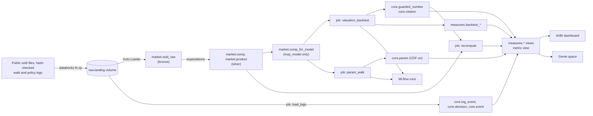

# Databricks: what is built, and how it fits together

Status: build design, 2026-11-15. Owner: the Databricks lead. Product choices are marked *agent proposal*; the why and the platform tour are in [databricks.md](databricks.md). This page is the one place for tables, lineage, the pipeline, parity, governance and the demo path. Nate's ask: [words](../product/words.md#2026-11-15-nate-official-apis-where-they-exist-the-browser-design-as-specced-ranking-systems-accounted-for-databricks-perfected).

Marks: *observed* (read in a doc or seen on the workspace, source named), *inferred* (our reasoning).

## 1. The workspace we build on

Nate's workspace (`--profile Nate`, id 7474651613371474) is a **Databricks free trial**, not Free Edition: Nate read the Manage Trial bar on 2026-11-15, $392 of $400 in credit left (*observed*, [packet 71](../.agents/team/packets/team/71-databricks-handoff.md)). It was created 2026-11-13 23:14 UTC, so the 14-day trial ends about 2026-11-27 (*inferred*; the Manage Trial bar shows the date). This is the workspace the judges see. An earlier version of this page called it Free Edition from a feature count; that was wrong and set limits we did not have for a day.

The choices below were made for Free Edition and are kept, because they cost nothing and spend the credit slowly:

| Choice | Why it stays |
|---|---|
| Public sold files are fetched off the workspace, hash-checked, and uploaded to a volume. No job fetches the web. | The hash is the provenance; a job that fetches can change under us. |
| Every query, the dashboard and Genie use the existing Serverless Starter Warehouse (`a2d6ba8cc4538aca`, auto-stop 10 minutes). | No warehouse is created. A new one is a paid resource and needs Nate's go. |
| Job tasks run in a chain or at most 4 wide. | Keeps a run readable and its credit small. |
| One pipeline, `secondhand-market`, owns bronze to silver for market data. | One owner per table. |
| No App, no Lakebase project, no endpoint. | Each is a paid resource and needs Nate's go. |

Nothing on this page creates a paid resource.

Measured on this workspace, 2026-11-15 (*observed*):

| Feature | Works | How it was checked |
|---|---|---|
| ABAC: governed tags (tag policies) and catalog row filter and column mask policies | yes; a new governed tag takes about a minute before `CREATE POLICY` accepts it | a probe policy masked `alice` as `a***`; now live as `sh_owner_only`, `sh_mask_handle` |
| Metric views, including a guarded measure (`CASE WHEN COUNT(1) >= 30 THEN … END`) | yes, created through the Statements API; the CLI's `aitools tools query` drops indented YAML lines, so it cannot create one | probe view over `market.comp` returned per-source medians |
| AI functions | yes: `ai_classify` answered in 3.7 s | one call on a StockX title |
| System tables `system.access.table_lineage`, `system.access.audit` | readable | the lineage and audit views return rows |
| Serverless `spark_python_task` | runs the file with no `__file__`; entrypoints take `--root ${workspace.file_path}` | three jobs failed with NameError, then passed |
| SQL file tasks | split on every `;`, so a `BEGIN … END` block fails; compound SQL runs from a Python task | the data migration failed, then passed as a Python task |
| SQL warehouse | the existing Serverless Starter Warehouse, auto-stop 10 minutes | `databricks warehouses get a2d6ba8cc4538aca` |

## 2. Audit, 2026-11-15

| Piece | State | Evidence |
|---|---|---|
| Catalog `secondhand`, schemas `core`, `governance`, `measures` | real, empty | `databricks tables list secondhand core --profile Nate` lists 11 tables, `SELECT count(*) FROM secondhand.core.observation` is 0 |
| Row filter `owner_only`, mask `mask_handle`, retention and rights tags | real, per table | [databricks/sql/02_governance.sql](../databricks/sql/02_governance.sql), run by `node databricks/run-sql.mjs` |
| Bundle [deploy/databricks.yml](../deploy/databricks.yml): schema, two volumes, secret scope, `nightly_fits`, `purge_user` | validates, never deployed; targets catalog `workspace`, not `secondhand`; `nightly_fits` runs 9 tasks at once, over Free Edition's 5 | `databricks bundle validate --target dev --profile Nate`; `workspace.secondhand` does not exist |
| Nightly folds in `jobs/<engine>/` | stubs on the workspace: `valuation/fit.py` reads a `comp` table nobody fills, the rest train on fixtures | [jobs/valuation/fit.py](../jobs/valuation/fit.py) skips "no comp table yet" |
| Real sold rows | real off the workspace: StockX 2019 (99,956 dated sales) on the Mac, the rest rebuildable by `fetch.sh` | [jobs/valuation/data/](../jobs/valuation/data/README.md) |
| `param` registry | real in memory (TS and Python); no Delta store | [jobs/param/registry.py](../jobs/param/registry.py) `MemoryStore` |
| Proof layer (guarded numbers, citations, basis hash) | real in TS only | [app/src/engines/proof/proof.ts](../app/src/engines/proof/proof.ts) |
| MLflow experiments, dashboards, Genie over our data, metric views, pipelines | missing | `databricks experiments list-experiments`, `databricks lakeview list` return none of ours |
| System tables | readable: lineage and audit return rows | `SELECT count(*) FROM system.access.table_lineage` |
| Governed tags | the workspace has the system classification tags (`class.credit_card`, ...) | `databricks tag-policies list-tag-policies --profile Nate` |
| Gateway with Claude, Agent Bricks | missing on the workspace | workspace checks |

## 3. Layout and lineage

Catalog `secondhand` (one catalog, one owner, one place a judge opens):

| Schema | Holds | Written by |
|---|---|---|
| `raw` | volume `landing`: `sold/<source>/rows.csv.gz` with `manifest.json`, `logs/*.jsonl` | upload from Windows |
| `market` | `sold_raw` (bronze streaming table), `comp`, `product` (silver), `comp_for_model` (view) | the pipeline |
| `core` | the canon rows of [product.md §3](product.md#3-the-data-model): `observation`, `evidence`, `citation`, `guarded_number`, `claim_check`, `param`, `event`, `job`, `decision`, `storefront_snapshot`, `log_event` | jobs |
| `measures` | `backtest_run`, `backtest_estimate`, `recompute_check`, `parity_check`, `rights_audit`, and the gold views the dashboard and Genie read | jobs and views |
| `governance` | `principal_map`, `owner_only`, `mask_handle`, policies | SQL setup task |

`market.comp` carries the comp shape `fit.py` already reads (`comp_id, site, price_cents, price_type, sold_at, observed_at, condition, product_id, url_ref, lot_parts`) plus its evidence and rights (`source, licence, source_sha256, extractor_version, may_store, may_model, may_show, may_share`). Public market rows have no owner; they are not in `core.observation`, whose `user_id` is required. *agent proposal*.

Lineage is Unity Catalog's own: every table above is written by a job or the pipeline, so `system.access.table_lineage` draws the graph (*observed*: the table returns rows on the workspace). What lineage cannot show, which rows fed one number, is the citation's job (§5).

## 4. The pipeline and the jobs

All in the one bundle in `deploy/`, which includes one resource file per piece (`deploy/resources/*.yml`) so two builders never edit the same file. Deploy only through `node deploy/deploy.mjs deploy --target dev --profile Nate`.

| Resource | Kind | Does | Proof |
|---|---|---|---|
| `setup` | job, SQL file tasks | runs `databricks/sql/*.sql` in order: schemas, tables, governance, views | the tables exist with their filters, masks and tags |
| `secondhand-market` | pipeline, serverless, triggered | Auto Loader from `raw.landing/sold/`, expectations: `price_cents > 0` dropped, `may_model IS NOT NULL` failed, `price_type IN ('sold','asking')` dropped; one comp per `row_id` | pipeline event log shows each expectation's pass and drop counts |
| `valuation_backtest` | job, Python | the engines lead's runner over `comp_for_model`, frozen per test sale; writes `measures.backtest_*`, one `core.guarded_number` and one `core.citation` per estimate, one MLflow run per run | rows in each table; the MLflow run |
| `param_walk` | job, Python | the `param` registry over real months (§6): each month a challenger is fitted on the past and scored on the next month; promoted only on a held-out win; rolled back when a promoted champion loses its next month | `core.param` versions with `moved_by`; `table_changes` on `core.param` |
| `recompute` | job, Python | recomputes each citation's `basis_hash` from `market.comp` by `basis_ids`; writes `measures.recompute_check` | every row `equal = true` |
| `parity` | job, Python | runs the Python twins on the shared fixtures and compares with the TypeScript outputs committed beside them (§5) | every row `equal = true` |
| `load_logs` | job, Python | reads `raw.landing/logs/*.jsonl` (walk and policy sweep logs) into `core.log_event`, and the `decision.answer` lines into `core.decision` | row counts match the files' lines |
| `rights_audit` | job, SQL | every fit's and citation's basis rows checked against `may_model`; lineage edges into `core.param` and `core.citation` | `measures.rights_audit` violations = 0 |
| `nightly_fits` | job (existing) | each engine's fold, now in a chain of at most 4 at once | runs green or skips with its reason |
| `purge_user` | job (existing) | the Delta half of delete_user | unchanged |

## 5. Parity: each calculation once, in two languages, checked

Where a number is computed in the app (TypeScript) and in a job (Python), both read one fixture and must agree exactly (*agent proposal*):
- A fixture is a JSON file of inputs beside the TS engine (as `app/src/engines/param/row.json` already is). A small node script writes the TS outputs next to it (`*.ts-out.json`), committed. The Python test asserts equality locally; the `parity` job reruns it on the workspace's Python and writes `measures.parity_check (engine, case, ts_value, py_value, equal, code_sha)`.
- Money is integer cents on both sides, so equality is exact; a ratio is compared after rounding to 6 places.
- First pairs: `basisHash` (proof.ts) and its Python twin `databricks/proof.py`; `scopeKey` and promote/rollback (param.ts and `jobs/param/registry.py`); the valuation estimate on the engines lead's fixtures once the TS engine reads the same rows.

## 6. The `param` walk over real months

The registry's rule (30-day half-life, promote only on a held-out win, rollback) has only run on fixtures. The walk runs it on StockX 2017-09 to 2019-02 (*agent proposal*):
- Each month m: fit the valuation params that are `param` rows on sales before m minus the 7-day gap; score on month m. Write the challenger with `held_out_score`, `n_eff` (30-day half-life weights) and `fitted_on_ids_hash`.
- Promote when the challenger beats the champion on m by more than the noise (the bootstrap interval of the score difference); otherwise it stays a challenger.
- After a promotion, the champion is scored on m+1 against the previous champion; if it is worse by more than the noise, `rollback` restores the previous version, `moved_by = rollback`.
- Every move is one MLflow run (params, held-out score, the decision) and one `core.param` row; Delta's change feed keeps the history.

## 7. Governance, ours beside theirs

The centrepiece. Each row is a promise the app makes, the Databricks feature it rests on, and what we add.

| Our promise | Databricks built-in we use | What we add on top | Shown by |
|---|---|---|---|
| A person sees only their own rows and linked accounts | Unity Catalog row filters (*observed*, [filters and masks](https://docs.databricks.com/data-governance/unity-catalog/filters-and-masks)); ABAC row filter policies on governed tags at catalog level (*observed*, [ABAC policies](https://docs.databricks.com/aws/en/data-governance/unity-catalog/abac/policies), needs serverless or DBR 16.4) | The same rule as the app's Postgres RLS (`user_id` is the caller), so both stores agree; `principal_map` from workspace principal to person | `governance_coverage` view: every `core` table has a filter |
| Buyer and seller handles are not shown | Column masks; governed tags (system `class.*` tags exist on the workspace, *observed*) | One mask policy matched by the tag `personal`, so any newly tagged column is masked without a new ALTER | the dashboard reads a masked handle |
| Every row carries the rights of its source | Tags on catalogs, tables and columns (*observed*); tags do not follow lineage (*observed*, [settled](../research/data/nate/open-items-settled-databricks.md) row 18) | Rights per row (`may_store`, `may_model`, `may_show`, `may_share`), pipeline expectations that refuse a row without them, `comp_for_model` as the only table a fit reads | `rights_audit`: 0 rows with `may_model = false` in any fit or citation basis |
| Every shown number is guarded | Metric views define a measure once (*observed*, [business semantics](https://docs.databricks.com/uc-semantics/)); no minimum-count rule was found on a measure (*observed*, [databricks.md §5.1](databricks.md#51-one-idea-in-three-places)) | `guarded_number` with `state` and `hide_reason`; gold views and the Genie instructions return the hide reason, never a thin number | the refusals tile; Genie answering a thin question with its count |
| Every number can be recomputed | Delta time travel and change data feed (*observed*, [CDF](https://docs.databricks.com/tables/features/change-data-feed)); table-level lineage | A `citation` per number with `basis_ids` and `basis_hash`, and a job that recomputes them | `recompute_check` all equal |
| What leaves the system is backed by evidence | Unity Gateway service policies, Beta: ON CALL and ON RESULT, ALLOW/DENY/ASK, fail closed, built-ins `block_hallucination` and `detect_sensitive_data` (*observed*, [service policies](https://docs.databricks.com/data-governance/unity-catalog/service-policies/)) | `claim_check` checks each claim against `attribute` and `evidence` rows; the built-ins are a second layer when the gateway carries our models | designed; built when Claude is on the gateway (§9) |
| Some actions are never automated; writes are dry by default | Grants decide who may call a service; service-policy ASK pauses only MCP calls (*observed*, same page) | `policy.ts check()` answers every verb `auto`, `ask`, `locked` or `never`; each answer is a `decision` row with its policy version | refused and held tiles, from the policy sweep and the walk |
| Every change has a why | `system.access.audit` records who touched which table (*observed*: rows on the workspace) | `decision` and `event` rows carry the why, the actor and the trace id | the audit tile joins both |
| A learned weight changes only on evidence | MLflow tracking; Delta CDF | `param` versions with held-out scores, promote on a win beyond the noise, rollback | the weight timeline |
| Source data is what it says | Pipeline expectations; data quality monitoring (anomaly detection, profiling, serverless, *observed*, [data quality](https://docs.databricks.com/data-governance/unity-catalog/data-quality-monitoring/)) | sha256 of every source file in the row and the manifest; `extractor_version` | expectation counts tile |

## 8. The proof a judge sees

**Dashboard `secondhand: proof`** ([proof.lvdash.json](../databricks/dashboards/proof.lvdash.json), rebuilt 2026-11-15 after Nate rejected the first one: "So i hated the dashboard. Did you even consider standards", [packet 71](../.agents/team/packets/team/71-databricks-handoff.md)). The first version was seven pages of governance tables, deployed after its queries passed and before anyone looked at it. The rebuild follows the AI/BI skill's first rule ("KPI on the top ... and we see something happen"), [the UI constitution](../product/ui-constitution.md) and the [brand](../brand/constitution.md). It is one story page and one data page. Each beat has one heading, counters on top, one chart where something changes, and a table only where a judge opens rows:

| Beat | Counters | Then | Reads |
|---|---|---|---|
| 1. A price opens to the sales behind it | shown prices that carry their sales; prices rebuilt exactly from those sales | pick a price, see its earlier sales with links (`measures.why`) | `citation_coverage`, `recompute_check`, `why()` |
| 2. Closer than the usual guesses, on the same sales | within 20% for our price, last sale and the 90-day median; how often our range held the sale | within 20% by week, three lines on the same sales | the metric view `valuation_metrics` |
| 3. The weight on recent sales changed once, on evidence | changes, months held, rollbacks | the half-life in force each month; each change with its gain and noise | `param_moves` |
| 4. Each person's rows stay theirs, even from the owner | rule-breaking rows across every owner (the break-glass guard); tables locked to their owner; accounts the viewer can read | the locks in force | `guard_status`, `policies_in_force`, `governance.principal_map` |
| 5. What it never does on its own | never-alone requests refused | each action, asked and refused | `never_automated` (synthetic, labelled) |

Rules the page keeps, each checked by [test_dashboard.mjs](../databricks/test_dashboard.mjs): every figure has a title and a description naming its data; every rate shows its count (`98.5% of 39,707`); no statistics notation or em dashes; figures are historical public sales and never called accuracy on live data. Our price is ink and the baselines gray, so the eye goes to ours (brand Article 5: color is not decoration). The Genie space is linked through `uiSettings.genieSpace`.

**Next: the live page** (Nate, 2026-11-15, after seeing the rebuilt page: "thats a good test dashboard, but we will develop our dashboard to respond to realtime data from across sites and what we scan for our internal testing"). The page above becomes the test page, which shows how we test on public history. A live page goes first, built over the rows the product writes:
- reads per site in the last day: answered, failed or blocked, time to answer, minutes since the last read (`core.log_event`, `core.observation` with `data = 'live:<site>'`);
- prices shown from live reads with their sales attached, and prices held back with the reason (`core.guarded_number`, `core.citation`);
- what our internal scans found: items by kind, identified or asked again (`core.evidence`, `data = 'captured'`).
Measured 2026-11-15 10:40 Central: the workspace holds no `live:` or `captured` rows yet, only example (53 observations) and synthetic (480 policy answers) rows. The page needs the logs to land first. Today `load_logs` runs on demand. Running it every few minutes, or as an Auto Loader stream in the market pipeline, spends trial credit, so the cadence is Nate's call. Until rows arrive, each live tile says what has not arrived, never zero.

**The metric view** `measures.valuation_metrics` ([13_metrics.sql](../databricks/sql/13_metrics.sql)) is the one place the price measures are defined: sales tested, estimates shown, within 20 percent, median error, range held the sale, by who priced it, week, kind and dataset. Every rate is null when fewer than 30 estimates were shown in the cell, the same 30 as `valuation_accuracy` and §9's rule. It is created through the Statements API (§11.3), not by a bundle task.

**How a dashboard change ships.** Every dataset query runs through the Statements API with the dashboard's catalog and schema; then a review copy is created with `databricks lakeview create` under `/Shared/secondhand-review`, rendered in a browser, judged by a design-critic seat against the constitutions, and shown to Nate. Only then does `databricks bundle deploy` replace the deployed dashboard. A passing query is not a passing screen.

**Genie space `secondhand market`** over `market.comp`, the `measures` views and the metric view, with instructions to answer the hide reason when n is under the guard, and 10 benchmark questions with verified SQL (*observed*, [Genie Agents](https://docs.databricks.com/genie-agents/)).

## 9. What is proved

Read on Nate's workspace, 2026-11-15. Each line names the command that gives it.

| Claim | Number | Command |
|---|---|---|
| Public sold rows in the lakehouse | 1,688,603 comps from 6 sets in `market.comp` (1,688,864 bronze, 261 dropped by expectations); 1,581,374 in `comp_for_model` | `SELECT source, count(*) FROM secondhand.market.comp GROUP BY source` |
| Rights travel with the row | grailed, goodwill, two small CC sets are `may_model = false` and absent from `comp_for_model` | same, on `comp_for_model` |
| One person cannot read another's rows | 7 of 14 guarded numbers visible to Nate, all `usr_nate`; `owner_only('usr_ben')` is false for his principal | `SELECT user_id, count(*) FROM secondhand.core.guarded_number GROUP BY 1` |
| Handles never shown | `m***` from `observation.seller_handle`, by the catalog policy `sh_mask_handle` on the governed tag `sh_personal` | `SELECT seller_handle FROM secondhand.core.observation LIMIT 2` |
| One calculation, two languages | 20 of 20 parity cases equal between `proof.ts` and `databricks/proof.py` | `python -m pytest databricks/parity/test_parity.py` |
| Never-automated actions refuse | 480 policy answers; all 32 never-performed answers `never` on every site, promoted or not | `node databricks/policy-sweep.mjs` |

## 10. Open

**Main is ahead of the workspace.** These are merged and not deployed: the guard that runs inside break-glass, erasure with tombstone and vacuum, the governance revokes, `source_rights`, `basis_level`, and nightly-fits paused in the bundle. The deploy is blocked because the deployed dashboard was edited in the UI, and `databricks bundle deploy` will not overwrite it without `--force`, which waits on Nate. Until the deploy and the setup chain (`setup`, `erasure_setup`, `governance_setup`, `parity`, `load_bench`, `load_logs`) run, any "zero violations" read on the workspace is from the old guard. That guard ran under the owner filter and could not see other people's rows.

**Named fixes, in build order** (from packet 71's queue; each has its measure):

| # | Fix | Owned files | Done when |
|---|---|---|---|
| F1 | The param registry's four new columns on the live table: `origin` ('fit' or 'event'), `previous_version`, `keep`, `days_since_last` (contract from engines, `jobs/param/registry.py:15`; engines adds them to the CREATE TABLE in `01_tables.sql`). Ours: `ALTER TABLE secondhand.core.param ADD COLUMNS` through `migrate_data.py`, a guard rule listing any `origin` outside the two values, `param_walk.registry_rows` carrying all four. Runs after the dashboard deploy | `databricks/tasks/migrate_data.py`, `databricks/sql/09_guard.sql`, `databricks/tasks/param_walk.py` | `test_migrate_data.py` passes; `DESCRIBE secondhand.core.param` shows the four columns; the guard rule returns 0 rows |
| F2 | Payload columns that carry buyer or seller text are masked or dropped (security audit #3, [01_tables.sql:23](../databricks/sql/01_tables.sql)) | `databricks/sql/01_tables.sql`, `02_governance.sql` | a viewer outside the owner reads the payload as masked; `policies_in_force` lists it under masked columns |
| F3 | The secret scope's ACL is set to the operator and the job principal only (audit #4). It holds no secrets today, and its only ACL is the owner's MANAGE | `deploy/databricks.yml` | `databricks secrets list-acls` shows exactly the two principals |
| F4 | A champion marked served reads only `comp_for_product` | `databricks/sql/09_guard.sql`, `jobs/valuation/fit.py` (engines) | a guard rule returns 0 rows on the workspace; a fixture fit over a `may_model = false` row fails its test |
| F5 | A weekly view of which fallback level priced each shown number, once engines' `guard()` writes `basis_level` | `databricks/sql/10_dashboard.sql` | the view returns one row per week and level; the share at the top level is on the board |
| F6 | `databricks/README.md` says what each folder holds and how a change ships (§8) | `databricks/README.md` | a reader finds the deploy order and the review step without this page |
| F7 | nightly-fits stays paused until `fit.py` stops reading `may_model = false` rows (row in [waiting.md](plans/waiting.md), owner engines) | `deploy/resources/*.yml` | `databricks jobs get` shows PAUSED until engines' fix lands |

- **Claude on the gateway, claim checks at the gateway**: needs a full workspace or Nate's go on a provider; designed, not built.
- **An App showing "why this price"** from a citation: needs Nate's go (an App is a resource).
- **NBER eBay**: the workspace's egress is limited to trusted domains, and Windows got HTTP 403 on a HEAD to data.nber.org; tried again with a GET before giving up.
- **Data quality monitoring** on `market`: billed as serverless; on only with Nate's say.

## 11. Platform findings, 2026-11-15

Observed on the workspace; exact errors supplied by the build orchestrator:

1. **CHECK constraints and row-level security cannot share a table.** ``[ROW_LEVEL_SECURITY_CHECK_CONSTRAINT_UNSUPPORTED] Creating CHECK constraint on table `secondhand`.`core`.`guarded_number` with row level security policies is not supported.`` We use the [guard view and failing job](../databricks/sql/09_guard.sql), the [door check](../databricks/guard.py), and an [hourly alert](../deploy/resources/alerts.yml). `guard_refusals` records the door's refusals; `guard_violations` finds rows written past it. Design (b), an unfiltered staging table with CHECKs merged into the filtered table, is the option for a full workspace; it is not built.
2. **The owner filter hides other people's rows from the operator's own job.** `[DELTA_NEW_NOT_NULL_VIOLATION] 53 rows in secondhand.core.observation violate the new NOT NULL constraint on data`. The backfill needed a logged break-glass window (76 s, `governance.break_glass`). [migrate_data.py](../databricks/tasks/migrate_data.py) brackets the migration with access, an audit row, and revocation even when it fails.
3. **Metric views need the Statements API.** The CLI's `aitools tools query` drops indented YAML lines: `[METRIC_VIEW_INVALID_VIEW_DEFINITION] … Missing required creator property 'expr'`. We create metric views through the Statements API, preserving the YAML.

Serverless Python has no `__file__`: entrypoints take `--root ${workspace.file_path}` ([§1](#1-the-workspace-we-build-on)).

SQL file tasks split at semicolons: compound SQL runs from a Python task ([§1](#1-the-workspace-we-build-on)).
