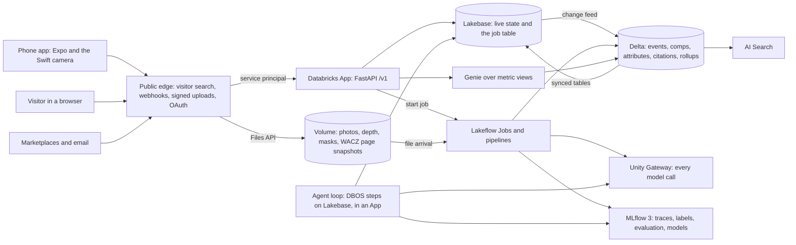
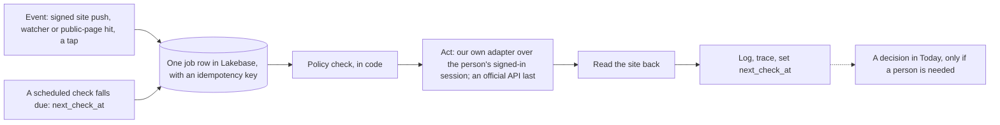
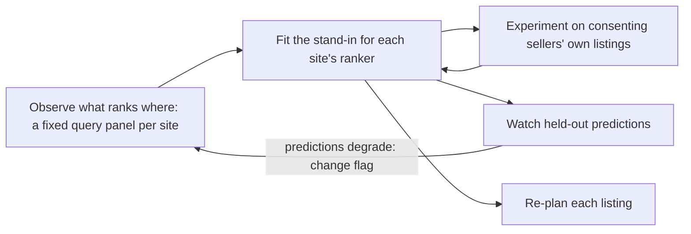
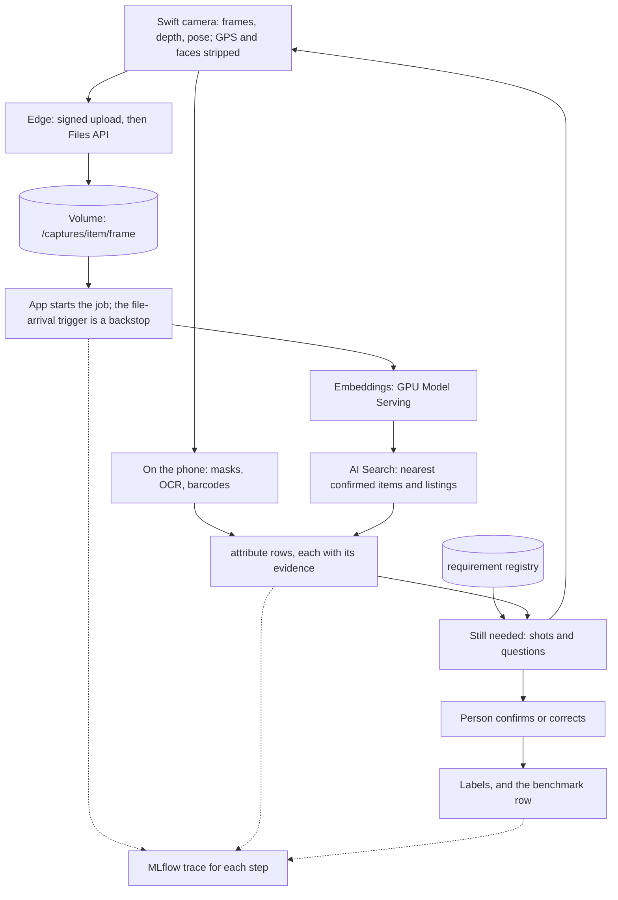

# Databricks, and how secondhand is built on it

Status: explanation and *agent proposal* for Ben and Nate. Written 2026-11-14.

This page explains Databricks in plain words. It shows where each feature of secondhand runs on the platform, and proposes what we add that the platform does not have. It answers Nate's asks: [go beyond the standard](../product/words.md#2026-11-14-nate-databricks-beyond-the-standard), [a full explanation](../product/words.md#2026-11-14-nate-the-databricks-explanation), [make it provable and build features for Databricks](../product/words.md#2026-11-14-nate-provable-and-features-for-databricks), [images, proven aggregates and adaptive algorithms](../product/words.md#2026-11-14-nate-images-proven-aggregates-and-adaptive-algorithms), [a general scoring feature](../product/words.md#2026-11-14-nate-a-general-scoring-feature-and-real-time-algorithms) and [innovate without overcomplicating](../product/words.md#2026-11-14-nate-innovate-without-overcomplicating-and-the-agent-framework). The choice of Databricks as the backend is decided ([decisions](../product/decisions.md#2026-11-14-databricks-runs-the-whole-backend-with-a-hybrid-fallback)), and so is the rule that licences and site terms are recorded as facts and do not shape the build ([decisions](../product/decisions.md#2026-11-14-licences-and-site-terms-are-recorded-as-facts-and-do-not-shape-the-build)). Everything here about *how* is an *agent proposal*. Nothing on this page is a decision, and every feature stays in scope ([decisions](../product/decisions.md#2026-11-14-keep-every-feature-in-scope)).

How to read the marks:
- *observed*: read in an official doc, an official skill or a repository, with the source named.
- *asserted*: a source says it, but we have not checked it.
- *inferred*: our own reasoning.

The research behind this page is in the [platform note](../research/data/nate/databricks-platform.md), the [dev tooling note](../research/data/nate/databricks-dev-tooling.md), [what Databricks rewards](../research/data/nate/what-databricks-rewards.md), [scoring and ranker inference](../research/price/nate/scoring-and-ranker-inference.md) and Ben's [Databricks note](../research/data/ben/databricks.md). The facts checked a second time, and the open projects that could fill the gaps, are in [open facts](../research/data/nate/open-facts-databricks.md), the [evidence gate note](../research/messages/nate/evidence-gate.md), and the notes on [durable agents](../research/data/nate/port-durable-agents.md), [ontology and aggregation](../research/data/nate/port-ontology-and-aggregation.md), [provenance and evidence](../research/data/nate/port-provenance-and-evidence.md) and [web intake and browsers](../research/data/nate/port-web-intake-and-browsers.md). Official Databricks agent skills are cited by name, for example databricks-lakebase.

**The pitch in one line** (*agent proposal*). Every fact and every number in secondhand carries where it came from, refuses to show when it cannot be backed, and carries the rights of its sources with it. On that base sits the headline feature: a scoring engine that tells a seller, per marketplace, what an item will net, how good the listing is, how well it is likely to show in search, and which way the market is moving, each with a range and an honest "not enough to say".

## 1. Databricks in plain words

Databricks began as hosted Apache Spark. It now holds storage, a catalog, compute, a Postgres database, app hosting, agents and model calls in one account. Six ideas cover it.

### 1.1 Open tables

Data is stored as files in open formats: Delta Lake, and Apache Iceberg (skill databricks-iceberg). A table is a folder of Parquet files plus a log of every change. Because the log exists, three things work:
- **Time travel.** You can read a table as it was at an earlier version. The log is kept 30 days by default and old data files 7 days. From Databricks Runtime 18.0, time travel past the file retention is blocked, so readable history is 7 days unless raised (*observed*, `https://docs.databricks.com/aws/en/delta/history`). Nothing records which table versions a query read: the query history and lineage system tables have no version field (*observed*, [open facts](../research/data/nate/open-facts-databricks.md#5-time-travel-retention-recording-and-replaying-a-querys-table-versions)).
- **Row tracking.** Every row gets a stable ID that survives updates and merges (`_metadata.row_id`), plus the version that last changed it (`_metadata.row_commit_version`). It needs Runtime 14.0 or newer (*observed*, `https://docs.databricks.com/aws/en/delta/row-tracking`). The skills databricks-pipelines and databricks-dbsql use it for incremental refresh.
- **Change data feed.** You can read only what changed since a given version.

In plain words: a table remembers its past, and each row has a name that does not change.

### 1.2 One catalog

Unity Catalog names and governs everything under one grant model: tables, views, files in volumes, models, functions, and the model services the gateway fronts (skill databricks-unity-catalog).

Lineage is recorded without any code. It goes down to columns, and its nodes include tables, views, file paths, ML model versions and gateway model services. User-defined functions get table-level lineage only. Lineage system tables keep a rolling 395 days (*observed*, `https://docs.databricks.com/aws/en/data-governance/unity-catalog/data-lineage`).

Volumes hold files, such as photos and depth maps, under the same grants. The Files API takes uploads of up to 5 GiB, and volumes have no signed URLs (*observed*, [platform note](../research/data/nate/databricks-platform.md#file-storage-unity-catalog-volumes)).

In plain words: one list of everything, who may touch it, and what was made from what.

### 1.3 Compute that comes and goes

Serverless compute starts when work arrives and stops when it ends. Three shapes matter here:
- **Jobs** are tasks in a graph. A job starts on a schedule, when a table updates, when a file arrives, or runs continuously (skill databricks-jobs).
- **Lakeflow pipelines** are declared tables that keep themselves current. Expectations drop or flag bad rows (skill databricks-pipelines).
- **SQL warehouses** run SQL over the tables, for dashboards and Genie (skill databricks-dbsql).

In plain words: you pay for work, not for idle machines.

### 1.4 Lakebase

Lakebase is managed Postgres (versions 16, 17 and 18), generally available since January 2026 (*observed*, [platform note](../research/data/nate/databricks-platform.md#lakebase-managed-postgres)). It holds the app's live state: items, listings, offers, jobs and decisions. Four things set it apart (skill databricks-lakebase):
- **Branches.** A copy of the whole database is made in seconds. A project allows up to 500 branches and a history window of 2 to 30 days.
- **Scale to zero.** An idle database suspends and wakes in a few hundred milliseconds. On waking, pooled connections, prepared statements and session settings are gone.
- **Sync both ways.** Synced tables copy Delta into Postgres, as a snapshot, on a trigger or continuously, and are read only there. A change feed copies Postgres changes into Delta tables named `lb_<table>_history` (Public Preview).
- **Postgres extensions.** pgvector and pg_trgm are available.

Logins use OAuth tokens that last one hour.

In plain words: a normal Postgres the app talks to, which can fork itself and which pours its history into the tables.

### 1.5 Apps and agents next to the data

**Databricks Apps** host a web server behind the workspace's own sign-in. We use FastAPI (skill databricks-apps-python). Each app has its own service principal. It can also act as the calling user, through a token forwarded in `x-forwarded-access-token` (*observed*, [platform note](../research/data/nate/databricks-platform.md#databricks-apps)).

**Agent Bricks** hosts agents (skill databricks-agent-bricks). For long work the current server is DurableAgentServer: persistent run state and crash recovery, with memory in Lakebase. AgentServer, LongRunningAgentServer and agents on Model Serving moved to Legacy on 5 October. On 12 October, Knowledge Assistant and Supervisor Agent became legacy too: for new code agents Databricks recommends the Agent Bricks CLI, and for no-code agents Genie Agents (*observed* for both dates, `https://docs.databricks.com/aws/en/release-notes/product/2026/october`). So "Agent Bricks runs the agents" means code agents deployed with the Agent Bricks CLI, as Ben's [judging note](../research/data/ben/databricks-judging-evidence.md#what-this-changes-agent-proposals) also says. Its docs name exactly-once tool execution as a non-goal: a lease (a claim with a 3 second heartbeat) keeps one worker on a run, but a tool can run twice after a crash (*observed*, [durable agents note](../research/data/nate/port-durable-agents.md#the-answer)). DBOS Transact, an MIT-licensed library with an official Lakebase guide and a demo that deploys to Apps, records each step in Postgres so a finished step is not repeated (*observed* for the guide and demo; the step features are *asserted* from DBOS docs).

**Genie** answers questions in plain words by writing SQL over tables you choose (skill databricks-genie-agents). Genie Ontology, with Domains and Pages, went GA on 11 November 2026, three days before this page: a learned map of business terms built from metric views and reachable through the Genie One MCP server with the same Unity Catalog permissions (*observed*, [settled](../research/data/nate/open-items-settled-databricks.md) row 11). Genie One is free for users through 31 January 2027; calls by a service principal are billed ([settled](../research/data/nate/open-items-settled-databricks.md) row 29).

**AI Search** (formerly Vector Search) keeps a vector index in step with a Delta table and blends keyword and vector results (skill databricks-vector-search). Tag-based access rules (ABAC) on the source table do not carry into the index (*observed*, [open facts](../research/data/nate/open-facts-databricks.md#4-governed-tags-and-abac)), so anything the index must respect, such as a rights tag, is a filter column in the index (*inferred*).

In plain words: the app, its agents and its search run beside the data, not across a network from it.

### 1.6 One record of model calls

**Unity Gateway** went GA on 4 August 2026; the 16 September note covers only its management API, and service policies stay Beta (*observed*, [claims validated](../research/cross-cutting/nate/claims-validated-specs.md)). It sits in front of every model, whether ours or a provider's, and adds fallbacks, budgets, rate limits, and inference tables that log each request (skill databricks-unity-gateway). Its service policies (Beta, opt-in) check a call before the model sees it (ON CALL) and the whole answer before it is released (ON RESULT). Each returns ALLOW, DENY or ASK. Four are built in: unsafe content, jailbreak, hallucination and sensitive data. A custom policy can be a SQL function, a model acting as judge, Python code (30 second limit) or an outside service (5 second limit). Policies see text only, cannot rewrite it, and see the request's tags; a SQL policy cannot look up a table (*observed*, [evidence gate note](../research/messages/nate/evidence-gate.md#62-gateway-service-policies-what-runs-before-release)).

**MLflow 3** traces each step of an agent or job: inputs, outputs, timings, tags, and feedback from people. Evaluation datasets and judges then score those steps (skill databricks-mlflow-evaluation). Production monitoring scores a sample of logged traces after the fact; no MLflow scorer holds an answer before release (*observed*, [evidence gate note](../research/messages/nate/evidence-gate.md#64-mlflow-what-is-scored-afterwards)). The model registry in Unity Catalog keeps versions of each model under aliases such as "Champion" (*observed*, `https://docs.databricks.com/aws/en/machine-learning/manage-model-lifecycle/`).

In plain words: every model call and every step is written down in one place, and can be scored.

## 2. Where it excels, and where it does not

| Area | Where it excels | Where it falls short for us | Mark |
|---|---|---|---|
| Governance | One grant model across files, tables and models. Lineage is automatic. | Lineage stops at columns and file paths. It cannot say which rows, or which part of a photo, produced one shown value. | *observed* (lineage doc); the gap is *inferred* |
| History | Time travel, stable row IDs, change feeds. | Readable history is 7 days by default, and nothing records which versions a query read. Rewinding cannot prove an old number. | *observed* (history doc, [open facts](../research/data/nate/open-facts-databricks.md#5-time-travel-retention-recording-and-replaying-a-querys-table-versions)) |
| Evidence | Gateway service policies hold an answer before release. | Nothing checks a claim against catalog tables, and MLflow scores after release. | *observed* ([evidence gate note](../research/messages/nate/evidence-gate.md#61-answer-in-one-table)) |
| Web intake | Jobs, volumes, AI Functions. | No web fetcher, page snapshot or archive. Lakeflow Connect has no HTTP source, `ai_parse_document` does not take HTML. Apps forbid root and apt, and serverless jobs forbid OS packages, so a browser likely cannot run there. | *observed* ([web intake note](../research/data/nate/port-web-intake-and-browsers.md#databricks-side-checks)); the browser point is *inferred* |
| App database | Lakebase branches and two-way sync. | Tokens expire after 1 hour and do not work through PgBouncer. Row-level security keys on the database role, which is the app's, not our user's. Waking from suspend loses session state. | *observed* ([platform note](../research/data/nate/databricks-platform.md#lakebase-managed-postgres)); the workaround is *inferred* |
| Who can call an app | Workspace sign-in and the CAN USE permission. | No public mode is documented. A forum reports a 302 redirect for anonymous requests and a 401 for personal tokens. A phone app with its own users, marketplace webhooks and visitors with no account cannot reach an App directly. | *observed* (no public mode in the docs); forum *asserted*; consequence *inferred* |
| Per-user isolation | An App acts as itself, or as a workspace user. | Our users are not workspace users, so we carry the user's identity ourselves. | *inferred* |
| Long work | Jobs, and DBOS steps on Lakebase (*agent proposal*, §3.1; the runtime is open as J2 in [open-questions](open-questions.md)). | An App gets 15 seconds after SIGTERM, so long work cannot live inside a request. The agent servers run a tool at least once, not exactly once. Lakebase has no pgmq or pg_cron, and scale to zero drops LISTEN/NOTIFY and advisory locks. | *observed* ([platform note](../research/data/nate/databricks-platform.md#databricks-apps), [durable agents note](../research/data/nate/port-durable-agents.md#the-answer)) |
| Cold starts | Scale to zero almost everywhere. | The first request after idle waits for a wake. | *observed* |
| Preview status | Most pieces are GA. | Some pieces are not: the Postgres-to-Delta change feed is Public Preview, the Review App, review queues and prompt registry are Beta, and three agent servers are Legacy. | *observed* |
| Images | Volumes, AI Search, GPU Model Serving. | AI Search indexes text or precomputed embeddings, not images, so image vectors come from our own GPU endpoint and are indexed in AI Search as self-managed embeddings (*agent proposal*, P7). | *observed* ([settled](../research/data/nate/open-items-settled-databricks.md) row 28); the route is *inferred* |
| Workspace | A full workspace: GPU serving, Direct Vector Access, open egress with controls, Delta Sharing. | The event workspace is not Free Edition ([settled](../research/data/nate/open-items-settled-databricks.md) row 2), so no Free Edition workaround is kept (P7). Cost per GPU endpoint is Ben and Nate's call (§9). | *observed* |

## 3. The architecture

The public edge sits outside Databricks because Apps have no public mode (§2). It is small. It serves unauthenticated, rate-limited visitor search, receives marketplace webhooks and answers them with a 2xx in under one second, issues signed upload URLs, holds the OAuth PKCE verifier, and answers eBay account-deletion notices. It calls the App with a service principal over machine-to-machine OAuth. Phones get their tokens through RFC 8693 token exchange against a federation policy (*observed*, [platform note](../research/data/nate/databricks-platform.md#how-an-external-mobile-app-authenticates-its-end-users)).

This refines the decision that "Databricks Apps hosts the backend and webhooks" ([decisions](../product/decisions.md#2026-11-14-databricks-runs-the-whole-backend-with-a-hybrid-fallback)). The backend stays on Apps. The webhook receiver moves to the edge, and the edge then hands each webhook to the App. That refinement is Ben and Nate's to accept (§9).

### 3.1 The agent runtime: one loop, two triggers

Every action secondhand takes on a marketplace, on every site, runs through one loop. Each site gets its own harness ([decisions](../product/decisions.md#2026-11-14-each-marketplace-gets-its-own-harness-run-on-browser-use-cloud)), run in browsers we host ourselves, with no browser vendor ([Nate](../product/words.md#2026-11-14-nate-host-all-engines-ourselves-and-can-the-persons-own-device-do-the-work)), and the sites are set ([decisions](../product/decisions.md#2026-11-14-the-platform-list-is-set)). The hosted browser runs in a container on our own compute, outside Apps and serverless jobs, because Apps forbid root and apt, serverless jobs forbid custom images and OS packages, and the Apps proxy cuts a request at 300 seconds (*observed*, [web intake note](../research/data/nate/port-web-intake-and-browsers.md#databricks-side-checks)). Forum reports put the cut at 30 to 120 seconds (*asserted*, Ben's [proposal 7](../research/data/ben/databricks-judging-evidence.md#what-this-changes-agent-proposals)). Either way, every long job is start-then-poll: the App starts the job and returns at once, and the phone follows the job states started, running, arrived and failed through `GET /v1/jobs/:id/events` (*agent proposal*). Whether the Beta `system.ai.sandbox` or other Databricks compute could run the hosted browser is untested, and is a first-hour check in [assessment.md](assessment.md).

1. **Two triggers, one job.** A trigger is an event, or a scheduled check that falls due. Either one becomes exactly one job row with an idempotency key, such as `post:{item}:{site}:{n}`. Workers pull rows from the table with Postgres `SELECT ... FOR UPDATE SKIP LOCKED`, so two workers never run one row (*agent proposal*; that Lakebase supports it is *inferred* from it being Postgres). The loop runs as a DBOS workflow, each numbered step a recorded step, so a restart resumes after the last finished step (*agent proposal*). A crash inside the act step can still repeat it, which is why the loop reads the site back before acting again (*inferred*).
2. **Policy in code.** The tier of the action ([decisions](../product/decisions.md#2026-11-14-automation-runs-in-tiers-that-learn)), the offer ceiling and the pace for each site are checked in code. A model never makes this check.
3. **Act.** The harness uses our own adapter for the site over the person's signed-in session first, then our fetch engine for public reads, and an official API or aggregator last ([product §6](product.md)). Each account session runs one job at a time, paced per site.
4. **Read back, then log.** After acting, the harness reads the site back to confirm the effect, writes the event and one trace per job, and raises a decision only when a person is needed.
5. **When to look again.** Each listing and each conversation has a `next_check_at`, set from its state: a live offer is checked sooner than a quiet listing. An event sets it to now. A slower sweep, the 5-minute reconcile, catches anything an event missed (*agent proposal*).

**The verbs.** About a dozen, the same on every site: `post`, `revise`, `end`, `relist`, `read_listings`, `read_inbox`, `send_message`, `read_offers`, `answer_offer`, `make_offer`, `read_orders`, `read_stats`, `search` and `save`, the list in [product.md](product.md) §6. Each site has a capability table saying which verbs it supports and by which route.

| Site | Route | How sales and messages are detected | Notes |
|---|---|---|---|
| eBay | Our own adapter first; the official APIs (Inventory and Listing, Fulfillment, Message, Negotiation, Analytics, Notification) as the last fallback | Notification webhooks | Full API set (*observed*, [platform access](../research/connect/nate/platform-access.md)) |
| Facebook Marketplace | Harness | Sale and message emails | The Partnership route is EU and EEA only, and lists as a link-out (*observed*, platform access) |
| Depop | Our own adapter over the signed-in session; no partner access ([Nate](../product/words.md#2026-11-14-nate-no-depop-partner-access-so-build-an-ai-driven-workaround), [engines/protocol-and-adapters.md §3.7](engines/protocol-and-adapters.md#37-depop-without-partner-access-agent-proposal)) | Signed-in watchers on the notification feed, inbox, offers and orders | The partner API (OAuth PKCE S256, gated by email; *observed*, platform access) is not granted to us, so it is not a route |
| Poshmark | Harness | Sale and message emails | No API (*observed*, platform access). It flags server IPs, so replay stays in the page (*asserted*) |
| Mercari | Harness | Sale and message emails | API is partner-only (*asserted*, platform access) |
| OfferUp, Grailed | Search and price only | n/a | Decided ([decisions](../product/decisions.md#2026-11-14-the-platform-list-is-set)) |

**Platform pieces.**

| Piece | Its job in the loop |
|---|---|
| A job table in Lakebase | The queue workers pull from, with the idempotency keys |
| Lakeflow jobs | The sweeps: reconcile, order poll, health probe |
| DBOS Transact on Lakebase, in an App (open as J2, [open-questions](open-questions.md)) | Recorded steps, queues, scheduled workflows and an idempotent start. The open alternative is Flue (TypeScript, Apache-2.0), whose Postgres store could sit on Lakebase and whose OpenTelemetry traces MLflow can read, but which has no Lakebase, MLflow or browser adapter and runs steps at least once (*observed*, [Flue note](../research/cross-cutting/nate/flue-agent-harness.md#2-durability)) |
| MLflow 3 | One trace per job |

**Route outcomes** (*agent proposal*, patterns from the treg router). Each attempt on a site writes one row to an append-only Delta table `route_call`: the event, the `comp` or `rank_observation` it produced, site, verb, route, attempt number, whether it fell back, time taken, HTTP status, a verdict (hit, empty, wrong or blocked), cost and the rules version. A route that answered (`ok`) is kept apart from one that returned the right thing (`hit`). Rules only reorder the candidate routes, carry a version, and have a switch that turns them off. Each call updates its route's `success` Beta `param` in the same transaction ([data](features/data.md#real-time-weights-agent-proposal)).

**Coverage facts** (*asserted*, from our harness research):
- The browser service keeps no network log. So a replay fast path, which repeats a site's own calls instead of clicking, needs a Chrome DevTools Protocol attach from the start of the session, which our own hosted browser gives us.
- Poshmark flags server IPs and Depop needs in-page calls, so replay stays inside the page.
- Sites without webhooks are detected by signed-in watchers, and on Poshmark and Mercari by the public listing page checked every 1 to 2 minutes with the signed-in read confirming ([engines/protocol-and-adapters.md §3.6](engines/protocol-and-adapters.md#36-how-every-event-reaches-the-system-agent-proposal)). Sale email is not used ([handoff](../.agents/team/packets/team/45-handoff-to-the-build-session.md)).

**The removal test.** Each piece stays only if removing it would lose something a user or a judge can see. The aim is every existing platform strength used where it works best, and nothing used for show.

| Piece | What it does for us | Without it | Verdict |
|---|---|---|---|
| Public edge | Visitor search, webhooks, uploads, OAuth | Phones, visitors and marketplaces cannot reach the App | Keep |
| Apps (FastAPI) | One API, the only writer to Lakebase | No backend on the platform | Keep |
| Lakebase | Live state, the job table, branches, two-way sync | Live state moves off the platform | Keep |
| Delta and Unity Catalog | History, lineage, grants, row IDs | No `evidence` or `citation` rows (§5.1) | Keep |
| Volumes | Photos, depth, masks, WACZ page snapshots | Files outside the grant model | Keep |
| Jobs | Every background step and sweep | Nothing runs between requests | Keep |
| Lakeflow pipelines | The comps pipeline, with expectations | Hand-written checks in jobs | Keep, for comps, rollups and `param_fold` |
| DBOS on Lakebase | Messages, offers, browser runs, step by step | A crash repeats finished steps | Keep (*agent proposal*) |
| Unity Gateway | Fallbacks, budgets, a log of every call | Each provider wired by hand | Keep |
| AI Search | Item and listing candidates, over text | Photo search built by hand | Keep, for text and for photo vectors as self-managed embeddings (§2) |
| MLflow 3 | Traces, labels, evaluation, the per-site models | No "why?", no learning loop, no scoring engine | Keep |
| Metric views | One definition for each number | Numbers defined in many places | Keep: the base of guarded numbers (§5.1) |
| Genie | Free questions in insights | Only fixed charts | Keep, for insights only, always showing its SQL and its rows |
| Delta Sharing | The market-history data product | No governed way to share | Keep, on a full workspace only (§5.3) |
| Zerobus | High-rate event ingest | product.md keeps it for event ingest into Delta, at least once, deduped on `operation_id` and event id | **Kept** with the Lakebase change feed; the one event table dedupes both (*agent proposal*) |
| Custom vision model on Model Serving | GPU masks and embeddings | Image vectors computed by hand | **Kept** (*agent proposal*, P7): image vectors and server-side masks on a GPU endpoint; cost per endpoint is Ben and Nate's call |
| Knowledge Assistant | Question answering over documents | We have no document corpus that needs it, and it is Legacy since 12 October | **Dropped** |
| LongRunningAgentServer and DurableAgentServer | Long agent runs under a lease | The first is Legacy since 5 October; both run tools at least once | **Dropped**, in favour of DBOS on Lakebase. DurableAgentServer is held in reserve where a lease is enough (*inferred*) |
| AI/BI dashboards | Charts for analysts | Insights draws its own charts from metric views | **Dropped** from the product: it would be for show |
| Bundles (skill databricks-dabs) | Deploying everything as code | Clicking in the UI | Kept as tooling, not a product piece |

## 4. Every feature, built on the platform

Each block gives the pieces, the data path, what the official skills say, what we have verified, and what to test first. The blocks follow an item's life. The specs are in [features/](README.md), and the shared model is in [product.md](product.md). Shared conventions:
- The API lives under `/v1` and keeps money in cents.
- `GET /v1/jobs/:id/events` streams job progress.
- `POST /v1/decisions/:id/act` returns 409 when the decision is stale.
- Every attribute records its source: measured, label, inferred, spec, you_said or marketplace.
- Message text, addresses and tokens are never logged.

### 4.1 Capture ([spec](features/capture.md))
- **Pieces:** the Swift camera module; signed upload URLs from the public edge; a volume holding the full JPEG, a 1536 px copy, depth, masks and USDZ; the jobs `capture_judge`, `defect_propose` and `folder_group`; AI Search for an early match; one MLflow trace per job; the capture-requirements registry (§5.3).
- **Data path:** the phone strips GPS and faces, and drops depth unless the item is being measured. The edge writes the frames to the volume. The App starts `capture_judge` directly, and a file-arrival trigger on the same path catches anything missed. The job scores each frame against the shot list for the item's kind, and the result streams back to the camera.
- **What the skills say:** databricks-jobs lists file-arrival triggers. The docs call them "best effort to check for new files every minute", and within seconds when file events are enabled (*observed*, `https://docs.databricks.com/aws/en/jobs/file-arrival-triggers`). A camera waiting on a person cannot wait a minute, so the App starts the job itself (*inferred*).
- **Verified:** Files API uploads of up to 5 GiB, and no signed URLs on volumes (*observed*).
- **Test first:** time from upload to job start, comparing a direct start with the trigger (checks run about every minute, [settled](../research/data/nate/open-items-settled-databricks.md) row 26).

### 4.2 Identify ([spec](features/identify.md))
- **Pieces:** OCR, barcodes and masks on the phone; image embeddings (Appendix A); AI Search candidates; typed judgements on the Decisions API and Jev side by side, called directly rather than through Model Serving ([decisions](../product/decisions.md)); frontier vision models through Unity Gateway; MLflow traces; labels. Of the Claude models Databricks hosts, Sonnet 5.5 and Fable 5 take text only, so image steps use Haiku 5.5, Sonnet 5 or Opus 5.5 (*observed*, [settled](../research/data/nate/open-items-settled-databricks.md) row 19).
- **Data path:** frames become embeddings on the GPU endpoint, and an AI Search query over those self-managed embeddings returns the nearest confirmed items and listings by photo, while AI Search matches the label text and descriptions. Attribute extraction can run as one `ai_query(..., files => ...)` job over the photos in the volume, writing to Delta; it takes JPEG and PNG only (*asserted*, Ben's [proposal 6](../research/data/ben/databricks-judging-evidence.md#what-this-changes-agent-proposals)). Each fact is then written as an `attribute` row whose `evidence` points at its image region (§5.1). The job computes which questions are still needed, using the registry. When the person confirms, the confirmation becomes a label. A "you said" answer counts as 1.0, and a return for "not as described" counts as a verified correction. The label kinds are owner statement, observed evidence, verified correction, and specialist judgement, the four kinds of `label` in [product.md](product.md).
- **What the skills say:** databricks-vector-search describes Delta Sync indexes with hybrid search. AI Search indexes text or precomputed embeddings and has no image-native index, so we compute image vectors and index them as self-managed embeddings (*observed*, [settled](../research/data/nate/open-items-settled-databricks.md) row 28).
- **Verified:** no image-native AI Search index ([settled](../research/data/nate/open-items-settled-databricks.md) row 28).
- **Test first:** how often the right item is in the top five candidates, scored on the benchmark (§5.3).

### 4.3 Measure ([spec](features/measure.md))
- **Pieces:** Swift depth and pose capture; a Lakeflow job that masks the item, runs the point measurement 3 times and cross-checks scale; AI Search to find published dimensions; corrections as labels.
- **Data path:** depth and pose land in the volume. The job writes each measurement as an `attribute` whose `evidence` points at its frames, its depth samples and the spread of the three runs. A published spec, if one is found, is shown beside it with the source "spec".
- **What the skills say:** databricks-jobs covers the task graph. Nothing in the platform measures objects, so that part is ours (*inferred*).
- **Test first:** the spread of the three runs against a tape measure, on ten items.

### 4.4 Appraise ([spec](features/appraise.md))
- **Pieces:** the App API; Glance, through AI Search over self-managed image vectors from the GPU endpoint ([product.md](product.md)); Haiku, Sonnet and Opus through Unity Gateway; the price engine.
- **Data path:** the most to pay is computed in code, never by a model: `max_pay = P(identity) x P(condition) x P(authentic) x net(best site, p25) - hassle - risk_margin - target_profit`. A value-of-information check asks at most 3 questions, choosing those that move `max_pay` most.
- **What the skills say:** databricks-unity-gateway gives each endpoint fallbacks and a budget, so a slow model falls back without app code (*observed*, skill).
- **Test first:** a unit test that answering one question moves `max_pay` in the expected direction.

### 4.5 Price ([spec](features/price.md))
- **Pieces:** the job `valuate`, with the stages identify, find_sales, adjust, range, net and plans; metric views; the fee table.
- **Data path:** comparable sales come from the `comp` table, and each row carries its `rights` tags (§5.1). Ben's [proposal 2](../research/data/ben/databricks-judging-evidence.md#what-this-changes-agent-proposals) is taken: the pricing job asks the public market Genie space (§4.15) through the Conversation API, and the SQL Genie wrote shows under each price, beside its `citation` (*agent proposal*; a past winner, Data Readiness Desk, did this, *observed* by Ben). Weighted p25, p50 and p75 are computed in code. The job abstains with fewer than 6 sales in 12 months, or fewer than 2 in 90 days. Net is `price - fee - fixed - shipping - processing`. The plan chosen maximises P(sale within T) x net, which is the Financial axis of the scoring engine (§5.2).
- **What the skills say:** databricks-metric-views defines a measure once, for every consumer. A measure has only `name`, `expr`, `comment`, `display_name`, `format`, `synonyms` and `window`. No minimum-count or suppression field was found in the YAML reference (*observed*, 28 October, [open facts](../research/data/nate/open-facts-databricks.md#3-metric-views-validity-or-suppression-condition-on-a-measure)). The closest tools are a view `filter`, a filtered measure (`FILTER (WHERE ...)`) and a CASE that returns NULL (*inferred*). Tag-based access rules cannot be applied to metric views (*observed*, same note).
- **Test first:** the abstain path fires on a thin item, and the range is recomputed exactly from its `citation` (§5.1).

### 4.6 Item card ([spec](features/item-card.md))
- **Pieces:** live state in Lakebase; a server-sent event stream from the App; attribute history as Delta events through the Lakebase change feed; "why?" built from traces, events and evidence.
- **Data path:** the card reads Lakebase. Each attribute change lands in `lb_<table>_history`. Tapping a field opens its evidence: the frame region, the label text, or the page it came from.
- **What the skills say:** databricks-lakebase covers synced tables and the change feed, which is in Public Preview.
- **Verified:** LISTEN/NOTIFY is lost when Lakebase suspends (*observed*, [platform note](../research/data/nate/databricks-platform.md#lakebase-managed-postgres)). So the stream must re-subscribe or poll after a wake (*inferred*).
- **Test first:** keep an event stream open across a Lakebase suspend.

### 4.7 Studio ([spec](features/studio.md))
- **Pieces:** Seedream 5.5 (Ben's pick), with Nano Banana 2.1 only as a fallback; a loop that prepares, renders, checks and repairs, with at most 2 repair rounds; render records as files in the volume and rows in Delta; photo tweaks without generation (brightness, contrast and the like), as Ben asked ([words](../product/words.md#2026-11-14-photo-tweaks-without-generation-and-a-photo-score)).
- **Data path:** each render keeps a pointer to its source frames and its check result. A render is never used as identification evidence. The photo score feeds the Quality axis (§5.2).
- **What the skills say:** databricks-unity-gateway fronts external model providers. Whether it fronts these two image models is unverified. If it does not, the job calls them directly and logs each call as a trace span (*inferred*).
- **Test first:** register one image model as a Gateway endpoint.

### 4.8 List ([spec](features/list.md))
- **Pieces:** the marketplace layer `market.<fn>(account, input, {idempotency_key})` with the verbs of §3.1; the eBay validate dry run; our own harness for each site, in our hosted browsers; DBOS steps on Lakebase for browser runs (§3.1); the scoring engine's per-site plan (§5.2).
- **Data path:** every write is one job in the loop of §3.1 and carries a key, such as `post:{item}:{site}:{n}`. A reconcile job runs every 5 minutes and compares what each site shows with what Lakebase holds.
- **What the skills say:** databricks-agent-bricks names DurableAgentServer for runs that must survive a crash, and its tools run at least once (§1.5). So the post is a recorded step, and reconcile catches a repeat (*inferred*).
- **Test first:** kill a run halfway through a post, and check that reconcile records the listing exactly once.

### 4.9 Connect ([spec](features/connect.md))
- **Pieces:** the edge holds the PKCE verifier; tokens live in the server vault, a Databricks secret scope, and a row holds only `account.token_ref` ([product.md](product.md)); a health probe job runs every 30 minutes; site sessions and opt-in saved passwords by `token_ref`, read only by the sign-in job; agents plus AI Search match imported listings to items.
- **Data path:** the OAuth callback reaches the edge, which hands the code to the App. The App stores the encrypted token. The probe marks each account's health for You > Accounts, and account risk is shown per site. Access routes per site are in [platform access](../research/connect/nate/platform-access.md).
- **Test first:** refresh a token across two probe cycles, and check that no token appears in any trace or log.

### 4.10 Watch ([spec](features/watch.md))
- **Pieces:** Firecrawl monitors, eBay Browse and Exa (decided), and our own adapters in place of the paid search API ([Nate](../product/words.md#2026-11-14-nate-we-do-not-pay-for-apify-priced-tools-prove-it-can-be-done-and-ours-is-free)); the job `watch_run`; a seen set; rules first, then models, at most 20 items per request.
- **Data path:** an alert fires when `total <= max_total AND match >= 0.8 AND fits AND live`. Fetching runs in our harness and the fetch engine, and lands in a volume through the Files API (*inferred*). Each fetched page is kept as a WACZ snapshot and becomes a `comp` row whose `evidence` carries its `rights` tags (§5.1).
- **Test first:** serverless reaches the Firecrawl and eBay APIs through the workspace's egress controls.

### 4.11 Buy ([spec](features/buy.md))
- **Pieces:** a search that fans out to every site and streams a chip per site; the price engine's verdict, computed in code; AI Search for "For you"; agents that draft offers under a ceiling set in code.
- **Data path:** results stream over the event endpoint. The offer ceiling comes from `max_pay` (§4.4), and a model never sets it.
- **Test first:** a slow site does not delay the others' chips.

### 4.12 Messages ([spec](features/messages.md))
- **Pieces:** the job `poll_inbox`; typed judgements; text drafts by Sonnet 5.5, which takes text only per the supported-models list (the Free Edition page says only that some models are unavailable), and drafts that read photos by Haiku 5.5, Sonnet 5 or Opus 5.5 ([settled](../research/data/nate/open-items-settled-databricks.md) rows 19, 20, 35); a send guard; buyer text wrapped as data, never as instruction.
- **Data path:** each new message is an event in the loop of §3.1. A draft goes to the send guard, and then to Today or out under the action's tier ([decisions](../product/decisions.md#2026-11-14-automation-runs-in-tiers-that-learn)). Message text is removed before any trace span is written (*agent proposal*).
- **Test first:** a trace of a message run contains no message text.

### 4.13 Sold ([spec](features/sold.md))
- **Pieces:** webhooks at the edge, each written as a unique `sale_receipt` row and answered with a 2xx in under one second; one transaction that claims the sale; a delist fan-out with the key `delist:{item}:{site}`; for sites without webhooks, signed-in watchers and the public-page check (§3.1); no sale email.
- **Data path:** the edge records the event, the App claims the sale in one Lakebase transaction, and a job delists everywhere else.
- **Test first:** two webhooks for the same sale produce exactly one claim.

### 4.14 Today ([spec](features/today.md))
- **Pieces:** decisions, rules and events stored in Lakebase; ranking in plain code; Expo push notifications; approvals recorded as labels; earned autonomy (§5.3).
- **Data path:** acting on a stale decision returns 409. After 3 unedited approvals of the same kind, the card offers "Always do this" ([decisions](../product/decisions.md#2026-11-14-automation-runs-in-tiers-that-learn)).
- **What the skills say:** in databricks-mlflow-evaluation, feedback attaches to traces. `log_feedback` does not cover traces stored in Unity Catalog (*observed*, [platform note](../research/data/nate/databricks-platform.md#mlflow-3)), so a person's tap on a trace is stored as a `label` row in Delta that links the trace id ([product.md](product.md) keeps traces in Unity Catalog Delta and states the `log_feedback` limit).
- **Test first:** every promotion can be traced back to its three approvals.

### 4.15 Insights ([spec](features/insights.md))
- **Pieces:** numbers queried from Lakebase and Delta rollups through metric views; fee routes; Genie for free questions; guarded numbers (§5.1). Ben's [proposal 1](../research/data/ben/databricks-judging-evidence.md#what-this-changes-agent-proposals) is taken: a public market Genie space over `comp`, `product` and rollups, which carry no user id, with curated instructions, sample questions, trusted SQL and table comments, tested on 5 questions nobody has seen. The per-person "Ask" stays as it is (*agent proposal*; judges test Genie live, *observed* by Ben). Genie Ontology (§1.5) could carry the mapping of each site's condition scale, fee base and number definitions, so a question about "good condition" means the same on every site (*agent proposal*; the mapping itself is a Delta table, [ontology note](../research/data/nate/port-ontology-and-aggregation.md#reconciling-five-marketplaces)).
- **Data path:** Genie's Conversation API is polled every 1 to 5 seconds (*observed*, [platform note](../research/data/nate/databricks-platform.md#genie)). Every answer shows its SQL and its rows, and passes the guard before it is shown.
- **Test first:** a question whose answer rests on fewer than 5 sales is refused, and the refusal says how many sales there were.

### 4.16 Data ([spec](features/data.md))
- **Pieces:** FastAPI is the only writer; Genie runs over the rollups; the job table.
- **Data path:** the job table holds an order poll every 60 seconds, a reconcile every 5 minutes, the watches, hourly comps and rollups, an hourly threshold evaluation (precision 0.98 or recall 0.95), and a daily retention run.
- **What the skills say:** databricks-jobs; scheduling is Jobs, since Lakebase has no pg_cron or pgmq ([settled](../research/data/nate/open-items-settled-databricks.md) row 16). Analytics design is in [analytics and recommendations](../research/data/nate/analytics-and-recommendations.md), and privacy rules are in [privacy and data](../research/cross-cutting/nate/privacy-and-data.md).
- **Test first:** run the full job table for a day with no job starting late.

### 4.17 Replay ([spec](features/replay.md))
- **Pieces:** a recorder; a replay runner; recipe rows in Lakebase; a daily canary.
- **Data path:** a recorded flow is replayed against a Lakebase branch of the current state, and the branch is diffed with the expected result (*agent proposal*, using branch-first agents, §5.3).
- **Test first:** replay one recorded listing flow on a branch and diff it.

### 4.18 Market ([spec](features/market.md))

Nate asked for [a market anyone can learn from](../product/words.md#2026-11-14-nate-a-market-anyone-can-learn-from), and said [visitors can search but not sell](../product/words.md#2026-11-14-nate-visitors-and-full-users).
- **Pieces:** visitor search at the public edge, with no account and a rate limit; referral link-outs on the buy side; price history from our own snapshots; release hype and trends from how comp and `rank_observation` counts change over time; followed interests for full users; the price index and the market-history data product (§5.3).
- **Data path:** the edge calls the App with a service principal. The App queries AI Search and the `comp` table. In the index the `rights` tags are filter columns, because tag-based access rules do not carry into an index (§1.5). A link-out is logged as an anonymous event with no user ID. Every number is guarded and every comp carries its `rights` tags (§5.1). Visitors never sell; only full users do.
- **Test first:** a visitor's search stays under the rate limit, and the anonymous event carries nothing that identifies the visitor.

### 4.19 Score ([spec](features/score.md))
- **Pieces:** features over `comp`, `rank_observation` and `attribute` rows; one model per site in the Unity Catalog registry; experiments tracked in MLflow; drift monitoring; serving. All of it is in §5.2.
- **Data path:** scores sit where a decision is made, in the draft, on each live listing and on each match in Buy, never on a tab of their own ([spec](features/score.md)).
- **Test first:** the visibility score hides itself when the change flag for its site is up.

## 5. What we add that the platform lacks

Nate asked for "a thing for Databricks, something databricks lacks already that we know we can build" ([words](../product/words.md#2026-11-14-nate-provable-and-features-for-databricks)), and to innovate without overcomplicating: "restructure rather than append: shorter and clearer wins over complete" is the steer this section follows. So there is one idea, shown in three places (§5.1), and one headline capability built on it (§5.2). The rest is how a careful team builds on the platform (§5.3). Every claim that the platform lacks something is marked; "not found" means we did not find it in the docs and skills we read.

### 5.1 One idea in three places

**The idea in one sentence** (*agent proposal*): every fact keeps where it came from, every number is cited or refuses, and every row carries the rights of its source.

| Place | The question a person asks | What the platform has | The gap | What we build |
|---|---|---|---|---|
| **Collection: every fact keeps its `evidence`** | "Where did *size M* come from?" "Where did this sale come from?" | Volumes, with file paths as lineage nodes; stable row IDs; time travel; MLflow traces of each model call (*observed*, lineage, row-tracking and history docs) | Lineage links a table to a file path. It does not link one field value to a region of one frame, a depth reading, a span of label text, or a page as it was captured (*inferred*) | `attribute` rows and `comp` rows, each with its `evidence` |
| **Analysis: guarded numbers** | "How was this number made, can I get it again, and is it enough to trust?" | Metric views define each measure once; time travel; lineage (*observed*) | Nothing binds a shown number to the rows it read, its definition and its code; nothing records which table versions a query read. No minimum-count or suppression field was found on a measure (*observed*, YAML reference, 28 October; §4.5) | A `citation` per number, and `guarded_query` |
| **Governance: rights travel as tags** | "Was this allowed to feed a model, or leave in a shared dataset?" | Unity Catalog grants and lineage system tables (*observed*) | Row filter and column mask policies decide who reads a row. No policy type was found that blocks data from training, serving or sharing, and nothing checks, per row, what its source allows (*not found*, [open facts](../research/data/nate/open-facts-databricks.md#4-governed-tags-and-abac)) | `rights` tags on every comp, and a gate before any model call or share |

The names and fields are [product.md](product.md)'s, and they win ([product.md, the proof layer](product.md#the-proof-layer-agent-proposal), and [its data model](product.md#3-the-data-model)). `evidence` is what a fact rests on; a `citation` is what lets a number be recomputed.
- **`attribute`:** one row per fact, with its value, source (measured, label, inferred, spec, you_said or marketplace), method, whether a person confirmed it, and `evidence[]`. Each `evidence` entry has a kind (`image_region`, `depth`, `label_text`, `lookup` or `owner`), a ref, an optional region, the capture time and the extractor version.
- **`comp`:** a market sale or listing, whose `evidence` holds the source URL, read time, `snapshot_ref`, fingerprint, extractor version and `rights`. The snapshot is a WACZ file of the page in a volume, written by warcio in a job, with its sha256 fingerprint in Delta ([web intake note](../research/data/nate/port-web-intake-and-browsers.md#top-five-value-against-port-work)). A search result page is a `rank_observation`, with the same `evidence` shape.
- **`citation`:** the metric, filters, `table_versions[]`, definition version, code version, time computed, `basis_ids[]` (the rows the number read) and a hash of them.
- **`rights`:** the tags `may_store`, `may_model`, `may_show`, `may_share` and `ttl`, set per source from its terms.

**Guarded numbers.** Nate's position: "we try and can easily achieve collecting enough information to become certain" ([words](../product/words.md#2026-11-14-nate-certainty)). Two things make that true. The value-of-information check asks at most 3 questions (§4.4), and each answer becomes a label, so the next similar item needs fewer. And `guarded_query` applies refusal rules from a YAML file next to each metric view before any number leaves: a minimum effective sample ([money D1](determinations/money.md#d1-comparable-set-and-weights), a `param` row), freshness, and rights. Rights tags are set on each derived table by our pipeline, since tags do not follow lineage ([settled](../research/data/nate/open-items-settled-databricks.md) row 18). Genie's answers pass through the same guard. A hidden number carries its `hide_reason`, for example "3 sales in 90 days", and names the capture that would resolve it, such as "price range wide: add tag photo" (Ben's [proposal 9](../research/data/ben/databricks-judging-evidence.md#what-this-changes-agent-proposals), *agent proposal*). Uncertainty is a state that more capture resolves, not a dead end. A past Genie challenge entry, "the Genie app that refuses to answer", shows judges value refusal ([what Databricks rewards](../research/data/nate/what-databricks-rewards.md)).

**Recompute** reruns the definition over the `basis_ids[]` the `citation` lists. The `comp` and `attribute` history tables are append-only, so those rows are still there after time travel's 7 days have passed, and no table version is needed; a table that is not append-only is read with `VERSION AS OF n` and n is stored in the citation, since query history records no read version ([settled](../research/data/nate/open-items-settled-databricks.md) row 17) (*agent proposal*, [provenance note](../research/data/nate/port-provenance-and-evidence.md#top-five-value-against-port-work)).

**The evidence gate (`claim_check`).** Unity Gateway service policies (Beta) are the hook: a custom policy, in Python (30 s per evaluation and 500 MiB, fails closed, *observed* on the [Python policies page](https://docs.databricks.com/aws/en/data-governance/unity-catalog/service-policies/python-policies), [settled](../research/data/nate/open-items-settled-databricks.md) row 1) or as an external HTTP call (its limits are not published on the pages read; measure with the probe, [claims validated](../research/cross-cutting/nate/claims-validated-sites-and-rivals.md)), runs ON RESULT and returns ALLOW, DENY or ASK. A DENY comes back as HTTP 200 with a `databricks_service_policy` object (*observed*, [evidence gate note](../research/messages/nate/evidence-gate.md#62-gateway-service-policies-what-runs-before-release)). The answer's fact IDs travel in `request_tags`, and the policy checks each cited ID against the `attribute` and `evidence` rows, writing a `claim_check` verdict of pass, hold or abstain (*agent proposal*). Limits: policies see text only and cannot rewrite it, a SQL policy cannot look up a table, and Agent Services are not covered (*observed*, same note). Whether a Python policy can read a Unity Catalog table was not found. So the gate is ours, built on their hook.

**The rights gate.** Every comp carries `rights` tags for what its source allows, today. The gate runs before a model call, a publish or a share, and refuses any input whose tag bars that use. Lineage system tables check which tables fed a number, and the tags check the rows (*inferred*). The facts behind the tags are in one place (§5.4). While secondhand is a hackathon build the gate records and reports and does not refuse; at a public launch it enforces ([product.md](product.md) `rights`). That switch is one setting, because the tags are already there (*agent proposal*).

- **What is new:** value-level provenance across pixels, pages and numbers. The lineage page lists no row-level mapping among its limits (*observed*, `https://docs.databricks.com/aws/en/data-governance/unity-catalog/data-lineage`). Joining it to per-row rights is what we add; we did not find that on the platform, but no page states it is absent, so it is not claimed as new.
- **Reusable form:** the Delta schemas for `attribute`, `comp` and `citation`, plus a small Python library with `write_attribute`, `write_comp`, `publish(number, citation)`, `recompute(citation)` and `guarded_query`, plus an App panel that shows the chain (*agent proposal*). An insurer could use it to show exactly why a claim was valued at a given figure.
- **Cheapest kill tests:** a week after publishing 20 numbers, recompute each one from its `citation`; any difference fails. Ask 20 questions, including thin ones; any thin number shown fails. Tag one row as restricted and send it toward a model call and a share; if either goes through with enforcement on, it fails.

### 5.2 The scoring engine

Nate asked for [a general scoring feature](../product/words.md#2026-11-14-nate-a-general-scoring-feature-and-real-time-algorithms). It scores any item, listing or product on four axes, separately for each marketplace. It is built on §5.1: every input is a row with its `evidence`, every score has a `citation`, and the guard decides whether it shows. The spec is [score](features/score.md); the evidence is [scoring and ranker inference](../research/price/nate/scoring-and-ranker-inference.md).

Its output is a plan per site, chosen from similar listings in real time. Nate: "that is a determined calculation and feature. The user can also influence other marketing strategies, but likely goes for the best option", and "It needs to be fast, credible and dynamic, yet transparent" ([words](../product/words.md#2026-11-14-nate-the-best-strategy-per-platform-computed)). So the best plan is preselected, and each input it weighs is shown with its source and weight. Inputs may come from any open-internet source ([words](../product/words.md#2026-11-14-nate-open-source-onto-databricks-and-open-internet-sources)); each one's `rights` tags are recorded (§5.1). Every method, weight and hide rule lives in [spec/determinations/](determinations/), the one place they are written; [docs/how-it-works/](../docs/how-it-works/README.md) explains them for people.

| Axis | What it measures |
|---|---|
| Financial | P(sale within a period at a price) x what the seller keeps, for each plan |
| Quality | Photos, completeness against what the site asks for, and the title against what buyers search |
| Visibility | A learned stand-in for each site's ranker, with a probability for each factor that it helps |
| Trend | Movement in listings, sales and price |

**The loop.**

1. **Observe.** A fixed panel of searches per site is run on a schedule, and each result page is a `rank_observation` row (§5.1).
2. **Fit.** A stand-in model per site learns which listing features go with a higher rank.
3. **Experiment.** On consenting users' own listings, one variable at a time, in matched pairs, measured with the seller's own analytics. eBay Seller Hub and the Sell Analytics `getTrafficReport` give impressions and views, and Etsy has Shop Stats (*asserted*); the same was not confirmed for Depop, Poshmark, Mercari or Facebook. eBay lets a live listing's title and photos be revised and its price lowered (*observed*, `https://www.ebay.com/help/selling/listings/revising-listing?id=4356`). eBay and Etsy have no split-test tool, and Amazon's is brand-gated (*asserted*).
4. **Detect a change.** When the stand-in's held-out predictions degrade, or the panel's daily rank-list distance (Levenshtein or Kendall tau) rises above the noise floor of a control pair, the site's change flag goes up. Semrush Sensor uses Levenshtein, and MozCast began with 1,000 keywords (*observed*, [observing rank and performance](../research/list/nate/observing-rank-and-performance.md)).
5. **Re-plan.** Each listing's plan is recomputed against the refitted model.

**Experiments with limits.** Arms are allocated adaptively by Thompson sampling, with Beta counts per arm kept in a Unity Catalog table (*inferred*; no official Databricks bandit example was found). Ganti et al. (arXiv 1802.03050) apply it to pricing, and Bastani, Simchi-Levi and Zhu (arXiv 1902.10918) share a prior across products. Safety limits (*inferred*): a hard price floor, an exploration budget, an allocation floor, a ramp cap, and fallback to the current arm. Samples are small for one seller: moving click-through from 2% to 3% needs about 3,800 impressions per arm, and moving the sale rate from 5% to 7.5% needs about 1,500 listings per arm (*inferred*). So results are pooled across sellers, or read as a posterior.

**Every score carries a range, its basis, and a rule for when it must not be shown** (*inferred*):

| Axis | Range from | Basis shown | Hidden when |
|---|---|---|---|
| Financial | A conformal interval on net, plus a survival band on days to sale | Comparable count and window | Too few comps, or the interval is wider than the point value |
| Quality | A classifier probability with Mondrian coverage | Fields present | The guard fails |
| Visibility | A posterior interval on rank or impression share | Panel size, days observed, noise floor | Held-out agreement is not above the control-pair noise, or the panel is stale |
| Trend | A change-point or drift flag with its run length | Window and detector | The series is shorter than the burn-in, or the change flag is up |

Calibration methods ([range calibration](../research/price/nate/range-calibration.md)): split conformal and conformalized quantile regression (arXiv 1905.03222); Mondrian conformal per category (the crepes library); adaptive and weighted conformal under drift (arXiv 2202.13415); conformalized survival for days to sale (arXiv 2103.09763). Financial abstains under 6 sales in 12 months, or 2 in 90 days. Expected value is P(sale within the horizon) x net, minus the holding cost per day x the expected days. A combined number is shown only when every axis clears its hide rule, and its weights are a value judgement for the person, not a fact.

**Platform pieces.**

| Piece | What it does | Mark |
|---|---|---|
| Features over `comp`, `rank_observation` and `attribute` rows | Feature tables in Unity Catalog, served online by the Lakebase-powered online feature store (`create_online_store`) | *observed*, `https://docs.databricks.com/aws/en/machine-learning/feature-store/online-feature-store` |
| A model per site, with a challenger | Registered models with a "Champion" alias; a "Challenger" alias works the same way | *observed*: any alias string works ([settled](../research/data/nate/open-items-settled-databricks.md) row 5) |
| Tracked experiments | Each experiment's arms, counts and outcomes as MLflow runs and a Delta table | *inferred* |
| Drift monitoring | Data profiling (formerly Lakehouse Monitoring) compares successive windows and a baseline; the change-point logic is ours | *observed*, `https://docs.databricks.com/aws/en/data-governance/unity-catalog/data-quality-monitoring/data-profiling/`; change points *inferred* |
| Serving | Model Serving: up to 300,000 QPS per endpoint with route optimisation, 16 MB per request, 1,000 endpoints per workspace | *observed*, `https://docs.databricks.com/aws/en/machine-learning/model-serving/model-serving-limits` |

**What the ranking evidence says** ([ranking algorithms](../research/list/nate/ranking-algorithms.md), [quality and value classifiers](../research/price/nate/quality-and-value-classifiers.md)). Only Meta, Vinted and eBay publish how they rank. eBay's patents describe relevance, plus listing quality, plus business rules; Etsy is described as S = R x Q (*asserted*). The recency boost is small and temporary, and relisting is unproven. Observation has traps: promoted placements (eBay's `priorityListing`), personalisation, position bias, survivorship and small samples; a sample of 30 still leaves a wide interval. Photo quality has a small effect on sales (odds ratios of 1.17 to 1.25, eBay and Cornell 2018); photo count correlates with sales more strongly, a correlation not shown to cause them, and price relative to similar sold items is the strongest predictor.

**It must never claim:**
- that a factor weight is the site's real weight;
- causation from a correlation;
- that a finding on one site holds on another;
- visibility while the change flag is up;
- a combined score when any axis is hidden;
- a sale probability with no comps;
- that a before-and-after test was randomised.

**Honest limits.** Each site's ranker runs on its own servers, is personalised and changes without notice. So the claim is measured confidence, never certainty. We learn from what the sites show and from our sellers' own results; we do not take the marketplaces' apps apart.

- **What we add:** a governed, per-site model of ranking and sale, with ranges and hide rules on every score, re-planned when a site changes. We found no official example of this on the platform, but did not find a page that states it is absent, so it is not claimed as new.
- **Cheapest kill test** (*agent proposal*): sample, 30 panel listings per site observed daily for 14 days; data, `rank_observation` rows; pass, the stand-in's held-out Kendall tau beats the tau between two control listings with the 95% bootstrap interval of the difference above 0. Otherwise the Visibility axis stays hidden for that site, and the engine says so. Rank drift on the panel needs a custom metric ([settled](../research/data/nate/open-items-settled-databricks.md) row 6).

### 5.3 How a careful team builds on the platform

None of these is an invention. Each is good practice done well, and each feeds §5.1 or §5.2.

#### The image workflow
Volumes, file-arrival triggers, jobs, AI Search and MLflow joined into one flow that writes an `attribute` row, with `evidence` pointing at its image region, for every fact. Diagram and routes are in [Appendix A](#appendix-a-the-image-workflow).

#### The capture registry
A table, `requirement`, with one versioned row set per kind, from the 13 kinds in [identity schema by kind](../research/item-card/nate/identity-schema-by-kind.md). For each kind it records:
- what identifies the item and where that is printed (tag, care label, sole, inside);
- the views needed (front, back, tag, care label, fabric, flaw, detail, side, inside, sole) and the measurements;
- the condition vocabulary for each market, including split grades (vinyl and books grade item and cover; cards add a typed defect list);
- completeness classes that change the price class (PriceCharting: Loose, CIB, New, Graded; BrickLink: Sealed, Complete, Incomplete);
- legal flags that block a sale: CPSC recalls, and drop-side cribs or cribs made before June 2011;
- facts a photo cannot show (battery health, whether it works, smell), and the few questions that most change the value, in order.

Date codes do not prove authenticity, so the registry never treats one as proof. The camera reads it to know the shots and questions still needed. A weekly job proposes a new question order from which questions moved the price or prevented a return, and a person approves it. Kill test: on 10 items of 3 kinds, against a fixed shot list; if it is not faster, or leaves no fewer facts missing, it fails.

#### A self-building benchmark
Each confirmed item becomes a row of an MLflow evaluation dataset: frames, true attributes, kind and label kind. These datasets live in Unity Catalog with versions, lineage and grants, and can be curated through review queues (Beta) (*observed*, `https://docs.databricks.com/aws/en/mlflow3/genai/eval-monitor/build-eval-dataset`). No benchmark for identifying resale items was found ([identification technologies](../research/identify/nate/identification-technologies.md)). Every route change is scored on it before it ships. An item enters only with a training-permission label, and faces are removed. Kill test: after 50 items, it must separate two routes (eBay's image search against SigLIP 2 plus AI Search) by more than the noise between two runs of one route.

#### Photos tied to outcomes
Frames and listing features joined to sold or not, days taken and share of asking, kept with consent and anonymised ([privacy and data](../research/cross-cutting/nate/privacy-and-data.md)). It feeds the Quality axis. Kill test (*agent proposal*): sample, at least 300 consented listings of one kind that sold or expired; data, `listing` outcome rows joined to frames; pass, photo quality's odds ratio on a sale within 30 days, with price against comps controlled for, has a 95% interval above 1.0. Otherwise Studio's photo score is not credited with sales.

#### A price index you can recompute
Each category's index is the sum of current values divided by the count, rebased to 1,000, Card Ladder's method ([market intelligence](../research/data/nate/market-intelligence.md)). Inputs are our `comp` rows and our users' sales, each with its `rights` tags. Asking and sold are two series, never mixed. A point below the effective-sample rule of [money D1](determinations/money.md#d1-comparable-set-and-weights) is hidden; above it, low, medium and high are bands of `n_eff`, each a `param` row; a stale series is dropped after two weeks. Every point has a `citation`. Kill test: rebuild one week from its citations; any difference fails.

#### Per-site strategy
What each site rewards, learned and re-planned per listing, is the Visibility axis and the loop of §5.2.

#### A market-history data product
Nate sees value in "unified anonymous data" for businesses. The guarded, anonymous aggregates can be shared through Delta Sharing filtered by rights tag. Selling data is Ben and Nate's call.

#### Branch-first agents
Lakebase allows 500 branches (*observed*), and the repo `databricks/tmm` "Lakebase-Agentic-CI" already runs agents on CI branches (*observed*). An agent's database effects run first on a branch, Today shows the diff, and the approved action is replayed on main, since branches do not merge back and reset runs parent to child only (*observed*, [settled](../research/data/nate/open-items-settled-databricks.md) row 8). Marketplace effects cannot be branched. Form: `on_branch(action)`. Kill test (*agent proposal*): sample, 20 previewed actions on the real workspace; data, the job's timed `trace` spans; pass, branch, apply and diff together at p95 under 2 s.

#### Earned autonomy
Decided: promotion after 3 unedited approvals ([decisions](../product/decisions.md#2026-11-14-automation-runs-in-tiers-that-learn)). AppKit's approval step denies after 60 s (*observed*); ours waits in Today. Each promotion is a row in a `promotion` table tied to its three traced approvals, and a correction demotes it. Ben's [proposal 4](../research/data/ben/databricks-judging-evidence.md#what-this-changes-agent-proposals) is taken: an MLflow judge is aligned to the approve and edit taps with MemAlign (MLflow 3.14 or newer, at least 10 traces, 50 to 100 recommended; *asserted*, Ben's note, not rechecked here), and §6 shows the judge's agreement with the taps before and after alignment. Its limit, from the same note: taps pool only from our own team or from people who opted in, or the judge is aligned per person; one person's taps never judge another's (*agent proposal*). Kill test: replay the approvals log; any promotion without three traced, unedited approvals fails.

#### A Lakebase pattern for consumer apps
Tokens last one hour, the built-in PgBouncer does not accept OAuth tokens (password roles work through it, [claims validated](../research/cross-cutting/nate/claims-validated-specs.md)), and row-level security keys on the database role (*observed*); AppKit refreshes tokens 2 minutes early (*observed*). App users who are not workspace users get row-level security on `app.user_id`, set with `set_config` inside each transaction, with a pool lifetime of about 45 minutes. No official template was found. Kill test: two users share one pool and one tries to read the other's row; any leak fails.

#### Traces as the "why?" screen
The MLflow trace, redacted, is shown to the person. Kill test (*agent proposal*): sample, 10 people, 5 prices each; data, their written answers checked against each price's `citation`; pass, at least 40 of 50 answers name the comps and the adjustment the citation holds, from the screen alone.

#### Emulators: not built
minilake covers Unity Catalog, SQL, jobs, volumes and secrets, and answers "not implemented" for apps, serving, Lakebase, vector search, pipelines and MLflow (*observed*, [dev tooling](../research/data/nate/databricks-dev-tooling.md#the-layered-loop-for-this-product)). Emulating the rest would be effort, not value. We use the existing tools (Appendix B).

### 5.4 Licences and site terms, as facts

Decided: these are recorded as facts and do not shape the build ([decisions](../product/decisions.md#2026-11-14-licences-and-site-terms-are-recorded-as-facts-and-do-not-shape-the-build), [Nate's words](../product/words.md#2026-11-14-nate-licences-do-not-constrain-the-build)). This table is the one place they live. Each source's rows carry a tag from it (§5.1), so a restricted source is tagged today and enforced at launch.

| Source | The fact | What changes at a public launch |
|---|---|---|
| eBay API licence | No price modelling; no "Conversion, completion or success rates" without written permission; no non-eBay AI; no bulk or aggregated distribution; listing information shown at most 6 hours older than eBay's site and other content 24 hours, with its age disclosed, a display-freshness rule that binds only rows read through eBay's API, our last-fallback route ([claims validated](../research/cross-cutting/nate/claims-validated-specs.md); [ranking algorithms](../research/list/nate/ranking-algorithms.md), [market intelligence](../research/data/nate/market-intelligence.md)) | Written permission from eBay, or the gate keeps eBay-tagged rows out of models, the index and shares, and purges them at 6 hours |
| Mercari, Poshmark, Depop terms | Automated collection is barred; Poshmark also bars delete-and-repost ([platform access](../research/connect/nate/platform-access.md)) | The person's own agent acts on their signed-in session after their sign-off ([Nate](../product/words.md#2026-11-14-nate-the-person-signs-off-so-it-is-their-own-agent-acting)); relist experiments on Poshmark stop |
| StockX, PriceCharting | Reuse and display are barred ([market intelligence](../research/data/nate/market-intelligence.md)) | A licence, or their rows are never shown |
| WatchCharts | Has a written storage path (same note) | Follow that path |
| Etsy API | Commercial use needs approval (*asserted*) | Approval, if Etsy is ever added (it is skipped today) |
| Seller analytics | Used under the seller's authorisation | A consent flow per seller, built from the start (*agent proposal*) |
| Observed result pages | Site terms restrict collection | Permission or a feed for each site |

Unchanged by this decision: a home address goes out only on the person's tap; buyers' data is handled as [privacy and data](../research/cross-cutting/nate/privacy-and-data.md) sets out; no recalled products are sold; account risk is shown per site; and ranking runs on the marketplaces' servers, never ours to read.

### 5.5 What we build, ranked, and the three to lead with

Ranked by what a Databricks engineer has not seen on the platform, then by how many screens use it (*inferred*). A row says "new" only where an official page states the absence; "not found in the pages read" is not proof, so those rows say what we add instead.

| Rank | Thing built | Open-source start | What Databricks has today | What is new | App features that use it |
|---|---|---|---|---|---|
| 1 | `attribute` and `comp` rows, each with its `evidence` (§5.1) | None needed: Delta tables with row tracking | Partly. Lineage reaches tables, columns and file paths, and the lineage page lists no row-level mapping among its limits (*observed*, `https://docs.databricks.com/aws/en/data-governance/unity-catalog/data-lineage`, [provenance note](../research/data/nate/port-provenance-and-evidence.md#what-databricks-already-has-existing-notes-extended-not-repeated)). Row tracking gives each row a stable ID (*observed*, `https://docs.databricks.com/aws/en/delta/row-tracking`) | **New:** one field value tied to the frame region, depth reading, label span or captured page it rests on | capture, identify, measure, item-card, studio (a render is never `evidence`) |
| 2 | A `citation` for every number, and `guarded_query` (§5.1) | crepes, for Mondrian conformal ranges (§5.2) | Partly. Metric views define a measure once, with no minimum-count or suppression field (*observed*, YAML reference page `uc-semantics/metric-views/yaml-reference`, [open facts](../research/data/nate/open-facts-databricks.md#3-metric-views-validity-or-suppression-condition-on-a-measure)). Time travel keeps table versions (*observed*, `https://docs.databricks.com/aws/en/delta/history`). Lineage stops above rows (rank 1) | **New:** a shown number bound to the rows, definition and code it used, which refuses when its basis is thin | appraise, buy, price, insights, market, score |
| 3 | The scoring engine (§5.2) | crepes; the survival and drift methods of §5.2 | Has the pieces: online feature store (`https://docs.databricks.com/aws/en/machine-learning/feature-store/online-feature-store`), model lifecycle (`https://docs.databricks.com/aws/en/machine-learning/manage-model-lifecycle/`), serving (`https://docs.databricks.com/aws/en/machine-learning/model-serving/model-serving-limits`), data profiling (`https://docs.databricks.com/aws/en/data-governance/unity-catalog/data-quality-monitoring/data-profiling/`) (*observed*) | Not claimed. We add a per-site model of ranking and sale, with a range and a hide rule on every score | score, list |
| 4 | The evidence gate, `claim_check` (§5.1) | None | Partly: Unity Gateway service policies (Beta) run on a result and return ALLOW, DENY or ASK (*observed*, `https://docs.databricks.com/aws/en/data-governance/unity-catalog/service-policies/`, [evidence gate note](../research/messages/nate/evidence-gate.md#62-gateway-service-policies-what-runs-before-release)) | Not claimed. We add the policy that checks each cited fact against its `attribute` and `evidence` rows | messages, item-card, price |
| 5 | `rights` tags and the rights gate (§5.1) | None | Partly: row filter and column mask policies decide who reads a row; no policy type was found that blocks a table from training, serving or sharing (*observed* and *not found*, [open facts](../research/data/nate/open-facts-databricks.md#4-governed-tags-and-abac)) | Not claimed. We add a tag per row, checked before a model call, a publish or a share | watch, market, price, the data product (§5.3) |
| 6 | Page snapshots for `comp` rows (§5.1) | warcio, writing WACZ | Not found: Lakeflow Connect has no HTTP or web source (*observed* in the skill databricks-lakeflow-connect only, [web intake note](../research/data/nate/port-web-intake-and-browsers.md#databricks-side-checks)) | Not claimed: checked in a skill, not in the docs | watch, market, price |
| 7 | The job loop (§3.1) | DBOS Transact | Partly: file-arrival and scheduled triggers (*observed*, `https://docs.databricks.com/aws/en/jobs/file-arrival-triggers`, `https://docs.databricks.com/aws/en/jobs/scheduled`); the AI bridge's agent servers lease runs in Lakebase and state exactly-once tool execution as a non-goal; DBOS already has an official Lakebase integration (*observed*, [durable agents note](../research/data/nate/port-durable-agents.md#databricks-side-checked)) | Not new: we adopt the DBOS integration | connect, sold, messages, list, today |
| 8 | The image workflow (§5.3, Appendix A) | SigLIP 2; pgvector | Has: volumes, file-arrival triggers, MLflow, and pgvector on Lakebase (*observed*, `https://docs.databricks.com/aws/en/oltp/projects/extensions`) | Not new: the pieces joined carefully | capture, identify, measure |
| 9 | Earned autonomy (§5.3) | None | Partly: AppKit's approval step denies after 60 s (*observed*, Appendix B) | Not claimed. We add a promotion record tied to three traced approvals | today |
| 10 | The capture registry (§5.3) | None | Not found in the pages read | Not claimed. We add shot and question requirements per kind | capture |
| 11 | A Lakebase pattern for consumer apps (§5.3) | AppKit's token refresh | Partly: one-hour tokens, and row-level security that keys on the database role (*observed*); no official template found | Not claimed. We add row-level security on `app.user_id` for people who are not workspace users | every signed-in screen |

**Lead with these three:**
1. **Evidence on every fact**, shown through the image workflow: tap "size M" and see the frame region that says so.
2. **Guarded numbers**: a number that refuses when it is thin, and one recomputed live from its `citation`.
3. **The scoring engine**: four axes per site, each with its range, and a visibility score that hides itself when a site changes.

## 6. Benchmarking

We compare three stacks:
- **A usual stack outside Databricks:** a hosted Postgres, object storage, a vector database, a model API, and logs in a SaaS tool.
- **A typical Databricks entry:** an App, Genie over a table, and a notebook.
- **secondhand**, as built on this page.

No results are claimed yet. Each row defines what we would measure, and what result would refute us.

| Dimension | Usual stack | Typical Databricks entry | secondhand | Type | Measurement | Refuted if |
|---|---|---|---|---|---|---|
| Governance and data rights | Rights live in documents | Unity Catalog grants | Grants plus `rights` tags on every comp, with a gate before models and shares | Measurable | Send 50 tagged rows, some restricted, toward model calls and shares | A restricted row reaches a model or share without passing its tag check |
| Traceability | Logs, if kept | Lineage from table to table | `evidence` on every `attribute` and `comp`, and a `citation` on every number | Measurable | Share of 50 sampled fields and numbers whose chain resolves; equality on recompute | Any chain is broken, or any recompute differs |
| Market questions | A dashboard | Genie over a table | The public market Genie space (§4.15) scored on 30 market questions with verified SQL, before and after each change, with scores logged to MLflow (Ben's [proposal 3](../research/data/ben/databricks-judging-evidence.md#what-this-changes-agent-proposals), *agent proposal*) | Measurable | Share of the 30 answered with SQL that returns the verified result; share of thin questions refused | A change ships while its score falls, or a thin question gets a number |
| Judging the agents | Manual review | Feedback in a review app | An MLflow judge aligned to the approve and edit taps with MemAlign (§5.3, Ben's [proposal 4](../research/data/ben/databricks-judging-evidence.md#what-this-changes-agent-proposals)) | Measurable | The judge's agreement with held-out taps, before and after alignment | Agreement does not rise after alignment |
| Scoring | Point estimates, if any | A model in a notebook | Four axes per site, each with a range, a basis and a hide rule | Measurable | Coverage of the stated ranges on held-out sales; visibility agreement against the control-pair noise | Coverage falls below the stated level, or a visibility score shows while its change flag is up |
| Learning from people | Rarely closed | Feedback in a review app | Confirmations, corrections and returns become labels, and labels move autonomy | Measurable | Corrections per item over the first items of each kind | Corrections do not fall as items accumulate |
| Operational and analytical data joined | ETL between two systems | Often analytics only | Lakebase and Delta, joined by the change feed and synced tables | Measurable | Lag from a Lakebase write to the Delta row, and to the insights number | The measured lag exceeds what the screen promises |
| Cost | Several bills | One bill | One bill, scaling to zero | Measurable | DBUs per item, end to end, on the full workspace | The cost per item exceeds the usual stack's for the same flow |
| Time to a working flow | Days of wiring | Fast for analytics, slow for an app | One bundle deploy | Measurable, and partly argument | Hours from an empty workspace to the first item listed, through a bundle | A teardown and redeploy does not reach a working flow |

## 7. Demo moments

The criteria come from [what Databricks rewards](../research/data/nate/what-databricks-rewards.md): Product judgement, Evidence and Uncertainty, Technical Execution and Ambition (DAIS For Good), and five equal criteria at the APJ hackathon.

| Moment | What the judge sees | Criteria |
|---|---|---|
| 1. "Where did size M come from?" | Tap a field and see the frame with its box, the model version, and "you confirmed" | Evidence and Uncertainty; Technical Execution |
| 2. A number that refuses | The judge asks the public market Genie space (§4.15, Ben's [proposal 1](../research/data/ben/databricks-judging-evidence.md#what-this-changes-agent-proposals)) a thin question, and it refuses with its `hide_reason`, saying how many sales there are. A thick answer opens its `citation`, and is recomputed live from the `basis_ids[]` it lists | Evidence and Uncertainty; Ambition |
| 3. A score that knows its limits | One item scored on four axes for each site, each with its range and basis. A site's change flag goes up, and its visibility score hides itself and says why | Evidence and Uncertainty; Ambition |
| 4. The camera knows what it still needs | The shot list differs for sneakers and a vinyl record, read from the registry | Product judgement |
| 5. Autonomy, earned | The third unedited approval offers "Always do this", and the promotion links to its three traces | Product judgement; Technical Execution |
| 6. The price index | A chart with n on every point, asking and sold kept apart, rebuilt from its citations | Ambition |

DAIS For Good also requires an App, citations, and actions that persist; the event workspace is not Free Edition ([settled](../research/data/nate/open-items-settled-databricks.md) row 2). All six moments run in the App, cite their sources, and write to Lakebase.

## 8. The workspace

The product runs on a full workspace, not Free Edition ([settled](../research/data/nate/open-items-settled-databricks.md) row 2), so the Free Edition workarounds are dropped (P7, *agent proposal*): image vectors and server-side masks run on GPU serving, AI Search holds them as self-managed embeddings, egress runs under the workspace's controls, and pipelines and jobs are not packed to fit a quota. Claude image steps run on Haiku 5.5, Sonnet 5 or Opus 5.5 and text on Sonnet 5.5 (rows 19, 20); per-model rate limits are 1,000,000 input and 100,000 output tokens a minute for Sonnet 5.5 and Opus 5.5, 200,000 and 20,000 for Haiku 5.5 (row 22, the workspace Quota tab holds the live values). Cost per GPU endpoint is Ben and Nate's call (§9).

If Lakebase or Apps is not working within 2 hours of setup, the decided fallback moves the app and its database off Databricks. Comps, valuation, traces, evaluation and Genie stay on it ([decisions](../product/decisions.md#2026-11-14-databricks-runs-the-whole-backend-with-a-hybrid-fallback)).

## 9. What to test first, and open questions

Run these on a real workspace, in this order. The platform note's list is in [open risks](../research/data/nate/databricks-platform.md#inferred-open-risks-and-what-to-test-first-on-a-real-workspace).
1. The edge calls the App with a service principal, and an anonymous call is refused.
2. A Lakebase pool refreshes its tokens across one hour, and survives a suspend.
3. Row-level security on `app.user_id`: two users, one pool, no leak.
4. Two workers pull from the job table, and each row runs exactly once.
5. Upload to job start: a direct start against the file-arrival trigger.
6. Serverless reaches Firecrawl, eBay and the model providers through the egress controls.
7. Genie's rate limits: 20 sequential questions through the Conversation API, recording each 429 and its latency ([settled](../research/data/nate/open-items-settled-databricks.md) row 12).
8. The App's request timeout: an endpoint that sleeps 150 s and streams a heartbeat every 10 s, called with `curl -N`, noting the cut-off second (row 13).
9. A metric view measure `CASE WHEN COUNT(*) >= n THEN AVG(price) END` is accepted (row 14); a browser launches in `system.ai.sandbox` with Playwright (row 3); the Data API takes a service principal token and refuses an outside JWT (row 30); `logprobs: true` on Haiku 5.5 and Sonnet 5.5 returns the field or a 400 (row 33).
10. Recompute 20 numbers from their citations after a week.
11. GPU endpoint cost per hour at the image traffic §6 expects, for Ben and Nate's call.
12. A teardown and a fresh `databricks bundle deploy` from the README's exact commands reach a working flow, with the components laid out as in the `agentic-support-console` pattern and drawn in an architecture diagram (Ben's [proposal 8](../research/data/ben/databricks-judging-evidence.md#what-this-changes-agent-proposals), *agent proposal*).

Open questions:
- **The webhook receiver (Ben and Nate).** It moves from Apps to the public edge, which refines the backend decision (§3).
- **Selling data (Ben and Nate).** Whether to sell the market-history data product, and on what terms (§5.3).
- **Permissions for a public launch (Ben and Nate).** Whether and when to ask eBay and each site for the permissions in §5.4. This does not shape the build.
- **Recompute.** Each `citation` lists the `basis_ids[]` it read from append-only tables, so recompute does not depend on time travel (*agent proposal*, §5.1).
- **Settled claims.** The Python policy, Apps access, the Challenger alias, rank drift, branch merges and the image models are settled in [settled](../research/data/nate/open-items-settled-databricks.md) (rows 1, 4, 5, 6, 8, 19); harness coverage (§3.1) is measured by the built harness per site (row 9); which sites expose seller analytics is Ben and Nate's (row 7).

## Appendix A: the image workflow

| Step | What happens | Route | Mark |
|---|---|---|---|
| Capture | The camera follows the registry's shot list for the kind. GPS and faces are stripped on the phone; depth is kept only for measuring | Swift module ([decisions](../product/decisions.md#2026-11-14-the-app-is-an-expo-app-with-a-native-swift-camera-module)) | decided |
| Land | Frames, the 1536 px copy, depth and pose are written to a volume path per item | Edge, then the Files API (no signed URLs on volumes) | *observed* |
| Start | The App starts the job at once. A file-arrival trigger on the path is the backstop, since it checks about every minute | Jobs | *observed*, file-arrival doc |
| Masks and text | Segmentation, OCR and barcodes run on the phone. Open single-task models such as SAM 3 for masks and PP-OCRv5 for text are the server-side option ([identification technologies](../research/identify/nate/identification-technologies.md)) | On the phone; a server-side model runs on GPU serving | *inferred* |
| Embeddings | Image vectors from SigLIP 2 or Marqo-Ecommerce | a GPU Model Serving endpoint, indexed in AI Search as self-managed embeddings | *inferred*; no image-native index (*observed*, [settled](../research/data/nate/open-items-settled-databricks.md) row 28) |
| Candidates | Nearest confirmed items and listings by photo, blended with keyword matches on the label text | AI Search over the photo vectors and a Delta Sync index over label text and descriptions | *inferred* |
| Attributes | Each `attribute` (brand, size, each measurement, each flaw, condition) is written with its `evidence`: frame, box or mask, depth sample or text span, plus the extractor version and trace ID | Delta `attribute` table with row tracking | §5.1 |
| Still needed | Required views with no accepted frame, and low-confidence facts ranked by their effect on value. Legal flags block the sale | The registry plus a function in the job | §5.3 |
| Confirm | The person answers. Answers become labels of the four kinds, and a return for "not as described" becomes a verified correction | Lakebase, then the change feed into Delta | decided ([identify spec](features/identify.md)) |
| Learn | Confirmed items join the benchmark; with consent, photos join the outcome set | MLflow evaluation dataset in Unity Catalog | *observed*, eval-dataset doc |
| Trace | One trace per job, with a span per step, and no personal data in any span | MLflow 3, kept in experiments | *observed* ([platform note](../research/data/nate/databricks-platform.md#mlflow-3)) |

**How capture varies by kind.** The registry encodes the variation (§5.3):
- A t-shirt needs its tag, its care label and its graphic.
- Sneakers need the size tag inside and the sole.
- A record needs the cover and the label, graded separately.
- A trading card needs its front, its back and a list of defects.
- A powered tool needs a question about whether it works, because a photo cannot show that.

No photo route identifies sneakers, books, vinyl, bikes, tools, art or furniture by model on its own ([identification technologies](../research/identify/nate/identification-technologies.md)). For those kinds, label text and questions carry the identification.

## Appendix B: adopt, adapt or build

Licences and versions are *observed* from the repositories on 2026-11-14 ([dev tooling](../research/data/nate/databricks-dev-tooling.md)).

| Backend piece | Considered | Verdict | Reason | Licence and maturity | Left to build |
|---|---|---|---|---|---|
| API on Apps | FastAPI on Apps (skill databricks-apps-python); AppKit | Adopt FastAPI; borrow patterns from AppKit | Our API is Python. AppKit's token refresh and stream heartbeat are worth copying | AppKit: Apache-2.0, v0.95.0 | The `/v1` routes |
| Auth and the public edge | Apps sign-in; RFC 8693 token exchange with federation policies | Adopt the token exchange; build the edge | Apps have no public mode | Token exchange is in the docs (*observed*, [platform note](../research/data/nate/databricks-platform.md#how-an-external-mobile-app-authenticates-its-end-users)) | The edge: visitor search, webhooks, uploads, PKCE, deletion notices |
| Lakebase access and token refresh | AppKit `createLakebasePool`, which refreshes 2 minutes early; its database plugin is service-principal only and in beta | Adapt to Python | Same rule, different language | Apache-2.0 | A pool with a lifetime of about 45 minutes, refresh, and no PgBouncer for OAuth roles |
| Per-user isolation | None found | Build | Our users are not workspace users | n/a | Row-level security on `app.user_id`, set per transaction |
| Migrations and branching | `databricks/tmm` Lakebase-Agentic-CI | Adapt | It shows CI on branches | Licence not read | Migrations run on a branch before main |
| Job progress streams | AppKit streams (buffer of 100, heartbeat every 10 s); jobs polled every 5 s | Adapt to FastAPI server-sent events | Same design | Apache-2.0 | `GET /v1/jobs/:id/events` |
| Long-running agents | DBOS Transact on Lakebase; Flue; DurableAgentServer and LongRunningAgentServer in databricks-ai-bridge | Adopt DBOS on Lakebase; Flue as the alternative; DurableAgentServer where a lease is enough; reject the Legacy server | The agent servers run tools at least once; DBOS records each step, has an official Lakebase guide and an Apps demo (*observed*), and its features are *asserted* ([durable agents note](../research/data/nate/port-durable-agents.md#the-answer)) | DBOS: MIT; Flue: Apache-2.0 | Agent definitions and the job loop (§3.1) |
| Reconciling the five sites | Genie Ontology (GA 11 November); a Delta mapping table | Adopt Genie Ontology over the mapping table (*agent proposal*) | Condition scales, fee bases and definitions differ by site ([ontology note](../research/data/nate/port-ontology-and-aggregation.md#reconciling-five-marketplaces)) | Three days old; reachable through the Genie One MCP server (row 11 of [settled](../research/data/nate/open-items-settled-databricks.md)) | The mapping rows per site (§4.15) |
| Site adapters | opencli; a cloud browser service | Adopt the opencli pattern, one declared adapter per site and verb with its fixtures; the runtime is ours (P1, *agent proposal*) | Our own adapter is the first route ([product §6](product.md)) | Licence not read | The five site adapters, the fetch engine, the route table |
| Page snapshots | No Databricks fetcher or archive found; WACZ written by warcio | Build on warcio | A WACZ file holds the page, its index and a page list; a sha256 fingerprint in Delta finds repeats ([web intake note](../research/data/nate/port-web-intake-and-browsers.md#top-five-value-against-port-work)) | Licence not read | The snapshot job and the fingerprint index (§5.1) |
| The evidence gate | Gateway service policies (Beta); MLflow monitoring | Build on the service policy hook | MLflow scores sampled traces after release; a policy runs before ([evidence gate note](../research/messages/nate/evidence-gate.md#61-answer-in-one-table)) | Beta | The custom policy that writes a `claim_check` for each cited fact (§5.1) |
| Human approval | AppKit `appkit.approval_pending`, which denies after 60 s | Adapt | Our approvals wait in Today for days, so there is no auto-deny | Apache-2.0 | The decisions table and 409 on stale |
| Tracing and feedback | MLflow 3 | Adopt | Native | GA; the Review App is Beta | Redaction; traces kept in experiments |
| Evaluation | MLflow evaluation datasets and judges | Adopt | Versioned in Unity Catalog | GA; review queues are Beta | The benchmark (§5.3) |
| Scoring models | Feature tables, the online feature store, the model registry with aliases, data profiling, Model Serving | Adopt | Each piece exists; the per-site loop and hide rules do not | Official | The scoring engine (§5.2) |
| Comp pipelines | Lakeflow declarative pipelines; sdp-meta (formerly dlt-meta) | Adopt plain pipelines; sdp-meta not adopted | sdp-meta generates many bronze and silver tables from metadata, and we have a few tables | sdp-meta: Databricks License, v0.1.1 | The comps pipeline |
| Data quality on incoming data | dqx; pipeline expectations | Adopt dqx | `apply_checks_and_split` returns good and bad rows; rules can live in YAML, Unity Catalog, volumes or Lakebase; it works on streams; its telemetry is only a User-Agent ping to the workspace | Databricks License, v0.17.2 | Rules for each source ([dev tooling](../research/data/nate/databricks-dev-tooling.md#data-quality)) |
| Ingest of app events | Lakebase change feed; Zerobus (GA 2 November, at least once) | Adopt the change feed and Zerobus, deduped on `operation_id` and event id ([product.md](product.md)) | Each path covers what the other does not | The change feed is Public Preview | Event table design |
| Vector search | AI Search; pgvector; Zingg accelerators fuzzy-item-matching and product-er-with-images | Adopt AI Search for text and for photo vectors as self-managed embeddings; adapt the Zingg matching ideas | No image-native index ([settled](../research/data/nate/open-items-settled-databricks.md) row 28); matching imported listings | Accelerators as published | Embedding jobs on GPU serving |
| Model calls and guardrails | Unity Gateway | Adopt | Fallbacks, budgets, inference tables | GA 4 August 2026; service policies Beta ([claims validated](../research/cross-cutting/nate/claims-validated-specs.md)) | Endpoint configuration |
| Metric definitions | Metric views; open-retail-data-model (`mv_*` views) | Adopt metric views; adapt the naming | One definition per number | open-retail-data-model: Apache-2.0 | `guarded_query` (§5.1) |
| Genie | Genie Conversation API | Adopt, behind the guard | Free questions over metric views | Rate limits to measure (§9 item 7) | The guard and the SQL view |
| Deployment | Bundles (skill databricks-dabs); the `agentic-support-console` pattern | Adopt bundles; use the pattern as a reference (Ben's [proposal 8](../research/data/ben/databricks-judging-evidence.md#what-this-changes-agent-proposals)) | Everything as code; a judge redeploys from the README's exact commands | Official | The bundle, the README commands and an architecture diagram (§9) |
| Local and workspace testing | chispa; pysparkdt; sqlframe over DuckDB; sail; minilake; pytester; sqlfluff | Adopt chispa, pysparkdt and sqlfluff; trial minilake for jobs and volumes, kept only if it catches real bugs; use pytester against a real workspace; run local Postgres with pgvector in place of Lakebase | Each covers one layer. minilake lacks apps, serving, Lakebase, vector search, pipelines and MLflow, its CI runs only on Ubuntu, and no Windows support was found | chispa MIT (778 stars); pysparkdt MIT (53, pyspark 4.0); sqlframe MIT (544); sail Apache-2.0 (3,498); minilake MIT (148, v1.9.3); pytester Databricks License (v0.7.5); sqlfluff MIT | The test layers ([dev tooling](../research/data/nate/databricks-dev-tooling.md#apps-and-the-product-backend)) |

## Appendix C: Ben's nine proposals, taken or not, and where

Ben's proposals are in his [judging evidence note](../research/data/ben/databricks-judging-evidence.md#what-this-changes-agent-proposals). All nine are taken here as *agent proposal*; none is Decided.

| # | Proposal | Taken or not | Where | Source mark |
|---|---|---|---|---|
| 1 | A public market Genie space over `comp`, `product` and rollups, with no user id, tested on 5 unseen questions | Taken: it lets a judge test Genie live without consumer identity | §4.15, §7 moment 2 | Queens, *observed* by Ben |
| 2 | The pricing job calls that space through the Conversation API, with the SQL under each price | Taken: it puts Genie inside the product | §4.5 | Data Readiness Desk, *observed* by Ben |
| 3 | A 30-question market benchmark with verified SQL, before and after each change, logged to MLflow | Taken: accuracy numbers are scored | §6 | ChicagoPulse, *observed* by Ben |
| 4 | A judge aligned to approve and edit taps with MemAlign, agreement shown before and after | Taken, with only our own or opted-in taps pooled | §5.3, §6 | MLflow 3.14 or newer and the trace counts *asserted* |
| 5 | On Free Edition, photo vectors in Lakebase pgvector and AI Search over text | Replaced: the event workspace is a full one, so photo vectors are self-managed embeddings in AI Search (P7) | §2, §8, Appendix A, Appendix B | docs *observed* by Ben; [settled](../research/data/nate/open-items-settled-databricks.md) rows 2, 28 |
| 6 | Identification and extraction as `ai_query(..., files => ...)` over the volume | Taken as an option | §4.2 | JPEG and PNG only |
| 7 | Start-then-poll for every long job | Taken: it is how the job loop already reports | §3.1 | the 30 to 120 s cut is *asserted* (forum) |
| 8 | The `agentic-support-console` pattern as a reference, and the repo shipped as a bundle with exact README commands and a diagram | Taken | Appendix B, §9 item 12 | judges scored reproducibility, per Ben |
| 9 | Uncertainty shown as a state that more capture resolves | Taken: it fits capture's "still needed" list | §5.1 | [Nate's words](../product/words.md#2026-11-14-nate-certainty) |
