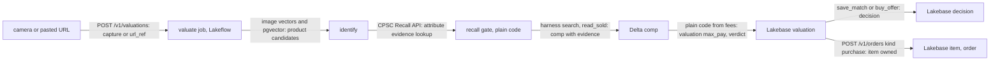

# Appraise
Status: draft, second pass. Every design line is an *agent proposal* except where a line links a decision. Slug: appraise. Written 2026-11-14.

At a garage sale, on a Facebook listing, holding a card, or looking at a box of their own things, a person today guesses or scrolls sold listings while the seller waits. Appraise answers in seconds with the most to pay, what the thing is worth on each site after its flaws, whether it is recalled, cheaper equal options, the one check that settles the price, and, for a thing they own, whether to sell, trade in or donate it. It is the [price](price.md) engine pointed at a thing with no item yet: a `valuation` keyed by a capture or a URL ([decision](../../product/decisions.md#2026-11-14-selling-comes-first-buying-is-a-full-side)). Ben: "Appraise anything" ([words](../../product/words.md#2026-11-14-pavlo-and-appraise)). Nate: "negoitate at a garage sale, or check pokemon card investments... similar in quality... at lower prices" ([words](../../product/words.md#2026-11-14-nate-store-and-buying)). Feature page: [features/appraise](../../features/appraise/README.md).

## What the person does and sees

| Step | Where | What they see |
|---|---|---|
| 1 | Buy search camera or pasted link, or ＋ "What's it worth" ([decision](../../product/decisions.md#2026-11-14-the-buy-tab-mirrors-sell-with-shelves), [bar](../../product/decisions.md#2026-11-14-the-bottom-bar-is-today--sell----buy--you)) | Camera opens; a link fills in the listing's photos and price |
| 2 | Valuation card | **Glance**, within 2 s, from the on-phone comp index: what it is and a rough range, labelled "rough" |
| 3 | Same card | **Recall check** before any verdict: nothing shown when clear; "Recalled: do not buy or sell" with the notice when matched |
| 4 | Same card | **Check**, within 10 s: verdict (Buy, Offer, Skip, Unsure), "Pay up to $40", "Offer $30", range per site after flaws |
| 5 | Same card | One check: "Check the zipper works" or "Photo of the tag". Answering moves the numbers |
| 6 | Haggle pad | Type the seller's price; verdict and profit update at once, offline |
| 7 | Card sections | Cheaper equivalents with a match label each, price history |
| 8 | "Your options" (a thing they own) | Sell, trade in, donate side by side: what they get, how long, effort |
| 9 | **Deep**, on tap | the full research job; a Today card says when it lands |
| 10 | "Bought it" | enter what you paid; an `owned` item with cost appears; "Sell this" moves it to capturing ([product](../product.md)) |

Casual is the default framing: "fair price", target profit 0 ([decision](../../product/decisions.md#2026-11-14-the-first-person-we-build-for-is-someone-clearing-their-own-things)). A reseller who sets `user.target_profit_cents` sees profit at the asking price. Batch: several photos in a row rank by profit per minute ([garage-sale](../../research/appraise/ben/garage-sale.md)).

## Design choices

| Choice | Options considered | Picked | Why | What would change it |
|---|---|---|---|---|
| Speed tiers | one slow answer; Glance, Check, Deep ([appraisal-run](../../research/appraise/ben/appraisal-run.md)) | three tiers on one `valuate` job | a seller waiting at a table gives seconds | p95 at a real sale on mobile data |
| Identity at Glance | AI Search text; image vectors; an LLM ([product](../product.md)) | self-managed image vectors plus the on-phone comp index, Haiku 5.5 to name it | AI Search has no image embeddings; the index works offline | top-1 accuracy on our captures |
| Recall gate | none; a warning after the verdict; a gate before it ([autonomous-features](../../research/cross-cutting/nate/autonomous-features.md)) | CPSC Recall API before any Buy or Sell verdict | selling a recalled product is illegal, resale included | a match miss rate that needs a person |
| Most to pay | asking minus a margin; expected net with risks ([appraisal-run](../../research/appraise/ben/appraisal-run.md), [quality-and-value-classifiers](../../research/price/nate/quality-and-value-classifiers.md)) | calibrated probability x value, the qualified-to-price gate | the published objective; an unidentified thing gets no number | resale outcomes against `max_pay` |
| Which check | a fixed list; value of information ([appraisal-run](../../research/appraise/ben/appraisal-run.md)) | the check that moves `max_pay` most, at most 3 | one question beats a form | VOI against fixed order, in a test |
| Sell, trade in, donate | sell only; a comparison ([autonomous-features](../../research/cross-cutting/nate/autonomous-features.md), [user-wants](../../research/cross-cutting/ben/user-wants.md)) | three guarded numbers with hand-off links | 60.1% donated against 21.6% resold (Kijiji 2016); trade-in buyers have no quote API | a trade-in partner API |

## What it reads and writes

| Entity | Reads | Writes |
|---|---|---|
| `capture`, `photo` | shots or link images | a light capture, no item |
| `product`, `comp` | identity candidates, comps (price owns `comp`) | new comps with `evidence` and rights through the `valuate` job |
| `attribute` | | on Bought it, observed facts with `evidence {kind, ref, region?, captured_at, extractor_version}`; a recall match as `lookup` evidence |
| `valuation` | | `capture_id` or `url_ref`; `per_site[]`, `drivers[]`, `max_pay_cents`, `verdict`, `check`, `job_id`; each number a guarded number with `citation_id` |
| `score` | quality and trend axes (`spec/features/score.md`) | financial axis for a `match`, as price defines it |
| `match` | | the source listing and cheaper equivalents, `valuation_id` set |
| `want` | `max_total_cents` | on "Watch for this" |
| `order`, `item` | | Bought it: `POST /v1/orders` kind purchase; `owned` item with `cost` |

## States

| Move | Trigger |
|---|---|
| `valuate` stages `identify`, `find_sales`, `adjust`, `range`, `net`, `plans`, each `started, running, arrived, failed` | Glance arrives after `identify`, Check after `net`, Deep reruns with wider sources |
| verdict `unsure` to `buy`, `offer` or `skip` | the one check answered, or Deep arrives |
| verdict forced `skip` | recall matched |
| `match` `found` to `saved` | `save_match` answered |
| `match` to `offered` | `buy_offer` answered |
| new item `owned` | Bought it, or a `did_you_buy` yes |
| `owned` to `capturing` | Sell this (`POST /v1/items/:id/sell`) |

## Systems underneath

| Piece | Role |
|---|---|
| `POST /v1/valuations` | starts the `valuate` job for a capture or URL |
| On-phone comp index (price owns it) | Glance offline: nearest products and recent sold medians |
| Image vectors, pgvector | identity by look |
| Claude Haiku 5.5 | Glance naming, routing |
| Claude Opus 5.5 | Check reads listing text and flaws; Deep investigates |
| Decisions API and Jev | typed "same model?", "flaw visible?" ([decision](../../product/decisions.md#2026-11-14-typed-judgements-run-on-both-the-decisions-api-and-jev-and-our-labels-pick)) |
| Harness `search`, `read_sold` | read a pasted listing and find equivalents across the set ([decision](../../product/decisions.md#2026-11-14-the-platform-list-is-set)) |
| CPSC Recall REST API | recall lookup by product name, brand and model (US) |
| Plain code | `max_pay`, offer, verdict, net, haggle pad, route comparison |
| MLflow 3 | trace per appraisal, the "why?" timeline |

**Recall gate.** Query brand, model and product name. A fuzzy match at or above a set threshold writes `lookup` evidence with the recall URL and forces `skip`, and capture's `requirement` legal flag makes `post` refuse. Below the threshold but above a lower one, the card shows "Possible recall: check the model number" as the one check. Broken or unstable nursery products are never rated Buy. With the API down the card says "Recall check unavailable", and no Buy verdict is given.

**Most to pay**:
`max_pay = P(identity) x P(condition) x P(authentic) x net(best site, p25) - hassle - risk_margin - target_profit`.
Each P is calibrated on labelled outcomes. Below the qualified-to-price gate (identity not confirmed) the card has no number and shows the check. Following the certainty principle, identity, variant and size are stated as confirmed once settled. Authenticity and working condition stay probabilities that the card words as ranges. `net` and its range come from [price](price.md), with the same calibration and hide states. `max_pay` is hidden whenever the range is.

**Equivalents** are ranked by total cost to the door and labelled Exact verified, Likely same model, Same family different variant, Comparable substitute, or Visually similar unverified ([analytics](../../research/data/nate/analytics-and-recommendations.md)). A referral fee never changes the order. Nate's couch ("a scan shows one on ebay of the same type for less") is this section.

**Your options** (a thing they own, or a Bought it item):

| Route | Number | Time | Hand-off |
|---|---|---|---|
| Sell | net range on the best plan from price | days to sell | Sell this |
| Trade in | best quote among buy-back sites, read at that time, labelled with its age | about 48 h quote lock (*asserted*) | opens the site |
| Donate | fair market value range from sold comps, for the receipt | pickup or drop-off | opens ThredUp Clean Out, Goodwill pickup |

Each is a guarded number. A route with no basis is hidden with its reason, never guessed. Effort is shown as steps, not a score.

**Outgoing words.** A drafted offer message passes a `claim_check`; a hold raises `unbacked_claim`. A `buy_offer` asks every time. A price over `want.max_total_cents` raises `offer_over_ceiling`.

## Data flow

## Contract for the frontend

| Call | Body | Returns |
|---|---|---|
| `POST /v1/valuations` | `{capture_id}` or `{url_ref}` | `202 {job_id}`; stages stream |
| `GET /v1/valuations/:id` | | verdict, `max_pay_cents`, `per_site[]`, `check`, routes, each a guarded number |
| `POST /v1/matches/:id/act` | `{action: save | offer, amount_cents?}` | a `save_match` or `buy_offer` decision; `422 outside_limits` |
| `POST /v1/orders` | `{kind: purchase, valuation_id, cost}` | order and `owned` item |
| `POST /v1/items/:id/sell` | | item `capturing` |

`Idempotency-Key` on every POST. `503 waking` while the warehouse starts; Glance still answers from the phone.

## Who may act

| Action | Who | Tier |
|---|---|---|
| Appraise, recall check, find equivalents | system | auto |
| Save or like on the site | person | `save_match`: ask, promotable, never Poshmark likes |
| Make an offer to a seller | person | `buy_offer`: ask every time |
| Above `max_total_cents` | person | `offer_over_ceiling`: ask |
| Complete a purchase | person, on the site | `complete_purchase`: locked |
| List a recalled product | nobody | `post` refuses |

## How it fails

| Failure | Seen as | Recovery |
|---|---|---|
| No signal at a sale | Glance from the phone index only, "rough" | Check runs on reconnect |
| Identity unsettled | no number, one check | the check, then Deep |
| Recall API down | "Recall check unavailable", no Buy verdict | retry; the person can check the notice link |
| Link site blocks the read | "Could not read this listing" | paste photos instead |
| Too few sales | "Not enough sales to price this" | Deep |

## How we will know it works

| Bar | Source | Test |
|---|---|---|
| Glance p95 under 2 s, Check p95 under 10 s on mobile data | Ben's tiers ([appraisal-run](../../research/appraise/ben/appraisal-run.md)) | timed runs at a real garage sale |
| Range coverage and miss: the same bars as price (at least 70% per category in an 80% range; MdAPE under 28%) | Underpriced AI 75.3% of 81; FlipTip $28 on $100 ([range-calibration](../../research/price/nate/range-calibration.md)) | the price backtest, restricted to appraisals |
| Bought at or under `max_pay` resold at a profit at least 8 times in 10 | *agent proposal* | resale outcomes of Bought it items |
| The one check moves the verdict more often than a fixed order | VOI | split test |
| Recall gate catches every product in a set of known recalled items | CPSA s19 | 50 recalled products from the CPSC list |

## Facts to know

| Fact | Mark | Link | At public launch |
|---|---|---|---|
| CPSC Recall REST API answered with no key on 2026-11-14; matching is fuzzy; US only | *observed* | [autonomous-features](../../research/cross-cutting/nate/autonomous-features.md) | unchanged |
| Selling recalled products is illegal, resale online included (CPSA s19, 15 U.S.C. 2068) | *observed* | same note | unchanged: it protects people |
| Trade-in sites have no public quote API; quotes lock about 48 h; Gazelle affiliate up to 8% | *asserted* | same note | an affiliate deal is disclosed; it never ranks |
| ThredUp Clean Out accepts 60 to 80%, pays in 10 to 14 weeks, $5.99 to reclaim | *asserted* | same note | none |
| Donations over $500 need Form 8283 | *observed* | same note | none |
| 60.1% of people donated and 21.6% resold (Kijiji 2016) | *observed* | [user-wants](../../research/cross-cutting/ben/user-wants.md) | none |
| PriceCharting: internal use on a subscription, no public display | *observed* | [market-intelligence](../../research/data/nate/market-intelligence.md) | its history is not shown to visitors |
| eBay API licence bans AI training on its content | *observed* | [product](../product.md) | eBay comps leave the model or consent is obtained |
| Account risk differs per site | *observed* | [product](../product.md) | shown per site on save and offer |

## Demo path

For Ben and Nate to mark.

1. Photo of a stroller at a table. Glance names it; the recall gate matches, and the card reads "Recalled: do not buy or sell".
2. Photo of a jacket. Check: "Pay up to $40". Type $35 in the haggle pad and Offer turns to Buy.
3. A lamp they own: Your options shows sell $28 to $36, trade in hidden (no buyer), donate $15 to $20.

## Open for Ben and Nate

- Should a recalled item the person owns get a "how to return it to the maker" hand-off from the recall notice?
- Does the donate route show tax value to everyone, or only to those who say they itemise?

## Needs from the shared model

- `valuation.routes[] {route: sell | trade_in | donate, value, time, link}` as guarded numbers.
- `GET /v1/valuations/:id` in the endpoint list.
- `unbacked_claim` in the decision kinds.
