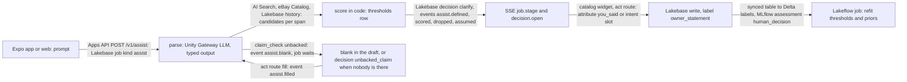

# Assist

Status: draft, *agent proposal* except where a line links a decision. Slug: assist. Written 2026-11-14.

The hassle: an assistant that answers a vague prompt with a question makes the person stop, read and type again, and a form with every field up front leaves most of it unused. Nate's brief is that the assistant "doesnt output questions you have to respond to", that the unclear words in the prompt are highlighted, and that a tap opens "the widget ... below their focused input that remains on screen, with preselected options, as well as an input box that appears when they seelect other, similar to how claude code does it" ([words](../../product/words.md#2026-11-14-nate-the-assistant-asks-through-inputs-not-questions); also [words](../../product/words.md#2026-11-14-nate-documentation-shows-how-we-price-and-market-and-inputs-generated-from-the-prompt)).

Assist owns the asking: how a prompt, a spoken note or a capture gap becomes highlighted spans and generated inputs, and how an answer comes back. It does not own what is searched, valued or compared: Buy ([buy.md](buy.md)), Market ([market.md](market.md)), Watch ([watch.md](watch.md)), Identify ([identify.md](identify.md)) and Capture ([capture.md](capture.md)) own their results. It is the one way any feature asks the person anything: capture's requirement fill, Identify's candidates and the fields ladder in [fields-by-kind](../determinations/fields-by-kind.md) all raise `clarify` spans here, and no feature has a question flow of its own. Which capture question comes next stays with [card 17](../determinations/seeing-the-item.md#17-which-question-to-ask-next-and-when-to-stop). Every method is a card in [asking-and-intent.md](../determinations/asking-and-intent.md).

The pattern is Bruce Liu's intra-turn interaction, read in [packet 41](../../.agents/team/packets/today/41-intra-turn-ui-for-nate.md) from his posts ([video](https://x.com/liu_xingyu/status/2121015724374397183), [diagram](https://x.com/liu_xingyu/status/2121015726802960637), [demo and thesis links](https://x.com/liu_xingyu/status/2121015728623231448)), the 152 replies, the silent video frame by frame and the demo site's CSS, JS and recorded replays; no live model was run and the thesis was not read ([limits](../../.agents/team/packets/today/41-intra-turn-ui-for-nate.md#limits)). **Feedforward** marks the words the AI guessed from while the person types, and each guess can be changed before send. **Leaving Blanks** stops the AI's own text at a fact only the person knows and goes on in the same message once it is filled (observed in the packet, [short version](../../.agents/team/packets/today/41-intra-turn-ui-for-nate.md#the-short-version)). This design takes both, with the changes below marked *agent proposal*.

## What the person does and sees

| Surface | Where | What it reads a prompt against |
|---|---|---|
| Ask sheet | Sell, the shop section chat ([generative-ui](../../research/today/ben/generative-ui.md#approval-flow-end-to-end)) | the person's items, sites, orders, time windows |
| Buy search | the Buy tab search box and its chat | products, variants, sizes, the purpose slots |
| Market chat and research | product pages, the market search, and research and price prompts | products, categories, regions, periods |
| Capture | spoken and typed notes in a capture, and the gaps the registry still needs | the `requirement` rows for the item kind |
| Listing draft | the draft [list](list.md) writes after capture | the item's attributes, sold comps and sites: guesses are marks on the draft's words, seller-only facts are blanks |
| Messages | a reply [messages](messages.md) drafts | the item's attributes and the pickup windows: a fact no attribute backs is a blank, never a claim |
| Visitor | Buy and Market search without an account | the same as Buy, nothing saved |

| Step | The person | They see |
|---|---|---|
| 1 | types or says "north face puffer for my son, under 100" | results start at once on the best reading; nothing waits |
| 2 | | "north face puffer" and "my son" are highlighted; "under 100" is plain because it was read with certainty |
| 3 | does nothing | the results stand on "Nuptse 700, kids' sizes". The span keeps a light mark, and an assumption chip under the input says "Kids' sizes" with Undo |
| 4 | taps "my son" | a size picker opens under the input, which stays on screen and keeps the keyboard's place. "Boys' 10 to 12" is preselected from his last purchase. An Other row opens a text box |
| 5 | picks "Boys' 14 to 16" | the span becomes a settled chip in the prompt, the picker leaves, and the results update in place |
| 6 | types "for skiing" | a new span starts; spans already settled stay settled |

### Two modes, and which applies

| Mode | For | Looks | Preselected | Card |
|---|---|---|---|---|
| Guess (Feedforward) | a fact some source can observe or infer: a photo, a tag, a lookup, sold comps, history, the prompt | a dotted underline on the person's own words, which are never rewritten | yes, when card 7's margin is met | [card 20](../determinations/asking-and-intent.md#20-whether-a-fact-is-a-guess-or-a-blank) |
| Blank (Leaving Blanks) | a fact only the person knows: a flaw the photos miss, a smoke-free home, an original receipt, pickup hours outside the windows | a grey placeholder with a thin solid underline that pulses slowly, inside the system's own text, which stops there | never; a model's value for a blank is discarded and logged | card 20 |

The rule: a fact is a blank when no source can observe it (its `requirement` row says `asked`, or `claim_check` would mark the sentence `unbacked`); otherwise it is a guess. A blank is never written as a claim, so it is the asking side of `claim_check` ([product.md §3](../product.md#3-the-data-model)) and of "never invent a fact". A buyer's search never stops at a blank; an empty purpose slot is left empty ([card 10](../determinations/asking-and-intent.md#10-the-buyers-purpose-slots-and-what-is-inferred-before-asking)).

The listing draft after capture, both modes at once (the packet's own [proposal](../../.agents/team/packets/today/41-intra-turn-ui-for-nate.md#where-this-could-touch-secondhand-agent-proposal-not-decided)):

| Step | The person | They see |
|---|---|---|
| 1 | finishes a capture | the draft: "Patagonia Better Sweater, men's M, very good, $48 on eBay and Poshmark". Brand, size, condition, category, price and sites are dotted marks |
| 2 | taps "$48" | a price slider over the sold comps, each sale a dot, the you-keep figure moving live; nothing changes until they let go |
| 3 | taps "very good" | the condition scale, with the photo regions behind the grade |
| 4 | reads on | the draft stops at "From a ___ home." and "Bought ___." with a count of blanks left; nothing is filled in for them |
| 5 | fills "smoke-free", taps Leave it out on the second | the draft goes on in place; the sentence left out is cut, not guessed |
| 6 | changes the price later | the text after the price's first use goes grey while it is rewritten; nothing before it moves |

Rules that hold on every surface:

- No question is ever a message the person must answer. A span never blocks the result, the send button or another span; a blank stops only the system's own text, never the person's.
- A span is highlighted only when its answer would change a value, the match set or the price ([card 3](../determinations/asking-and-intent.md#3-whether-resolving-a-span-would-change-anything)). Nothing is asked when photos, a tag, history or a lookup settle it, or when the gap is ours ([identify](identify.md#when-it-asks-and-when-it-must-not)).
- Mark states are told apart by mark, never by a number: pending (the dots march while the model still scores the word), guessed (dotted, not yet seen), kept (dotted, seen and kept), changed (solid grey), said (no mark: their own words say it), dropped (the dots fade: the system took its guess back), and for blanks open, filled and stale. A colour decision tints its underline in the colour (observed in the packet). What each teaches is in [States](#states).
- Every picker ends with "Something else" (Nate's "other"), which turns into a text field; the typed value becomes a new selected chip and a user-authored option (observed in the packet, [things all three share](../../.agents/team/packets/today/41-intra-turn-ui-for-nate.md#things-all-three-share)). Yes or no pickers get it too, next to "Not sure".
- Touch: a phone has no hover. A tap opens the picker and pins it; the hit area around a marked word is at least 44 pt (48 dp on Android) even when the word is shorter, and two marks close together split the gap between them. A long press shows why the mark is there. On the web with a pointer, resting 110 ms opens and a click pins, as in the demo (observed in the packet).
- One widget is open at a time, anchored under the focused input and pointing at its word. It closes on an answer, on a tap outside, or when its span leaves. The input never moves off screen.
- A guess tied to no word (a goal, a focus, a context) sits in the interpretation line above the input; when the result arrives, the decision list above it shows one line per decision, unseen defaults first, each opening its picker ([card 22](../determinations/asking-and-intent.md#22-decisions-tied-to-no-word-and-the-decision-list)).
- The person can mark a word the system missed: long press or select it and tap Ask about this, or type it in `[[ ]]` (a reply's idea, packet). The word gets a mark whatever card 1 says.
- A filled value is reused later in the same text with the same underline. Reopening a filled value or a mark previews live and commits on release; the text after its first use is marked stale and rewritten ([card 23](../determinations/asking-and-intent.md#23-when-a-filled-value-is-reused-reopened-or-goes-stale)).
- Four or more open blanks in one text, or blanks raised while nobody was there, become one short form instead of a picker each ([card 24](../determinations/asking-and-intent.md#24-when-one-form-beats-a-picker-per-blank)). A blank with nobody there becomes a Today card with the action's deadline, and at the deadline the action goes ahead without the claim or not at all ([card 25](../determinations/asking-and-intent.md#25-what-a-blank-does-when-nobody-is-there)).
- The full action set ([UI constitution, Article 6](../../product/ui-constitution.md#article-6-complete-not-minimal-and-nothing-extra)): the preselected option as the primary action, other options, Something else, and the escape, named; a blank's escape is Leave it out. Ignoring a guess keeps the assumption; ignoring a blank keeps the text stopped there.
- An input leaves when it is no longer needed: answered, superseded by a later prompt, settled by new evidence, or past the stop rule ([card 9](../determinations/asking-and-intent.md#9-when-inputs-leave-and-when-to-stop)). No control is left on screen unused.
- Words follow [copy.md](../../product/copy.md) and pass `node scripts/copy-lint.mjs`.

## Design choices

| Choice | Options considered | Picked | Why | What would change it |
|---|---|---|---|---|
| How the assistant asks | a question message; highlighted spans with an anchored widget ([Nate](../../product/words.md#2026-11-14-nate-the-assistant-asks-through-inputs-not-questions)); an up-front form ([buyer-intent §2](../../research/watch/nate/buyer-intent-and-official-alternatives.md#2-how-do-products-decide-what-to-ask-and-when-to-stop)) | highlighted spans | Nate's words; Google's retail guide keeps "the single free-text input bar ... active at all times" while filters show below it (observed, [guide](https://docs.cloud.google.com/retail/conversational_search_backup/conversational-commerce-ux-guide)) | a test against the pattern's behaviour in [packet 41](../../.agents/team/packets/today/41-intra-turn-ui-for-nate.md#the-short-version): share of misreadings fixed before send against after, and turns per finished task, with a chips-below-the-input arm; marks lose if they fix fewer before send or cost more turns |
| What happens to an ignored span | block; drop the constraint; proceed on the best reading with an undoable assumption | assume and show it | no blocking; acting for a person without a preview lowered trust, while a preview with a reason helped (asserted, [buy-side §4](../../research/watch/nate/buy-side-products-and-search-experience.md#4-generated-shopping-interfaces-2025-to-2026)) | undo rate on assumptions above the bar below |
| Who decides whether to ask | the model; arithmetic over the candidates | arithmetic; the model parses and writes words only | on coding tasks, asking clarifying questions raised pass rate from 27% to 65% (arXiv 2504.16331; not tested on listings, [claims validated](../../research/cross-cutting/nate/claims-validated-papers-and-docs.md)), and models clarify 3 times less often than they should (asserted, [clarifying-inputs §8](../../research/identify/nate/clarifying-inputs.md#8-design-all-inferred)) | a model-chosen arm reaching the same accuracy with fewer spans |
| One asking mechanism or many | a kind per surface; AI SDK `needsApproval`; the `clarify` decision widened | `clarify`, with a span payload | one act route, one signature, one label path for Sell, Buy, Market and capture; `needsApproval` is yes or no only ([generative-ui](../../research/today/ben/generative-ui.md#approval-flow-end-to-end)) | Ben's catalog needs a frame per surface |
| How a widget is rendered | free generated UI; A2UI; Ben's json-render catalog | the catalog, with entries 54 to 67 proposed below | unknown components render nothing, and `catalog.validate` runs on the server ([generative-ui](../../research/today/ben/generative-ui.md#how-a-screen-is-put-together)); json-render has no radio or chip input today (observed in the note, [clarifying-inputs §6](../../research/identify/nate/clarifying-inputs.md#6-typed-generative-ui-catalogues)) | Ben picks A2UI's ChoicePicker and Slider instead |
| Where a buyer's purpose lives | fields on `want`; a new `intent` | `intent`, which a saved `want` keeps | a search and a visitor have purpose before any want exists; prior queries beat population demand for size (F1 0.853) and gender (0.726 against 0.330) (observed, [arXiv 2607.01530](https://arxiv.org/abs/2607.01530)) | Watch owning purpose on `want` alone |
| How a span is found | one LLM pass; mention detection then linking to the catalog | two stages: an LLM with a typed output marks mentions, AI Search and the eBay Catalog link them | the two-stage pattern is how brand linking is done on short queries; brand queries average three to four words (asserted, [arXiv 2502.01555](https://arxiv.org/abs/2502.01555)) | link accuracy under the bar below |
| Guess or leave a blank | guess everything; ask everything; the packet's two modes, Feedforward and Leaving Blanks | both, split by whether a source can observe the fact ([card 20](../determinations/asking-and-intent.md#20-whether-a-fact-is-a-guess-or-a-blank)) | a blank is how "never invent a fact" asks instead of claiming; the packet's thesis line: "The hard design question becomes which uncertainty can safely remain a blank" (observed, [packet 41](../../.agents/team/packets/today/41-intra-turn-ui-for-nate.md#ui-3-leaving-blanks-on-a-birthday-dinner-video-38-to-58-s)) | blanks filled with a different fact than the guess would have been under 5%, which would say a guess was safe |
| How a mark opens | hover only, as the demo; tap; long press | tap opens and pins on touch, 110 ms hover on web | a phone has no hover (inferred); repliers said small hover targets and lots of clicking may not suit every user, and the author's answer confirms the demo opens on hover (observed, [post](https://x.com/liu_xingyu/status/2121086404793098601), [pushback](../../.agents/team/packets/today/41-intra-turn-ui-for-nate.md#what-people-pushed-back-on-from-the-152-replies)) | mis-taps on marks over 3% of taps |
| A picker per blank or one form | inline pickers; a form ([reply](https://x.com/YousieGoosie/status/2121083479710716395)) | inline under 4 open blanks, one form at 4 or more and for blanks raised overnight ([card 24](../determinations/asking-and-intent.md#24-when-one-form-beats-a-picker-per-blank)) | inline keeps a fact next to the sentence it changes; a form is quicker when many independent facts are missing at once | time to fill per blank, form against inline |
| A blank when nobody is there | wait; invent; drop the sentence; ask on Today | the existing `unbacked_claim` decision with the action's deadline; at the deadline the action goes ahead without the claim, or not at all if the claim is required ([card 25](../determinations/asking-and-intent.md#25-what-a-blank-does-when-nobody-is-there)) | reuses the kind `claim_check` already raises ([product.md §3](../product.md#3-the-data-model)), and never invents | sales lost to a claim left out over the bar in card 25 |

## What it reads and writes

| Entity | Reads | Writes |
|---|---|---|
| `decision` kind `clarify` | | one per open span, with the span payload below |
| `attribute` | value, confidence, source, unknown_reason | `you_said` from an answer (Sell, capture); never overwrites a `you_said` |
| `intent` (new) | | the purpose slots, each a provenance value ([card 10](../determinations/asking-and-intent.md#10-the-buyers-purpose-slots-and-what-is-inferred-before-asking)) |
| `want` | text, fit | gains `intent_id` when saved from a search |
| `requirement` | field, obtained_by, priority | nothing; a capture span carries `requirement_id` |
| `label` | | `owner_statement` per answer; `verified_correction` per undo of an assumption |
| `thresholds` | `assist_span_open`, `assist_preselect_margin`, `assist_value_floor` | refit proposals |
| `item`, `order`, `follow`, history | for inference before asking | |
| `decision` kind `unbacked_claim` | its `deadline` | one per blank left open when nobody is there ([card 25](../determinations/asking-and-intent.md#25-what-a-blank-does-when-nobody-is-there)) |
| `claim_check` | which sentences of a draft are unbacked | nothing; an unbacked sentence becomes a blank instead of a claim |
| `event` | | `assist.parsed`, `assist.assumed`, `assist.answered`, `assist.left`, and from packet 41's operations `assist.defined`, `assist.scored`, `assist.dropped`, `assist.blank`, `assist.filled`, `assist.stale` (new) |

Every written value carries `evidence` (`owner` for an answer or a fill, `lookup` or `image_region` for an inference). Each `owner_statement` label carries the mark state it came from, and its weight is by that state ([card 21](../determinations/asking-and-intent.md#21-what-each-mark-state-teaches)): a default the person saw and kept is never stored as a value they chose.

## States

`clarify` uses the decision states ([product.md §4](../product.md#4-states)). Inside `open`, the mark moves (the packet's mark set, extended, *agent proposal*):

| From | To | Trigger |
|---|---|---|
| (none) | pending | `assist.defined`: the parse marks the word while it is still scored ([card 1](../determinations/asking-and-intent.md#1-whether-a-span-is-unresolved)) |
| pending | guessed | `assist.scored` over the threshold, with a preselection or none (card 7) |
| pending or guessed | dropped | `assist.dropped`: new words or evidence settle it; the dots fade |
| guessed | kept | seen and left: opened and closed without a change, or in view 1.5 s with typing paused, or shown in the decision list (`assist.assumed`, undoable) |
| guessed or kept | changed | an act with another option or Something else (decision `answered`) |
| (none) | said | the person's own words settle it; no mark is drawn |
| (none) | blank | `assist.blank`: an only-you fact ([card 20](../determinations/asking-and-intent.md#20-whether-a-fact-is-a-guess-or-a-blank)) |
| blank | filled | `assist.filled`: the person fills it, written `you_said` with `owner` evidence |
| filled or changed | stale | `assist.stale`: the value is reopened; the text after its first use is rewritten, then the mark returns to filled or changed |
| any | left | the prompt is rewritten past the span, Leave it out on a blank, or the stop rule ([card 9](../determinations/asking-and-intent.md#9-when-inputs-leave-and-when-to-stop)); decision `superseded` or `expired` |

The earlier three states map onto marks: open is pending, a blank, or guessed with no preselection; assumed is guessed or kept; settled is changed, said or filled. What each teaches, and which counts for earned autonomy, is [card 21](../determinations/asking-and-intent.md#21-what-each-mark-state-teaches).

## Data flow



## Systems underneath

| Piece | Job here |
|---|---|
| Apps API | `/v1/assist`, the policy check, the act route |
| Unity Gateway | the parse model (an LLM with a zod-typed output, streamed as typed operations define, score, signal and drop, and `<blank>` records inside drafted text, as the demo's model does, inferred from [packet 41](../../.agents/team/packets/today/41-intra-turn-ui-for-nate.md#how-it-works-underneath-from-the-demo-sites-code)), the words of a span label; one regeneration through copy-lint, then the template ([generative-ui](../../research/today/ben/generative-ui.md#edge-cases)) |
| OpenAI Decisions API | typed fixed-option judgements on capture photos, run beside the gateway model with labels picking ([openai-decisions-api](../../research/identify/ben/openai-decisions-api.md#recommended-question-set-one-call-per-stage)) |
| AI Search, eBay Catalog `ASPECT_REFINEMENTS` | product candidates and how each aspect splits them |
| Lakebase | spans, decisions, intent, history reads |
| MLflow 3 | a trace per assist job; the `human_decision` assessment on each answer |
| Lakeflow job | weekly refit of the thresholds and the slot priors, a new `thresholds` version for a person to approve |
| Expo native module | the drag grid and the region picker, like `MeasureOverlay`; on native, marks drawn over the text input the same way (inferred) |
| Web editor | marks as ProseMirror marks keyed like `ph:kids:0`, as the demo builds them on TipTap (observed in packet 41) |

## Contract for the frontend

Conventions are [product.md §7](../product.md#7-contract-conventions).

| Endpoint | Does |
|---|---|
| `POST /v1/assist {surface, text, item_id?, want_id?, capture_id?, context_ref?}` (new) | starts a job kind `assist`; returns `202 {id, kind, state, stages[]}` |
| `POST /v1/search` | as today, plus `assist_job_id` in its reply, so Buy's results and spans arrive together |
| `GET /v1/jobs/:id/events`, `GET /v1/jobs/:id` | stages `parsed` (span offsets, all states), `linked` (options per span), `proposed` (`clarify` decisions open, assumptions applied); each stage carries the real counts in its `found{}` payload ([product.md §7](../product.md#7-contract-conventions)), here candidates linked per span from AI Search and the eBay Catalog, counted from `route_call` records; poll every 2 s when SSE fails |
| `GET /v1/stream` | `decision.open`, `decision.close` for each span |
| `POST /v1/decisions/:id/act {option_id, signature, version, edit?}` | an answer. Other sends `option_id: "other"` with `edit {text}`; a typed override sends `edit {value, unit}`. The server reparses the edit and stores it as a user-authored option. Returns `{decision, event_id, job?}`; the job reruns the caller's search or valuation |
| `POST /v1/events/:id/undo` | undoes an assumption; the span goes back to open |
| `PATCH /v1/items/:id/attributes/:name` | a correction typed on the item card, as Identify |

The span payload on a `clarify` decision (new fields, *agent proposal*):

```
span: {id, key, start, end, text, surface,
       mode: guess|blank,
       mark: pending|guessed|kept|changed|said|dropped|blank|filled|stale|left,
       kind: word|goal|focus|context|voice,
       why: scaffolding|disambiguation|interpretation|association|reference,
       template,            (e.g. "Size {}."; the decision list line, copy-linted)
       scope: message|conversation,
       fact_type, slot? | requirement_id?, assumption_event_id?,
       seen_at?, opened, dwell_ms}
widget: catalog entry name; widget_props: validated by the catalog schema
options[]: {id, label, signature, image_url?, evidence[]}   (existing, extended)
suggested: option_id or null   (the preselection; card 7; always null when mode is blank)
allow_other: true   (every picker ends with Something else)
wait: true when mode is blank and the text stops there
```

Each option keeps Ben's HMAC over `["sh-decision-v1", decisionId, optionId, action, sha256(input), item_version]`; for a visitor `item_version` is the search's version and `decisionId` the span id. A visitor's spans ride on the search reply and are never stored as decisions; the answer goes in the next `POST /v1/search` as `answers[] {span_id, option_id, signature, edit?}`.

### Widget vocabulary

| Fact type | Widget (catalog) | Preselected when ([card 7](../determinations/asking-and-intent.md#7-which-option-is-preselected-and-when-none-is)) | Other path |
|---|---|---|---|
| one of a few named (2 to 5) | `ChoiceChips` (Ben's, from the [capture plan](../../research/capture/ben/build-plan.md), numbered 54 here), 44 pt targets | top option leads the next by the margin | text box, reparsed |
| one of many | `OptionList` (55) with search | as above, top 5 shown, the rest by typing | the list's own search box |
| yes or no | `YesNo` (56) | prior over 0.8 for one side | none; "Not sure" is the escape |
| number with unit | `NumberWithUnit` (57), unit toggle | the inferred value | typed value |
| range (budget) | `RangeSlider` (58), two thumbs, money | inferred range from history or the prompt | typed low and high |
| two dimensions | `DimensionGrid` (59), drag height by width, snaps to the unit, typed override | the inferred size, outlined | typed values |
| size in a size system | `SizePicker` (60): system, then size | from purchases and `fit` | typed size and system |
| colour | `ColourSwatches` (61), with names | the colour read from the photo | typed name |
| place | `PlacePicker` (62), saved places first; `MeetupPlace` (28) for pickups | the saved spot | typed place |
| date | `DatePicker` (63) with "Any time" | none unless the prompt names one | typed date |
| product candidate with photos | `IdentityCandidates` (45), "None of these" | identity's lead rule ([card 9](../determinations/seeing-the-item.md#9-which-product-it-is-and-when-identity-is-confirmed)) | text, then a new search |
| region of a photo | `RegionYesNo` (64) over `FlawPins` (42) | none | a pin the person places |
| condition | `ConditionPicker` (46), shown as a scale from new to for parts, the photo regions behind the grade | the inferred grade | Something else |
| several of a set (sites, compatibility) | `MultiChips` (68), multi-select, as the packet's single or multi | the sites the item suits, from [list](list.md) | Something else |
| price | `PriceSlider` (74): sold comps as dots on the track, you-keep after fees shown live, commits on release | the comps' suggested price | typed price |
| region on a map | `GeneratedMap` (69), regions drawn from latitude and longitude, as the demo's map (observed in packet 41); extends `PlacePicker` (62) | the saved area | typed place |
| a look to match | `ReferenceThumbs` (70), image thumbnails; picking one attaches it as a reference | none | an uploaded photo |
| typeface or layout (shop page, studio) | `TypefacePreview` (71), `LayoutPreview` (72), each option drawn as itself | the current one | Something else |
| tone of a reply | `VoicePad` (73), a 2D pad (polite to firm by short to detailed) with a live sample line, as the demo's pad | the person's usual tone from sent replies | typed sample |
| an only-you fact | `InlineBlank` (77), a grey placeholder in the drafted text, opening the matching widget above with nothing preselected | never | Something else and Leave it out |
| free text | `FreeText` (65), last resort | none | it is the text box |

Every widget above ends with Something else, except where it is the text box itself. A product word expands into `IdentityCandidates` cards, the reply's idea of turning a word into cards ([cards](https://x.com/bysaudrahman/status/2121149156194755047), which the author liked, observed in the packet). Also proposed: `PromptSpans` (66, the prompt with marked spans, rendered inside the input; a native component like `MeasureOverlay` (43)), `AssumptionChip` (67, the assumption with Undo, as `ActionLogRow` (33) does), `InterpretationLine` (75, chips above the input for decisions tied to no word) and `DecisionList` (76, the lines above a result, each row an `AssumptionChip`). The drag grid (59), sliders (58, 74), swatches (61), thumbnails (70), typeface and layout previews (71, 72), the map (69) and the 2D pad (73) together cover the packet's control set. Rows 54 to 77 are a proposal for Ben's catalog, which runs 1 to 40 in [generative-ui](../../research/today/ben/generative-ui.md#the-component-registry-agent-proposal) and 41 to 53 in the [build plan](../../research/cross-cutting/ben/build-plan-posting-messages-ui.md); Stack and Section stay the only layout atoms.

## Who may act

`clarify` is `ask`, not promotable ([product.md §5](../product.md#5-who-may-act)). Assist sends nothing outward and never acts for the person on a site. An assumption changes only the person's own result and is undoable. The model has read tools and `propose_clarify` only; `policy()` runs at proposal and at act. A visitor can answer spans for a search and open product pages; saving an answer to an intent shows "Sign up to save this".

## How it fails

| Failure | The person sees | Recovery |
|---|---|---|
| The parse times out | results on the plain text, no highlights | the job retries once; spans arrive late or not at all |
| A span links to nothing | no highlight | the words are searched as typed |
| Stale signature (over 15 min) or `409 stale` | the widget refreshes its options | reissued decision |
| An Other text does not parse | the text is kept as a free constraint and searched as typed | a `label` for the parser's eval set |
| SSE drops through the Apps proxy | spans appear on the 2 s poll | polling always works |
| A generated label fails copy-lint twice | the template label | logged |
| The model writes a value into a blank | the blank, empty | the value is discarded and logged as a parser error |
| A suggestion misses what the person meant | Something else on every picker | the typed value is stored as a user-authored option and a `label` for the parser |

## How we will know it works

| Claim | Check | Bar (target) |
|---|---|---|
| Spans cut retyping | reformulations per search session in the logs | under Baymard's average of 2.2 iterations (asserted, [buy-side §5](../../research/watch/nate/buy-side-products-and-search-experience.md#5-search-experience-research-for-product-search)) |
| Only useful spans | share of answered spans whose answer changed the result | 80% or more (starting value, *agent proposal*) |
| Preselection is right | share of spans left assumed or answered with the preselection, among non-fast taps | 85%, set by IntentTune's size F1 of 0.853 (observed, [arXiv 2607.01530](https://arxiv.org/abs/2607.01530)) |
| Assumptions are trusted | undo rate per assumption | under 10% (starting value) |
| No blocking | sessions where results waited on a span | 0 |
| Fast | prompt sent to first highlight | 1.5 s at p95 on 100 prompts from the labelled set (starting value; Google shows filters "as users type", observed, [guide](https://docs.cloud.google.com/retail/conversational_search_backup/conversational-commerce-ux-guide)) |
| Marks catch misreadings before send | share of misreadings fixed on a mark before send, of all fixed before or after | 70% or more (starting value) |
| Fewer turns than chips | first, 20 people with 20 prompts each from the labelled set: Other rate and time to answer, marks against chips below the input ([scorecard](../assessment.md#might-work-needs-direction-13)); then follow-up turns per finished task in the logs | first, marks no worse than chips by more than 20%; then fewer turns, at 95% confidence |
| Blanks never invent | drafts sent with a claim no attribute or fill backs | 0 |
| Autonomy rests on seen marks | "Always do this" offers whose 3 approvals had every money and claim mark opened or changed | 100% |
| A guess does not bend the answer | gap in pick rate between preselected and the no-preselection arm on the same fact ([card 21](../determinations/asking-and-intent.md#21-what-each-mark-state-teaches)) | under 5 points |
| Overnight blanks get filled | `unbacked_claim` decisions from a blank answered before their deadline | 60% or more (starting value) |

## Facts to know

- LLMs clarify 3 times less often than needed (arXiv 2503.13975) (asserted, [clarifying-inputs §8](../../research/identify/nate/clarifying-inputs.md#8-design-all-inferred)).
- Claude Code's question tool adds an Other free-text choice on its own (asserted from public issue pages).
- Inline marks with anchored pickers, and blanks the person fills, are built and working in Liu's demo (observed in [packet 41](../../.agents/team/packets/today/41-intra-turn-ui-for-nate.md#the-original-posts), from its recorded examples and code; no live model was run, [limits](../../.agents/team/packets/today/41-intra-turn-ui-for-nate.md#limits)). No e-commerce search box doing it was found; one patent describes it (inferred from search). The bar is therefore the pattern's behaviour, not marks against chips in the abstract.
- Touch targets: 44 pt iOS, 48 dp Android, 24 px web (asserted, [clarifying-inputs §8.1](../../research/identify/nate/clarifying-inputs.md#81-input-catalogue)).
- An FTC disclosure applies wherever a result carries a referral (asserted, [buy-side §6](../../research/watch/nate/buy-side-products-and-search-experience.md#6-referral-and-affiliate-programmes)).
- Prompt text is logged masked through [log/](../../log/README.md), like message text.

## Demo path

For Ben and Nate to mark.

## Open for Ben and Nate

| Question | Recommendation | What depends on it |
|---|---|---|
| B9 in [open-questions](../open-questions.md#for-ben): which catalog entries does Ben take first? | chips, range slider, colour swatches, product candidates and the dimension grid | the clarifying-questions page |
| B11: are the stage counts shown, where, and animated how? | beside the answer as it fills in, never blocking it | every surface below |
| May `clarify` widen from Identify to every surface? | yes, one mechanism | product.md §5 |
| Does Ben take catalog rows 54 to 77, or A2UI's pickers? | the catalog | the frontend build |
| Is the guess-or-blank rule "can a source observe it" ([card 20](../determinations/asking-and-intent.md#20-whether-a-fact-is-a-guess-or-a-blank))? | yes | list, messages, claim_check |
| Does a blank with nobody there become `unbacked_claim` with the action's deadline, going ahead without the claim at the deadline? | yes | today, list, messages |
| Does a visitor's purpose stay with the visitor session, counts only? | yes | the edge |

## Needs from the shared model

- `clarify`: owner identify and assist, replaces `clarifying_question` (unchanged); the span payload fields above on `decision`.
- Job kind `assist`, stages `parsed`, `linked`, `proposed`.
- Entity `intent`, prefix `in_`: owner_ref (user or visitor), surface, job_id, want_id?, slots {use, for_whom, budget, size, compatibility[], deadline, condition_tolerance}, each a provenance value.
- `want.intent_id`.
- `POST /v1/assist`; `assist_job_id` on `POST /v1/search`; `answers[]` on `POST /v1/search` for visitors.
- Events `assist.parsed`, `assist.assumed`, `assist.answered`, `assist.left`, `assist.defined`, `assist.scored`, `assist.dropped`, `assist.blank`, `assist.filled`, `assist.stale` in events.json.
- `unbacked_claim` raised from a blank, with the action's deadline, and its expiry going ahead without the claim when the action is otherwise automatic.
- Promotion to "Always do this" counts an approval as unedited only when every money and claim mark on it was opened or changed ([card 21](../determinations/asking-and-intent.md#21-what-each-mark-state-teaches)).
- Catalog rows 68 to 77.
- Thresholds `assist_span_open`, `assist_preselect_margin`, `assist_value_floor`.
