# Assist

Status: draft, *agent proposal* except where a line links a decision. Slug: assist. Written 2026-11-14.

The hassle: an assistant that answers a vague prompt with a question makes the person stop, read and type again, and a form with every field up front leaves most of it unused. Nate's brief is that the assistant "doesnt output questions you have to respond to", that the unclear words in the prompt are highlighted, and that a tap opens "the widget ... below their focused input that remains on screen, with preselected options, as well as an input box that appears when they seelect other, similar to how claude code does it" ([words](../../product/words.md#2026-11-14-nate-the-assistant-asks-through-inputs-not-questions); also [words](../../product/words.md#2026-11-14-nate-documentation-shows-how-we-price-and-market-and-inputs-generated-from-the-prompt)).

Assist owns the asking: how a prompt, a spoken note or a capture gap becomes highlighted spans and generated inputs, and how an answer comes back. It does not own what is searched, valued or compared: Buy ([buy.md](buy.md)), Market ([market.md](market.md)), Watch ([watch.md](watch.md)), Identify ([identify.md](identify.md)) and Capture ([capture.md](capture.md)) own their results. Which capture question comes next stays with [card 17](../determinations/seeing-the-item.md#17-which-question-to-ask-next-and-when-to-stop). Every method is a card in [asking-and-intent.md](../determinations/asking-and-intent.md).

## What the person does and sees

| Surface | Where | What it reads a prompt against |
|---|---|---|
| Ask sheet | Sell, the shop section chat ([generative-ui](../../research/today/ben/generative-ui.md#approval-flow-end-to-end)) | the person's items, sites, orders, time windows |
| Buy search | the Buy tab search box and its chat | products, variants, sizes, the purpose slots |
| Market chat | product pages and the market search | products, categories, regions, periods |
| Capture | spoken and typed notes in a capture, and the gaps the registry still needs | the `requirement` rows for the item kind |
| Visitor | Buy and Market search without an account | the same as Buy, nothing saved |

| Step | The person | They see |
|---|---|---|
| 1 | types or says "north face puffer for my son, under 100" | results start at once on the best reading; nothing waits |
| 2 | | "north face puffer" and "my son" are highlighted; "under 100" is plain because it was read with certainty |
| 3 | does nothing | the results stand on "Nuptse 700, kids' sizes". The span keeps a light mark, and an assumption chip under the input says "Kids' sizes" with Undo |
| 4 | taps "my son" | a size picker opens under the input, which stays on screen and keeps the keyboard's place. "Boys' 10 to 12" is preselected from his last purchase. An Other row opens a text box |
| 5 | picks "Boys' 14 to 16" | the span becomes a settled chip in the prompt, the picker leaves, and the results update in place |
| 6 | types "for skiing" | a new span starts; spans already settled stay settled |

Rules that hold on every surface:

- No question is ever a message the person must answer. A span never blocks the result, the send button or another span.
- A span is highlighted only when its answer would change a value, the match set or the price ([card 3](../determinations/asking-and-intent.md#3-whether-resolving-a-span-would-change-anything)). Nothing is asked when photos, a tag, history or a lookup settle it, or when the gap is ours ([identify](identify.md#when-it-asks-and-when-it-must-not)).
- Three span states, told apart by mark, never by a number: **open** (needs a look), **assumed** (read one way, tap to change) and **settled** (the person said it, or it was read with certainty).
- One widget is open at a time, anchored under the focused input. It closes on an answer, on a tap outside, or when its span leaves. The input never moves off screen.
- The full action set ([UI constitution, Article 6](../../product/ui-constitution.md#article-6-complete-not-minimal-and-nothing-extra)): the preselected option as the primary action, other options, Other, and the escape, named. Ignoring it keeps the assumption.
- An input leaves when it is no longer needed: answered, superseded by a later prompt, settled by new evidence, or past the stop rule ([card 9](../determinations/asking-and-intent.md#9-when-inputs-leave-and-when-to-stop)). No control is left on screen unused.
- Words follow [copy.md](../../product/copy.md) and pass `node scripts/copy-lint.mjs`.

## Design choices

| Choice | Options considered | Picked | Why | What would change it |
|---|---|---|---|---|
| How the assistant asks | a question message; one question at a time ([clarifying-questions](../../docs/how-it-works/clarifying-questions.md)); highlighted spans with an anchored widget ([Nate](../../product/words.md#2026-11-14-nate-the-assistant-asks-through-inputs-not-questions)); an up-front form ([buyer-intent §2](../../research/watch/nate/buyer-intent-and-official-alternatives.md#2-how-do-products-decide-what-to-ask-and-when-to-stop)) | highlighted spans | Nate's words; Google's retail guide keeps "the single free-text input bar ... active at all times" while filters show below it (observed, [guide](https://docs.cloud.google.com/retail/conversational_search_backup/conversational-commerce-ux-guide)) | a test where spans cost more reformulations than chips |
| What happens to an ignored span | block; drop the constraint; proceed on the best reading with an undoable assumption | assume and show it | no blocking; acting for a person without a preview lowered trust, while a preview with a reason helped (asserted, [buy-side §4](../../research/watch/nate/buy-side-products-and-search-experience.md#4-generated-shopping-interfaces-2025-to-2026)) | undo rate on assumptions above the bar below |
| Who decides whether to ask | the model; arithmetic over the candidates | arithmetic; the model parses and writes words only | unneeded questions cut success from 65% to 27%, and models clarify 3 times less often than they should (asserted, [clarifying-inputs §8](../../research/identify/nate/clarifying-inputs.md#8-design-all-inferred)) | a model-chosen arm reaching the same accuracy with fewer spans |
| One asking mechanism or many | a kind per surface; AI SDK `needsApproval`; the `clarify` decision widened | `clarify`, with a span payload | one act route, one signature, one label path for Sell, Buy, Market and capture; `needsApproval` is yes or no only ([generative-ui](../../research/today/ben/generative-ui.md#approval-flow-end-to-end)) | Ben's catalog needs a frame per surface |
| How a widget is rendered | free generated UI; A2UI; Ben's json-render catalog | the catalog, with entries 54 to 67 proposed below | unknown components render nothing, and `catalog.validate` runs on the server ([generative-ui](../../research/today/ben/generative-ui.md#how-a-screen-is-put-together)); json-render has no radio or chip input today (observed in the note, [clarifying-inputs §6](../../research/identify/nate/clarifying-inputs.md#6-typed-generative-ui-catalogues)) | Ben picks A2UI's ChoicePicker and Slider instead |
| Where a buyer's purpose lives | fields on `want`; a new `intent` | `intent`, which a saved `want` keeps | a search and a visitor have purpose before any want exists; prior queries beat population demand for size (F1 0.853) and gender (0.726 against 0.330) (observed, [arXiv 2607.01530](https://arxiv.org/abs/2607.01530)) | Watch owning purpose on `want` alone |
| How a span is found | one LLM pass; mention detection then linking to the catalog | two stages: an LLM with a typed output marks mentions, AI Search and the eBay Catalog link them | the two-stage pattern is how brand linking is done on short queries of about 2.4 words (asserted, [arXiv 2502.01555](https://arxiv.org/abs/2502.01555)) | link accuracy under the bar below |

## What it reads and writes

| Entity | Reads | Writes |
|---|---|---|
| `decision` kind `clarify` | | one per open span, with the span payload below |
| `attribute` | value, confidence, source, unknown_reason | `you_said` from an answer (Sell, capture); never overwrites a `you_said` |
| `intent` (new) | | the purpose slots, each a provenance value ([card 10](../determinations/asking-and-intent.md#10-the-buyers-purpose-slots-and-what-is-inferred-before-asking)) |
| `want` | text, fit | gains `intent_id` when saved from a search |
| `requirement` | field, obtained_by, priority | nothing; a capture span carries `requirement_id` |
| `label` | | `owner_statement` per answer; `verified_correction` per undo of an assumption |
| `thresholds` | `assist_span_open`, `assist_preselect_margin`, `assist_value_floor` | refit proposals |
| `item`, `order`, `follow`, history | for inference before asking | |
| `event` | | `assist.parsed`, `assist.assumed`, `assist.answered`, `assist.left` (new) |

Every written value carries `evidence` (`owner` for an answer, `lookup` or `image_region` for an inference).

## States

`clarify` uses the decision states ([product.md §4](../product.md#4-states)). Inside `open`, the span state moves:

| From | To | Trigger |
|---|---|---|
| (none) | open | `assist.parsed` finds a span over the threshold ([card 1](../determinations/asking-and-intent.md#1-whether-a-span-is-unresolved)) |
| open | assumed | a preselection exists and results were shown on it (`assist.assumed`, undoable) |
| open or assumed | settled | an act (decision `answered`) or new evidence clears the threshold (`superseded`) |
| any | left | the prompt is rewritten past the span, or the stop rule ([card 9](../determinations/asking-and-intent.md#9-when-inputs-leave-and-when-to-stop)); decision `superseded` or `expired` |

## Data flow

```mermaid
flowchart LR
  P["Expo app or web: prompt"] -->|"Apps API POST /v1/assist: Lakebase job kind assist"| J["parse: Unity Gateway LLM, typed output"]
  J -->|"AI Search, eBay Catalog, Lakebase history: candidates per span"| S["score in code: thresholds row"]
  S -->|"Lakebase decision clarify, event assist.assumed"| D["SSE job.stage and decision.open"]
  D -->|"catalog widget, act route: attribute you_said or intent slot"| A["Lakebase write, label owner_statement"]
  A -->|"synced table to Delta labels, MLflow assessment human_decision"| T["Lakeflow job: refit thresholds and priors"]
```



## Systems underneath

| Piece | Job here |
|---|---|
| Apps API | `/v1/assist`, the policy check, the act route |
| Unity Gateway | the parse model (an LLM with a zod-typed output), the words of a span label; one regeneration through copy-lint, then the template ([generative-ui](../../research/today/ben/generative-ui.md#edge-cases)) |
| OpenAI Decisions API | typed fixed-option judgements on capture photos, run beside the gateway model with labels picking ([openai-decisions-api](../../research/identify/ben/openai-decisions-api.md#recommended-question-set-one-call-per-stage)) |
| AI Search, eBay Catalog `ASPECT_REFINEMENTS` | product candidates and how each aspect splits them |
| Lakebase | spans, decisions, intent, history reads |
| MLflow 3 | a trace per assist job; the `human_decision` assessment on each answer |
| Lakeflow job | weekly refit of the thresholds and the slot priors, a new `thresholds` version for a person to approve |
| Expo native module | the drag grid and the region picker, like `MeasureOverlay` |

## Contract for the frontend

Conventions are [product.md §7](../product.md#7-contract-conventions).

| Endpoint | Does |
|---|---|
| `POST /v1/assist {surface, text, item_id?, want_id?, capture_id?, context_ref?}` (new) | starts a job kind `assist`; returns `202 {id, kind, state, stages[]}` |
| `POST /v1/search` | as today, plus `assist_job_id` in its reply, so Buy's results and spans arrive together |
| `GET /v1/jobs/:id/events`, `GET /v1/jobs/:id` | stages `parsed` (span offsets, all states), `linked` (options per span), `proposed` (`clarify` decisions open, assumptions applied); poll every 2 s when SSE fails |
| `GET /v1/stream` | `decision.open`, `decision.close` for each span |
| `POST /v1/decisions/:id/act {option_id, signature, version, edit?}` | an answer. Other sends `option_id: "other"` with `edit {text}`; a typed override sends `edit {value, unit}`. The server reparses the edit and stores it as a user-authored option. Returns `{decision, event_id, job?}`; the job reruns the caller's search or valuation |
| `POST /v1/events/:id/undo` | undoes an assumption; the span goes back to open |
| `PATCH /v1/items/:id/attributes/:name` | a correction typed on the item card, as Identify |

The span payload on a `clarify` decision (new fields, *agent proposal*):

```
span: {id, start, end, text, surface, state: open|assumed|settled|left,
       fact_type, slot? | requirement_id?, assumption_event_id?}
widget: catalog entry name; widget_props: validated by the catalog schema
options[]: {id, label, signature, image_url?, evidence[]}   (existing, extended)
suggested: option_id or null   (the preselection; card 7)
allow_other: true unless the fact type is yes or no
```

Each option keeps Ben's HMAC over `["sh-decision-v1", decisionId, optionId, action, sha256(input), item_version]`; for a visitor `item_version` is the search's version and `decisionId` the span id. A visitor's spans ride on the search reply and are never stored as decisions; the answer goes in the next `POST /v1/search` as `answers[] {span_id, option_id, signature, edit?}`.

### Widget vocabulary

| Fact type | Widget (catalog) | Preselected when ([card 7](../determinations/asking-and-intent.md#7-which-option-is-preselected-and-when-none-is)) | Other path |
|---|---|---|---|
| one of a few named (2 to 5) | `ChoiceChips` (Ben's, from the [capture plan](../../research/capture/ben/build-plan.md), numbered 54 here), 44 pt targets | top option leads the next by the margin | text box, reparsed |
| one of many | `OptionList` (55) with search | as above, top 5 shown, the rest by typing | the list's own search box |
| yes or no | `YesNo` (56) | prior over 0.8 for one side | none; "Not sure" is the escape |
| number with unit | `NumberWithUnit` (57), unit toggle | the inferred value | typed value |
| range (budget) | `RangeSlider` (58), two thumbs, money | inferred range from history or the prompt | typed low and high |
| two dimensions | `DimensionGrid` (59), drag height by width, snaps to the unit, typed override | the inferred size, outlined | typed values |
| size in a size system | `SizePicker` (60): system, then size | from purchases and `fit` | typed size and system |
| colour | `ColourSwatches` (61), with names | the colour read from the photo | typed name |
| place | `PlacePicker` (62), saved places first; `MeetupPlace` (28) for pickups | the saved spot | typed place |
| date | `DatePicker` (63) with "Any time" | none unless the prompt names one | typed date |
| product candidate with photos | `IdentityCandidates` (45), "None of these" | identity's lead rule ([card 9](../determinations/seeing-the-item.md#9-which-product-it-is-and-when-identity-is-confirmed)) | text, then a new search |
| region of a photo | `RegionYesNo` (64) over `FlawPins` (42) | none | a pin the person places |
| condition | `ConditionPicker` (46) | the inferred grade | none |
| free text | `FreeText` (65), last resort | none | it is the text box |

Also proposed: `PromptSpans` (66, the prompt with marked spans, rendered inside the input; a native component like `MeasureOverlay` (43)) and `AssumptionChip` (67, the assumption with Undo, as `ActionLogRow` (33) does). Rows 54 to 67 are a proposal for Ben's catalog, which runs 1 to 40 in [generative-ui](../../research/today/ben/generative-ui.md#the-component-registry-agent-proposal) and 41 to 53 in the [build plan](../../research/cross-cutting/ben/build-plan-posting-messages-ui.md); Stack and Section stay the only layout atoms.

## Who may act

`clarify` is `ask`, not promotable ([product.md §5](../product.md#5-who-may-act)). Assist sends nothing outward and never acts for the person on a site. An assumption changes only the person's own result and is undoable. The model has read tools and `propose_clarify` only; `policy()` runs at proposal and at act. A visitor can answer spans for a search and open product pages; saving an answer to an intent shows "Sign up to save this".

## How it fails

| Failure | The person sees | Recovery |
|---|---|---|
| The parse times out | results on the plain text, no highlights | the job retries once; spans arrive late or not at all |
| A span links to nothing | no highlight | the words are searched as typed |
| Stale signature (over 15 min) or `409 stale` | the widget refreshes its options | reissued decision |
| An Other text does not parse | the text is kept as a free constraint and searched as typed | a `label` for the parser's eval set |
| SSE drops through the Apps proxy | spans appear on the 2 s poll | polling always works |
| A generated label fails copy-lint twice | the template label | logged |

## How we will know it works

| Claim | Check | Bar (target) |
|---|---|---|
| Spans cut retyping | reformulations per search session in the logs | under Baymard's average of 2.2 iterations (asserted, [buy-side §5](../../research/watch/nate/buy-side-products-and-search-experience.md#5-search-experience-research-for-product-search)) |
| Only useful spans | share of answered spans whose answer changed the result | 80% or more (starting value, *agent proposal*) |
| Preselection is right | share of spans left assumed or answered with the preselection, among non-fast taps | 85%, set by IntentTune's size F1 of 0.853 (observed, [arXiv 2607.01530](https://arxiv.org/abs/2607.01530)) |
| Assumptions are trusted | undo rate per assumption | under 10% (starting value) |
| No blocking | sessions where results waited on a span | 0 |
| Fast | prompt sent to first highlight | 1.5 s at p95 (starting value; Google shows filters "as users type", observed, [guide](https://docs.cloud.google.com/retail/conversational_search_backup/conversational-commerce-ux-guide)) |

## Facts to know

- 56% of instructions miss information (EMNLP 2025) and LLMs clarify 3 times less often than needed (arXiv 2503.13975) (asserted, [clarifying-inputs §8](../../research/identify/nate/clarifying-inputs.md#8-design-all-inferred)).
- Claude Code's question tool adds an Other free-text choice on its own (asserted from public issue pages).
- No shipped e-commerce product was found that marks entities inline in the search box; one patent describes it (not found, inferred from search).
- Touch targets: 44 pt iOS, 48 dp Android, 24 px web (asserted, [clarifying-inputs §8.1](../../research/identify/nate/clarifying-inputs.md#81-input-catalogue)).
- An FTC disclosure applies wherever a result carries a referral (asserted, [buy-side §6](../../research/watch/nate/buy-side-products-and-search-experience.md#6-referral-and-affiliate-programmes)).
- Prompt text is logged masked through [log/](../../log/README.md), like message text.

## Demo path

For Ben and Nate to mark.

## Open for Ben and Nate

| Question | Recommendation | What depends on it |
|---|---|---|
| B9 in [open-questions](../open-questions.md): do spans and an anchored widget replace one question at a time? | yes, per Nate's words; Ben to react | the clarifying-questions page |
| May `clarify` widen from Identify to every surface? | yes, one mechanism | product.md §5 |
| Does Ben take catalog rows 54 to 67, or A2UI's pickers? | the catalog | the frontend build |
| Does a visitor's purpose stay with the visitor session, counts only? | yes | the edge |

## Needs from the shared model

- `clarify`: owner identify and assist, replaces `clarifying_question` (unchanged); the span payload fields above on `decision`.
- Job kind `assist`, stages `parsed`, `linked`, `proposed`.
- Entity `intent`, prefix `in_`: owner_ref (user or visitor), surface, job_id, want_id?, slots {use, for_whom, budget, size, compatibility[], deadline, condition_tolerance}, each a provenance value.
- `want.intent_id`.
- `POST /v1/assist`; `assist_job_id` on `POST /v1/search`; `answers[]` on `POST /v1/search` for visitors.
- Events `assist.parsed`, `assist.assumed`, `assist.answered`, `assist.left` in events.json.
- Thresholds `assist_span_open`, `assist_preselect_margin`, `assist_value_floor`.
