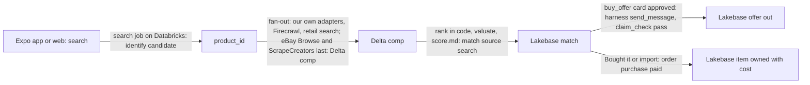

# Buy
Status: draft, second pass. Every design line is *agent proposal* except where it links a decision. Slug: buy. Written 2026-11-14.

The hassle: buying used means searching five apps that each describe the same thing differently, and guessing whether a price is fair. Shipping and fees are worked out by hand, sellers are messaged one by one, and nobody knows which site would take a return. Buy is one search box that first works out what the thing is and what it is worth. It then searches official retail and used markets together, and an agent does the legwork up to the moment the person pays. Buying is a full side of the app, run by the same engine as selling ([decision](../../product/decisions.md#2026-11-14-selling-comes-first-buying-is-a-full-side)).

Buy owns search, saves, For you, outgoing offers and purchases. Watch ([watch.md](watch.md)) owns `want` and `match` and the act endpoint. `market.md` owns product pages, price history, trends and follows; Buy links into a product page from every result.

## What the person does and sees

The Buy tab mirrors Sell: a search box with a camera and a link field, then the shelves New matches, Watching and Bought ([decision](../../product/decisions.md#2026-11-14-the-buy-tab-mirrors-sell-with-shelves)). Lines from Nate's buying proposal ([words](../../product/words.md#2026-11-14-nate-store-and-buying)) are marked Nate.

| Step | The person | They see |
|---|---|---|
| 1 | Types, photographs or pastes a link ([search box](../../product/words.md#2026-11-14-search-box), [appraise from Buy](../../product/words.md#2026-11-14-appraise-from-buy)). A visitor can do this without an account ([words](../../product/words.md#2026-11-14-nate-visitors-and-full-users)). | First, what it is: the product, identified with the same engine as selling. One chip corrects it; one radio choice settles a variant only when the search cannot. |
| 2 | Waits | Sites fill in as they answer. New retail price where it is sold new, the guarded fair used range per site, and how many are out there "as of" a time. A link to the product page (`market.md`) for its history. |
| 3 | Scrolls | Results from the five marketplaces and official stores in one list, filtered by condition, ranked by delivered total against the fair range ([one search](#one-search-across-every-store)). Each shows its match label, its score axes from `score.md`, the return terms and the seller terms. On a used result, the better official option sits beside it ([below](#the-better-official-option)). Then "Similar for less" (Nate). |
| 4 | Taps Open on site | The listing opens on its own site with a referral tag. For a visitor this is the only action. |
| 5 | Taps Save (full users) | It goes to Watching. Saving it on the site too is a `save_match` card. |
| 6 | Taps Offer or Ask | The agent drafts the offer or the question. The person approves each one (`buy_offer`). Replies land in the chat icon ([messages.md](messages.md)). |
| 7 | Taps Buy | The site opens to pay. We never take payment ([Nate](../../product/words.md#2026-11-14-nate-store-and-buying)). |
| 8 | Comes back | "Did you buy it?" once. Yes creates a purchase order and an `owned` item with its cost. "Sell this" is one tap from Bought. |
| 9 | Opens For you (opt in) | A shelf built from their [style profile](#your-style-profile): sizes, brands, wants and past purchases. It never shows their own items. Each card says what it inferred ("your size M, from 6 items"), and one tap resets it. |
| 10 | Sells something they still use (a desk, a phone) | A `replace_after_sale` card with matches under the sale price. |

Match labels are the canon set defined in [product §3](../product.md#3-the-data-model) (`match label`), with thresholds owned by [seeing-the-item card 9](../determinations/seeing-the-item.md#9-which-product-it-is-and-when-identity-is-confirmed), shown on every card: `exact`, `likely_same_model`, `same_family_other_variant`, `comparable`, `unresolved`. Following the certainty principle, identity, variant and size are stated as confirmed once settled. Price is a range, and authenticity and hidden condition are stated as not known. "Similar for less" shows only `comparable` items whose material and condition are known ([M17](../determinations/market-insight.md#m17-a-cheaper-equivalent-of-similar-quality-and-material)).

Delivered total = price + shipping + fees and tax where the site charges them, as [M26](../determinations/market-insight.md#m26-delivered-price) works it out. Local pickup shows distance instead. Buyer protection is shown per site: a Facebook local pickup carries none, and Poshmark does not cover fit ([trust note §9](../../research/sold/nate/trust-returns-disputes.md#9-buyer-protection-per-marketplace-and-what-voids-it), *observed* and *asserted*).

Where the design makes a person stumble: we never see the payment, so Bought depends on the "Did you buy it?" prompt, and on eBay on reading the Won list through connect's `import`.

## One search across every store

*agent proposal*, from Nate's "a suite like shopify, and the better official option" ([words](../../product/words.md)). Buy owns the search and its results. The catalog behind them (one product id grouping every offer) is on the product page ([market.md](market.md#one-catalog)).

| Part | What the person gets | How |
|---|---|---|
| One list | the five marketplaces, the maker's store, authorised retailers, official refurbished programmes and brand resale, one result per offer, grouped under the product | fan-out above plus the official sources of [M24](../determinations/market-insight.md#m24-same-purpose-match); the Shopify Catalog's Universal Product ID already groups merchants' offers (*observed*, [Shopify note 1.2](../../research/watch/nate/shopify-catalog-and-agentic-commerce.md#12-data-model-observed-global-catalog-docs-and-the-ucp-variant-schema)) |
| Condition filter | one row of chips: New, Refurbished, Like new, Good, Fair, For parts, and "from the maker or brand" | the one scale of [M25](../determinations/market-insight.md#m25-one-condition-scale) |
| Delivered price per offer | item, shipping, tax estimate, the arrival window | [M26](../determinations/market-insight.md#m26-delivered-price) |
| Stock and where it ships | In stock, Preorder, Backorder, Pickup in store, Unknown; ships from, and a "ships to me" filter | M26 |
| More like this | a tap on any result, or a photo, finds the same or similar products | `like` on `POST /v1/search`: the product id, or the photo's embedding through identify; Shopify's `catalog.like` takes an image or an id (*observed*, [note 1.3](../../research/watch/nate/shopify-catalog-and-agentic-commerce.md#13-query-to-results-observed)) |

A filter that would leave nothing says how many it hid ("4 hidden by Ships to me"), with one tap to clear it ([buy-side note 8](../../research/watch/nate/buy-side-products-and-search-experience.md#8-design-what-an-intuitive-unified-search-and-shopping-experience-takes-from-these-inferred), *inferred*).

## The better official option

*agent proposal*. On any used result, and on a link pasted from any site, the app shows the best new, official refurbished or brand resale option for the same purpose and says which is the better buy for this person. The person's purpose comes from the slots in `spec/determinations/asking-and-intent.md`, asked by `spec/features/assist.md`; Buy reads them and does not decide what to ask.

| Row | Used listing | Official option | Card |
|---|---|---|---|
| Match | | "Same product, new", "Its newer model" or "Does the same job" | [M24](../determinations/market-insight.md#m24-same-purpose-match) |
| Delivered price | to the door | to the door | M26 |
| Condition | on the one scale, with who stands behind it | the same | M25 |
| Warranty and returns | the site's buyer protection, the seller's terms | the programme's terms | [M29](../determinations/market-insight.md#m29-new-against-used-verdict) |
| Authenticity risk | from [score](score.md) | none for the maker; stated for others | M29 |
| Recall | [card 20](../determinations/seeing-the-item.md#20-recall-or-safety-flag) | card 20 | |
| Delivery | the window | the window | M26 |
| Value it keeps | share after the person's horizon; "newer model announced" | the same | [M27](../determinations/market-insight.md#m27-value-it-will-keep) |
| Cost to own | with its range | with its range | [M28](../determinations/market-insight.md#m28-net-cost-of-ownership) |

Above the rows, one sentence: the verdict of M29 (used, official or a close call, and why). It is not shown when M29 hides it, and the rows still show.

Referral rule: a referral, commission or placement payment never enters the order or the verdict; M29's check runs it with and without referral fields and requires the same result. A link that earns a referral carries "We may earn a referral fee. It never changes the order or the verdict." beside it, visible without a tap, because the FTC requires a material connection to be disclosed where it cannot be missed and treats a ranking set by payment as deceptive even when disclosed (*observed*, [buy-side note 6](../../research/watch/nate/buy-side-products-and-search-experience.md#6-referral-and-affiliate-programmes)). A link with no programme (Facebook, Vinted) carries no line.

## Your style profile

A `style profile` per person (the `style_profile` row, which buy owns), learned from what they sell, keep, save, follow and buy ([Nate](../../product/words.md#2026-11-14-nate-sale-emails-the-expo-account-where-routes-are-hosted-and-a-buy-page-shaped-by-your-style); *agent proposal*). It feeds the For you shelf, the recommendations on every shelf and the order of results within the same delivered-total band. Each trait shows its reason and count ("your size M, from 6 items"); the person can edit, remove or reset any trait, and a trait they remove is never relearned without a new signal they can see. It never changes order by referral: M29's check runs with and without referral fields. Insights shows the same profile ([insights](insights.md)). Which screen holds it is open, as Ben's layout is ([Nate](../../product/words.md#2026-11-14-nate-bens-design-is-not-finished-or-decided-how-the-system-drives-every-feature)).

## Design choices

| Choice | Options considered | Picked | Why | What would change it |
|---|---|---|---|---|
| What search does first | keyword fan-out; identify first, then fan out ([identification-technologies](../../research/identify/nate/identification-technologies.md), [one-search-box](../../research/watch/ben/one-search-box.md), [Nate](../../product/words.md#2026-11-14-nate-vision)) | Identify the product first (text, photo or link), then fan out to retail and used sites in parallel, streaming batches | One identity gives one fair range, one product page and dedupe across sites. Parallel image search takes 1 to 3 s (*asserted*). | Identify top-1 under 0.8 on the 50-search test, which would make the fallback a keyword search with labels. |
| Who can search | full users only; visitors too ([words](../../product/words.md#2026-11-14-nate-visitors-and-full-users), [referrals](../../product/words.md#2026-11-14-nate-referrals-and-market-data)) | Visitors search and link out with a referral, rate limited at the edge. Only full users save, watch, offer or sell. | Nate's call; a visitor's search is also market data. | |
| Link-outs | plain URL; EPN `itemAffiliateWebUrl` on eBay; per-site programmes ([buyer-side §5](../../research/watch/nate/buyer-side-actions-and-affiliate.md#5-affiliate-and-partner-programmes)) | The EPN URL on eBay; a tagged plain URL elsewhere; every tap writes a `referral_click`. A referral fee never changes the ranking or a verdict, and a tagged link says so beside it ([disclosure](#the-better-official-option)). | EPN pays on a Buy It Now within 24 h of the click, by category (*observed*). | The used-item EPN rate, if it is too low to matter. |
| Saving on the site | Watching only; like, watch or cart through the harness ([buyer-side §1](../../research/watch/nate/buyer-side-actions-and-affiliate.md#1-ebay-what-exists-per-action)) | `save_match`, ask, promotable. Every site goes through our own adapter over the person's session; on eBay `AddToWatchList` (official, user token; the per-user limit is read from `WatchListMaximum`, which is 300 in eBay's sample response) is the last fallback. Never Poshmark likes. | The official route on eBay carries no account risk, which is a fact to weigh in the measured fallback. | |
| Offers and questions | auto inside a ceiling; ask each time ([buyer-side §2](../../research/watch/nate/buyer-side-actions-and-affiliate.md#2-user-agreements-on-agents-acting-for-buyers), [messages-and-offers](../../research/messages/ben/messages-and-offers.md)) | `buy_offer`, ask every time, not promotable. An accepted offer binds on eBay, so sending one is the person's tap. | eBay and Depop terms bar buying agents without human review, and the person's real account is the one at risk. | |
| Ranking | delivered total against fair value; a learned ranker ([fanout §ranking](../../research/watch/ben/fanout-and-watch-loop.md#ranking-against-fair-value), [analytics §5](../../research/data/nate/analytics-and-recommendations.md#5-recommendations-how-marketplaces-personalise-and-cold-start)); ThriftX's cheapest-copy collapse and Dupe.com's per-retailer cap (*asserted*, [search teardown](../../research/watch/nate/teardown-search-and-similar-finders.md#table-for-the-lead)) | Results are ordered by the delivered total's place in the guarded fair range, then the match label, then the `score.md` quality axis. Cross-posted copies collapse to the cheapest, with "also on" ([watch dedupe](watch.md#design-choices)). At most 3 rows from one seller in any 20 (starting value). A referral is attached after the order is fixed and never changes it. Market uses the same statement. | The person can check it; the cap keeps one bulk seller from filling the page (*inferred*); collapse plus the fair range shows cheapest against fair, which ThriftX lacks ([parity](../parity.md#cross-marketplace-search-and-similar-item-finders)). | The price backtest finds a better order. |
| A public search API (*agent proposal*) | none; our own, over HTTP and MCP ([Shopify note 9](../../research/watch/nate/shopify-catalog-and-agentic-commerce.md#9-feature-table)) | Public, others may call it ([Nate](../../product/words.md#2026-11-14-nate-the-search-engine-is-an-api-no-feeds-no-tax-service-tags-on-retouched-photos)): `search`, `product`, `compare`, `history` and `trends` as MCP tools served by the same handlers as `POST /v1/search`, `GET /v1/products/:id`, `POST /v1/compare`, `GET /v1/products/:id/history` and `GET /v1/trends`, plus an `llms.txt`; keys and rate limits at the edge, referral disclosure in every result. Rows return only where `rights.may_share` holds, so Shopify Catalog offers (no redistribution, *observed*) and anything personal are left out. It serves search only, never people's listings. | Nate said yes, it is public; Ben has not been asked. Dupe.com publishes an MCP endpoint, `llms.txt`, `agent.txt` and a UCP manifest (*observed*, [search teardown §2](../../research/watch/nate/teardown-search-and-similar-finders.md#2-dupecom)); ours adds used markets, sold comps and the verdict (*inferred*). | Abuse cost above the key's budget, or a source's terms that bar it. |
| For you | off; on by default; opt in ([analytics §5](../../research/data/nate/analytics-and-recommendations.md#5-recommendations-how-marketplaces-personalise-and-cold-start)) | Opt in. An inferred size or taste is personal data, shown and editable in You ([§8](../product.md#8-cross-cutting-requirements)). | | The click and save rate, against search alone. |

## What it reads and writes

| Entity | Fields used here |
|---|---|
| `match` (watch owns) | source `search` or `for_you`, site, url, price_cents, seen_at, valuation_id; states saved, asked, offered, bought |
| `offer` | direction `out`, match_id, amount_cents, state; written only after the person approves |
| `conversation` | role `buy`, match_id, `next_check_at` |
| `order` | kind `purchase`, starts at `paid` ([§4 order](../product.md#order)) |
| `item` | `owned`, with `cost {amount_cents, currency, date, source: purchase, bought_it}` |
| `comp` | every result read, with `evidence {source_url, read_at, snapshot_ref, fingerprint, extractor_version, rights}` |
| `valuation`, `score` | read; each number shown is a guarded number with `citation_id` |
| `claim_check` | on every message and offer note to a seller |
| `visitor`, `referral_click` | written by market on link-outs from search |

## States

| Thing | States used | Moves on |
|---|---|---|
| match | saved, asked, offered, bought, gone | save_match answered; buy_offer approved and sent; bought; the site read-back |
| order | `paid` onward for kind purchase | Bought it, a did_you_buy yes, or `import` |
| item | (new) to `owned`, then `capturing` on Sell this | as in [§4](../product.md#4-states) |
| `search` job | stages `identify`, `fanout`, `rank`, each `started, running, arrived, failed`; each stage carries real counts in `found{}` ([product.md §7](../product.md#7-contract-conventions)): sites searched, listings found, listings kept after filtering, from `route_call` and `citation` records ([Nate](../../product/words.md#2026-11-14-nate-the-ui-shows-the-work-animation-and-findings-as-they-arrive)) | the search call |

## Data flow

Saving follows [§10 want to match](../product.md#want-to-match-to-saved-listing).

## Systems underneath

| Piece | Does here |
|---|---|
| Identify | the shared engine ([identify.md](identify.md)); text, photo or link to a candidate |
| Fan-out | the same per-site routes as watch ([fanout §routes](../../research/watch/ben/fanout-and-watch-loop.md#per-platform-search-routes), [paste a link](../../research/watch/ben/fanout-and-watch-loop.md#paste-a-link)), plus retail search for the new price |
| Harnesses | `save` and `send_message` on each site through our own adapter over the person's session, an official API only as the last fallback ([decision](../../product/decisions.md#2026-11-14-each-marketplace-gets-its-own-harness-run-on-browser-use-cloud), [§6](../product.md#harnesses)). The person's session; one job per account at a time. |
| Price, score | valuation per site and the score axes |
| Connect | `import` of past purchases ([connect.md](connect.md)): eBay `GetMyeBayBuying` Won list (60 days), plus receipt emails ([email note](../../research/sold/nate/email-and-notification-detection.md)) |

## Contract for the frontend

| Call | Shape |
|---|---|
| `POST /v1/search` | `{text?, photo_id? or upload, url?, filters?: {condition[], seller_kind[], ships_to?, ships_from?, max_delivered_cents?, in_stock_only?}, like?: product_id or photo_id}`; visitor or user; streams batches on `GET /v1/stream` with `{product, results[], official[], sites_pending[]}` |
| `POST /v1/matches/:id/act` | watch owns it; `save` opens `save_match`, and `bought` creates the order |
| `POST /v1/orders` | `{kind: purchase, match_id, price_cents, date}` |
| `POST /v1/decisions/:id/act` | answers `buy_offer`, `offer_over_ceiling`, `seller_counter`, `did_you_buy`, `replace_after_sale`, `save_match`, `unbacked_claim` |
| `POST /v1/items/:id/sell` | moves an `owned` item to capturing |

Errors follow [§7](../product.md#errors). A visitor over the edge limit gets `429 rate_limited` and "Try again in a minute"; a site that fails shows as that site's chip greyed out, never as raw text.

## Who may act

| Action | Mode ([§5](../product.md#decision-kinds-the-complete-list)) |
|---|---|
| Search and read | `auto` |
| Save on the site | `save_match`, ask, promotable; never Poshmark likes |
| An offer or a question to a seller | `buy_offer`, ask every time |
| A seller's counter | `seller_counter`, ask |
| A price above `max_total_cents` | `offer_over_ceiling`, ask |
| A saved match went gone | `did_you_buy`, ask |
| A text a claim_check holds | `unbacked_claim`, ask |
| Paying, or an offer that binds | `complete_purchase`, locked |

## How it fails

| Failure | The person sees | Recovery |
|---|---|---|
| Identify unsure | two or three candidate chips | one tap picks; the pick is a label |
| A site slow or blocked | its chip greyed out, "Depop: no answer" | the next batch, or the fallback route |
| The listing sold | "Gone" on the card | `gone`; `did_you_buy` if it was saved |
| A harness save fails | "Saved here, not on Depop" | retry, or keep it on Watching only |
| A message holds on claim_check | a card showing the claim with no backing | edit, or drop the claim |
| No fair range yet | "not enough sales yet" | the guarded number is hidden with its reason |

## How we will know it works

| Claim | Bar | Check |
|---|---|---|
| Search is fast | p95 under 3 s to the identified product and first batch; p95 under 10 s to the last site. No published figure for cross-site resale search was found, so the test decides ([coverage](../coverage.md)). | 50 real searches across the item kinds in §8 |
| It identifies the right thing | top-1 of 0.9 on the 50 searches; published model-plus-search figures (42.4% to 86.8%, [identification-technologies](../../research/identify/nate/identification-technologies.md), *asserted*) are context, not a bar for this task | hand labels |
| Ranking helps | the best delivered total for an exact match sits in the top 3 on 90% of searches | the same set |
| For you is worth a shelf | click and save rate above search's | two weeks of opt-in users |
| Referrals earn | qualifying EPN purchases per 100 eBay link-outs | the EPN report |

## Facts to know

- eBay's User Agreement §3 bans "buy-for-me agents, LLM-driven bots, or any end-to-end flow that attempts to place orders without human review", without prior express permission (*observed*, effective 2026-06-28). Depop's terms carry the same wording, and Grailed bans offers or purchases without human review of each ([buyer-side §2](../../research/watch/nate/buyer-side-actions-and-affiliate.md#2-user-agreements-on-agents-acting-for-buyers)). This is why `buy_offer` asks every time: the person's real account is at risk. The risk is shown per site at connect. For a public launch: ask eBay for written permission.
- eBay `PlaceOffer` is closed to new applicants and needs explicit user action before each call. Checkout through the Order API is Limited Release (*observed*, [§1](../../research/watch/nate/buyer-side-actions-and-affiliate.md#1-ebay-what-exists-per-action)). Offers go through the harness. For a public launch: apply for Buy API access through EPN.
- `AddToWatchList` takes a user token and returns `WatchListMaximum`, which is 300 in the reference's sample; read it per user rather than fixing 300 (*observed*). `GetMyeBayBuying` returns the Watch, Won and Lost lists for 0 to 60 days (*observed*).
- No site has an official buyer message API, and only eBay has any buyer-side API (*observed*, [§3](../../research/watch/nate/buyer-side-actions-and-affiliate.md#3-buyer-side-official-api-non-ebay)).
- Poshmark bans automated likes, shares and follows. Mercari bans bots. OfferUp bans third-party apps without consent (*observed*). For a public launch: the harness on these sites is a per-site risk card at connect.
- EPN pays on a Buy It Now within 24 h of the click, and on a Best Offer submitted within 24 h and later accepted (*observed*). The category rates (Fashion 4%) date from 2020 (*asserted*). Grailed's and Depop's affiliate rates conflict between sources; OfferUp and Facebook have none ([§5](../../research/watch/nate/buyer-side-actions-and-affiliate.md#5-affiliate-and-partner-programmes)).
- Rules that protect people: a seller never sees the buyer's home address unless the person taps to share it. A seller's personal data from a conversation is kept only as `buyer_ref_hash`. A recalled product never shows as a result. Licences are recorded and do not shape the build ([decision](../../product/decisions.md#2026-11-14-licences-and-site-terms-are-recorded-as-facts-and-do-not-shape-the-build)).

## Open for Ben and Nate

| Question | Recommendation | Depends on it |
|---|---|---|
| Is For you a fourth shelf on the Buy tab, given Ben's three? | Yes, opt in, shown after the first want. | the Buy tab layout |
| Do referrals pay for the product ([§9](../product.md#9-open-for-ben-and-nate))? | Measure EPN per 100 link-outs before deciding. | the business model |

## Needs from the shared model

- The `search` job stages above.
- The `filters` and `like` fields on `POST /v1/search`, and `official[]` in its stream batches.
- An `offer_view` on each result {condition on the one scale, seller_kind, delivered_cents, delivery_min_days, delivery_max_days, stock, ships_from, ships_to}; for official rows, the `retail_offer` entity listed in [market-insight's needs](../determinations/market-insight.md#what-i-need-from-other-areas).
- `POST /v1/compare {url or match_id}` for a pasted link from any site, returning the verdict block below.
- The search tools on the agent endpoint below, served from the same handlers.
