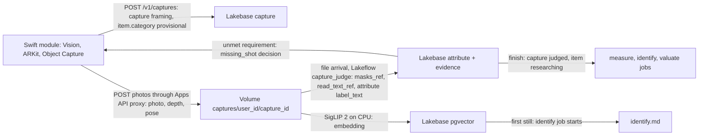

# Capture
Status: draft, second pass, *agent proposal* except where a line links a decision. Slug: capture. Written 2026-11-14. Names follow [product.md](../product.md), which wins where this page differs.

Today a seller photographs an item from guesses, finds the flaw a buyer will complain about after the sale, retypes the tag, and gets asked "measurements?" in the messages. Capture takes that off them: point the phone, follow one instruction at a time, and the item leaves with listing photos, read text, flaws and the facts the rest of the app needs, each fact tied to the pixels or depth it came from. Ben: "the user has to do no thinking at all" ([words](../../product/words.md#2026-11-14-tools-and-capture)). Nate's process: capture as a series of images or a 3D model turned into images, identify from the capture and parallel background searches, and generated inputs only where needed ([words](../../product/words.md#2026-11-14-nate-capture-then-identify-process)).

## What the person does and sees

Capture lives under ＋ in the bottom bar ([decision](../../product/decisions.md#2026-11-14-the-bottom-bar-is-today--sell----buy--you)) and ends by offering Sell this, What's it worth or Find this.

| Step | The person | The app |
|---|---|---|
| 1 | Taps ＋. | Opens the camera on the guided shot list, offline-capable ([decision](../../product/decisions.md#2026-11-14-capture-opens-on-the-guided-shot-list-talk-mode-is-one-tap-away)). Capture state `framing`. |
| 2 | Points at the item. | The item picks its kind and mode within the first frames ([decision](../../product/decisions.md#2026-11-14-capture-is-one-session-and-the-item-picks-the-mode)): flat clothes get `shots` (flat lay, tag, care label, flaws); rigid things and furniture get `scan` first, a walk-around with a live coverage ring. No category chips before a still exists. |
| 3 | Holds steady, or walks around. | Auto-shutter when the on-device gates pass; the shutter button is always there; each kept shot shows a 3 s undo. State `shooting`. |
| 4 | Sees one instruction, sometimes. | "Closer on the tag", "Turn it over": one per unmet `requirement` row that a view can settle, in priority order, with an arrow or outline per [copy.md](../../product/copy.md). |
| 5 | Taps the voice button, if they like. | `talk` mode over the same session (below); switching loses nothing. |
| 6 | Answers a question only if no view can settle it. | Identify's `clarify` inputs arrive as background searches resolve, one at a time, no spinner ([clarifying-inputs](../../research/identify/nate/clarifying-inputs.md) §8). |
| 7 | Picks Sell this, What's it worth or Find this. | Capture reaches `judged`; the item moves to `researching` ([product.md §10](../product.md#capture-to-item-card)). |

**How the kind is decided.** The first frames give a provisional class on the phone (Apple Vision classification plus plane, outline softness and LiDAR extent). The first kept still goes to `capture_judge`, which confirms or swaps it and sets `item.category` to one of the 13 kinds in [identity-schema-by-kind](../../research/item-card/nate/identity-schema-by-kind.md). A swap keeps every photo; an unsure judgement raises `category_unsure`. The kind loads its `requirement` rows; `coverage.needed[]` holds the unmet row ids and `coverage.kept[]` the met ones.

**What each row needs.** Rows obtained by `label`, `seen` or `measured` ask for a view (`missing_shot`, or `retake` for a failed one). Rows obtained by `lookup` go to the background searches. Rows obtained by `asked` go to identify's `clarify`. There is no fixed cap: the session stops asking when every row a view can settle is met or the person taps Done; whatever is left becomes `unknown_reason: not_visible` and shows on the item card.

**Talk mode.** Ben's newer design replaces the live model that watches ([decision, 21:33](../../product/decisions.md#2026-11-14-capture-opens-on-the-guided-shot-list-talk-mode-is-one-tap-away)) with a decision tree owned by code: about 1 fps at 768 px to the Decisions API, two passes accept a view, set spoken lines, SpeechAnalyzer on the phone, slots filled on Jev, and an after-pass on the recording as the safety valve ([words, 22:24](../../product/words.md#2026-11-14-video-capture-as-a-decision-tree), [decision-tree-capture](../../research/capture/ben/decision-tree-capture.md)). The newer words govern this page. What the person says is stored as `you_said` with `evidence.kind: owner`.

**Origins.** A folder drop or a website upload is `item.origin` (`folder` or web upload as `capture`), not a mode: photos join the same judge, `folder_group` ends in one `approve_groups` decision, and the list shows which views are still missing ([decision](../../product/decisions.md#2026-11-14-the-phone-app-comes-first-a-website-follows)).

**A product link or receipt.** Optional, any time. Stored as `evidence.kind: lookup` on the identity attribute, never proof of the exact variant: "An original purchase URL is evidence, not proof" (Nate).

### Where Ben's design makes a person stumble, and what the backend adds

| Stumble in Ben's design | Change |
|---|---|
| Category chips under 0.6 appear before anything is framed | the kind shows after the first still, as a swap if wrong |
| The 6-shot cap drops a second flaw | flaws sit outside any cap; `requirement` rows decide |
| The white sheet and the 10 s spin read as required | offered, never asked |
| The recap re-asks what was heard | shows only what changed a field |

Unused by his design and used here: pose coverage from ARKit, depth confidence on the mask, the early product match from the first still, past labels setting gate thresholds, and the `requirement` priority learned by `requirement_reorder` in `score.md`.

## Design choices

| Choice | Options considered | Picked | Why | What would change it |
|---|---|---|---|---|
| How capture knows what it still needs | fixed shot list ([guided-shot-list](../../research/capture/ben/guided-shot-list.md)); adaptive with a cap ([adaptive-capture](../../research/capture/nate/adaptive-capture.md)); `requirement` rows per kind ([identity-schema-by-kind](../../research/item-card/nate/identity-schema-by-kind.md)) | `requirement` rows, no cap | the cap of 2 had no source (coverage); rows name the field, method and view | views per item on 30 real items show a cap would lose nothing |
| Listing images | real frames ([scan-to-images](../../research/capture/nate/scan-to-images.md)); renders of the scan ([object-capture](../../research/measure/ben/object-capture.md)); image-to-3D | real frames, the sharpest per pose bin, masked; renders only as an extra angle on rigid items after the 8 checks | the iPhone model is `.reduced`, one 2048 px texture, so renders lose tags, logos and weave; Etsy needs an unedited real photo; image-to-3D is prohibited | a full-detail model on the phone |
| What the 3D model is for | listing photos; measuring, the spin view and frame choice | measuring, the spin view, choosing frames | its poses cluster viewpoints for free | none expected |
| Talk mode | live model that watches ([live-video-capture](../../research/capture/ben/live-video-capture.md)); decision tree ([decision-tree-capture](../../research/capture/ben/decision-tree-capture.md)) | decision tree | Ben's newer words; set lines cannot invent; costs bounded | the tree misses its 85% per-question bar |
| Gates | on the phone; cloud judge; a photo score ([capture build-plan](../../research/capture/ben/build-plan.md), [seeing-the-item-pipeline](../../research/cross-cutting/ben/seeing-the-item-pipeline.md)) | gates on the phone, `capture_judge` in the cloud | instant feedback offline; the cloud confirms | thresholds fail the false accept or reject bar |
| Masks and text without GPU serving | SAM 3 on a GPU; on-device Vision; PP-OCRv5 on CPU ([identification-technologies](../../research/identify/nate/identification-technologies.md)) | Vision foreground mask plus the Object Capture `objectMask`; Vision OCR on the phone, PP-OCRv5 in the job | Free Edition has no GPU serving ([databricks-platform](../../research/data/nate/databricks-platform.md)); both run without one | mask IoU on dark fabric falls under the bar |
| When identify starts | after finish; at the first kept still ([identification-stack](../../research/identify/nate/identification-stack.md)) | at the first kept still, in parallel | Nate's process; questions arrive while shooting | none expected |

## What it reads and writes

| Entity | Fields written | `evidence` |
|---|---|---|
| `item` | new id, `category`, `origin: capture` or `folder` | |
| `capture` | `mode` (`shots`, `scan`, `talk`), `coverage {needed[], kept[]}`, `depth_ref`, `pose_ref`, `masks_ref`, `read_text_ref`, `kept_raw` | |
| `photo` | `role`, `file_ref`, `parent_photo_ids[]`, `exif_stripped`, `use: real` | |
| `attribute` brand, size, style code | value from the tag, `source: label` | `label_text`, photo ref and the text box region |
| `attribute` fibre, RN, CA, country | from the care or neck label | `label_text`, photo ref and region |
| `attribute` colour | `source: inferred` until confirmed | `image_region` on the masked front |
| `attribute` `flaw.<n>` | `{kind, where, severity}` from `defect_propose`, unconfirmed until `confirm_flaw` | `image_region` with the box; `depth` where LiDAR shows a dent |
| `attribute` recall status | for kinds with a recall row | `lookup`, the CPSC record read |
| `attribute` what the person said | `source: you_said` | `owner`, clip ref and `captured_at` |
| `decision` | `retake`, `missing_shot`, `confirm_flaw`, `approve_groups`, `category_unsure` | |

Every row above carries `extractor_version`. Reads: the kind's `requirement` rows, the early product match, past labels for gate thresholds. Capture shows no numbers; a count it shows (views left) is a guarded number cited to the `requirement` version. Capture sends nothing to a marketplace or person, so it raises no `claim_check`; the facts it writes are what `claim_check` later backs claims with.

## States

Capture states, from [product.md](../product.md) §4: `framing`, `shooting`, `uploading`, `judging`, `judged`. Capture ends at `judged`, which moves the item from `capturing` to `researching`. A failed upload stays in `uploading` with retries; the item states and their other moves are in product.md §4.

## Systems underneath

| Piece | Does here |
|---|---|
| Swift capture module ([decision](../../product/decisions.md#2026-11-14-the-app-is-an-expo-app-with-a-native-swift-camera-module)) | camera, gates, ARKit depth and pose at 5 Hz, Object Capture, Vision mask, OCR, barcode, EXIF strip, face and screen blur. Writes no log lines; sends events to JS, which logs ids only ([log/README.md](../../log/README.md), [events.json](../events.json)). Expo's open question is product.md §9. |
| Apps API proxy | uploads into the Volume, since Volumes have no presigned URLs (product.md §6) |
| Volume `captures/user_id/capture_id` | frames, depth, confidence, pose, masks, USDZ |
| Lakeflow `capture_judge` | file-arrival trigger, one active run per job; writes `masks_ref`, `read_text_ref` and embeddings |
| Unity Gateway | every model call: the kind and gate judgements on the image path, kept apart from text ([decision](../../product/decisions.md#2026-11-14-image-decisions-and-text-decisions-are-separate-and-the-provider-for-each-stays-open)); typed checks on both providers ([decision](../../product/decisions.md#2026-11-14-typed-judgements-run-on-both-the-decisions-api-and-jev-and-our-labels-pick)) |
| Embeddings | SigLIP 2 or Marqo-Ecommerce (Apache-2.0) on serverless CPU, or a hosted embedding through the gateway; vectors in Lakebase pgvector, since AI Search takes no image embeddings |
| MLflow 3 | one trace per job carrying refs, never images (a trace over 25 MB is unreadable) |

**Free Edition changes**: no GPU serving, so no SAM 3; masks come from the phone, OCR from the phone and PP-OCRv5 on CPU, embeddings from CPU or a hosted model; 5 concurrent tasks means `capture_judge` queues behind other jobs, so the phone's gates carry the live feedback.

**Privacy** ([privacy-and-data](../../research/cross-cutting/nate/privacy-and-data.md)): GPS stays on the phone; EXIF is stripped before upload; faces, mail, house numbers and screens are blurred on the phone; no room mesh is kept; outside providers get the masked item crop, not the room; raw room frames and scans are deleted after cutouts unless `kept_raw`. The talk recording is kept only until the after-pass ends.

## Data flow

## Contract for the frontend

| Call | Body | Returns |
|---|---|---|
| `POST /v1/captures` | `{item_id?, mode, device:{model, has_lidar, os}}` | `{capture_id, item_id}` |
| `POST /v1/captures/:id/photos` | multipart: file, `{role, pose?, has_depth}` | `{photo_id}` |
| `POST /v1/captures/:id/finish` | `{intent: sell, worth, find}` | job `capture_judge` |
| `PATCH /v1/items/:id/attributes/:name` | a correction, as `you_said` | attribute |
| `GET /v1/items/:id` | | item with attributes, evidence and `missing_fields[]` |
| `GET /v1/jobs/:id`, `/events`; `GET /v1/stream` | | stages `received`, `judged` |
| `POST /v1/decisions/:id/act` | the chosen option | decision |

Idempotency-Key on every POST; errors `{code, message, failed_step, retry}` (product.md §7). A mode switch is a new `POST /v1/captures` on the same `item_id`; a link or receipt is a `PATCH` on the identity attribute.

## Who may act

| Action | Mode |
|---|---|
| Auto-shutter, auto-keep with undo, upload to our Volume | auto |
| Send the masked crop to a vision provider | auto |
| Start talk mode | the person's tap, each session |
| Send an unmasked room frame outside, store a room mesh | never |

No outward marketplace action happens here.

## How it fails

| Failure | The person sees | Recovery |
|---|---|---|
| No network | a small upload count | queue, retry with the same Idempotency-Key |
| Wrong kind picked | the other list one tap away | shots carry over |
| Object Capture crashes (iPhone 17 Pro, iOS 26.4.2 and 26.5, [measure plan](../../research/measure/ben/build-plan.md)) | scan continues | one-frame LiDAR box, then pose coverage |
| Mirror, glass, black fleece | depth ignored there | that field `unknown_reason: not_visible` or a card prompt (adaptive-capture §1, §9) |
| Blurry or dark after 2 retakes | shot kept with a flag | `confirm_flaw` asks |
| Three corrections or 20 s in talk mode | the manual shutter | the after-pass on the recording |
| Face or two items in view | "One item at a time" | continue when clear |
| Free Edition queue full | live gates still answer | `capture_judge` runs when a task frees |

## How we will know it works

Bars come from Ben's decision-tree targets ([decision-tree-capture](../../research/capture/ben/decision-tree-capture.md) §11) and published figures where they exist.

| Claim | Bar | Source of the bar |
|---|---|---|
| Gates are fair | false accept at most 1 in 20, false reject at most 1 in 10, against a person's judgement | Ben §11 |
| Talk mode is right | per-question accuracy at least 85%; wrong correction at most 1 in 10; at most 10 lines per session; 55 of 60 facts slotted, 0 invented | Ben §11 |
| Flaws are found | 18 of 20 seeded flaws | Ben §11 |
| It is quick | a tee in under 70 s | Ben §11 |
| Views earn their place | views per item on 30 real items, each asked view changed a field; decides the no-cap choice | coverage audit |
| Masks hold | share of items needing a hand-fixed mask at most Hurst's 18% (*asserted*), counted on the 30 items | [scan-to-images](../../research/capture/nate/scan-to-images.md) |
| Listing frames beat renders | buyers prefer real frames on garments; renders only where they pass the 8 checks (Hurst's hand-held 11.7-point lead is *asserted*) | scan-to-images |
| The kind is right | provisional against confirmed kind on every test item | the test set |
| Both paths work | adaptive-capture §10: 30 tape-measured items, a LiDAR and a non-LiDAR iPhone, naive operators, blind scoring | [adaptive-capture](../../research/capture/nate/adaptive-capture.md) |

## Facts to know

| Fact | Link, mark | At public launch |
|---|---|---|
| Depth 256x192, 20 cm to 2 m, confident wrong returns on mirrors | [adaptive-capture](../../research/capture/nate/adaptive-capture.md) §1, *sourced* | |
| Object Capture needs LiDAR and iOS 17+; iPhone gets `.reduced`, under 50k triangles, one 2048 texture | [scan-to-images](../../research/capture/nate/scan-to-images.md), *observed* | |
| Each sample carries image, depth, confidence, gravity, `objectMask` and camera | scan-to-images, *observed* | |
| Fabric photogrammetry gives a lumpy mesh | scan-to-images, *asserted* | |
| eBay wants your own images, video up to 150 MB, no 3D type; Etsy needs at least one unedited real photo | scan-to-images, *observed* | the site terms are enforced per listing, so renders carry a provenance label |
| SAM 3 needs a GPU; SigLIP 2, Marqo-Ecommerce and PP-OCRv5 are Apache-2.0; DINOv3 is gated | [identification-technologies](../../research/identify/nate/identification-technologies.md), *observed* | a gated model's terms apply to a commercial product |
| Free Edition: no GPU serving, 5 concurrent tasks, 3 apps that stop after 24 h | [databricks-platform](../../research/data/nate/databricks-platform.md), *observed* | a paid workspace lifts the limits |
| Selling a recalled product is illegal (CPSA §19); drop-side and pre-June-2011 cribs must be destroyed | [identity-schema-by-kind](../../research/item-card/nate/identity-schema-by-kind.md), *observed* | holds now: a recall `lookup` row blocks `post` ([product.md](../product.md#licences-terms-and-the-rules-that-protect-people)) |
| Marketplaces' EXIF stripping is undocumented; backgrounds are never stripped | [privacy-and-data](../../research/cross-cutting/nate/privacy-and-data.md), *sourced* | holds now: GPS stays on the phone |

Licences and terms are recorded and do not shape the build ([decision](../../product/decisions.md#2026-11-14-licences-and-site-terms-are-recorded-as-facts-and-do-not-shape-the-build)).

## Demo path

For Ben and Nate to mark.

## Open for Ben and Nate

1. **Talk mode: the live model or the tree?** Ben's 21:33 decision says a live model watches; his 22:24 words describe a tree owned by code. This page follows the newer words. Does the decision entry change to match? Depends: talk mode's cost and the voice stack.
2. **Does a rigid item open on the list or straight into the scan?** Joint: "Rigid things and furniture get a move-around scan". Ben: "the camera opens on the guided shot list". Recommendation: open on the list, whose first step for rigid items is the scan, so both hold.
3. **Business.** Receipts, links and measured capture data could carry value as resale proof or paid data; no model is picked.

## Needs from the shared model

- `photo.role` values for identity-schema's views: `care_label`, `detail`, `side`, `inside`, `sole`.
- `requirement` rows for the 13 kinds, and the 13 kinds as `item.category` values.
- A legal flag on `requirement` (recall status as a `lookup` row that blocks `post`); product.md names it but the row shape has no field.
- `evidence.region` shape: a box for `image_region` and `label_text`, two points for a measurement.
