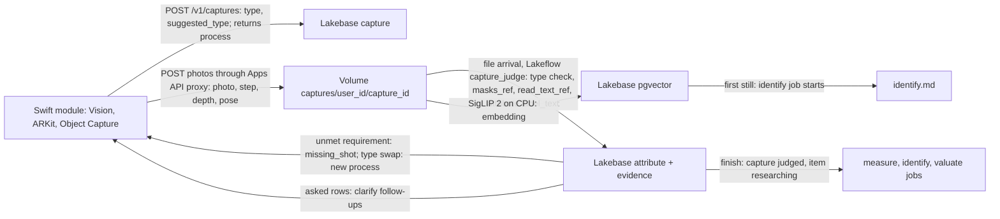

# Capture
Status: draft, third pass, *agent proposal* except where a line links a decision. Slug: capture. Written 2026-11-14. Names follow [product.md](../product.md), which wins where this page differs. How the engine decides each step, with its numbers and build tasks: [engines/capture](../engines/capture.md).

Today a seller photographs an item from guesses, finds the flaw a buyer will complain about after the sale, retypes the tag, and gets asked "measurements?" in the messages. Capture takes that off them: press the camera, say what kind of thing it is with one tap, follow that type's short process, and the item leaves with listing photos, read text, flaws and the facts the rest of the app needs, each fact tied to the pixels or depth it came from. Ben: "the user has to do no thinking at all" ([words](../../product/words.md#2026-11-14-tools-and-capture)). Nate's flow, which this page follows: "The camera will be pressed, an onboarding tutorial of how to select the product type, whether apparel, furniture, tech, whatever, then each has a cpature process, either instant picture, series of pictures with specified frames like clothing tags, scanning for objects to then determine dimensions. Each process is designed to be intutivie, and grant the system the least amount of needed clarification" ([words](../../product/words.md#2026-11-14-nate-finalised-the-intelligence-engine-the-listing-swarm-the-buying-engine-and-how-capture-works)). His earlier steer still holds: front, back and tag for clothes with no side photos, LiDAR for furniture and shoes, the least extra input ([words](../../product/words.md#2026-11-14-nate-front-back-and-tag-for-clothes-lidar-for-objects-the-least-extra-input)), and clothing is not 3D ([words](../../product/words.md#2026-11-14-nate-answers-to-the-first-ten-questions-for-ben)). Which frames each type takes, and when one more is worth asking for: [capture-shots](../determinations/capture-shots.md#default-plans-by-kind).

## What the person does and sees

Capture lives under ＋ in the bottom bar ([decision](../../product/decisions.md#2026-11-14-the-bottom-bar-is-today--sell----buy--you)) and ends by offering Sell this, What's it worth or Find this. Ben decided the camera opens on the guided shot list ([decision](../../product/decisions.md#2026-11-14-capture-opens-on-the-guided-shot-list-talk-mode-is-one-tap-away)); Nate's words above replace the list with a type pick. This page specifies Nate's flow as the proposal; the choice between the two is [Open 2](#open-for-ben-and-nate). Screens, the tutorial's design and motion are Ben's; this page gives the behaviour and the contract.

| Step | The person | The app |
|---|---|---|
| 1 | Presses the camera (＋). | The camera opens, offline-capable. On the first press only, the tutorial runs: how to pick a type, and that each type has its own short process. It can be skipped, and replayed from the picker's help. Seeing or skipping it sets `user.tutorial_seen`. Capture state `framing`. |
| 2 | Points at the item and taps its type. | The type picker sits over the live camera: the 14 families plus other, as `OptionList` (55) with the top 5 shown ([assist widgets](assist.md#widget-vocabulary)). From the first frame the phone suggests a type and puts it first; when the suggestion leads the next by [card 7](../determinations/asking-and-intent.md#7-which-option-is-preselected-and-when-none-is)'s margin it is preselected, so one tap confirms. With no confident suggestion nothing is preselected. `POST /v1/captures` returns the type's `process[]`. |
| 3 | Follows the type's process. | One of Nate's three step kinds at a time ([per-type processes](#the-process-for-each-type)): `instant` (one still), `series` (named frames in order, such as front, back, tag) or `scan` (a move-around with a live coverage ring, giving dimensions from depth where the phone has LiDAR). Auto-shutter when the on-device gates pass; the shutter button is always there; each kept shot shows a 3 s undo. State `shooting`. |
| 4 | Sees one instruction, sometimes. | "Closer on the tag", "Turn it over": one per unmet `requirement` row that a view can settle, in priority order, with an arrow or outline per [copy.md](../../product/copy.md). |
| 5 | Taps the voice button, if they like. | `talk` mode over the same session ([below](#talk-mode)); switching loses nothing. |
| 6 | Adds photos or generates them, if they like. | One row: **Add photos** reopens the camera on the same item for more real frames; **Generate** makes extra listing images from what the item was confirmed to be, through studio's route ([studio](studio.md#retouch-chosen-by-the-person)). One line before Generate runs says the photos will be marked as AI in the app. Generated photos carry `ai_marked` and the AI tag in the app; real photos never do. Retouch is off unless the person asks; tag, label, serial and flaw photos are never touched. |
| 7 | Answers a follow-up only if no view can settle it. | The type's [follow-up inputs](#follow-up-inputs-by-type), one at a time and at most 3, each preselected where the photos or a lookup give a value. Condition and wear are one step: the family's condition scale as Nate's slider from pristine to broken, with the flaws found shown as pins to confirm. Identify's `clarify` inputs arrive the same way as background searches resolve, no spinner ([clarifying-inputs](../../research/identify/nate/clarifying-inputs.md) §8). |
| 8 | Picks Sell this, What's it worth or Find this. | Capture reaches `judged`; the item moves to `researching` ([product.md §10](../product.md#capture-to-item-card)). Unanswered follow-ups take [card 8](../determinations/asking-and-intent.md#8-what-is-assumed-when-a-span-is-ignored)'s default and stay open on the item card. What's it worth on a thing they own can end in Just value it: the item stays `owned` with its card and a draft, nothing posted ([appraise](appraise.md)). |

**Identification starts at the first frame.** The first frames give the type suggestion on the phone (Apple Vision classification plus plane, outline softness and LiDAR extent), and barcode and text reads begin at once. The first kept still uploads and starts the identify job in parallel with the rest of the process ([identify](identify.md)), so questions and candidates arrive while the person is still shooting.

**How the type is decided.** The person's pick sets `capture.type` and `item.category` to one of the 14 families in [product.md](../product.md#3-the-data-model). The phone's suggestion is stored as `capture.suggested_type`, so every disagreement is a label. `capture_judge` checks the pick against the first kept still ([card 1](../determinations/seeing-the-item.md#1-item-kind)). When it is sure of another type it swaps the type through `PATCH /v1/captures/:id`, keeps every photo and adds the new type's missing frames as `missing_shot`; when it is unsure it raises `category_unsure` and the person picks. The type loads its `requirement` rows; `coverage.needed[]` holds the unmet row ids and `coverage.kept[]` the met ones.

**What each row needs.** Rows filled by `label`, `seen` or `measured` ask for a view (`missing_shot`, or `retake` for a failed one). Rows filled by `lookup` go to the background searches. Rows filled by `asked` become the follow-up inputs, through identify's `clarify(slot, candidates[], value_of_information)`. A shot outside the type's process is asked only when its worth over its effort passes card 17's bar ([capture-shots card 3](../determinations/capture-shots.md#3-whether-an-extra-shot-is-asked)). The session stops asking when every row a view can settle is met or the person taps Done; whatever is left becomes `unknown_reason: not_visible` and shows on the item card.

### The process for each type

Each type's process is its plan in [capture-shots](../determinations/capture-shots.md#default-plans-by-kind), sent to the phone as `process[]`. Without LiDAR every `scan` becomes the 8-still ring ([capture-shots](../determinations/capture-shots.md#on-a-phone-without-lidar)), so the person makes the same move.

| Type | Process | What it settles without asking |
|---|---|---|
| [apparel](../determinations/capture-shots.md#apparel-tops-and-dresses-trousers-outerwear) | `series` front, back, tag | brand, size and fabric from the tag; colour and flaws from front and back; flat measurements from the front |
| [shoes](../determinations/capture-shots.md#shoes) | `scan`, then `series` size label, soles | model and size from the label; sole wear; length from depth or lookup |
| [bags](../determinations/capture-shots.md#bags) | `scan`, then `series` inside tab | maker and date code from the tab; dimensions; corner and handle wear |
| [jewellery_watches](../determinations/capture-shots.md#jewellery_watches-watches-and-jewellery) | `series` front, back or stamp | reference and metal stamp; scratches |
| [electronics, phones and laptops](../determinations/capture-shots.md#electronics-phones-and-laptops) | `series` About screenshot, front with the screen on, back | model, storage, battery health from the screenshot; screen and housing wear |
| [electronics, other](../determinations/capture-shots.md#electronics-headphones-cameras-consoles-audio) | `scan`, then `series` model plate | model from the plate; dimensions |
| [furniture](../determinations/capture-shots.md#furniture) | `scan` | width, depth and height from depth; named defects |
| [lighting_home](../determinations/capture-shots.md#lighting_home-home-goods-decor-and-lighting) | `scan`, then `series` base | maker mark; dimensions |
| [media](../determinations/capture-shots.md#media-books-and-media) | `instant` front cover, back with barcode | edition from the barcode |
| [cards_collectibles](../determinations/capture-shots.md#cards_collectibles-trading-cards) | `instant` front and back | set, number, and grade and cert from a slab label |
| [toys_lego](../determinations/capture-shots.md#toys_lego-toys-and-sets) | `instant` box, or `scan` for a built set | set number; seal |
| [appliances_tools](../determinations/capture-shots.md#appliances_tools-tools) | `scan`, then `series` rating plate | model and voltage from the plate |
| [bikes_sports, baby_gear](../determinations/capture-shots.md#appliances_tools-tools) | `scan`, then `series` serial or the model and date label | the serial; model and date code, which feed the recall lookup |
| [other](../determinations/capture-shots.md#other) | `instant` front; `scan` if the first frame shows a rigid item over 10 cm | enough for `capture_judge` to name a type |

### Follow-up inputs by type

What a camera cannot see, asked with [assist](assist.md#widget-vocabulary)'s controls, in the same `clarify` call identify uses. Each type gets the fewest inputs; at most 3 per item ([fields-by-kind](../determinations/fields-by-kind.md#root-fields-every-item)). Whether something works is only ever the person's statement, so it is never preselected. An answer is written as `you_said` with `owner` evidence. Preselection follows [card 7](../determinations/asking-and-intent.md#7-which-option-is-preselected-and-when-none-is).

| Type | Fact | Why it cannot be seen | Control | Preselected value and its source |
|---|---|---|---|---|
| every type | condition grade, on the family's scale ([fields-by-kind](../determinations/fields-by-kind.md#family-and-kind-fields-what-each-adds)) | the photos show the wear; the grade a buyer reads is a judgement the seller stands behind | `ConditionPicker` (46), Nate's slider from pristine to broken | the grade from the photos ([card 14](../determinations/seeing-the-item.md#14-condition-on-each-markets-own-scale)) |
| every type, same step | wear the photos missed | a flaw off camera, a smell, a sticky zip | `RegionYesNo` (64) over `FlawPins` (42) for each proposed flaw, then `InlineBlank` (77) for anything else | each flaw `defect_propose` found shows as a pin; none is confirmed for the person |
| apparel | none | the tag gives brand, size and fabric | none | none |
| shoes | box included | the box is usually off camera | `YesNo` (56) | Yes when a box appeared in a frame, else nothing |
| bags | dust bag, authenticity card | kept apart from the bag | `MultiChips` (68) | the ones seen in a frame |
| jewellery_watches | box and papers | kept apart from the piece | `YesNo` (56) | Yes when seen in a frame, else nothing |
| jewellery_watches | runs and keeps time (watches) | a still cannot show a movement running | `InlineBlank` (77) | never |
| furniture | pickup or delivery | a handover choice, not a fact of the piece | `ChoiceChips` (54) | the person's saved handover choice |
| lighting_home | works (powered items only) | function cannot be seen | `InlineBlank` (77) | never |
| electronics | works, every function tried | function cannot be seen | `InlineBlank` (77) | never |
| electronics | signed out and erased | an account lock is the seller's act, done off camera | `InlineBlank` (77) | never |
| appliances_tools | works | function cannot be seen | `InlineBlank` (77) | never |
| appliances_tools | charger and batteries included | kept apart from the tool | `MultiChips` (68) | the ones seen in a frame |
| media | plays without skips (discs only) | a disc's play cannot be seen | `InlineBlank` (77) | never |
| cards_collectibles | none | front, back and slab label give the rest | none | none |
| toys_lego | sealed, complete or incomplete | missing pieces cannot be counted from a photo | `ChoiceChips` (54) | sealed when a factory seal is seen, else nothing |
| bikes_sports | frame size | often unprinted on the frame | `NumberWithUnit` (57) | the size from the serial or model lookup |
| bikes_sports | rides, shifts and brakes | function cannot be seen | `InlineBlank` (77) | never |
| baby_gear | all hardware present | loose parts sit in a bag off camera | `InlineBlank` (77) | never |
| other | works (only when the identified kind has a function) | function cannot be seen | `InlineBlank` (77) | never |

Twenty rows. Things looked up rather than asked: shoe length, furniture assembly, a baby item's expiry from its date code, accessories seen in a frame. Each shows on the item card for correction through `PATCH /v1/items/:id/attributes/:name`.

### Talk mode

Ben's newer design replaces the live model that watches ([decision, 21:33](../../product/decisions.md#2026-11-14-capture-opens-on-the-guided-shot-list-talk-mode-is-one-tap-away)) with a decision tree owned by code: about 1 fps at 768 px to the Decisions API, two passes accept a view, set spoken lines, SpeechAnalyzer on the phone, slots filled on Jev, and an after-pass on the recording as the safety valve ([words, 22:24](../../product/words.md#2026-11-14-video-capture-as-a-decision-tree), [decision-tree-capture](../../research/capture/ben/decision-tree-capture.md)). The newer words govern this page. Talk mode runs the same type's process by voice. What the person says is stored as `you_said` with `evidence.kind: owner`.

**Origins.** A folder drop or a website upload is `item.origin` (`folder` or web upload as `capture`), not a mode: photos join the same judge, `folder_group` ends in one `approve_groups` decision, and the list shows which views are still missing ([decision](../../product/decisions.md#2026-11-14-the-phone-app-comes-first-a-website-follows)). No tutorial and no type pick: `capture_judge` names the type.

**A product link or receipt.** Optional, any time. Stored as `evidence.kind: lookup` on the identity attribute, never proof of the exact variant: "An original purchase URL is evidence, not proof" (Nate).

### Where Ben's design makes a person stumble, and what the backend adds

| Stumble in Ben's design | Change |
|---|---|
| Category chips under 0.6 appear before anything is framed | the type picker shows over the live camera with the first frame's suggestion first and preselected only past card 7's margin; a wrong pick is swapped by `capture_judge` with every photo kept |
| The 6-shot cap drops a second flaw | flaws sit outside any cap; `requirement` rows decide (Ben's option A, "Cap at 6 plus flaws", [build plan](../../research/capture/ben/build-plan.md)) |
| The white sheet and the 10 s spin read as required | offered, never asked; the sheet is also the white-balance reference ([build plan](../../research/capture/ben/build-plan.md), white balance) |
| The recap re-asks what was heard | shows only what changed a field |

Unused by his design and used here: pose coverage from ARKit, depth confidence on the mask, the early product match from the first still, past labels setting gate thresholds, and the `requirement` priority learned by `requirement_fold` in `score.md`.

## Design choices

| Choice | Options considered | Picked | Why | What would change it |
|---|---|---|---|---|
| How capture opens | the guided shot list (Ben's decision); a type pick then the type's process (Nate's words) | the type pick, suggested from the first frame, as the proposal | Nate's newer words; the pick costs one tap when the suggestion is confident, and it chooses the process before the first shot instead of after | Ben and Nate decide (Open 2); the 30-item test shows the pick costs more time than the list |
| How capture knows what it still needs | fixed shot list ([guided-shot-list](../../research/capture/ben/guided-shot-list.md)); adaptive with a cap ([adaptive-capture](../../research/capture/nate/adaptive-capture.md)); `requirement` rows per type ([identity-schema-by-kind](../../research/item-card/nate/identity-schema-by-kind.md)) | `requirement` rows, no cap | the cap of 2 had no source (coverage); rows name the field, method and view | views per item on 30 real items show a cap would lose nothing |
| Listing images | real frames ([scan-to-images](../../research/capture/nate/scan-to-images.md)); renders of the scan ([object-capture](../../research/measure/ben/object-capture.md)); image-to-3D | real frames, the sharpest per pose bin, masked; renders only as an extra angle on rigid items after the 8 checks; no 3D model for clothes, on the evidence in [capture-shots](../determinations/capture-shots.md#is-3d-effective-for-clothes); generated images only on Generate, marked in the app | the iPhone model is `.reduced`, one 2048 px texture, so renders lose tags, logos and weave; Etsy needs an unedited real photo | a full-detail model on the phone |
| What the 3D model is for | listing photos; measuring, the spin view and frame choice | measuring, the spin view, choosing frames | its poses cluster viewpoints for free | none expected |
| Talk mode | live model that watches ([live-video-capture](../../research/capture/ben/live-video-capture.md)); decision tree ([decision-tree-capture](../../research/capture/ben/decision-tree-capture.md)) | decision tree | Ben's newer words; set lines cannot invent; costs bounded | the tree misses its 85% per-question bar |
| Gates | on the phone; cloud judge; a photo score ([capture build-plan](../../research/capture/ben/build-plan.md), [seeing-the-item-pipeline](../../research/cross-cutting/ben/seeing-the-item-pipeline.md)) | gates on the phone, `capture_judge` in the cloud | instant feedback offline; the cloud confirms | thresholds fail the false accept or reject bar |
| Masks and text | SAM 3 on a GPU; on-device Vision; PP-OCRv5 on CPU ([identification-technologies](../../research/identify/nate/identification-technologies.md)) | SAM 3 on GPU serving in the workspace, as [identify](identify.md)'s route table lists it, with PP-OCRv5 in the job; the phone's own foreground mask (plus the Object Capture `objectMask`) and Vision OCR are the instant on-device pass and the fallback when no GPU serving exists | the event gives a full workspace ([databricks-platform](../../research/data/nate/databricks-platform.md)), so the capability is not shrunk to fit; where there is no GPU serving and the phone mask fails, a hosted SAM 3 endpoint (fal or Roboflow) is the option ([pipeline](../../research/cross-cutting/ben/seeing-the-item-pipeline.md), masks), the same as studio | mask IoU on dark fabric falls under the bar |
| When identify starts | after finish; at the first kept still ([identification-stack](../../research/identify/nate/identification-stack.md)) | at the first frame on the phone, the first kept still in the cloud, in parallel | Nate's process; questions arrive while shooting | none expected |
| Follow-up inputs | a form per type; one `clarify` at a time with assist's controls | one at a time, at most 3, preselected from evidence | "grant the system the least amount of needed clarification" (Nate); one fact per tap | the 30-item test shows a form is faster for a type (card 24's four-blank rule) |

## What it reads and writes

| Entity | Fields written | `evidence` |
|---|---|---|
| `item` | new id, `category` (the picked or swapped type), `origin: capture` or `folder` | |
| `capture` | `type`, `suggested_type`, `process[]`, `mode` (`shots`, `scan`, `talk`), `coverage {needed[], kept[]}`, `depth_ref`, `pose_ref`, `masks_ref`, `read_text_ref`, `kept_raw` | |
| `photo` | `role`, `step`, `file_ref`, `parent_photo_ids[]`, `exif_stripped`, `use: real`; generated photos `use: improved`, `ai_marked: true` through studio | |
| `user` | `tutorial_seen` | |
| `attribute` brand, size, style code | value from the tag, `source: label` | `label_text`, photo ref and the text box region |
| `attribute` fibre, RN, CA, country | from the care or neck label | `label_text`, photo ref and region |
| `attribute` colour | `source: inferred` until confirmed | `image_region` on the masked front |
| `attribute` `flaw.<n>` | `{kind, where, severity}` from `defect_propose`, unconfirmed until `confirm_flaw` | `image_region` with the box; `depth` where LiDAR shows a dent |
| `attribute` condition and each follow-up | the person's answer, `source: you_said` | `owner`, with the photo grade it started from |
| `attribute` recall status | for types with a recall row | `lookup`, the CPSC record read |
| `attribute` what the person said | `source: you_said` | `owner`, clip ref and `captured_at` |
| `decision` | `retake`, `missing_shot`, `confirm_flaw`, `approve_groups`, `category_unsure` | |

Every row above carries `extractor_version`. Reads: the type's `requirement` rows, the early product match, past labels for gate thresholds. Capture shows no numbers; a count it shows (views left) is a guarded number cited to the `requirement` version. Capture sends nothing to a marketplace or person, so it raises no `claim_check`; the facts it writes are what `claim_check` later backs claims with.

## States

Capture states, from [product.md](../product.md) §4: `framing` (the tutorial and the type pick happen here), `shooting`, `uploading`, `judging` (follow-ups are answered here), `judged`. Capture ends at `judged`, which moves the item from `capturing` to `researching`. A failed upload stays in `uploading` with retries; the item states and their other moves are in product.md §4.

## Systems underneath

| Piece | Does here |
|---|---|
| Swift capture module ([decision](../../product/decisions.md#2026-11-14-the-app-is-an-expo-app-with-a-native-swift-camera-module)) | camera, the first-frame type suggestion, gates, ARKit depth and pose at 5 Hz, Object Capture, Vision mask, OCR, barcode, EXIF strip, face and screen blur. Writes no log lines; sends events to JS, which logs ids only ([log/README.md](../../log/README.md), [events.json](../events.json)). Expo's open question is product.md §9. |
| Apps API proxy | uploads into the Volume, since Volumes have no presigned URLs (product.md §6) |
| Volume `captures/user_id/capture_id` | frames, depth, confidence, pose, masks, USDZ |
| Lakeflow `capture_judge` | file-arrival trigger, one active run per job; checks the type; writes `masks_ref`, `read_text_ref` and embeddings |
| Unity Gateway | every model call: the type and gate judgements on the image path, kept apart from text ([decision](../../product/decisions.md#2026-11-14-image-decisions-and-text-decisions-are-separate-and-the-provider-for-each-stays-open)); typed checks on both providers ([decision](../../product/decisions.md#2026-11-14-typed-judgements-run-on-both-the-decisions-api-and-jev-and-our-labels-pick)) |
| Embeddings | SigLIP 2 or Marqo-Ecommerce (Apache-2.0) on serverless CPU, or a hosted embedding through the gateway; vectors in Lakebase pgvector, since AI Search takes no image embeddings |
| MLflow 3 | one trace per job carrying refs, never images (a trace over 25 MB is unreadable) |

**Workspace**: the event provides a full workspace, so nothing here is shrunk to Free Edition limits ([Nate](../../product/words.md#2026-11-14-nate-do-not-limit-the-product-to-fit-databricks); [settled note, row 2](../../research/data/nate/open-items-settled-databricks.md)). SAM 3 and the embeddings run on GPU serving in the workspace; the phone's mask and OCR stay the instant pass, and the phone's gates carry the live feedback whatever the job queue does.

**Privacy** ([privacy-and-data](../../research/cross-cutting/nate/privacy-and-data.md)): GPS stays on the phone; EXIF is stripped before upload; faces, mail, house numbers and screens are blurred on the phone; no room mesh is kept; outside providers get the masked item crop, not the room; raw room frames and scans are deleted after cutouts unless `kept_raw`. The talk recording is kept only until the after-pass ends.

## Data flow

## Contract for the frontend

| Call | Body | Returns |
|---|---|---|
| `POST /v1/captures` | `{item_id?, type, suggested_type, mode, device:{model, has_lidar, os}}` | `{capture_id, item_id, process[]}`, each step `{step, kind: instant, series or scan, role, needs_lidar}` |
| `PATCH /v1/captures/:id` | `{type}`, the person's swap; `capture_judge` makes the same call | `{process[]}`; photos kept, missing frames raised as `missing_shot` |
| `POST /v1/captures/:id/photos` | multipart: file, `{role, step, pose?, has_depth}` | `{photo_id}` |
| `POST /v1/captures/:id/finish` | `{intent: sell, worth, find}` | job `capture_judge` |
| `PATCH /v1/me` | `{tutorial_seen: true}` | the user |
| `PATCH /v1/items/:id/attributes/:name` | a correction, as `you_said` | attribute |
| `GET /v1/items/:id` | | item with attributes, evidence and `missing_fields[]` |
| `GET /v1/jobs/:id`, `/events`; `GET /v1/stream` | | stages `received`, `judged`; follow-up `clarify` decisions |
| `POST /v1/decisions/:id/act` | the chosen option: a follow-up answer, `category_unsure`, or `studio_approve` after Generate | decision |

Idempotency-Key on every POST; errors `{code, message, failed_step, retry}` (product.md §7). A mode switch is a new `POST /v1/captures` on the same `item_id`; a link or receipt is a `PATCH` on the identity attribute. Generate has no endpoint here: it starts studio's job and returns through `studio_approve` ([studio](studio.md#contract-for-the-frontend)). Add photos is a new `POST /v1/captures` on the same `item_id`.

## Who may act

| Action | Mode |
|---|---|
| Auto-shutter, auto-keep with undo, upload to our Volume | auto |
| Preselect the suggested type | auto, past card 7's margin |
| Swap the type when `capture_judge` is sure | auto, photos kept, shown as a swap |
| Send the masked crop to a vision provider | auto |
| Start talk mode, Generate | the person's tap, each time |
| Send an unmasked room frame outside, store a room mesh | never |

No outward marketplace action happens here.

## How it fails

| Failure | The person sees | Recovery |
|---|---|---|
| No network | a small upload count; the type pick and process work offline from the phone's copy of the process table | queue, retry with the same Idempotency-Key |
| Wrong type picked | the swap, or `category_unsure` with the picker | shots carry over; the new type's missing frames are asked |
| Object Capture crashes (iPhone 17 Pro, iOS 26.4.2 and 26.5, [measure plan](../../research/measure/ben/build-plan.md)) | scan continues | one-frame LiDAR box, then pose coverage |
| Mirror, glass, black fleece | depth ignored there | that field `unknown_reason: not_visible` or a card prompt (adaptive-capture §1, §9) |
| Blurry or dark after 2 retakes | shot kept with a flag | `confirm_flaw` asks |
| Three corrections or 20 s in talk mode | the manual shutter | the after-pass on the recording |
| Face or two items in view | "One item at a time" | continue when clear |
| Job queue full | live gates still answer | `capture_judge` runs when a task frees |
| Generate fails or a render is blocked | the real photo stays in its place | studio's `redo`, or keep the real photos |

## How we will know it works

Bars come from Ben's decision-tree targets ([decision-tree-capture](../../research/capture/ben/decision-tree-capture.md) §11) and published figures where they exist. The engine's tests and their commands are in [engines/capture §9](../engines/capture.md#9-proof).

| Claim | Bar | Source of the bar |
|---|---|---|
| The type pick is one tap | on the 30 items, the suggestion is first in the list on at least 27 and preselected wrongly on at most 1 | card 7's margin, the test set |
| Gates are fair | false accept at most 1 in 20, false reject at most 1 in 10, against a person's judgement | Ben §11 |
| Talk mode is right | per-question accuracy at least 85%; wrong correction at most 1 in 10; at most 10 lines per session; 55 of 60 facts slotted, 0 invented | Ben §11 |
| Flaws are found | 18 of 20 seeded flaws | Ben §11 |
| It is quick | a tee in under 70 s, the type pick included | Ben §11 |
| Follow-ups are few | at most 3 per item; no follow-up asks a fact a kept frame settles | fields-by-kind root fields |
| Views earn their place | views per item on 30 real items, each asked view changed a field; decides the no-cap choice | coverage audit |
| Measurements hold | each primary field (pit to pit, length, waist, inseam) within ±1.3 cm and each secondary field (shoulder, sleeve, rise, thigh, leg opening) within ±2 cm; at least 80% of primary fields in budget before edits; no `high` field outside budget; rigid items L, W, H within ±1 cm or 3% | Ben's error budget ([measure plan](../../research/measure/ben/build-plan.md), error budget and report) |
| Masks hold | share of items needing a hand-fixed mask at most Hurst's 18% (*asserted*), counted on the 30 items | [scan-to-images](../../research/capture/nate/scan-to-images.md) |
| Listing frames beat renders | buyers prefer real frames on garments; renders only where they pass the 8 checks (Hurst's hand-held 11.7-point lead is *asserted*) | scan-to-images |
| The type is right | picked and suggested type against the confirmed type on every test item | the test set |
| Both openings are tested | the list-first opening and the type-pick opening timed on the same 30 items, naive operators, a LiDAR and a non-LiDAR iPhone, blind scoring ([adaptive-capture](../../research/capture/nate/adaptive-capture.md) §10) | the joint decision: "Both paths are tested on real items before either is final" |

## Facts to know

| Fact | Link, mark | At public launch |
|---|---|---|
| Depth 256x192, 20 cm to 2 m, confident wrong returns on mirrors | [adaptive-capture](../../research/capture/nate/adaptive-capture.md) §1, *sourced* | |
| Object Capture needs LiDAR and iOS 17+; iPhone gets `.reduced`, under 50k triangles, one 2048 texture | [scan-to-images](../../research/capture/nate/scan-to-images.md), *observed* | |
| Each sample carries image, depth, confidence, gravity, `objectMask` and camera | scan-to-images, *observed* | |
| Fabric photogrammetry gives a lumpy mesh | scan-to-images, *asserted* | |
| eBay wants your own images, video up to 150 MB, no 3D type; Etsy needs at least one unedited real photo | scan-to-images, *observed* | a site's term on edited or generated photos is a recorded fact and does not shape the build ([decision](../../product/decisions.md#2026-11-14-licences-and-site-terms-are-recorded-as-facts-and-do-not-shape-the-build)); no label goes on exported photos ([words](../../product/words.md#2026-11-14-no-ai-tag-on-exported-photos-track-it-on-our-end)), while the in-app AI mark stays. Re-check each site's rule before a public launch |
| SAM 3 needs a GPU; SigLIP 2, Marqo-Ecommerce and PP-OCRv5 are Apache-2.0; DINOv3 is gated | [identification-technologies](../../research/identify/nate/identification-technologies.md), *observed* | a gated model's terms apply to a commercial product |
| The event workspace is a full workspace, with GPU serving; Free Edition limits do not apply | [Nate](../../product/words.md#2026-11-14-nate-do-not-limit-the-product-to-fit-databricks), [settled note, row 2](../../research/data/nate/open-items-settled-databricks.md) | |
| Selling a recalled product is illegal (CPSA §19); drop-side and pre-June-2011 cribs must be destroyed | [identity-schema-by-kind](../../research/item-card/nate/identity-schema-by-kind.md), *observed* | holds now: a recall `lookup` row blocks `post` ([product.md](../product.md#licences-terms-and-the-rules-that-protect-people)) |
| Marketplaces' EXIF stripping is undocumented; backgrounds are never stripped | [privacy-and-data](../../research/cross-cutting/nate/privacy-and-data.md), *sourced* | holds now: GPS stays on the phone |

Licences and terms are recorded and do not shape the build ([decision](../../product/decisions.md#2026-11-14-licences-and-site-terms-are-recorded-as-facts-and-do-not-shape-the-build)).

## Demo path

For Ben and Nate to mark.

## Open for Ben and Nate

1. **Talk mode: the live model or the tree?** Ben's 21:33 decision says a live model watches; his 22:24 words describe a tree owned by code. This page follows the newer words. Does the decision entry change to match? Depends: talk mode's cost and the voice stack.
2. **What the first screen is: the shot list or the type pick?** Ben decided: "the camera opens on the guided shot list, which works in any room and with no network. A voice button on the camera screen starts talk mode" ([decision](../../product/decisions.md#2026-11-14-capture-opens-on-the-guided-shot-list-talk-mode-is-one-tap-away)). Nate, after it: "Now the camera opens on the shot checklist? no. The camera will be pressed, an onboarding tutorial of how to select the product type, whether apparel, furniture, tech, whatever, then each has a cpature process" ([words](../../product/words.md#2026-11-14-nate-finalised-the-intelligence-engine-the-listing-swarm-the-buying-engine-and-how-capture-works)).
   - Ben's reading: the first screen is the camera with the list of shots for the item drawn over it; the type is inferred and shown as a swap after the first still; no tutorial.
   - Nate's reading: the first screen is the camera with the type picker over it, the suggested type first; a one-time tutorial on the first press; the list of shots appears only as the chosen type's process.
   - Both keep the voice button, offline work and one session ([joint decision](../../product/decisions.md#2026-11-14-capture-is-one-session-and-the-item-picks-the-mode)). This page specifies Nate's as the proposal, and the contract carries both: `type` may be the suggestion with no tap. The test that settles it is the last row of the bars above. Answered by Nate on 2026-11-14; Ben's agreement not recorded ([words](../../product/words.md#2026-11-14-nate-capture-opens-on-the-type-pick-a-confident-suggestion-may-skip-the-tap-and-the-tutorial-is-animated-steps)): capture opens on the type pick; a confident suggestion may skip the tap, "but ideally the tap makes it easier to identify, we can try both ways", so both are built and compared on the same test; the tutorial is "a helpful step by step of animations for capturing the image", like the ones identity-verification apps show. Where it is replayed is still open, and its design is Ben's.
3. **3D for clothes: in, labelled as a model, or out?** Ben's pipeline generates a 3D model of a garment and shows it labelled as a model ([pipeline](../../research/cross-cutting/ben/seeing-the-item-pipeline.md)). The scan research says image-to-3D is prohibited on listing sites ([scan-to-images](../../research/capture/nate/scan-to-images.md)). The evidence says out for capture and listings: soft items mesh badly, the phone model loses the tag and weave, and no site found takes 3D ([capture-shots](../determinations/capture-shots.md#is-3d-effective-for-clothes), answering Nate's [question](../../product/words.md#2026-11-14-nate-is-3d-for-clothes-effective)). Answered by Nate on 2026-11-14; Ben's agreement not recorded ([words](../../product/words.md#2026-11-14-nate-answers-to-the-first-ten-questions-for-ben)): "Yes clothing is not 3d", so clothing is not captured or listed in 3D.
4. **Business.** Receipts, links and measured capture data could carry value as resale proof or paid data; no model is picked.
5. **Care label and fabric close-up.** Answered by Nate on 2026-11-14 ("agreed"); Ben's agreement not recorded ([words](../../product/words.md#2026-11-14-nate-answers-to-the-first-ten-questions-for-ben)): the care label and fabric close-up are shot only when a fact is unsettled ([capture-shots](../determinations/capture-shots.md)).
6. **Retouch and screens.** Capture keeps real frames; retouch is off by default and runs only when the person taps Generate ([studio](studio.md#retouch-chosen-by-the-person)). All screens and design work, the tutorial and the type picker included, go to Ben ([packet 43](../../.agents/team/packets/team/43-design-work-for-ben.md)).
7. **Follow-ups for electronics.** Condition, works, and signed out reach the cap of 3; a laptop with a charger would need a fourth. Does the cap hold, with the charger read from a frame, or may electronics take four? Answered by Nate on 2026-11-14; Ben's agreement not recorded ([words](../../product/words.md#2026-11-14-nate-each-type-gets-its-own-select-for-every-field-its-process-needs)): "yes electronics and all other needed fields that differ in the process get their own select type". So the cap of 3 does not bind where a type's process needs another field: each such field gets its own input of the fitting kind, still preselected where a photo or a lookup gives the value.

## Needs from the shared model

- `capture.type` and `capture.suggested_type` (each a `kind family` value), and `capture.process[]` `{step, kind (instant, series, scan), role, needs_lidar}`; `photo.step`. The photo roles capture uses already exist in product.md.
- `user.tutorial_seen` (bool) and `PATCH /v1/me`.
- `PATCH /v1/captures/:id {type}` for the type swap.
- `requirement` rows for the 14 families, keyed by `item_kind`.
- A legal flag on `requirement` (recall status as a `lookup` row that blocks `post`); product.md names it but the row shape has no field.
- `evidence.region` shape: a box for `image_region` and `label_text`, two points for a measurement.
