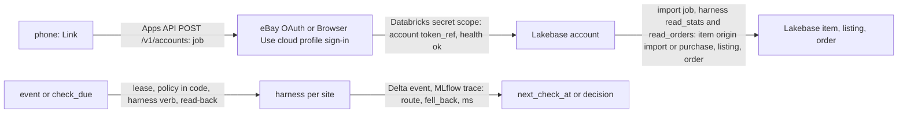

# Connect

Today a seller signs in to five sites, keeps each one signed in, and checks every app by hand for messages, offers and sales. Connect links each site once, inside a cloud browser that keeps the person's own login, and from then on the harness for that site acts and checks for them in the background.

Nate on how it runs ([words](../../product/words.md#2026-11-14-nate-innovate-without-overcomplicating-and-the-agent-framework)): "the agentic frameworks we custom design to cloud based browser use drive the platform actions for the user in the background, and autonmously monitoring and periodically checking, unless fired and hooked with an app event like someone messaging back about a listing".

The whole section below is an *agent proposal* built on the decided harness per marketplace ([decisions](../../product/decisions.md#2026-11-14-each-marketplace-gets-its-own-harness-run-on-browser-use-cloud)) and the runtime in [product.md](../product.md) §6.

## What the person does and sees

| # | Moment | What they see |
|---|---|---|
| 1 | First launch is setup ([decisions](../../product/decisions.md#2026-11-14-first-launch-is-setup-first)) | You > Accounts: eBay, Facebook, Depop, Poshmark, Mercari, OfferUp, Grailed and Email, each with a one-line risk for that site and a Link button |
| 2 | Link eBay | eBay's own sign-in in a sheet (OAuth). Back in the app the row reads ok, with what the harness can do there |
| 3 | Link Facebook, Depop, Poshmark or Mercari | the site's own sign-in page, shown live from the cloud browser in a sheet. They type their password into the site; we never see or keep it |
| 4 | Link Email | Gmail read-only sign-in. Without it the row says "email not connected: sale detection off for Poshmark and Mercari" |
| 5 | Right after a site links | "Found 41 listings" with Bring them in. Each imported listing becomes an item and its live listing; a listing that looks like an item we hold opens a `merge_items` card |
| 6 | Purchases (*agent proposal*) | "Found 41 purchases" with Bring them in: each becomes an item in `owned` with its cost set, plus an `order` of kind purchase |
| 7 | Any day | each row: health pill, the verbs that run there and the ones that open the site instead, last checked, and the risk line |
| 8 | Health changes | `expiring`: a quiet line on the row. `broken`: a `relink` card in Today. The site warned or limited the account: a `site_warning` card and the row goes `paused` |
| 9 | Unlink | the row's menu; the harness stops acting there; history and orders stay |

OfferUp and Grailed link as search and price only: posting there is planned, not built ([words](../../product/words.md#2026-11-14-grailed-and-offerup-posting-planned-not-built)).

## Design choices

| Choice | Options considered | Picked | Why | What would change it |
|---|---|---|---|---|
| How an account links | official OAuth ([platform-access](../../research/connect/nate/platform-access.md)); a cloud browser with a saved login ([posting-browser-use-ebay](../../research/list/ben/posting-browser-use-ebay.md)); a session on the phone; an extension in the person's browser ([crosslister-teardown](../../research/cross-cutting/nate/crosslister-teardown.md#5-capability-by-tool)) | OAuth inside the eBay harness, and Depop's if granted; a Browser Use saved profile on every other site | decided; Facebook has no OAuth for US sellers, Poshmark and Mercari have no API; agents run while the phone is locked | a partner grant on Facebook or Mercari moves that site's verbs to the API inside its harness |
| Where sessions live | cloud profile; device Keychain; both ([privacy-and-data](../../research/cross-cutting/nate/privacy-and-data.md#9-session-tokens-and-cookies-keychain-versus-server-vault)) | the cloud profile; Keychain holds only the app's own session | Keychain `WhenUnlockedThisDeviceOnly` cannot be read while the phone is locked | App Review's reading of guideline 5.1.1(v) on a server-held session (test below) |
| When the harness looks | a fixed poll per site; events only; one loop with two triggers ([email-and-notification-detection](../../research/sold/nate/email-and-notification-detection.md)) | one loop: events set `next_check_at` to now, sweeps pick rows whose time has passed | Nate's words; a fixed poll is either slow or wasteful; Vendoo polls every 10 min | measured lag of each site's events against the sweep |
| Sale detection on Poshmark and Mercari | sold-page poll; Gmail push; a forwarding filter ([email-and-notification-detection](../../research/sold/nate/email-and-notification-detection.md)) | both: Gmail push and a sold-page poll every 1 to 2 min (inferred) | Gmail push has no published latency; a forwarding filter can be spoofed | measured email lag per site |
| One session at a time | parallel jobs on one login; a lease per account ([cloud-browsers-and-detection](../../research/replay/nate/cloud-browsers-and-detection.md#13-replay-relevant-facts)) | a lease: one job drives an account's session, the next waits | a busy session returns 409; one login acting in two places looks like a bot | test accounts that tolerate two sessions without a warning |
| Browser identity | rotating proxies; one stable US IP per profile ([cloud-browsers-and-detection](../../research/replay/nate/cloud-browsers-and-detection.md#12-comparison-table)) | one profile paired with one stable US IP | a cookie replayed from another IP fails; Poshmark flags server IPs | a site that warns on the stable IP |
| A verb a site lacks | hide the site; a one-tap handoff that opens the site ([crosslister-teardown](../../research/cross-cutting/nate/crosslister-teardown.md#5-capability-by-tool)) | the handoff | the person still finishes the job in two taps | none |

## Data flow

## Reads and writes with the proof layer

| Entity | Connect writes | Evidence or guard |
|---|---|---|
| `account` | site, route (`harness`, `search_only`, `email`), health, capabilities, linked_at, token_ref | capabilities come from the harness probe at link; the probe's `job_id` and trace back each one |
| `item` | origin `import` or `purchase`; title, category, cost from the site | each `attribute` carries `evidence` of kind `lookup`, `ref` the snapshot of the site page read, `captured_at`, `extractor_version` |
| `listing` | imported live listings with `external_ids`, `state` live, `next_check_at` | read back from the site at import |
| `order` | kind purchase, price, site, `external_order_id` | the order page snapshot |
| `decision` | `relink`, `site_warning`, `merge_items` | `merge_items` shows the matching facts and their evidence |
| `event` | link, unlink, health change, import, every harness verb | `route`, `fell_back`, `ms`, `trace_id` |

Every number on the screen ("Found 41 listings", last checked) is a guarded number with a `citation` (metric, basis_ids of the rows found). Connect sends nothing a buyer reads, so it runs no `claim_check`; the verbs that do send (`post`, `send_message`) run it inside their jobs.

## States

| Account health | Means | Moves to | The person sees |
|---|---|---|---|
| `ok` | the last verb or probe read back | `expiring`, `broken`, `paused` | a green pill |
| `expiring` | a token or session near its end (eBay refresh at 18 months) | `ok` on refresh, `broken` on expiry | a quiet line |
| `broken` | sign-in needed (needsReauth) | `ok` after relink | a `relink` card |
| `paused` | the site warned or limited the account, or the person paused it | `ok` when the person resumes | a `site_warning` card; no outward verb runs |

Sign-in in progress is the account job's stage, not a health value. Job stages: `import` runs `read`, `match`, `write`; `unlink` runs `stop`, `revoke`.

## Harness and systems

### Verbs and capability per site

Every harness has the same verbs: `post, revise, end, relist, read_inbox, send_message, read_offers, answer_offer, read_orders, read_stats, search, save` ([product.md](../product.md) §6, Harnesses). What runs underneath:

| Site | Route | Native underneath | Handoff (opens the site) | Detector (asserted) | Risk line shown |
|---|---|---|---|---|---|
| eBay | harness, API inside | Inventory and Offer, Fulfillment plus Notification, Message API, Best Offer and Negotiation, Browse | none | Akamai | "eBay bars AI agents from ordering without your review" |
| Facebook | harness, US cloud browser | every verb in the browser | `read_offers`, `answer_offer` (no offers) | Arkose in some flows; warns before it restricts | "Facebook limits automated use; new listings capped at 20 a month" |
| Depop | harness, partner API inside if granted | products, mark sold, orders and webhooks, offers to likers | listing offers (none in the API) | Cloudflare | "Depop bans scraping without permission" |
| Poshmark | harness, paced | every verb in the browser; sale email | none | Cequence and reCAPTCHA | "Poshmark bans automation; accounts were suspended in Nov 2025" |
| Mercari | harness | every verb in the browser; sale email | none | Cloudflare | "Mercari bans bots and may hold funds" |
| OfferUp, Grailed | search and price only | `search`, `read_stats` through Firecrawl, Exa, our scrapers, Apify | `post` and the rest | not researched | "search only" |

Detection facts are from [cloud-browsers-and-detection §2](../../research/replay/nate/cloud-browsers-and-detection.md#20-what-the-sources-say-about-detection-layers).

### One loop, two triggers

| Site | Events that fire a job | Sweeps (`check_due`) |
|---|---|---|
| eBay | Notification topics (order, offer, message) | rows whose `next_check_at` passed |
| Depop | order webhooks | inbox and offers by sweep |
| Poshmark, Mercari | sale email by Gmail push | sold page every 1 to 2 min; inbox by sweep |
| Facebook | none found | everything by sweep |
| Every site | the person's tap | |

Each trigger becomes one `job` with an idempotency key; a repeat joins the running job. Then the lease, the policy check in code, the verb, the read-back, the event and trace, and either a decision or a new `next_check_at`. Starting values for `next_check_at`: pending offer or awaiting our reply, minutes; awaiting the buyer, 15 to 60 min; live with views or watchers, 1 to 2 h; quiet, 6 to 24 h; any event, now ([product.md](../product.md) §6, runtime).

### Lease and pacing

| Site | Pace set in the harness | Quiet hours |
|---|---|---|
| eBay | API call limits; browser steps 1 per 2 to 5 s | none for API reads |
| Depop | 200 creates per 10 s in the API; browser steps 1 per 2 to 5 s | local night for browser steps |
| Poshmark | 1 action per 2 to 5 s (inferred) | local night |
| Mercari, Facebook | 1 action per 2 to 5 s (starting value) | local night |

A second job for the same account waits for the lease. A `paused` account takes reads only after the person resumes.

### Read-back and reconcile

Every outward verb reads the site back before the event is written. A post with no read-back stays `posting` (postUnknown) until `reconcile` resolves it. `reconcile` runs nightly per account and right after a relink: it compares the site's listings and orders with ours, writes what it finds as events, and raises `site_changed_listing` ([list.md](list.md)) when a listing differs. What happens when a site changes after the person's tap is open in [product.md](../product.md#9-open-for-ben-and-nate).

### Systems

| Piece | Used for |
|---|---|
| Browser Use cloud (V4, saved profiles) | sign-in sessions and every browser verb |
| Databricks secret scope | eBay refresh token, Depop OAuth, Gmail OAuth, by `token_ref` |
| Lakebase | `account`, `job`, the lease row, `next_check_at` |
| Delta through the logger, MLflow | events and one trace per job |
| Lakeflow jobs | `check_due`, `reconcile` |
| Gmail API push (Pub/Sub, history.list) | sale email, read by `poll_orders` only |
| Agent framework | open: DurableAgentServer or Flue; a one-site trial on `read_inbox` then `send_message` decides |

## Contract

| Endpoint | Body | Returns |
|---|---|---|
| `POST /v1/accounts` | `{site}` | `201 {account_id, oauth_url}` or `{account_id, signin_session_url}`; `409 stale` if already linked |
| `GET /v1/accounts` | | each account: site, route, health, capabilities, last checked, risk line |
| `POST /v1/accounts/:id/import` | `{kind: listings or purchases}` | `202` `import` job |
| `DELETE /v1/accounts/:id` | | `202` `unlink` job |
| `POST /v1/decisions/:id/act` | `relink`, `site_warning`, `merge_items` options | `relink` returns a new sign-in session |

Errors use `{code, message, failed_step, retry}`; a site refusing sign-in is `502 site_failed` with `retry.by: user`. Ids: `acc_`, `job_`, `dec_`.

## Who may act

| Action | Who |
|---|---|
| Link, relink, unlink, resume a paused account | the person only |
| Import | the person's tap; merging with a held item is `merge_items`, ask |
| Probe health, refresh a token, sweep | auto |
| Any outward verb on a `paused` or `broken` account | nobody until it is `ok` |

## How it fails

| Failure | What happens |
|---|---|
| Sign-in abandoned in the sheet | the job fails at its sign-in stage; the row stays unlinked |
| Captcha or a second factor | the live sheet shows it; the person answers it themselves |
| Token or cookie expired | `broken`, a `relink` card; jobs for that account wait |
| The site warns or limits | `paused`, a `site_warning` card with the site's own words |
| Profile seen from a new IP | the sign-in fails; the harness keeps the stable IP and asks for a relink |
| Lease held too long | the job times out at its stage and the next job takes the lease |
| Gmail not linked | the health line, and the sold-page poll carries detection alone |

## How we will know it works

| Measure | Bar | Source |
|---|---|---|
| Time from a sale to our knowing on Poshmark and Mercari | under 2 min p95 | Vendoo polls every 10 min ([email-and-notification-detection](../../research/sold/nate/email-and-notification-detection.md)) |
| Time from an eBay or Depop event to the job starting | under 1 min p95 | our test; no published figure found |
| Accounts that stay `ok` over 30 days on test accounts | every site, no `site_warning` | test accounts per site |
| Two jobs on one account at once | never, in the traces | MLflow traces |
| Secrets in prompts, logs or traces | none | `node spec/log.mjs` and the secrets check |
| A server-held session under App Store 5.1.1(v) | passes App Review | a TestFlight review build; untested |

## Facts to know

| Fact | Mark | Source | At public launch |
|---|---|---|---|
| eBay OAuth: access 2 h, refresh 18 months | observed | [platform-access §2](../../research/connect/nate/platform-access.md#2-ebay) | unchanged |
| eBay User Agreement bars LLM bots and buy-for-me agents ordering without human review; effective 2026-06-28 on the live page, 2026-02-20 in Ben's note | observed | [platform-access §2](../../research/connect/nate/platform-access.md#2-ebay) | opening the page again settles the date; buying stays the person's tap |
| eBay API licence bars storing user IDs and passwords | observed | [platform-access §2](../../research/connect/nate/platform-access.md#2-ebay) | unchanged: passwords are never held |
| Facebook has no OAuth for US sellers; the partner API is EU and EEA only; the Automated Data Collection Terms apply | observed | [platform-access §3](../../research/connect/nate/platform-access.md#3-facebook-marketplace) | needs written permission or a partner route |
| Depop partner access is gated; PKCE tokens 1 h and 1 year; scraping banned unless authorised | observed | [platform-access §4](../../research/connect/nate/platform-access.md#4-depop) | a granted partner key |
| Poshmark has no API and bans automation, likes, shares, follows and delete-and-repost; suspensions in Nov 2025 were lifted within 24 h | observed, the lift asserted | [platform-access §5](../../research/connect/nate/platform-access.md#5-poshmark) | a written allowance, or the risk line stays |
| Mercari has no public API, bans bots and may suspend and hold funds; it stays in the set | asserted | [platform-access §6](../../research/connect/nate/platform-access.md#6-mercari), [decisions](../../product/decisions.md#2026-11-14-mercari-stays-in-the-platform-set) | a written allowance, or the risk line stays |
| Terms side by side | observed | [platform-access §7](../../research/connect/nate/platform-access.md#7-cross-marketplace-comparison-of-terms) | each term becomes a `rights` tag that is enforced |
| Gmail read scopes are restricted and need a yearly security assessment ($540 to $1,800) | asserted | [email-and-notification-detection](../../research/sold/nate/email-and-notification-detection.md) | the assessment is passed |
| App Store rules on account deletion and data | observed | [privacy-and-data §2](../../research/cross-cutting/nate/privacy-and-data.md#2-apple-app-store-rules) | unchanged |
| Deletion removes sessions and tokens | observed | [privacy-and-data §11](../../research/cross-cutting/nate/privacy-and-data.md#11-retention-and-deletion) | unchanged |
| Browser Use profiles keep a login across sessions | observed | [posting-browser-use-ebay](../../research/list/ben/posting-browser-use-ebay.md#browser-use-for-sites-without-an-api-poshmark-depop-mercari-facebook-marketplace) | unchanged |

Rules that protect people, unchanged: a home address goes out only on the person's tap; buyers' data is handled as in [privacy-and-data](../../research/cross-cutting/nate/privacy-and-data.md); a recalled product is not listed; the risk to each real account is shown on its row.

## Open for Ben and Nate

None. The framework choice and the after-the-tap conflict are open in [product.md](../product.md#9-open-for-ben-and-nate).

## Needs from the shared model

- A verb, or a named use of `read_stats`, that reads the seller's own active listings for `import`.
- The risk line's text per site as a field on `account.capabilities`.
- `reconcile`'s cadence (nightly per account and after relink) in the job table.
