# Data
Status: draft, *agent proposal* except where a line links a decision. Slug: data. Second pass 2026-11-14. Names, states, kinds and endpoints are [product.md](../product.md)'s; where [databricks.md](../databricks.md) (another author's draft) calls the proof layer assertion, observation and manifest, this page uses product's `evidence` and `citation`.

Decided: Databricks runs the whole backend with a two-hour fallback ([decision](../../product/decisions.md#2026-11-14-databricks-runs-the-whole-backend-with-a-hybrid-fallback)); licences and site terms are recorded as facts and do not shape the build ([decision](../../product/decisions.md#2026-11-14-licences-and-site-terms-are-recorded-as-facts-and-do-not-shape-the-build)). Data is the backbone for [item-card](item-card.md), [price](price.md), [today](today.md), [insights](insights.md), [score](score.md) and [market](market.md). It also holds the proof layer: every fact carries `evidence`, every number shown is a guarded number with a `citation`, and anything sent out passes a `claim_check` ([product §8](../product.md)). Where Ben's earlier plan differs, today's decisions win: his `why` endpoint, `idempotency` table and `action_log` are gone ([logging packet](../../.agents/team/packets/team/5-logging.md)).

## What the person does and sees

| Where | What they see | Backed by |
|---|---|---|
| Item card, "Why?" | What was done to this item and why, newest first; who did it (you, auto, the site); Undo where the site allows | `event` joined to the job's trace |
| Any number | One tap opens the sales or listings it rests on, with dates and the plain definition | `citation` |
| Today | Anything waiting; a held claim as "send without it, edit, or confirm" | `decision` (`unbacked_claim`, `rule_expiring`), `event` |
| You, "Ask" | A question box over their own items and sales, with the rows and the query shown, marked "AI-generated, check the rows" | guarded query, Genie behind it |
| You > Your data | What we hold, by kind, with Export and Delete account | all stores |
| "Always do this" | Offered after 3 unedited approvals of the same kind ([decision](../../product/decisions.md#2026-11-14-always-accept-is-offered-at-listing-and-only-unedited-approvals-count)) | `label`, `rule` |

Deletion is required by Apple 5.1.1(v) ([privacy](../../research/cross-cutting/nate/privacy-and-data.md)), so "Your data" is part of the promise that "Why?" makes.

## Design choices (*agent proposal*)

| Choice | Options considered | Picked | Why | What would change it |
|---|---|---|---|---|
| Where proof lives | MLflow traces only; fields on each row; an append-only ledger plus kept snapshots ([rewards](../../research/data/nate/what-databricks-rewards.md): "the unit of trust is the claim, not the row") | Ledger in Delta, snapshots in Volume | A fact can be re-read without refetching; a number can be recomputed | Test 9 below fails: a recompute differs after a week |
| How numbers reach the screen | Free Genie answers; plain views; metric views behind one `guarded_query` ([ChicagoPulse pattern in rewards](../../research/data/nate/what-databricks-rewards.md); [analytics](../../research/data/nate/analytics-and-recommendations.md)) | Metric views plus `guarded_query` in FastAPI | The browser cannot submit SQL; the hide rule is code, because no refusal setting was found in metric views | Metric views absent on Free Edition: same rules as plain SQL views |
| Tenant isolation | Unity Catalog row filters on synced tables; one Databricks identity per person; Postgres row security on `app.user_id` | Row security, set per transaction by the App | An app accepts only Databricks sign-in; no per-user isolation in the official plugin; synced tables are read-only and drop row filters | Row-security test on a real workspace ([coverage](../coverage.md) row 3) |
| Ingest to Delta | Lakebase change feed; Zerobus; Lakehouse Sync | Change feed | One path is enough; Zerobus is at-least-once and would need dedupe | Event volume past the feed's limits |
| Trace content | Message text in spans; ids only | Ids only, text read from the thread | Traces cannot be deleted by API ([platform](../../research/data/nate/databricks-platform.md)) | Open 1 |
| Auto-reply bar | One threshold; a middle band to a person ([item-matching blog, 2021, in rewards](../../research/data/nate/what-databricks-rewards.md)) | 0.98 precision and 0.95 recall, middle band to Today | Same as [product §10](../product.md) and [messages](messages.md) | Held-out taps miss the bar |
| Free-form questions | Genie over views; fixed question list | Fixed list always; Genie behind the guard where it exists | Genie Agents take no custom tools, so the guard sits in front | A Genie call through the App fails the guard ([coverage](../coverage.md) row 5) |

## Data flow (*agent proposal*)

```mermaid
flowchart LR
  P["site page or API"] -->|"Firecrawl or eBay API on edge: snapshot and observation written"| O["Delta observation, Volume snapshot"]
  O -->|"extractor in Lakeflow job: comp with evidence and rights"| C["Delta comp"]
  C -->|"dqx check in pipeline: comp kept or held"| M["Delta metric view rollup"]
  M -->|"guarded_query in FastAPI on Apps: citation written"| Z["Delta citation, Lakebase score"]
  Z -->|"GET /v1/insights: guarded number sent"| A["phone"]
  A -->|"tap to POST /v1/decisions/:id/act: decision answered, event"| E["Lakebase event, label"]
  E -->|"Lakebase change feed: history rows"| H["Delta event, label history"]
  H -->|"MLflow evaluation: label in_use, threshold proposed"| E
  D["draft message or listing"] -->|"claim_check in FastAPI: claim_check row, verdict"| E
```

## What it reads and writes

Fields are product's, not repeated here. Money and states read Lakebase, never Delta.

| Store | Holds | Flows to |
|---|---|---|
| Lakebase | `user, account, item, attribute, photo, capture, job, valuation, strategy, listing, conversation, message, offer, order, sale_receipt, decision, rule, limits, want, match, appointment, goal, event, label, claim_check, score, experiment, arm, follow` | Delta by change feed |
| Delta | `observation`, `comp` (append-only, no user id), `citation`, `ranker_model` data, `event` and `label` history, experiment results, rollups | Lakebase by synced tables of gold views only (a price range per product) |
| Volume | `raw.photos`, page snapshots, masks, depth | paths on `photo`, `observation` |
| AI Search | product, comp, and per-person approved-example indexes; self-managed embeddings | rebuilt from Delta |

An `event` is written in the same transaction as the change it records. Message text, addresses, tokens and payment details never enter `event` or a span; only ids do. Idempotency is the `Idempotency-Key` header and `operation_id`, not a table.

## The proof layer

**Evidence ledger.** `attribute.evidence[]` goes down to the image region: `{kind, ref: photo id, region: polygon, captured_at, extractor_version}`; a `lookup` evidence names the `observation`. For market data, `observation` (Delta, append-only) holds: `source_url, read_at, snapshot_ref, fingerprint, extractor_version, rights, parsed_ids[]`, and `comp.evidence` points at it. The `rights` tags are `may_store, may_model, may_show, may_share, ttl`. Product's older `permitted_uses` maps in (`display` to `may_show`; `price` and `train` to `may_model`; `cross_site_price` to `may_share`).

**Re-extraction.** Bump `extractor_version`; a job reads each kept snapshot whose `fingerprint` is unchanged and appends a new `comp`; the old row stays, so an old number recomputes at its own version. No refetch happens. Where `ttl` has passed the snapshot is gone, the row keeps only its fingerprint and parsed fields, and re-extraction is skipped and marked.

**Guarded numbers.** Each metric is a metric view plus one rule file beside it (`min_basis`, label bands, window, `hide_reason`, wording). `guarded_query` is the only path to a screen.

| Metric | Hidden when | Bands and words | Source (mark) |
|---|---|---|---|
| Sold range | under 5 sales: show the sales | low 5 to 9, medium 10 to 29, high 30 or more; never mixes sold and asking | [product §8](../product.md); [market intelligence](../../research/data/nate/market-intelligence.md), aiplannermail (*observed*) |
| Asking range | under 6 live listings | "Asking prices of N live listings" | same |
| Price history | under 3 snapshots on different days | "Seen since [date]: [low] to [high]. We started watching on [date]." | same |
| Old data | a read older than two weeks is dropped; before that, marked "OLD DATA" with its date | | same |
| Score axis | too few comparables; interval wider than the value; rank agreement not above the noise floor; ranker-change flag up | one `score` row per axis; no combined score if any axis hidden | [scoring](../../research/price/nate/scoring-and-ranker-inference.md) (*inferred*) |

**Citation.** `guarded_query` does five steps: read the metric view; collect `basis_ids`; read each input table's version; read the rights tags of every basis row; write `citation {metric, filters, table_versions[], definition_version, code_version, computed_at, basis_ids[]}` and return its id. `GET /v1/citations/:id` opens it. Because `comp` and `observation` are append-only, recompute filters on `basis_ids` and `observed_at`, so it does not depend on Delta history, which defaults to 7 days (*observed*, [databricks.md](../databricks.md) §5.1). Mutable inputs need raised retention or an append-only copy.

**Rights check.** `rights_gate(basis, use)` runs in `guarded_query` and before every model call and share, with `use` one of `show`, `model`, `share`. It refuses if any basis row's tag bars the use. Now it is in log-only mode: a would-be refusal writes an `event` (`rights.would_block`) and the build runs. For a public launch the same code is switched to refuse. Fixture: a `comp` with `may_model` false must never reach a prompt.

**Stores for the rest.**

| Entity | Lakebase | Delta | Written by |
|---|---|---|---|
| `score` | current | history | scoring job, through `guarded_query` |
| `ranker_model` | none | table plus UC model registry; aliases Champion and Challenger | training job; never read as a site's real weights |
| `experiment`, `arm` | live | results | decision `run_experiment`; Thompson sampling with a fallback arm ([scoring](../../research/price/nate/scoring-and-ranker-inference.md), *inferred*) |
| `claim_check` | row per draft | history | a stage inside `send_message`, `post` and draft jobs, not a job kind |

`claim_check`: an extract-only model splits the text into claims; plain code matches each to an `attribute` or `evidence`; the verdict is `pass`, `hold` or `abstain`. A hold opens decision `unbacked_claim` ([product §5](../product.md)).

## Platform pieces, judged

Test: if it were removed, would the app change? Borrowed from the contest guidance in [rewards](../../research/data/nate/what-databricks-rewards.md). Free Edition facts: 3 apps that stop after 24 hours, 1 Lakebase project, no GPU serving, open models only, outbound limited to trusted domains, non-commercial (*observed*, [platform](../../research/data/nate/databricks-platform.md); [databricks.md](../databricks.md) §8).

| Piece | If removed | Verdict and repository considered | Free Edition | Full workspace |
|---|---|---|---|---|
| Lakebase | no store for cards or Today | Adopt; migrations adapt `databricks/tmm` Lakebase-Agentic-CI (licence not read) | 1 project, scale to zero | ceiling 112 or 64 CU unresolved |
| Delta, change feed | no comp history or rollups | Adopt | fits | fits |
| Metric views, `guarded_query` | numbers go unguarded | Adopt metric views; adapt `open-retail-data-model` (Apache-2.0) names; build `guarded_query` | unverified; plain SQL views | fits |
| Genie | free-form Ask goes; fixed questions stay | Adopt behind the guard | unverified | fits |
| MLflow traces | "Why?" loses its detail | Adopt MLflow 3; build redaction | fits | fits |
| MLflow evaluation, `log_feedback` | thresholds cannot move | Adopt | fits | review queues are Beta |
| AI Search | no candidates or comp retrieval | Adopt; adapt Zingg `fuzzy-item-matching` ideas | one endpoint, no Direct Vector Access | fits |
| Gateway | direct provider calls, no fallback log | Adopt | unverified | GA |
| Long jobs | upload to job start breaks | Adopt `DurableAgentServer` (databricks-ai-bridge) | test 7 | fits |
| dqx | bad comps reach numbers | Adopt (Databricks License; Python below 3.13) | fits | fits |
| Zerobus | nothing: the change feed already ingests | Dropped, in reserve | unverified | GA, at-least-once |
| `ai_query` per row | nothing: Gateway calls do the same | Dropped; task functions where present, persisted | unverified | fits |
| UC row filters | none on the app path | Dropped there; Delta-side use follows `databricks-abac-rls-demo` (MIT) | fits | Public Preview on pipelines |

Fits in Free Edition: the build, for a person's own use, with the 24 hour restart. Needs a full workspace: a public launch (non-commercial), GPU serving, and any unverified row above that tests fail.

## States

| Moves | Trigger |
|---|---|
| `job` `started, running, arrived, failed` | the worker, with the trace id |
| `label` `proposed, in_use, retired` | evaluation proposes; a developer approves the threshold; the person approves a promotion |
| `claim_check` verdict `pass, hold, abstain` | the check |
| Delete request `requested, running, done, failed` | the person's tap; each store reports a stage |

## Contract for the frontend

| Endpoint | Returns |
|---|---|
| `GET /v1/events?item_id=&cursor=` | `{event_id, item_id, action, actor, at, why, trace_id, undo}`; a step with no trace says "no detail recorded" |
| `POST /v1/events/:id/undo` | the undo |
| `GET /v1/citations/:id` | what a number rests on |
| `POST /v1/me/export`, `DELETE /v1/me` | `export_user`, `delete_user` jobs |
| `GET /v1/jobs/:id/events`, `GET /v1/stream` | SSE; polling `GET /v1/jobs/:id` always works |

## Who may act

| Action | Mode |
|---|---|
| Write events, sync, sweep, reconcile, citations | auto, logged |
| Move a kind to Auto | the person, after 3 unedited approvals; never a locked kind |
| Lower an auto threshold | a developer; the system only proposes |
| Send a held claim | the person, by decision |
| Use a person's labels to train anything shared | never without their opt-in (Open 2) |
| Delete account, export | the person |

## How it fails

| Failure | Person sees | Recovery |
|---|---|---|
| Lakebase waking | a retry within a second | pool reconnect; token refresh; recycle at 45 minutes |
| Lakebase or Apps unusable in 2 hours | nothing | fallback per the decision |
| Sync lag | nothing: money and states read Lakebase | alert on lag |
| Metric rule missing | the number is hidden, "not enough yet" | never shown unguarded |
| Citation cannot be built | the number is hidden | job retries |
| Trace not stored | "no detail recorded" | never guessed |
| Delete fails in one store | which kind is pending | each store retries on its own |
| Genie slow or wrong | "Couldn't answer that"; rows still shown | fixed questions |

## How we will know it works

| Claim | Bar | Source (mark) |
|---|---|---|
| Numbers recompute | 20 numbers recomputed from their `citation` after a week: zero differences | [databricks.md](../databricks.md) §9 test 9 (*agent proposal*) |
| Thin numbers hidden | a 30-question set with verified SQL in six categories, run before and after every change; any thin number shown fails | ChicagoPulse in [rewards](../../research/data/nate/what-databricks-rewards.md) (*asserted*) |
| People are separate | two real users, every route and Genie: zero cross reads, row security on | [coverage](../coverage.md) row 3 |
| Auto replies are safe | precision 0.98 and recall 0.95 per class on held-out real taps; no auto action outside limits | [messages-and-offers.md](../../research/messages/ben/messages-and-offers.md) (*inferred*); [product §10](../product.md) |
| Unbacked claims stop | on labelled real drafts, an unbacked claim sent: zero | [rewards](../../research/data/nate/what-databricks-rewards.md) (*asserted*) |
| Rights tags work | a fixture with `may_model` false never reaches a prompt (logged now) | (*agent proposal*) |
| Re-extraction is free | 50 stored snapshots re-read with zero page fetches | (*agent proposal*) |
| Every change has an event | `node spec/log.mjs` on a real run: zero state changes without a line | (*agent proposal*) |
| Deletion is whole | after `DELETE /v1/me`, a scan by user id finds zero rows in every store | (*agent proposal*) |
| Sync and wake are quick | p95 sync, wake time and SSE lag measured | [coverage](../coverage.md) row 2 |

## Facts to know

| Fact | Mark | Source | For a public launch |
|---|---|---|---|
| An app accepts only Databricks sign-in; no per-user isolation in the official database plugin; synced tables are read-only without catalog row filters | observed | [databricks.md](../databricks.md) | the edge and row security stay |
| Lakebase tokens last 1 hour; scale to zero loses pools and LISTEN/NOTIFY | observed | [platform](../../research/data/nate/databricks-platform.md) | same |
| Zerobus is at-least-once; Genie Agents take no custom tools | observed | [databricks.md](../databricks.md) | same |
| Free Edition is non-commercial | observed | [platform](../../research/data/nate/databricks-platform.md) | needs a paid workspace |
| MLflow: no per-trace delete by API; 25 MB read limit; 100,000 traces | observed | [platform](../../research/data/nate/databricks-platform.md) | traces hold ids only |
| eBay: delete personal data promptly, honour deletion notices, no training on eBay content | observed | [privacy](../../research/cross-cutting/nate/privacy-and-data.md) | eBay rows get `may_model` and `may_share` false, enforced |
| StockX terms bar commercial use and public display; PriceCharting bars public-facing use; WatchCharts caps history shown | observed | [market intelligence](../../research/data/nate/market-intelligence.md) | tags enforced, or written consent |
| Apple 5.1.2(i): ask before sharing personal data with third-party AI | observed | [privacy](../../research/cross-cutting/nate/privacy-and-data.md) | in force |

Rules that stay: a home address only on the person's tap, buyers' personal data kept out of models and traces, recalled products not listed, and the risk to a real marketplace account shown per site.

## Open for Ben and Nate

1. Message text in traces. Ben: text stays in traces for "Why?" (*agent proposal*). Nate: deletion must reach traces, and they cannot be deleted by API ([privacy](../../research/cross-cutting/nate/privacy-and-data.md)). Recommend ids only, and a fixed trace window; an MLflow MCP `delete_traces` exists (experimental, untested).
2. Whose labels train what. Recommend: approvals tune that person's own rules and retrieval; shared training needs an opt-in.
3. Business: a paid workspace, and whether a governed market-history data set is sold ([databricks.md](../databricks.md) §5.8). Say, not picked.

## Needs from the shared model
- `observation` as a Delta table with `evidence` fields, and `rights_mode` (log, enforce) as one setting.
- Endpoints `POST /v1/ask` and `GET /v1/me/data`; `retention_class` on every entity.
- `rights.would_block` as an event action; `claim_check` and `citation` joined to `event.trace_id`.
