# Data
Status: draft, *agent proposal* except where a line links a decision. Slug: data. Second pass 2026-11-14. Names, states, kinds and endpoints are [product.md](../product.md)'s; where [databricks.md](../databricks.md) (another author's draft) calls the proof layer assertion, observation and manifest, this page uses product's `evidence` and `citation`.

Decided: Databricks runs the whole backend with a two-hour fallback ([decision](../../product/decisions.md#2026-11-14-databricks-runs-the-whole-backend-with-a-hybrid-fallback)); licences and site terms are recorded as facts and do not shape the build ([decision](../../product/decisions.md#2026-11-14-licences-and-site-terms-are-recorded-as-facts-and-do-not-shape-the-build)). Data is the backbone for [item-card](item-card.md), [price](price.md), [today](today.md), [insights](insights.md), [score](score.md) and [market](market.md). It also holds the proof layer: every fact carries `evidence`, every number shown is a guarded number with a `citation`, and anything sent out passes a `claim_check` ([product §8](../product.md)). Where Ben's earlier plan differs, today's decisions win: his `why` endpoint, `idempotency` table and `action_log` are gone ([logging packet](../../.agents/team/packets/team/5-logging.md)).

## What the person does and sees

| Where | What they see | Backed by |
|---|---|---|
| Item card, "Why?" | What was done to this item and why, newest first; who did it (you, auto, the site); Undo where the site allows | `event` joined to the job's trace |
| Any number | One tap opens the sales or listings it rests on, with dates and the plain definition | `citation` |
| Today | Anything waiting; a held claim as "send without it, edit, or confirm" | `decision` (`unbacked_claim`, `rule_expiring`), `event` |
| You, "Ask" | A question box over their own items and sales, with the rows and the query shown, marked "AI-generated, check the rows" | guarded query, Genie behind it |
| You > Your data | What we hold, by kind, with Export and Delete account | all stores |
| "Always do this" | Offered after 3 unedited approvals of the same kind ([decision](../../product/decisions.md#2026-11-14-always-accept-is-offered-at-listing-and-only-unedited-approvals-count)) | `label`, `rule` |

Deletion is required by Apple 5.1.1(v) ([privacy](../../research/cross-cutting/nate/privacy-and-data.md)), so "Your data" is part of the promise that "Why?" makes.

## Design choices (*agent proposal*)

| Choice | Options considered | Picked | Why | What would change it |
|---|---|---|---|---|
| Where proof lives | MLflow traces only; fields on each row; an append-only ledger plus kept snapshots ([rewards](../../research/data/nate/what-databricks-rewards.md): "the unit of trust is the claim, not the row") | Ledger in Delta, snapshots in Volume | A fact can be re-read without refetching; a number can be recomputed | Test 9 below fails: a recompute differs after a week |
| How numbers reach the screen | Free Genie answers; plain views; metric views behind one `guarded_query` ([ChicagoPulse pattern in rewards](../../research/data/nate/what-databricks-rewards.md); [analytics](../../research/data/nate/analytics-and-recommendations.md)) | Metric views plus `guarded_query` in FastAPI | The browser cannot submit SQL; the hide rule is code, because no refusal setting was found in metric views | A metric view cannot hold a rule the guard needs: the rule moves into `guarded_query` |
| Tenant isolation | Unity Catalog row filters on synced tables; one Databricks identity per person; Postgres row security on `app.user_id` | Row security, set per transaction by the App | An app accepts only Databricks sign-in; no per-user isolation in the official plugin; synced tables are read-only and drop row filters | Row-security test on a real workspace ([coverage](../coverage.md) row 3) |
| Ingest to Delta | Lakebase change feed; Zerobus; Lakehouse Sync | Change feed | One path is enough; Zerobus is at-least-once and would need dedupe | Event volume past the feed's limits |
| Trace content | Message text in spans; ids only | Ids only, text read from the thread | Traces cannot be deleted by API ([platform](../../research/data/nate/databricks-platform.md)) | Open 1 |
| Auto-reply bar | One threshold; a middle band to a person ([item-matching blog, 2021, in rewards](../../research/data/nate/what-databricks-rewards.md)) | 0.98 precision and 0.95 recall, middle band to Today | Same as [product §10](../product.md) and [messages](messages.md) | Held-out taps miss the bar |
| Free-form questions | Genie over views; fixed question list | Fixed list always; Genie behind the guard where it exists | Genie Agents take no custom tools, so the guard sits in front | A Genie call through the App fails the guard ([coverage](../coverage.md) row 5) |

## Data flow (*agent proposal*)

```mermaid
flowchart LR
  R["Lakebase route_table"] -->|"harness.call on the edge worker: own adapter, then fetch engine, official API or aggregator last; route_call logged"| P["site page, gatherer source, API or vendor"]
  P -->|"chosen route on the edge worker: snapshot and observation written"| O["Delta observation, Volume snapshot"]
  O -->|"per-call Beta update of the route success param; nightly truth check writes challengers"| R
  O -->|"extractor in Lakeflow job: comp with evidence and rights"| C["Delta comp"]
  C -->|"dqx check in pipeline: comp kept or held"| M["Delta metric view rollup"]
  M -->|"guarded_query in FastAPI on Apps: citation written"| Z["Delta citation, Lakebase score"]
  Z -->|"GET /v1/insights: guarded number sent"| A["phone"]
  A -->|"tap to POST /v1/decisions/:id/act: decision answered, event"| E["Lakebase event, label"]
  E -->|"Lakebase change feed: history rows"| H["Delta event, label history"]
  H -->|"param_fold: label in_use, param challenger written"| E
  D["draft message or listing"] -->|"claim_check in FastAPI: claim_check row, verdict"| E
```

## What it reads and writes

Fields are product's, not repeated here. Money and states read Lakebase, never Delta.

| Store | Holds | Flows to |
|---|---|---|
| Lakebase | `user, account, item, attribute, photo, capture, job, valuation, strategy, listing, conversation, message, offer, order, sale_receipt, decision, rule, limits, want, match, appointment, goal, event, label, claim_check, score, experiment, arm, follow, param`, and the router's `route_table` (each reviewed rule change and the kill switch is a kept `version`, not a second entity) | Delta by change feed |
| Delta | `observation`, `comp` (append-only, no user id), `citation`, `route_call` (the daily stats are a Lakeflow rollup of it, not an entity), `route_truth`, `ranker_model` data, `event` and `label` history, experiment results, rollups | Lakebase by synced tables of gold views only (a price range per product) |
| Volume | `raw.photos`, page snapshots, masks, depth | paths on `photo`, `observation` |
| AI Search | product, comp, and per-person approved-example indexes; self-managed embeddings | rebuilt from Delta |

An `event` is written in the same transaction as the change it records. Message text, addresses, tokens and payment details never enter `event` or a span; only ids do. Idempotency is the `Idempotency-Key` header and `operation_id`, not a table.

## The proof layer

**Evidence ledger.** `attribute.evidence[]` goes down to the image region: `{kind, ref: photo id, region: polygon, captured_at, extractor_version}`; a `lookup` evidence names the `observation`. For market data, `observation` (Delta, append-only) holds: `source_url, read_at, snapshot_ref, fingerprint, extractor_version, rights, parsed_ids[]`, and `comp.evidence` points at it. The `rights` tags are `may_store, may_model, may_show, may_share, ttl`. Product's older `permitted_uses` maps in (`display` to `may_show`; `price` and `train` to `may_model`; `cross_site_price` to `may_share`).

**Re-extraction.** Bump `extractor_version`; a job reads each kept snapshot whose `fingerprint` is unchanged and appends a new `comp`; the old row stays, so an old number recomputes at its own version. No refetch happens. Where `ttl` has passed the snapshot is gone, the row keeps only its fingerprint and parsed fields, and re-extraction is skipped and marked.

**Guarded numbers.** Each metric is a metric view plus one rule file beside it (`min_basis`, label bands, window, `hide_reason`, wording). `guarded_query` is the only path to a screen.

| Metric | Hidden when | Bands and words | Source (mark) |
|---|---|---|---|
| Sold range | below the minimum basis in [money D1](../determinations/money.md#d1-comparable-set-and-weights) and [D5](../determinations/money.md#d5-fair-value-range-overall-and-per-site): show the sales | display state per [money D6](../determinations/money.md#d6-range-calibration-and-display-state); never mixes sold and asking | [market intelligence](../../research/data/nate/market-intelligence.md), aiplannermail (*observed*) |
| Asking range | under 6 live listings | "Asking prices of N live listings" | same |
| Price history | under 3 snapshots on different days | "Seen since [date]: [low] to [high]. We started watching on [date]." | same |
| Old data | a read older than two weeks is dropped; before that, marked "OLD DATA" with its date | | same |
| Score axis | below the effective-sample rule of [money D1](../determinations/money.md#d1-comparable-set-and-weights) (`n_eff`, not a count of sales); interval wider than the value; rank agreement not above the noise floor; ranker-change flag up | one `score` row per axis; a combined line only if Ben and Nate allow the axes to combine ([product §9](../product.md)), and never with an axis hidden | [scoring](../../research/price/nate/scoring-and-ranker-inference.md) (*inferred*) |

**Citation.** `guarded_query` does five steps: read the metric view; collect `basis_ids`; read each input table's version; read the rights tags of every basis row; write `citation {metric, filters, table_versions[], definition_version, code_version, computed_at, basis_ids[]}` and return its id. `GET /v1/citations/:id` opens it. Because `comp` and `observation` are append-only, recompute filters on `basis_ids` and `observed_at`, so it does not depend on Delta history, which defaults to 7 days (*observed*, [databricks.md](../databricks.md) §5.1). Mutable inputs need raised retention or an append-only copy.

**Rights check.** `rights_gate(basis, use)` runs in `guarded_query` and before every model call and share, with `use` one of `show`, `model`, `share`. It refuses if any basis row's tag bars the use. Now it is in log-only mode: a would-be refusal writes an `event` (`rights.would_block`) and the build runs. For a public launch the same code is switched to refuse. Fixture: a `comp` with `may_model` false must never reach a prompt.

**Stores for the rest.**

| Entity | Lakebase | Delta | Written by |
|---|---|---|---|
| `score` | current | history | scoring job, through `guarded_query` |
| `ranker_model` | none | table plus UC model registry; aliases Champion and Challenger | training job; never read as a site's real weights |
| `experiment`, `arm` | live | results | decision `run_experiment`; Thompson sampling with a fallback arm ([scoring](../../research/price/nate/scoring-and-ranker-inference.md), *inferred*) |
| `claim_check` | row per draft | history | a stage inside `send_message`, `post` and draft jobs, not a job kind |

`claim_check`: an extract-only model splits the text into claims; plain code matches each to an `attribute` or `evidence`; the verdict is `pass`, `hold` or `abstain`. A hold opens decision `unbacked_claim` ([product §5](../product.md)).

## Source registry and router (*agent proposal*)

**In plain terms** (Nate, [words](../../product/words.md#2026-11-14-nate-a-harness-api-on-jev-ultrafast-or-firecrawl-a-pipeline-on-every-event), [words](../../product/words.md#2026-11-14-nate-our-own-protocol-official-apis-last)). One registry, two layers. The site protocol ([product §6](../product.md#the-harness-protocol)) is our own: an adapter per site and verb over the person's signed-in session, reads and writes, primary for every verb. Information engines (below) cover the open web. The route order is our own adapter, then our fetch engine (Firecrawl for fetch, extract and page monitors, Ben's decided engine for watch alerts, [decisions](../../product/decisions.md); or the jev-ultrafast pattern where a page needs steps: code builds the list of valid actions, the fast decision model picks one, and code confirms on a fresh read, [harness from repos](../../research/cross-cutting/ben/ai-harness-from-repos.md), *observed* by Ben's side), and last a site's official API or an outside aggregator such as treg, used only when ours cannot be made to work for that need. Every app event and every Databricks action (a table update, a file arrival, a job ending) starts a pipeline: one job whose agent runs the route. Market intelligence is what these same pipelines write.

Nate: "https://treg.to/ exemplifies just one way data is aggregated, but we can make our own and even more specialized, all built on data bricks in an impressive way" ([words](../../product/words.md#2026-11-14-nate-our-own-aggregation-more-specialized-on-databricks)). Treg routes a call to the cheapest working tool; ours also knows item kinds, sites and what a comp needs, and ranks routes on whether their data later proved right. Databricks has no multi-provider fetcher registry and no source reliability or reconciliation (*observed*, [aggregated search](../../research/data/nate/port-aggregated-search.md)), so we build that layer and keep it in Databricks stores.

**Registry.** One `route_table` row per (layer, site, need, route): need is a harness verb, a comp need (`sold`, `asking`, `retail`, `trend`, `identify`) or a gatherer's question. Each row holds what it returns (fields: price type, sold date, best offer flag, condition, photos), kind (`adapter, fetch, official_api, treg_direct, treg_routed, other_vendor`), unit cost and its basis, `success` (a Beta `param`), `completeness`, p50 and p95 ms, measured freshness (median lag from `sold_at` or `listed_at_source` to `read_at`), coverage per category and item kind, rights tags, `right_90d`, `breaker`, `account_risk`, state, and `seed_source`; the fields are product's ([§3](../product.md)). Columns follow the [treg design](../../research/cross-cutting/nate/treg-tool-routing.md) (*inferred*); the fetcher shape (transform query, extract, transform data) is OpenBB's, Apache-2.0 (*observed*, [aggregated search](../../research/data/nate/port-aggregated-search.md)); the adapter pattern is jackwener/opencli's ([databricks.md](../databricks.md) Appendix B).

**Router.** Plain code on the edge worker, called by every harness verb, comp read and gatherer. It filters routes that return what the need requires (a comp needs sold price with date and condition, per [money D1](../determinations/money.md#d1-comparable-set-and-weights)) and whose rights allow the use, skips any whose `breaker` is open, then orders them by kind (own adapter, fetch engine, then official API or aggregator, [words](../../product/words.md#2026-11-14-nate-our-own-protocol-official-apis-last)) and within a kind by lowest `unit_cost / (mean success x completeness x right_90d)` ([managing 16](../determinations/managing-and-buyers.md#16-which-route-to-use), [17](../determinations/managing-and-buyers.md#17-whether-an-account-is-healthy-or-at-risk)). A cost ceiling holds per observation and per batch. It falls back on transport failure, 429 or an empty or wrong verdict, never on another 4xx. Every attempt writes a `route_call` row and an event (`route`, `fell_back`, `ms`) and updates the route's `success` param in the same transaction; every result writes an `observation` with evidence, and `comp.source_route` is the `route_id`. Results from several routes merge by fingerprint, SearXNG style (AGPL, pattern only, *observed*, same source); a need's maximum age follows Jina's per-question freshness table idea (same source).

**What it takes from the published registries** ([teardown](../../research/data/nate/teardown-price-tools-and-registries.md#2-registries-and-routers); [parity](../parity.md#registries-and-routers)). Starting values, unsourced.
- Exploration. For reads only (never a verb that changes a listing), a share of calls (a `param`, prior 5%) goes to another eligible route, chosen at random weighted by `1 / cost per useful result`, so a demoted route keeps current measurements between hourly `route_probe` runs. OpenRouter splits traffic by weighted-random shares (*observed*); a pure best-first order starves the other routes of data (*inferred*, same note).
- Ceilings per call. Each call carries a cost ceiling and a latency ceiling (treg `X-Treg-Route-Max-Cost`, *observed (highlight)*; OpenRouter `max_price` and `preferred_max_latency`, *observed*), besides the ceilings per observation and per batch; a call over either is not sent, or is cut off and falls back.
- Recovery by call id. Every `route_call` has a `call_id`, and its raw response is kept as the observation's `snapshot_ref`. A retry with the same idempotency key, or a read by `call_id`, returns the stored result at zero cost (treg `GET /calls/<id>/result`, *observed (highlight)*).
- No cost on a provider error. A provider 4xx or 5xx records cost 0 against the person and the job, as treg does (*observed (highlight)*). Whatever a vendor bills for it is kept on the route as overhead, so cost per useful result stays honest.
- Entry schema. A `route_table` row is a registry entry shaped like the official MCP registry's `server.json` (a reverse-DNS `route_id` such as `com.ebay.browse.sold`, `version`, description, where it runs; *observed*) with Apify's `actor.json` input and output schemas (*observed*) as `input_schema` and `output_schema` (JSON Schema), and an `auth` kind from Composio's set (`API_KEY, OAUTH2, NO_AUTH, BASIC`, *observed (highlight)*) plus `session` for the own signed-in route. The output schema is what the filter above checks against a need.
- Pay per result. The ledger counts cost per useful result (a `hit` that passed its verdict) and cost per 1,000 results per route, as Apify shows its developers (*observed*), and each `route_call` is tagged with the person, job and need, as treg's `X-Treg-Meta` tags its ledger (*observed (highlight)*).
- A missing route. A need no eligible route can meet writes a `route_call` with verdict `no_route`; the health page lists these per site and need, the way treg's `catalog_request` records a missing capability (*observed (highlight)*).

**Proved right.** A nightly Lakeflow job writes `route_truth`: each route's comps against later truth (our own sales, a second route's sold read, a re-read of the same listing). `right_90d` is the share that agreed within the D5 range, a Beta `param` with prior 1 until 20 checks exist. A route's breaker opens after 3 straight failures or when its `success` mean falls below its guard, goes half-open after a cool-down, and an open adapter breaker starts `adapter_author`; these are starting values, unsourced.

**Where it runs.** `route_table` (reviewed rule changes, a kill switch) in Lakebase; `route_call`, `route_truth` in Delta, folded by Lakeflow; job kind `route_probe` on Databricks Jobs sends one known query per route each hour (a starting value). Our own adapters and gatherers run first; these outside services are measured routes in the same registry, each used where it does the job better or as the last fallback: Firecrawl or crawl4ai for page reads, serper and serpapi for search, treg for routed vendor calls, Apify actors and SoldComps for sold history, scrapecreators for Facebook search, the eBay Browse API, Discogs and PriceCharting for category anchors, Exa for page search, OpenRouter for model calls, and Browser Use cloud as the host of the signed-in session. Seed routes, costs and success rates per site are in [comps sources](../../research/price/ben/comps-sources-live.md) and [openrouter and treg](../../research/price/ben/openrouter-and-treg.md) (*observed* where they say so); treg publishes no freshness figure (*observed*), so ours is measured.

**Health page.** `GET /v1/sources/health` and a screen behind it: per site and need, each route's state, ok, hit, right rate, p95, cost per useful result, freshness, last error and the route order now in force; a dropped or killed route says why. People see only the line their number rests on ("from eBay sold, read 2 hours ago").

### Information engines

Two layers sit under the one registry: the site protocol for the five marketplaces, and information engines for the open web that market research needs ([product §6](../product.md#information-engines-agent-proposal), [words](../../product/words.md#2026-11-14-nate-search-and-information-engines-beside-the-protocol)). An engine row is a `route_table` row with `layer = engine`; it is ordered, measured, broken and explored exactly as above. Budgets per question (sources, cost, time) are `param` rows. Engines keep a standing index plus a live delta and store only what changed.

## Real-time weights (*agent proposal*)

One `param` registry holds every weight, threshold, prior, budget and hide rule; data owns it, and each determinations card says which of its values are rows ([words](../../product/words.md#2026-11-14-nate-a-general-scoring-feature-and-real-time-algorithms)). A row is `{key, scope (site, category, item kind), value or Beta(a, b), n_eff, status, version, frozen}` ([product §3](../product.md)).

How rows are read, updated, folded, promoted, guarded and rolled back is in [product §6](../product.md#real-time-weights-agent-proposal).

This replaces the 7-day router counters, the static table in [listing D11](../determinations/listing-and-marketing.md#d11-what-each-ranking-is-believed-to-reward) and the old weekly reorder of required fields as ways of changing values; field importance is now the `requirement_fold` challenger.

## Platform pieces, judged

Test: if it were removed, would the app change? Borrowed from the contest guidance in [rewards](../../research/data/nate/what-databricks-rewards.md). The build uses a full workspace with GPU serving; nothing is shrunk to fit Free Edition ([words](../../product/words.md#2026-11-14-nate-do-not-limit-the-product-to-fit-databricks)).

| Piece | If removed | Verdict and repository considered | Full workspace |
|---|---|---|---|
| Lakebase | no store for cards or Today | Adopt; migrations adapt `databricks/tmm` Lakebase-Agentic-CI (licence not read) | ceiling 112 or 64 CU unresolved |
| Delta, change feed | no comp history or rollups | Adopt | fits |
| Metric views, `guarded_query` | numbers go unguarded | Adopt metric views; adapt `open-retail-data-model` (Apache-2.0) names; build `guarded_query` | fits |
| Genie | free-form Ask goes; fixed questions stay | Adopt behind the guard | fits |
| MLflow traces | "Why?" loses its detail | Adopt MLflow 3; build redaction | fits |
| MLflow evaluation, `log_feedback` | params cannot move | Adopt | review queues are Beta |
| AI Search | no candidates or comp retrieval | Adopt; adapt Zingg `fuzzy-item-matching` ideas | fits |
| Gateway | direct provider calls, no fallback log | Adopt | GA |
| Long jobs | upload to job start breaks | Adopt `DurableAgentServer` (databricks-ai-bridge) | fits |
| dqx | bad comps reach numbers | Adopt (Databricks License; Python below 3.13) | fits |
| Zerobus | nothing: the change feed already ingests | Dropped, in reserve | GA, at-least-once |
| `ai_query` per row | nothing: Gateway calls do the same | Dropped; task functions where present, persisted | fits |
| UC row filters | none on the app path | Dropped there; Delta-side use follows `databricks-abac-rls-demo` (MIT) | Public Preview on pipelines |

## States

| Moves | Trigger |
|---|---|
| `job` `queued, running, done, failed`; its stages `started, running, arrived, failed` | the worker, with the trace id |
| `label` `proposed, in_use, retired` | evaluation proposes; a developer approves a `param` guard change; the person approves a promotion |
| `claim_check` verdict `pass, hold, abstain` | the check |
| `delete_user` job `queued, running, done, failed` | the person's tap; each store reports a stage |
| `route_table.state` `active, demoted, dropped, kill` | the success param against its guard, and the breaker; `kill` only by a developer |
| `param.status` `challenger, champion, retired` | `param_fold` writes a challenger; promotion when its backtest beats the champion by more than the bootstrap noise; rollback is one update |

## Contract for the frontend

| Endpoint | Returns |
|---|---|
| `GET /v1/events?item_id=&cursor=` | `{event_id, item_id, action, actor, at, why, trace_id, undo}`; a step with no trace says "no detail recorded" |
| `POST /v1/events/:id/undo` | the undo |
| `GET /v1/citations/:id` | what a number rests on |
| `POST /v1/me/export`, `DELETE /v1/me` | `export_user`, `delete_user` jobs |
| `GET /v1/jobs/:id/events`, `GET /v1/stream` | SSE; polling `GET /v1/jobs/:id` always works |
| `GET /v1/sources/health?site=&need=` | per route: layer, kind, state, breaker, success (mean and n_eff), right_90d, p95_ms, cost per useful result, freshness, last error, route order |

## Who may act

| Action | Mode |
|---|---|
| Write events, sync, sweep, reconcile, citations | auto, logged |
| Move a kind to Auto | the person, after 3 unedited approvals; never a locked kind |
| Widen a `param` guard band | a developer; the system only proposes |
| Send a held claim | the person, by decision |
| Use a person's labels to train anything shared | never without their opt-in (Open 2) |
| Delete account, export | the person |

## How it fails

| Failure | Person sees | Recovery |
|---|---|---|
| Lakebase waking | a retry within a second | pool reconnect; token refresh; recycle at 45 minutes |
| Lakebase or Apps unusable in 2 hours | nothing | fallback per the decision |
| Sync lag | nothing: money and states read Lakebase | alert on lag |
| Metric rule missing | the number is hidden, "not enough yet" | never shown unguarded |
| Citation cannot be built | the number is hidden | job retries |
| Trace not stored | "no detail recorded" | never guessed |
| Delete fails in one store | which kind is pending | each store retries on its own |
| Genie slow or wrong | "Couldn't answer that"; rows still shown | fixed questions |

## How we will know it works

| Claim | Bar | Source (mark) |
|---|---|---|
| Numbers recompute | 20 numbers recomputed from their `citation` after a week: zero differences | [databricks.md](../databricks.md) §9 test 9 (*agent proposal*) |
| Thin numbers hidden | a 30-question set with verified SQL in six categories, run before and after every change; any thin number shown fails | ChicagoPulse in [rewards](../../research/data/nate/what-databricks-rewards.md) (*asserted*) |
| People are separate | two real users, every route and Genie: zero cross reads, row security on | [coverage](../coverage.md) row 3 |
| Auto replies are safe | precision 0.98 and recall 0.95 per class on held-out real taps; no auto action outside limits | [messages-and-offers.md](../../research/messages/ben/messages-and-offers.md) (*inferred*); [product §10](../product.md) |
| Unbacked claims stop | on labelled real drafts, an unbacked claim sent: zero | [rewards](../../research/data/nate/what-databricks-rewards.md) (*asserted*) |
| Rights tags work | a fixture with `may_model` false never reaches a prompt (logged now) | (*agent proposal*) |
| Re-extraction is free | 50 stored snapshots re-read with zero page fetches | (*agent proposal*) |
| Every change has an event | `node spec/log.mjs` on a real run: zero state changes without a line | (*agent proposal*) |
| Every outside call is logged | a day of real runs: every `observation` has a `route_call`, and every fallback a reason | (*agent proposal*) |
| The router learns | 30% injected failures on a route demote it within 20 calls, and it recovers within 1 h of the failures stopping ([databricks.md](../databricks.md) §9) | (*agent proposal*) |
| Weights move in real time | an outcome event changes its `param` in the same transaction; the next read after the 60 s cache shows it | (*agent proposal*) |
| Each adapter works | its fixture test passes, a live read on the test account matches the fixture's fields, a write is read back ([product §6](../product.md#the-harness-protocol)) | (*agent proposal*) |
| Engines are fast | a research answer shows cited findings within 3 s and completes within 20 s; a repeat question answers from the standing index in under 1 s | (*agent proposal*) |
| Deletion is whole | after `DELETE /v1/me`, a scan by user id finds zero rows in every store | (*agent proposal*) |
| Sync and wake are quick | p95 sync, wake time and SSE lag measured | [coverage](../coverage.md) row 2 |

## Facts to know

| Fact | Mark | Source | For a public launch |
|---|---|---|---|
| An app accepts only Databricks sign-in; no per-user isolation in the official database plugin; synced tables are read-only without catalog row filters | observed | [databricks.md](../databricks.md) | the edge and row security stay |
| Lakebase tokens last 1 hour; scale to zero loses pools and LISTEN/NOTIFY | observed | [platform](../../research/data/nate/databricks-platform.md) | same |
| Zerobus is at-least-once; Genie Agents take no custom tools | observed | [databricks.md](../databricks.md) | same |
| Free Edition is non-commercial, has no GPU serving and stops apps after 24 h; the build runs on a full workspace, so none of this shapes the design | observed | [platform](../../research/data/nate/databricks-platform.md) | a paid workspace |
| MLflow: no per-trace delete by API; 25 MB read limit; 100,000 traces | observed | [platform](../../research/data/nate/databricks-platform.md) | traces hold ids only |
| eBay: delete personal data promptly, honour deletion notices, no training on eBay content | observed | [privacy](../../research/cross-cutting/nate/privacy-and-data.md) | eBay rows get `may_model` and `may_share` false, enforced |
| StockX terms bar commercial use and public display; PriceCharting bars public-facing use; WatchCharts caps history shown | observed | [market intelligence](../../research/data/nate/market-intelligence.md) | tags enforced, or written consent |
| Apple 5.1.2(i): ask before sharing personal data with third-party AI | observed | [privacy](../../research/cross-cutting/nate/privacy-and-data.md) | in force |

Rules that stay: a home address only on the person's tap, buyers' personal data kept out of models and traces, recalled products not listed, and the risk to a real marketplace account shown per site.

## Open for Ben and Nate

1. Message text in traces. Ben: text stays in traces for "Why?" (*agent proposal*). Nate: deletion must reach traces, and they cannot be deleted by API ([privacy](../../research/cross-cutting/nate/privacy-and-data.md)). Recommend ids only, and a fixed trace window; an MLflow MCP `delete_traces` exists (experimental, untested).
2. Whose labels train what. Recommend: approvals tune that person's own rules and retrieval; shared training needs an opt-in.
3. Business: a paid workspace, and whether a governed market-history data set is sold ([databricks.md](../databricks.md) §5.8). Say, not picked.

## Needs from the shared model
- `observation` as a Delta table with `evidence` fields, and `rights_mode` (log, enforce) as one setting.
- Endpoints `POST /v1/ask` and `GET /v1/me/data`; `retention_class` on every entity.
- `rights.would_block` as an event action; `claim_check` and `citation` joined to `event.trace_id`.
- Entities `route_table` (with `layer`), `route_call`, `route_truth`, `param`; `comp.source_route` and `candidate.source_route` hold a `route_id`; job kinds `route_probe`, `adapter_author`, `param_fold`; endpoint `GET /v1/sources/health`.
- `route_table` fields `version`, `input_schema`, `output_schema`, `auth` (`API_KEY, OAUTH2, NO_AUTH, BASIC, session`); `route_call` fields `call_id`, `cost_micro`, `overhead_micro`, `tags`, and verdict `no_route`; the per-call cost and latency ceilings as settings.
