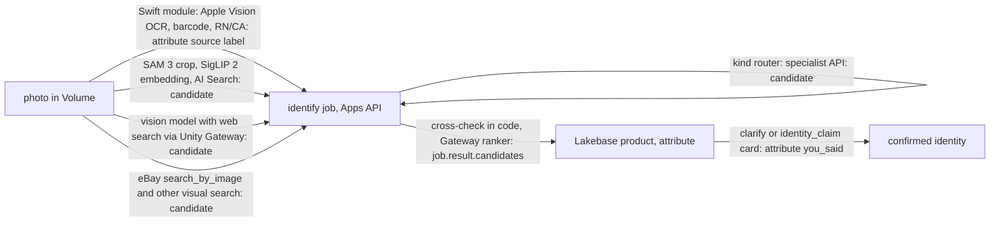

# Identify
Status: draft, second pass. Every design line is *agent proposal* unless it links a decision. Slug: identify. Written 2026-11-14.

Identify turns one capture, a pasted link or someone else's listing into one confirmed `product` identity and the `attribute` rows that rest on it ([product model](../product.md)). The same engine runs for an item you own and an item you want ([decision](../../product/decisions.md#2026-11-14-selling-comes-first-buying-is-a-full-side)). Ben's pipeline is in his [build plan](../../research/identify/ben/build-plan.md); Nate's stack is in [identification-stack](../../research/identify/nate/identification-stack.md) and [identification-technologies](../../research/identify/nate/identification-technologies.md).

The certainty principle governs every screen here: identity, variant, size, measurements and visible condition are settled (read the label, search, one more view, one tap) and then stated as confirmed, never as a percentage. What no capture can settle (price, authenticity, whether it works, hidden condition) is said plainly as not settled ([Nate's words](../../product/words.md#2026-11-14-nate-validate-breadth-and-an-auditable-spec)).

## What the person does and sees
Entry is ＋ (Sell this, What's it worth, Find this) ([decision](../../product/decisions.md#2026-11-14-the-bottom-bar-is-today--sell----buy--you)). Identify runs inside capture; results land on the item's review step.

1. While capture runs, fields fill in one by one: brand, model, variant, size.
2. When the routes agree and a code or catalogue entry backs them, one line shows the identity with a check mark: **Confirmed**. No tap is needed; **Not this?** sits beside it.
3. When they do not, a short set of candidate cards, each with its photo, plus **None of these**. The set is as small as the evidence allows: one card means "is it this?", two to four means pick one. Never a blank form ([Ben, failure trace](../../research/identify/ben/build-plan.md)).
4. At most one question at a time, the one that most narrows the set: chips, a size picker, yes/no on a photo region, or "show me the tag" (retake). Inputs come from the catalogue in [clarifying-inputs](../../research/identify/nate/clarifying-inputs.md).
5. **None of these** opens a text box and **Find this**. Skipping a question is allowed and teaches nothing.
6. "Why?" on any field opens the `GET /v1/events?item_id=` timeline: the crop, the tag text, the page it came from.
7. No percentages anywhere. A candidate is "same model, size not read yet", not "82%".

## Design choices
*agent proposal* for the picked column.

| Choice | Options considered | Picked | Why | What would change it |
|---|---|---|---|---|
| How routes run | Ben's ordered steps ([build plan](../../research/identify/ben/build-plan.md)); all at once from one capture ([identification-technologies](../../research/identify/nate/identification-technologies.md)) | Five routes fire at once from the capture; code routes fire as soon as a code is read; price history waits on a confirmed id | Latency is the slowest route, not the sum; a read code arrives in the first second on device | p95 time to confirmed identity over the 15 s cap on mobile data |
| How disagreement is settled | model vote; a ranking model alone; an evidence ladder in code ([identification-technologies](../../research/identify/nate/identification-technologies.md)) | Ladder: decoded GTIN or model plate > catalogue match > image search match > vision model guess. Image routes alone cap at `likely_same_model` | "Agreement among several models is not independent proof" (Nate); a code is | A labelled set where the ladder is beaten by the Gateway ranker |
| Cross-checking a candidate | trust the route's top hit; re-check against our photos ([identification-technologies](../../research/identify/nate/identification-technologies.md)) | Re-embed each candidate's images with the same model and compare to our crops, compare its text to the label read, and one vision-model same/different call; combined in code | Catches the visually similar wrong variant; the pattern is used by SnapIntel and CariBarang (*asserted*) | Cross-check adds less than 2 points of precision on the labelled set |
| How many candidates | fixed top 4 ([build plan](../../research/identify/ben/build-plan.md)); a set sized by confidence ([clarifying-inputs](../../research/identify/nate/clarifying-inputs.md)) | Conformal-style set: 1 means confirm, 2 to 4 means pick, empty means a question or **None of these** | Smaller sets are more accurate and a single card signals certainty (Cresswell 2024, ICML, *observed excerpt*) | Pick accuracy no better than fixed top 4 in a test |
| Which question, how many | a rule list; zero-shot model questions; expected information gain over the candidate set ([clarifying-inputs](../../research/identify/nate/clarifying-inputs.md)) | EIG over the candidate set, using eBay `ASPECT_REFINEMENTS` counts where present; cap 3 per item | EIG questions beat zero-shot ones (arXiv 2502.04485, *asserted*); needless questions cut pass@1 from 65% to 27% (arXiv 2504.16331, *asserted*) | The cap is unsourced: the deciding test is time to confirmed identity with caps 1, 2 and 3 |
| Who confirms | auto-accept at 0.90 ([build plan](../../research/identify/ben/build-plan.md)); always a tap; confirm when evidence settles it ([words](../../product/words.md#2026-11-14-nate-validate-breadth-and-an-auditable-spec)) | **Confirmed** without a tap only when the ladder's top rung (a code or catalogue entry) and the cross-check agree; otherwise one tap | Model probability measures concentration, not correctness ([harness](../../research/cross-cutting/ben/ai-harness-from-repos.md)); a code is checkable | Precision of untapped **Confirmed** under 99% on the labelled set (coverage marks the gate weak) |
| Specialists | none; by category; by value; by fake-risk ([identification-stack](../../research/identify/nate/identification-stack.md)) | By kind: cards, watches, LEGO, luxury bags, coins get a photo specialist; books, vinyl, sneakers, electronics, bikes, tools and clothing get a code lookup | A specialist knows the variant space a general model guesses at | No independent test of any specialist exists; our labelled set decides each one |
| Google | Lens via SerpApi as the main route (Ben); no Google; Web Detection as one route ([identification-technologies](../../research/identify/nate/identification-technologies.md)) | Nothing depends on Google. Lens through SerpApi and Cloud Vision Web Detection are two routes among the five, dropped without loss | Lens has no official API and is in litigation; Product Search is in maintenance | Recall without both Google routes within 2 points of recall with them |

### The routes
| Fires | Route | Technology | Writes, with `evidence.kind` |
|---|---|---|---|
| At once | Crop | SAM 3 mask (LVIS mask AP 48.8, *observed*) | `photo` crop, `image_region` |
| At once | Embedding | SigLIP 2 or Marqo against AI Search over `product` and our own confirmed items | candidate, `lookup` |
| At once | Vision model with web search | Anthropic, OpenAI, Gemini, xAI or Perplexity search tool ($2.50 to $14 per 1,000, *observed*) via Unity Gateway | candidate, `lookup` |
| At once | Visual search | eBay `search_by_image`, an Amazon wrapper, Yandex, Lens via SerpApi, Web Detection | candidate, `lookup` |
| At once | Label read | Apple Vision OCR, barcode, RN and CA in the Swift module; PP-OCRv5 or a vision model server side | attribute source `label`, `label_text` |
| On a read code | Code lookup | GTIN (GS1, eBay Catalog by GTIN), ISBN, IMEI/TAC, style code, model number, watch reference, sneaker SKU, LEGO set number, RN/CA | candidate `exact` or attribute `spec`, `lookup` |
| By kind | Photo specialist | CardOS (cards), FindWatch or WatchID (watches), Brickognize (LEGO), Vaultik (luxury bags), Numista (coins) | candidate, `lookup` |
| By kind | Code specialist | Discogs (vinyl), book, sneaker, electronics, bike, tool and clothing catalogues | candidate, `lookup` |
| On confirmed id | Price history | handed to valuate | none here |
| From capture | Geometry | measure job ([measure](measure.md)) | attribute source `measured`, `depth` |

Geometry rules candidates in or out (the larger or smaller version of a model). A pasted link or receipt runs a schema.org Product parse: "an original purchase URL is evidence, not proof of the exact variant" ([Nate](../../research/identify/nate/identification-stack.md)).

## Data flow
Consistent with [product §10](../product.md); adds the routes product §10 groups under one hop.

## Match labels and what each unlocks
Labels are the `candidate.match` values in [product §3](../product.md).

| Label | Meaning | Unlocks |
|---|---|---|
| exact | Same product and variant, backed by a code, a catalogue match that passed the cross-check, or a tap | Comps of the same product, catalogue spec, retail price |
| likely_same_model | Model matches; variant not settled | Comps; the variant is asked if it moves value |
| same_family_other_variant | Same line, a known difference (size, year, capacity) | Adjusted comps, never quoted as exact |
| comparable | Another product a buyer would weigh against it | Price context only |
| unresolved | None of the above | Candidates shown; no identity written |

Exact is never written from image search alone.

## When it asks, and when it must not
Rule: "resolve useful uncertainty per unit of user effort" ([Nate](../../research/identify/nate/clarifying-inputs.md)). A question is a `clarify` decision; counterfeit, function and removing a flaw are `identity_claim` (locked) ([product §5](../product.md)). Ask only when the answer changes identity, value, a listing claim, shipping or whether it may be sold; never when photos, a tag, a lookup or no target site settles it, or when the gap is ours (a route is down).

"Does it work?" is always the person's yes/no, never decided from photos ([Ben](../../research/identify/ben/build-plan.md)). Unknown values are written as `value: null`, `confidence: 0` with `unknown_reason` (`not_visible`, `not_read`, `conflict`, `not_asked`) and are never guessed into a listing ([product §3](../product.md)).

## Condition and flaws
- A tiled pass over every photo finds defects, typed and sized, written as `flaw.<n>` attributes with the flaw photo as evidence. A flaw visible from a distance caps condition at fair ([Ben](../../research/identify/ben/build-plan.md)).
- Condition is stored on the axes each kind needs ([item-card](item-card.md)) and mapped to each site's scale at listing time.
- Removing a flaw is `identity_claim`, the person's tap only. Flaw photos are never touched up ([studio](studio.md)).

## What it never claims
Never "authentic": fake-risk goes to the person ("An owner's confidence is not authentication", [Nate](../../research/sold/nate/trust-returns-disputes.md)). Never "works": that is the person's yes/no. Hidden condition (battery, smell, inside) is "Not checked". A marketplace description is source `marketplace`, below `spec`. Identity is Confirmed or a candidate set, never a percentage.

## Proof layer
- Every attribute and candidate carries `evidence` `{kind, ref, region?, captured_at, extractor_version}`; a code read points to the tag crop and its text.
- Identify shows no number except through a guarded number: a retail price from a page is `{value, basis_count: 1, as_of, citation_id, state}`; a hidden one gives `hide_reason`.
- Identify sends nothing to a buyer. Its confirmed attributes are what `claim_check` backs a listing's claims against in [list](list.md); a claim of "authentic" can never be backed, so it holds as `unbacked_claim`.

## Contract for the frontend
Only [product §7](../product.md) endpoints: `POST /v1/captures/:id/finish` returns the jobs; `GET /v1/stream` carries `job.stage`; `GET /v1/jobs/:id` gives `job.result.candidates[]`; a `clarify` is answered at `POST /v1/decisions/:id/act`; a correction is `PATCH /v1/items/:id/attributes/:name`; `POST /v1/valuations` takes an outside URL.

## Corrections become labels
A candidate tap or a correction writes `owner_statement`; a return "not as described" writes `verified_correction` ([returns](../../research/sold/nate/trust-returns-disputes.md)); a specialist's verdict writes `specialist`. "An owner's correction is useful but not automatically ground truth" ([Nate](../../research/identify/nate/clarifying-inputs.md)). Gates are recomputed nightly per route from labels.

## How it fails
| Failure | Seen as |
|---|---|
| A route times out (Lens 4 s, eBay 3 s, *agent proposal*) | The others carry on; at 15 s the set so far |
| Empty set | **None of these** state: a text box and **Find this** |
| Tag unreadable | One retake prompt (`retake`, capture) |
| Routes disagree | The ladder decides; if the answer moves value, one `clarify` |
| Identity matches a recall | The item cannot be listed; the card says why |

## How we will know it works
Run on the 100-item labelled set in [coverage](../coverage.md), plus Ben's 40 items and 150 eBay listings ([build plan](../../research/identify/ben/build-plan.md)).

| Measure | Bar | Source of the bar |
|---|---|---|
| Right answer in the shown set (up to 4) | 90% or better | Merlin bird ID top-3 about 90% (eBird 2015, *observed excerpt*) |
| Untapped **Confirmed** precision | 99% or better | *agent proposal*; certainty principle |
| Vision model with search alone, as a floor to beat | over 47.6% | VisBrowse-Bench Claude-4.6-Opus 47.6%, Pix2Fact Gemini-3.1-Pro 42.4% with search (*asserted*) |
| Embedding route retrieval | R@1 near 80 on our products | SigLIP 2 on SOP, R@1 80.28 (*asserted*) |
| Filled-field accuracy, top-4 recall, p50 time | 95%, 80%, 9 s or less | Ben's plan |
| Questions per item | at most the cap; share of questions that changed the answer reported | arXiv 2504.16331 (*asserted*) |
| Time to confirmed identity | p50 and p95 by kind | the cap test above |

No published benchmark exists for identifying a resale item from a photo, and no specialist has an independent test ([identification-technologies](../../research/identify/nate/identification-technologies.md)); Brickognize's 98.5% is a vendor claim.

## Facts to know
| Fact | Mark and link | At a public launch |
|---|---|---|
| Google Lens has no official API; Google is suing SerpApi; Cloud Vision Product Search is in maintenance; Vision Warehouse ends 2026-09-30; Bing Search APIs retired 2025-08-11; Web Detection is live at $3.50 per 1,000 | *observed*, [identification-technologies](../../research/identify/nate/identification-technologies.md) | the Lens route needs a fresh legal read |
| eBay forbids storing, co-mingling, modelling prices on and training with its content | *observed*, [platform access](../../research/connect/nate/platform-access.md) | `rights` tags on eBay evidence are enforced: no storage past ttl, no training |
| Etsy and Shopify forbid training on their content | *observed*, [identification-stack](../../research/identify/nate/identification-stack.md) | same enforcement |
| Amazon Berkeley Objects is CC BY 4.0; Open Products Facts is ODbL | *observed*, same note | attribution shown; a derived database shared alike |
| Model confidence measures concentration, not correctness | *observed*, [harness](../../research/cross-cutting/ben/ai-harness-from-repos.md) | none |
| Recalled products may not be sold; pre-2011 and drop-side cribs must be destroyed (CPSC) | *observed*, [identity-schema-by-kind](../../research/item-card/nate/identity-schema-by-kind.md) | protects people: holds now |
| Capture photos can show faces, addresses and serials | *asserted*, [privacy](../../research/cross-cutting/nate/privacy-and-data.md) | protects people: holds now; photos sent to a route are crops of the item |

## Where Ben and Nate differ
| Point | Ben | Nate |
|---|---|---|
| Main image route | Lens via SerpApi ([build plan](../../research/identify/ben/build-plan.md)) | Google's product search is closed; many routes ([identification-technologies](../../research/identify/nate/identification-technologies.md), *observed*) |
| Accepting | auto-accept at 0.90, `same_as` 0.85, others under 0.5 | ask only when it changes a decision ([clarifying-inputs](../../research/identify/nate/clarifying-inputs.md), *inferred*) |
| Candidates | up to 4, always | a set sized by confidence (*observed excerpt*) |

Where Ben's design stumbles: a fixed four cards asks a person to choose when one card would do, and leaning on Lens puts the whole feature on a route with no API. What the backend makes possible that his design does not use: AI Search over our own confirmed items gives a free exact match for the second copy of anything, and `ASPECT_REFINEMENTS` counts turn question choice into arithmetic.

## Open for Ben and Nate
| Question | Recommendation | Depends on it |
|---|---|---|
| Which paid specialists run per kind (FindWatch $0.02 to $0.05 a call, *observed*) | All named ones, each kept or dropped on the labelled set | spend per item |
| Untapped **Confirmed** (Nate's certainty) or Ben's auto-accept gate | **Confirmed** only on a code or catalogue match that passed the cross-check | taps per item, label volume |
| The question cap | 3, until the time-to-identity test | taps per item |

Business model: specialist calls cost cents per item, which a paid tier could carry.

Not checked: no route's latency was measured; the CPSC recall source for a lookup is not yet named in any note.
