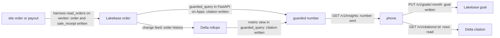

# Insights
Status: draft, *agent proposal* except where a line links a decision. Slug: insights. Second pass 2026-11-14. Names, states, kinds and endpoints are [product.md](../product.md)'s.

Nate: "set goals on how much they want sold" ([words](../../product/words.md#2026-11-14-nate-frameworks-and-goals)); the same entry has "incentives like money goals for the month, how many sales you've had, tracks progress". Ben put earned, count, potential and insights in You, and By site shows how fast each site sells and at what share of the asking price ([decision](../../product/decisions.md#2026-11-14-the-you-tab-leads-with-numbers-and-a-by-site-comparison)). Where this page differs from Ben's earlier plan, those decisions win; what changed: every number is a guarded number with a `citation` the person can open ([data](data.md)), and a `goal` exists (*agent proposal*, Nate's). Cost is never asked for: `item.cost` is filled from purchases only ([user-wants](../../research/cross-cutting/ben/user-wants.md), principle 10, L30).

## What the person does and sees

All in the You tab. Every number opens its `citation` in one tap: the sales or listings it rests on, with dates and the plain definition. A number that cannot be backed is a marked empty slot, never a guess ([copy](../../product/copy.md)).

| Step | They see |
|---|---|
| 1 | "You kept $X" (released), "On its way $Y" (sold, not yet released), "Could earn $A to $B" on live items |
| 2 | Sold count, total listed value, goal bar if a goal is set |
| 3 | By site: days to sell and share of the asking price, from our own sales |
| 4 | Per item: views and likes where the site reports them, offers and messages we saw, days listed; profit only where `item.cost` is known |
| 5 | Per product, "Market": similar ones sold, for sale now, who is watching ([market](market.md)) |
| 6 | Fees and records: fees paid, a downloadable record, a plain note on tax forms |
| 7 | Ask: a fixed list of questions, and a box for others (see Questions) |
| 8 | "Your things are worth $A to $B": every `owned` and live item, kept ones included, with how it moved since last week; and the total sold, all time ([Nate](../../product/words.md#2026-11-14-nate-value-from-similar-listings-and-demand-and-worth-knowing-even-if-you-never-sell), [Nate](../../product/words.md#2026-11-14-nate-sale-emails-the-expo-account-where-routes-are-hosted-and-a-buy-page-shaped-by-your-style); *agent proposal*) |
| 9 | Your style: what the app has learned from what you sell, keep, save, follow and buy, each trait with its reason; edit or remove any one ([buy](buy.md#your-style-profile); *agent proposal*) |

A sale ends on the amount kept: no confetti, streaks, countdowns or guilt copy (Robinhood removed confetti after a regulator cited gamification, [adjacent references](../../research/cross-cutting/ben/adjacent-references.md), *observed*). The payout is one quiet line on Today ([today](today.md)).

## Design choices (*agent proposal*)

| Choice | Options considered | Picked | Why | What would change it |
|---|---|---|---|---|
| Kept versus sold | Money in versus money released ([fees and taxes](../../research/price/nate/fees-and-taxes.md)) | Kept counts `released` orders only; sold-not-released shows as On its way | Unpaid money can still be refunded or disputed; product's states include `claim_window`, `return_open`, `dispute_open` | A site that never reports release: "Got paid?" tap, stored as `you_said` |
| Goal counts | Sold amount (Nate) or kept (Ben); a count of sales ([seller metrics](../../research/today/nate/seller-metrics-and-notifications.md)) | Kept after fees, sold amount one tap away | It is the number the person can spend | Goal use in a test group ([coverage](../coverage.md) row 3) |
| Peer comparison | Compare to other sellers (OneShop); compare sites ([seller metrics](../../research/today/nate/seller-metrics-and-notifications.md)) | By site only, from the person's own sales | Few precedents, and others' data is not ours to show | Test group asks for it |
| Fee source | Site APIs and CSVs; typed estimates | API or CSV where it exists, else "estimated" marked | eBay Sell Finances, Depop partner API or CSV, Mercari Gross Sales Report, Poshmark CSV; Facebook none ([analytics](../../research/data/nate/analytics-and-recommendations.md)) | A site adds an API |
| Free questions | Genie over rollup views; fixed list only ([databricks.md](../databricks.md) §5.7) | Fixed list first, Genie behind `guarded_query` | Genie Agents take no custom tools, so the guard has to sit in front | A Genie call through the App fails the guard ([coverage](../coverage.md) row 5) |
| Notification cadence | Per event; digest ([seller metrics](../../research/today/nate/seller-metrics-and-notifications.md)) | Push only for an offer at or above the lowest price, a deadline or a pickup; the rest about 3 batches a day (a starting value, unsourced; the rule is [managing 20](../determinations/managing-and-buyers.md#20-what-to-notify-now-in-a-batch-or-not-at-all)) | Fitz 2019 on batching, carried via coverage (*asserted*); batched seller notifications are untested | Opens and opt-outs in a test group |
| Profit | Ask what they paid; use purchase price only | Purchase price only, never asked | Principle 10 ([user-wants](../../research/cross-cutting/ben/user-wants.md)) | The person's own entry, shown as `you_said` |

## Data flow (*agent proposal*)

## Each guarded number

Shape: `{value or range, basis_count, as_of, citation_id, state: shown|hidden, hide_reason}`. Ledger numbers (earned, fees, kept, could earn) are queries over `order, event, strategy, valuation` and are never stored. Rules live in the metric definitions in [data](data.md).

| Number | Source | Wording | Hidden when |
|---|---|---|---|
| Kept | `order` in `released` or `handed_over`, payout less nothing more | "You kept $X" | no payout recorded; a tap on "Got paid?" counts as `you_said` |
| On its way | `order` in `paid` to `claim_window`, not refunded | "On its way $Y" | never added to Kept |
| Could earn | `valuation` range of live items less estimated fees | "Could earn $A to $B" | an item's range is below the minimum basis in [money D1](../determinations/money.md#d1-comparable-set-and-weights) and [D5](../determinations/money.md#d5-fair-value-range-overall-and-per-site); method in [D22](../determinations/money.md#d22-could-earn-across-live-items) |
| Worth of what you own ([money D22a](../determinations/money.md#d22a-worth-of-what-you-own)) | sum of each `owned` or live item's `valuation` range, with its change over 7 days | "Your things are worth $A to $B, up $C this week" | an item below the minimum basis in [money D1](../determinations/money.md#d1-comparable-set-and-weights) is left out and counted ("3 not valued yet"); never summed as exact |
| Total sold | `order` payouts reaching `paid`, all time | "$X sold so far" | never |
| Listed value | our own `listing` prices | "Listed for $X" | never |
| Sold count | `order` reaching `paid` | "N sold" | never |
| Days to sell | our `event`s | "Sold N days after you listed it" | listed outside the app, no list date |
| Share of asking | sold price over last ask | "Sold at N% of asking" | below the hide rule in [money D23](../determinations/money.md#d23-sell-through-and-share-of-asking) |
| Profit | `order` payout less `item.cost` | "You made $X on this one" | cost unknown (never asked) |
| Own views, likes | eBay traffic report | "Views as reported by <site>, updated <time>" | other sites, unless typed in |
| Own messages, offers | `message`, `offer` | "N offers we saw since you linked" | site not read by us |
| Competing asks | eBay Browse, own searches | "Asking prices of N live listings, lowest X, median Y" | under 6; never shown as sold |
| How many sold | our own sales, or a gated source | "N sold in the last 90 days" | `estimatedSoldQuantity` only; sold hidden by the site |
| Watching | eBay `watchCount`; likes | "N people are watching the live listings" | access not granted; few listings |
| For sale now | Browse total plus own searches | "N live listings found on <sites> as of <time>" | a site unreachable; never summed as complete |
| Sell-through | the 30-day listing cohort owned by [market M6](../determinations/market-insight.md#m6-sell-through), defined on screen | "Of N similar listings from <month>, M sold within 30 days" | M6's hide rule (a cohort under 10 listings); the stock formula only as M6's labelled fallback |
| Price range | sold comps | "Similar ones sold for $36 to $52 lately" | below the minimum basis in [money D1](../determinations/money.md#d1-comparable-set-and-weights) and [D5](../determinations/money.md#d5-fair-value-range-overall-and-per-site): the sales are shown instead |

The display state of a range (shown, wide, hidden) is [money D6](../determinations/money.md#d6-range-calibration-and-display-state)'s; the earlier sample bands (low 5 to 9, medium 10 to 29, high 30 or more) are retired here in favour of it. The two-week rule for old reads is from [market intelligence](../../research/data/nate/market-intelligence.md) (*observed*, aiplannermail). Marks for the market rows are in [Nate's note](../../research/data/nate/analytics-and-recommendations.md). Cannot be known: search volume on closed marketplaces (proxies are watchers, likes and sell-through), sold counts beyond what we saw disappear (an undercount, so labelled), others' offers and messages.

## Goals (*agent proposal*, Nate's)

`goal`: `{month, target_cents, target_sales?, progress}`; `progress` is derived from `order`, never stored. `PUT /v1/goals/:month` sets it. Rules: the bar counts Kept; a refund after release lowers progress with an `event`; hitting the target ends in the amount kept, no celebration; a missed month is not mentioned. Only OneShop and Vendoo mention goals in the research ([seller metrics](../../research/today/nate/seller-metrics-and-notifications.md), *observed*, *inferred*), so the evidence is weak and the deciding test is goal use in a test group. The progress method is [money D21](../determinations/money.md#d21-goal-progress).

## Analytics suite (*agent proposal*)

Nate asked for "a suite like shopify" ([words](../../product/words.md#2026-11-14-nate-a-suite-like-shopify-and-the-better-official-option)). A store sells many units of one SKU; a reseller sells one of each, so each store metric either carries over, is redefined for one-of-a-kind items, or has no meaning. Store definitions are from [Shopify and seller analytics](../../research/data/nate/shopify-analytics-and-seller-analytics.md) (*observed* in Shopify's help pages as that note cites them).

| Store metric | Here | What it becomes |
|---|---|---|
| Sessions, traffic source | carries over | listing impressions and views per site, split by source where the site gives one |
| Conversion rate | redefined | a listing converts once: the funnel stage reached, and views per offer and per sale across a group |
| Average order value | redefined | median sale price per category, brand and site |
| Gross profit by product | redefined | profit by category, brand and site, over items whose cost is known |
| Sell-through | redefined | a listing cohort, owned by [market M6](../determinations/market-insight.md#m6-sell-through) |
| Days of inventory (ending units over average daily units, 28 days) | redefined | sell-down estimate over the whole live stock |
| ABC analysis (80/15/5) | redefined | over categories and brands by expected value, not SKUs; the split is Shopify's, a starting value |
| Cohorts by first order | redefined | cohorts by listing month |
| Fulfilment time, returns | carries over | seller reliability: ship time, cancels, returns |
| Marketing spend against sales | carries over | promotion spend against result |
| Finance report, taxes | carries over | P&L with a tax-time export |
| Repeat customer rate, lifetime value | no meaning | buyers are one-off and their data is not kept |
| Low stock, reorder | no meaning | nothing restocks; the nearest is a stale-listing notice |
| Abandoned cart | no meaning | the nearest is likers or watchers with no offer, handled by [listing D17](../determinations/listing-and-marketing.md#d17-offer-to-likers-or-watchers) |

Every figure below is a guarded number with a `citation`, computed by `guarded_query` over Unity Catalog metric views on the Delta rollups (live counts from Lakebase). "Genie" means the metric view is open to free questions through `guarded_query`; "fixed" means a fixed screen only, because a free answer could mislead (a tax figure, a forecast). Site stats arrive by the harness verb `read_stats` in a new job kind `poll_stats`; sites that report nothing leave the stage "not reported by <site>", never zero.

| Figure | Source | Method (card) | Hidden when | Answered by |
|---|---|---|---|---|
| Listing funnel per item and per site: impressions, views, likes or watchers, offers, sale; traffic-source split | eBay traffic report (impressions, views by source, CTR, conversion), Etsy stats, Poshmark impressions, clicks, likes, offers (*observed*); Depop partner stats and Mercari (*asserted*); Facebook none; our own `offer`, `message`, `order` | stage counts per listing; interest against plan is [listing D15](../determinations/listing-and-marketing.md#d15-interest-against-plan) | a stage the site does not report; never summed across sites whose definitions differ | Genie |
| Stale-listing notice, each with an action | the funnel, days listed, [money D11](../determinations/money.md#d11-time-to-sell-range) | stale when [listing D15](../determinations/listing-and-marketing.md#d15-interest-against-plan) says below plan; the action is the move [listing D16](../determinations/listing-and-marketing.md#d16-next-move-on-a-live-listing) picks (price per [money D15](../determinations/money.md#d15-markdown-path-stale-and-relist), edit, refresh or relist per [listing D21](../determinations/listing-and-marketing.md#d21-edit-refresh-or-relist), offer to likers, promote), opened as that move's decision | D15 has too little interest data to judge | fixed |
| Profit by category, brand and site | `order` money lines, `item.cost` | gain per [money D20](../determinations/money.md#d20-cost-basis-and-gain-or-loss), grouped; card to add in money.md (Profit by group) | a group with no item of known cost; the count of items left out is always shown | Genie |
| P&L for a period, with a tax-time export | `order` money lines (fee by type, shipping, tax, refund, payout, promotion spend), `item.cost` | card to add in money.md (P&L for a period), lines from [D9](../determinations/money.md#d9-what-you-keep-per-site) and [D20](../determinations/money.md#d20-cost-basis-and-gain-or-loss); export is a CSV of every line with its `source`, labelled a record, never tax advice | a line whose source is `estimated` is shown marked, never hidden | fixed |
| Slow movers, ranked | live `listing`, `valuation` | ordered by [money D10](../determinations/money.md#d10-chance-of-sale-within-a-period-at-a-price) chance of sale in 30 days (a starting window), lowest first, with days listed against [market M7](../determinations/market-insight.md#m7-days-to-sell); ABC split in a card to add in money.md (Slow movers and ABC) | D10 hidden for that item | Genie |
| Sell-down estimate | live stock, [money D10](../determinations/money.md#d10-chance-of-sale-within-a-period-at-a-price), each item's [D15](../determinations/money.md#d15-markdown-path-stale-and-relist) path | days to sell half and all of the live stock, and kept over that time, as ranges; card to add in money.md (Sell-down estimate) | over half the live value has D10 hidden | fixed |
| Cohorts by listing month | own `listing`, `order` | of items listed in a month, share sold by day 7, 30, 60, 90, share of asking and kept; definition from [market M6](../determinations/market-insight.md#m6-sell-through) applied to own listings; card to add in money.md (Own listing cohorts) | a cohort below M6's minimum | Genie |
| Seller reliability: ship time, cancels, returns | our `order` events against the clocks in [managing 11](../determinations/managing-and-buyers.md#11-the-ship-by-deadline-and-other-clocks); the site's own figure where it reports one (Posh Stats over 90 days, *observed*) | [managing 17](../determinations/managing-and-buyers.md#17-whether-an-account-is-healthy-or-at-risk); the site's figure is shown beside ours, never replaced by it | fewer orders than card 17's minimum | fixed |
| Anomaly notice | every figure above, daily | a figure outside its expected band: traffic on a site per [listing D24](../determinations/listing-and-marketing.md#d24-whether-a-site-changed-its-ranking) (the `ranker_changed` notice); sales pace, fees, refunds and late payouts in a card to add in money.md (Anomaly in own figures) | the figure itself is hidden | fixed |
| Promotion spend against result | spend per listing (eBay Promoted Listings, Depop Boost, Etsy Ads), the funnel, `order` | lift against matched unpromoted listings per [listing D23](../determinations/listing-and-marketing.md#d23-whether-a-change-helped), against the break-even in [D18](../determinations/listing-and-marketing.md#d18-promoted-listing); return in a card to add in money.md (Promotion return) | D23 cannot tell a lift from noise: "too early to tell" | Genie |
| Monthly goal | `goal`, `order` | [money D21](../determinations/money.md#d21-goal-progress) | never; no goal set shows nothing | fixed |

Notices (stale and anomaly) ask nothing and commit nothing, so they are notice kinds, not decision kinds; their timing follows [managing 20](../determinations/managing-and-buyers.md#20-what-to-notify-now-in-a-batch-or-not-at-all). The figures the score shares are listed in [score](score.md#axes).

## Questions in plain language

| They ask | Answered by |
|---|---|
| "How much have I made this month?" | Kept, fixed list; opens its citation |
| "Which site sells fastest for me?" | By site, from our own sales; hidden by the rule in [money D23](../determinations/money.md#d23-sell-through-and-share-of-asking) |
| "What is this worth?" | `valuation` range; the sales themselves shown when below the [D5](../determinations/money.md#d5-fair-value-range-overall-and-per-site) basis |
| "Why hasn't it sold?" | Days listed, competing asks, watching, the recommended change from [price](price.md) |
| "What fees did I pay?" | Fees and records, by site, estimated ones marked |
| "Am I on track for my goal?" | Goal bar and plain arithmetic |
| Anything else | Genie over filtered rollup or metric views, through `guarded_query`; shows the rows and the query, "AI-generated, check the rows"; "Couldn't answer that" when it fails |

## What it reads and writes

| Entity | Use |
|---|---|
| `order`, `sale_receipt`, `event`, `listing`, `valuation`, `comp`, `offer`, `message`, `item` | read |
| `citation` | written on every number computed |
| `goal` | written by the person |
| `order` money lines | written by import: fee by type, shipping, tax, refund, payout, each with source `api, csv, typed, estimated` |

## States

| Thing | Moves |
|---|---|
| Order | `paid, pickup_booked, to_ship, shipped, delivered, handed_over, claim_window, released, cancelled, return_open, dispute_open, refunded`; only `released` or `handed_over` feeds Kept |
| Number | `shown` or `hidden`, with a reason; an estimate becomes known when the site's figure arrives |
| Goal | `active, reached, ended` |

## Contract for the frontend

| Endpoint | Returns |
|---|---|
| `GET /v1/insights` | guarded numbers under `kept, on_its_way, could_earn, listed, sold_count, goal, by_site[]`, and the suite under `funnel[], stale[], profit_by[], pnl, slow_movers[], sell_down, cohorts[], reliability[], anomalies[], promotion[]`, each filterable by `period`, `site`, `category`, `brand` |
| `GET /v1/records?tax_year=&format=csv` | the P&L lines with `source`, labelled a record |
| `GET /v1/citations/:id` | the rows, filters, definition and `computed_at` behind a number |
| `PUT /v1/goals/:month` | `{target_cents, target_sales?}` |
| `GET /v1/scores?subject_type=&subject_id=` | per-item axes ([score](score.md)) |

The tax note reads its source and date from a stored citation: for tax year 2026 the IRS says a 1099-K needs more than $20,000 and more than 200 transactions, a form can arrive below that, some states set lower limits, and a gain is taxable with or without a form (*observed*, [fees and taxes](../../research/price/nate/fees-and-taxes.md)). The app never says whether a sale is taxable to this person.

## Who may act

| Action | Mode |
|---|---|
| Compute and show numbers | auto |
| Set a goal, mark "Got paid?" | the person |
| Export records | the person |
| Push | auto only for an offer at or above the lowest price, a deadline or a pickup; else batched about 3 times a day, a starting value ([copy](../../product/copy.md)) |

## How it fails

| Failure | They see | Recovery |
|---|---|---|
| No payout data on a site | "On its way" plus "Got paid?" | their tap, `you_said` |
| Fee report late | fee marked "estimated" | replaced by the actual; difference logged |
| Refund after payout | Kept goes down, step in "Why?" | `event`, never silent |
| Citation cannot be built | the number is hidden | retried |
| Site unreachable | its row marked "as of <time>" | next poll |

## How we will know it works

| Claim | Bar | Source (mark) |
|---|---|---|
| Every number opens | scan `GET /v1/insights` on real accounts: zero shown values without `citation_id` | (*agent proposal*) |
| Recompute matches | 20 numbers recomputed from their citations after a week: zero differences | [databricks.md](../databricks.md) §9 (*agent proposal*) |
| Kept is right | equals real payouts to the cent on test accounts for eBay, Depop, Mercari, Poshmark | (*agent proposal*) |
| Unpaid never counts | a fixture in `claim_window` leaves Kept and the goal unchanged | (*agent proposal*) |
| Thin numbers hidden | 30 questions with verified SQL; any thin number shown fails | ChicagoPulse in [rewards](../../research/data/nate/what-databricks-rewards.md) (*asserted*) |
| Sellers get results | listed items sell: 12.2% within 30 days, median 7.5 days as the comparison | FlowLister in [pitch evidence](../../research/cross-cutting/ben/pitch-evidence.md) (*observed*) |
| No nagging | pushes per user per week and opt-outs | (*agent proposal*) |

Retention here is a hypothesis (*agent proposal*, Nate): people return when something real happened to their things, not for a streak.

## Facts to know

| Fact | Mark | Source | For a public launch |
|---|---|---|---|
| No API for messages or offers on any marketplace; Poshmark, Depop, Mercari, Facebook, Vinted have no analytics API found | asserted | [analytics](../../research/data/nate/analytics-and-recommendations.md) | same |
| Depop partner API cannot pull analytics; Depop shows Earnings a day late | observed | [comps sources](../../research/price/ben/comps-sources-live.md) | same |
| eBay's licence limits cross-service performance comparison and pricing models; Ben's and Nate's notes number the clause differently | observed | [fees and taxes](../../research/price/nate/fees-and-taxes.md), [comps sources](../../research/price/ben/comps-sources-live.md) | By site uses our own sales only; eBay rows carry `may_share` false, enforced |
| Fee base differs per site, so net needs shipping and tax | inferred | [fees and taxes](../../research/price/nate/fees-and-taxes.md) | same |
| Items under $15 sell within 30 days 8.6% of the time, $100 to $249.99 27.6% | observed | [pitch evidence](../../research/cross-cutting/ben/pitch-evidence.md) | same |

Rules that stay: buyers' personal data is not shown or kept, and the risk to a real marketplace account is shown per site.

## Open for Ben and Nate

1. What a goal counts. Nate: "set goals on how much they want sold". Ben: "You kept $X". Recommend kept, with sold one tap away. Deciding test: goal use in a test group.
2. How secondhand earns. Nate: "Buy-side referrals is perfect, with also the potential to collect unified anonymous data..." ([words](../../product/words.md#2026-11-14-nate-referrals-and-market-data)). Product's single earning question is open ([product §9](../product.md)). Affects the business model: not picked here.

## Needs from the shared model
- `GET /v1/records?tax_year=` (sales, fees, gain or loss, labelled a record), and an "I got paid" action on `order`.
- `order` money lines with `source`, including `promotion_spend`; events `order.paid_out`, `order.fee_reported`, `goal.set`.
- Job kind `poll_stats`, notice kinds `listing_stale` and `anomaly` and the suite fields on `GET /v1/insights` are in [product.md](../product.md).
- [product §8](../product.md) proof-layer guard still says "fewer than 5 sales"; it should link [money D1](../determinations/money.md#d1-comparable-set-and-weights) and [D5](../determinations/money.md#d5-fair-value-range-overall-and-per-site).
- Cards to add in money.md: Profit by group, P&L for a period, Slow movers and ABC, Sell-down estimate, Own listing cohorts, Anomaly in own figures, Promotion return. [D23](../determinations/money.md#d23-sell-through-and-share-of-asking) still defines sell-through as sold over sold plus active, against M6.
