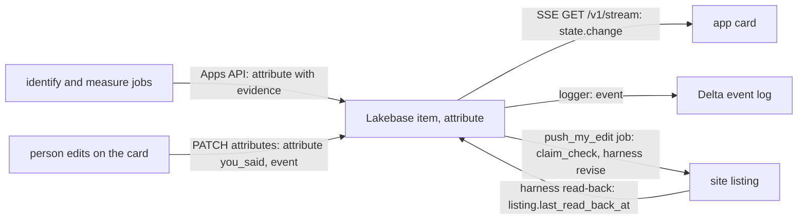

# Item card
Status: draft, second pass. Every design line is *agent proposal* unless it links a decision. Slug: item-card. Written 2026-11-14.

One record per physical thing. Every listing on every site is built from it, every edit lands in it, and its id outlives every relist, sale and return. The names are the `item`, `product`, `attribute`, `photo` and `listing` rows in [product §3](../product.md); this page says how the card uses them. Feature page: [item-card](../../features/item-card/README.md).

## What the person does and sees
Opened by tapping a tile in **Sell** ([decision](../../product/decisions.md#2026-11-14-the-sell-tab-is-a-photo-grid-with-state-pills-numbers-live-in-you)), or a result in **Buy**.

1. Photos on top, real ones first; improved ones marked ([studio](studio.md)).
2. The identity line: brand, model, variant, with **Confirmed** once [identify](identify.md) has settled it. No percentages.
3. The fields this kind needs (a shirt shows pit-to-pit; a watch shows reference and box and papers; a record shows sleeve grade apart from vinyl grade). Each shows where it came from: *measured*, *from the tag*, *looked up*, *you said*, or *not checked*.
4. Tap a field to edit it in place. The edit is pinned: no model rewrites it.
5. A row of site logos, each with its state pill. A dot on a logo means that site still needs a field; tapping it jumps there.
6. "Why?" on any field opens its history: the crop or tag it came from, who changed it, when.
7. Where it is, what you paid, how many you have: one tap each, never required.
8. Copy stays minimal ([decision](../../product/decisions.md#2026-11-14-in-app-copy-is-minimal-and-the-ui-shows-rather-than-says)).

## Design choices
*agent proposal* for the picked column.

| Choice | Options considered | Picked | Why | What would change it |
|---|---|---|---|---|
| Shape of the record | one flat form per site; one canonical record mapped per site ([listing fields](../../research/list/nate/listing-fields-by-platform.md)) | One record of typed attributes; each site's form is a mapping computed at listing time | Depop has no title, eBay's required fields are computed per category, five condition scales: a flat form per site would hold five copies of one fact | A site whose form cannot be produced from attributes plus `listing.overrides` |
| Which fields a kind has | one generic schema; per-kind field sets ([identity-schema-by-kind](../../research/item-card/nate/identity-schema-by-kind.md)) | Per-kind sets for 13 kinds, read from `requirement` rows | Cards, vinyl, watches and cameras grade on different axes; box and papers set a watch's price class | A kind where the generic set fills every target site's form |
| Condition | one internal scale; per-kind axes mapped to each site ([identity-schema-by-kind](../../research/item-card/nate/identity-schema-by-kind.md), [listing fields](../../research/list/nate/listing-fields-by-platform.md)) | Per-kind axes plus flaws; the site value is derived, never stored | Mapping loses detail one way only: from axes to a site scale, never back | A mapping test where two kinds collapse to the same site value with different prices |
| Required fields | inferred list (first pass); read per site and per category ([listing fields](../../research/list/nate/listing-fields-by-platform.md)) | Static rules for Facebook, Depop, Poshmark, Mercari; eBay computed from `getItemConditionPolicies` and `getItemAspectsForCategory` per category | eBay's own docs say the required list is per category | A site changing its form, caught by the harness read-back |
| Where every value rests | value only; value plus `evidence` ([harness](../../research/cross-cutting/ben/ai-harness-from-repos.md), [privacy](../../research/cross-cutting/nate/privacy-and-data.md)) | Every attribute carries `evidence` | `claim_check` backs a listing claim only against evidence; "Why?" needs it | none: the proof layer depends on it |
| Edits to live listings | ask each time; push every edit ([product §5](../product.md)) | `push_my_edit` is auto and read back; an agent's change is `agent_revision`, ask | The person's own edit is already the person's decision | A site where a revise resets ranking (score measures this, see `score.md`) |
| Cost and profit | always shown; hidden until set ([coverage](../coverage.md)) | Hidden until a cost is entered; then a guarded number | Someone clearing a closet has no cost basis | none open |

## The record by kind
Fields per kind from [identity-schema-by-kind](../../research/item-card/nate/identity-schema-by-kind.md) (*observed* where it names a grading house, *inferred* elsewhere).

| Kind | Identifiers | Condition axes | Completeness (sets price class) |
|---|---|---|---|
| Clothing | RN or CA number, style code | eBay NWT, NWOT, New with imperfections, Pre-owned Excellent, Good, Fair | hangtag, spare buttons, belt |
| Shoes | style code, size and width, gender sizing | New with box, without box, with defects, Pre-owned | box with correct label, laces, inserts |
| Bags | serial or date code (not proof of authenticity) | Fashionphile seven, Giftable to Flawed | box, dust bag, authenticity card, receipt |
| Watches | reference (126710BLNR) with serial kept apart | condition plus polished, unpolished, unknown | box and papers, the Chrono24 class |
| Cameras | model, shutter count | KEH: New, Like New, LN-, EX+, EX, BGN, UG | cap, strap, charger (KEH sells without) |
| Phones and electronics | model number, IMEI or TAC | Swappa: New, Mint, Good, Fair; battery health | box, charger, cable |
| Vinyl | catalogue number, matrix | Goldmine, vinyl and sleeve graded apart (VG+ is about 50% of NM) | inner sleeve, insert |
| Books | ISBN | book and dust jacket apart | dust jacket |
| Trading cards | set, card number | TCGplayer NM, LP, MP, HP, Damaged, a typed defect list; or PSA 1 to 10 with cert number | sleeve or slab |
| LEGO and games | set number | BrickLink sealed, complete, incomplete; PriceCharting loose, CIB, new, graded | box, manual, minifigures |
| Furniture | maker mark | named defects: water rings, veneer lift, wobble | hardware bag, keys, leaves |
| Tools and bikes | model, serial | function as the person's yes/no | batteries and charger; pedals, charger |
| Baby gear | model and date code | stains, frayed straps, cracked plastic | manual, harness, all hardware |

Battery, function and smell are never read from photos; they are the person's statement or *not checked*. Measurements are separate fields from the size label.

### Evidence on every attribute
| `evidence.kind` | Comes from | Example |
|---|---|---|
| `image_region` | a photo crop with its region | the flaw pin, the logo |
| `depth` | the measure job | pit-to-pit from LiDAR |
| `label_text` | OCR of a tag | "RN 54867" with the tag crop |
| `lookup` | a catalogue, code lookup or page | GTIN match, retail page |
| `owner` | the person's tap | "works", a corrected size |

Each carries `ref`, `captured_at` and `extractor_version` ([product §3](../product.md)).

## Which fields each site needs before listing
From the merged table in [listing fields](../../research/list/nate/listing-fields-by-platform.md) (*observed* unless marked).

| Field | eBay | Facebook | Depop | Poshmark | Mercari |
|---|---|---|---|---|---|
| Photos | 1 to 24 | required; 10 in app (*asserted*) | 1 to 8 | up to 16, cover 3:4 | up to 12 |
| Title | required, 80 (*asserted*) | required | none: first line of the description | required | required |
| Description | required | optional | required, 1000, 5 hashtags | required | required |
| Category | required, sets the rest | required | department and product type | department, category, sub | required |
| Condition | per category, by id | 4 values | 5 values | NWT toggle plus 3 | 5 values |
| Brand | per category; required when MPN is | optional | required | optional | optional |
| Size | per category | optional | when the type has sizes | required | per category |
| Package | for calculated shipping | delivery method | parcel size | none | weight, then size |
| Location | `merchantLocationKey` | required for local | address with country | none | ship-from |
| Other | quantity, policies; descriptors for cards and coins | | colour up to 2, SKU 50 | original price | battery health for phones |

A missing required field is `item.missing_fields[]` (derived) and the dot on that logo, never a failure at post time. The publish step never fills a gap, and the listing posted matches what the person approved ([harness §5](../../research/cross-cutting/ben/ai-harness-from-repos.md#5-listing-text)). An eBay match on GTIN or ePID fills aspects from the catalogue as `spec`.

## Editing in place, and pins
| Event | Effect |
|---|---|
| Person edits a field | `PATCH /v1/items/:id/attributes/:name`: `source: you_said`, `confirmed: true`, evidence `owner` |
| A model finds a better value | Shown beside the pinned value; one tap takes it |
| Edit to a field already live | `push_my_edit` (auto): the harness runs `revise` on each live listing and reads it back |
| Unpin | Same PATCH with `confirmed: false`; logs `attribute.unpinned`; the best model value returns |
| A site without revise | the edit stays on the card; `relist` is offered as an ask (never on Poshmark) |

## Identity across relists and returns
- A relist appends to `listing.external_ids[]`; the `item` id never changes. An eBay relist gets a new item id ([platform access](../../research/connect/nate/platform-access.md)).
- A return opens `returned` on the same item, keeps every attribute, and adds what the buyer reported as an event and possibly a new flaw ([returns](../../research/sold/nate/trust-returns-disputes.md)).
- Sold items stay searchable in **You** with what they sold for and where.
- An item bought through secondhand gets a card at once, origin `purchase`, the price as `item.cost` ([decision](../../product/decisions.md#2026-11-14-selling-comes-first-buying-is-a-full-side)).
- `kept` carries `kept_reason`: withdrawn, donated, gifted.
- `seller_sku` is the seller's own label, sent where a site has a SKU field.

## Where the thing is
`item.location {label, place?}`: "closet, top shelf", "storage unit B". It answers where to go to get it, and is never sent to a site. Pickup uses the saved public spot; the home address goes out only on the person's tap ([decision](../../product/decisions.md#2026-11-14-the-agent-books-pickups-inside-your-hours)).

## Cost, quantity, bundles
- `item.cost {amount_cents, currency, date, source}`, filled from a receipt or link where one exists. Profit in **You** is a guarded number `{value, basis_count, as_of, citation_id, state}`, hidden with `hide_reason: no_cost` until a cost exists ([fees and taxes](../../research/price/nate/fees-and-taxes.md)).
- Five identical shirts: one item, `quantity: 5`; a sale decrements everywhere.
- A lot: a group item whose children are items, each keeping its id; splitting ends the group listing.
- A sale of one unit anywhere delists or decrements everywhere else ([teardown](../../research/cross-cutting/nate/crosslister-teardown.md)).

## Data flow
Consistent with [product §10](../product.md).

## Proof layer
- Every attribute the card writes carries `evidence`; an edit carries `owner`.
- Every number shown (cost, profit, sold price, quantity left) is a guarded number with `citation_id`.
- An edit pushed to a live listing passes `claim_check` first. A hold becomes `unbacked_claim`: send without the claim, edit, or confirm the fact (which writes `owner` evidence).

## Contract for the frontend
Endpoints are [product §7](../product.md) only.
- `GET /v1/items/:id` returns the full card: item, product, attributes with evidence, photos, listings with `missing_fields[]`.
- `PATCH /v1/items/:id` for title, location, quantity, cost.
- `PATCH /v1/items/:id/attributes/:name` corrects or unpins.
- `GET /v1/events?item_id=&cursor=` is the "Why?" timeline; `POST /v1/events/:id/undo` reverses an edit inside its window.
- Changes arrive on `GET /v1/stream`.

## Who may act
| Action | Mode |
|---|---|
| Fill an unconfirmed field | auto |
| Push the person's edit to live listings | `push_my_edit`, auto, read back |
| An agent's change to live text | `agent_revision`, ask |
| Change a confirmed field | never; suggest only |
| Relist | `relist`, ask, promotable, never on Poshmark |
| Send location, cost or the home address to a site | never, except the address on the person's tap |

## How it fails
| Failure | Seen as |
|---|---|
| An edit fails to push to one site | That logo turns red; retry or relist |
| A site changed the listing | `site_changed_listing`: keep theirs, or put ours back |
| Oversold across sites | The second order is a decision: cancel, or find another unit |
| A recall matches the product | The item cannot be listed; the card says why |

## How we will know it works
| Measure | Bar | Source |
|---|---|---|
| Live listings whose read-back equals the card | 100% after reconcile | product §6 |
| Confirmed fields changed without a user event | zero, by replay of the event log ([log](../log.mjs)) | certainty principle |
| Required fields filled before post, per site | 100% of posts; 0 rejected for a missing field | eBay computes the list per category ([listing fields](../../research/list/nate/listing-fields-by-platform.md)) |
| Item ids kept through two relists and a return | 1 id, full history | product §3 |
| Condition mapping agrees with a grader | within one grade on 90% | Ben's condition bar ([build plan](../../research/identify/ben/build-plan.md)) |

No published figure was found for how well a crosslister fills each site's form.

## Facts to know
| Fact | Mark and link | At a public launch |
|---|---|---|
| eBay's required aspects and conditions are per category, from its Taxonomy and Metadata APIs | *observed*, [listing fields](../../research/list/nate/listing-fields-by-platform.md) | none |
| Depop has no title; Poshmark covers are 3:4 since 2026-03-25; Mercari phone grades need battery health | *observed*, same note | none |
| eBay terms forbid storing and modelling its content | *observed*, [platform access](../../research/connect/nate/platform-access.md) | `rights` tags on eBay-sourced `spec` attributes are enforced |
| A serial is not proof of authenticity | *observed*, [identity-schema-by-kind](../../research/item-card/nate/identity-schema-by-kind.md) | none |
| Recalled products are illegal to sell; pre-2011 and drop-side cribs must be destroyed (CPSC) | *observed*, same note | protects people: holds now |
| Capture photos can show faces, addresses and serials | *asserted*, [privacy](../../research/cross-cutting/nate/privacy-and-data.md) | protects people: holds now |
| Buyers' names and addresses on orders | *observed*, [returns](../../research/sold/nate/trust-returns-disputes.md) | protects people: kept on the order, never on the card |

## Where Ben and Nate differ
| Point | Ben | Nate |
|---|---|---|
| Condition | one scale, within one level ([build plan](../../research/identify/ben/build-plan.md)) | per-kind axes, mapped per site ([identity-schema-by-kind](../../research/item-card/nate/identity-schema-by-kind.md), *observed*) |
| Missing fields | listed per site in his missing-features note ([M10](../../research/cross-cutting/ben/missing-features.md)) | computed per category from the site ([listing fields](../../research/list/nate/listing-fields-by-platform.md)) |

Where Ben's design stumbles: the Sell grid shows one pill per tile, so a tile live on three sites and failed on one hides the failure; the logo row with per-site pills shows it. What the backend makes possible that it does not use: the event log can show "what changed since you last looked" on every card, and `requirement` priorities can order the fields by what moves value.

## Open for Ben and Nate
| Question | Recommendation | Depends on it |
|---|---|---|
| Household items: one owner, or shared? (coverage: untested) | One owner per item, a shared view by invite | who can sell it |

Business model: cost basis and profit make a reseller tier possible.

Not checked: the Facebook and Poshmark figures marked *asserted* were not read from a live form; the kind table's *inferred* rows have no grading source.
