# List
Status: draft, *agent proposal* except where a line links a decision. Slug: list. Written 2026-11-14, second pass.

The hassle it removes: today a seller rewrites the same title five ways, crops the same photos five times, guesses each site's price and timing, then has to remember to pull every copy when one sells. List turns one item card into one listing per site, each built from that site's best plan, posts them on one tap, keeps them in step, and ends the others when one sells.

Nate on the plan ([words](../../product/words.md)): "we in real time based on similar listings, determine the best marketing strategy for each platform, that is a determined calculation and feature. The user can also influence other marketing strategies, but likely goes for the best option."

## What the person does and sees

Lives in **Sell**, in the drafting area ([decisions](../../product/decisions.md#2026-11-14-listing-goes-item-by-item-in-a-drafting-area)); the `first_post` card also lands on Today.

1. After review, the item opens in the drafting area with one tab per site the plan picked, each with one line on why ("Depop sells this brand in 6 days").
2. Each tab shows that site's best plan, preselected: objective (Sell this week, Typical, Get the most), start price, the drops and their days, offers on or off, when it goes live. Under it, the two other objectives as one-tap chips with their expected days to sell and net, each a guarded number.
3. Each tab shows the draft as the site will show it: title in that site's form and length, the site's own attributes, photos in that site's order and count, price, shipping or pickup.
4. Tapping a field adjusts it inside the plan (price, a drop day, offers off). An edit on shared fields (photos, condition, measurements) reaches every tab unless that tab overrode it; an override shows a dot and Undo override.
5. Under the price: "Always accept offers at or above $X" and "lowest you'd take" ([decisions](../../product/decisions.md#2026-11-14-always-accept-is-offered-at-listing-and-only-unedited-approvals-count)).
6. Before the post: a recall check against CPSC runs; a match blocks the post and says why, with the recall link.
7. **Post to 4 sites** fills every site and stops before the final button. One stack of previews, then **Post** once. The first post of an item is always asked unless promoted ([decisions](../../product/decisions.md#2026-11-14-automation-runs-in-tiers-that-learn)).
8. Each site's pill moves Posting to Live with a link; a failed site shows Retry, Edit or Skip on that site only.
9. On a live item: interest per site (views, likes, watchers, offers; "not shown by this site" where a site gives none), and the plan's next step ("drops to $42 on day 10").
10. When the plan is recomputed, changes inside limits happen and show in the item's events with Undo; the rest arrive as a card (table below).
11. When it sells anywhere, the other listings end on their own and the item page shows each one coming down.

## Design choices

| Choice | Options considered | Picked | Why | What would change it |
|---|---|---|---|---|
| Who sets the plan | the person per site; one plan for all sites; one computed plan per site, preselected ([observing-rank-and-performance](../../research/list/nate/observing-rank-and-performance.md)) | one plan per site from that site's comparable listings now, in plain code, preselected, alternatives one tap away | Nate's words; sites differ in buyers, fees and ranking | people changing the preselected plan on more than half of items |
| Price path | fixed price; the site's own tools ([platform-levers](../../research/list/nate/platform-levers.md)); our path by objective (price.md) | our path: quick p25 with drops of 10% on day 3 and 5; balanced p50, 7% on day 10 and 20; max_return p75, 5% on day 21 and relist on day 45 | one rule across sites; the floor stays ours | no study on price or timing exists, so sell-through per objective on our own sales decides |
| Title form | one title; per-site form from the site's guidance ([listing-fields-by-platform](../../research/list/nate/listing-fields-by-platform.md)) | per site: brand, product type, key attributes, inside each site's limit | Poshmark and Mercari say this form drives search; Depop has no title | rank before and after on test listings (`score` job `observe_rank`) |
| Photo order and count | one order; per site from the visibility and quality `score`s ([ranking-algorithms](../../research/list/nate/ranking-algorithms.md), [observing-rank-and-performance](../../research/list/nate/observing-rank-and-performance.md)) | per site: the strongest photo first, then every photo the site allows | Tise: each extra image raises sale odds, coefficient 0.049; eBay first-photo quality odds ratios 1.17 and 1.25 | a `ranker_model` that finds count has no effect on a site |
| Offers and shipping | off by default; on where the site supports them ([platform-levers](../../research/list/nate/platform-levers.md)) | Best Offer on for eBay balanced and quick; free shipping where net allows | Best Offer +3.17% sale probability at the same price; free shipping +14% sale likelihood | our own sell-through per lever |
| Which sites get the item | every site; by fit ([platform-fit](../../research/list/ben/platform-fit.md)) | by fit: bulky to Facebook local only, clothes and accessories to Depop, eBay for most | each site's buyers | sell-through by site |
| Recall check | none; CPSC lookup at review; CPSC lookup before first post ([autonomous-features](../../research/cross-cutting/nate/autonomous-features.md)) | before every first post; `post` refuses a match | the rule that protects people | none |

## How each site's listing is built from its plan

| Site | Title form | Photo order | Attributes to fill | Price path | Timing | Offers |
|---|---|---|---|---|---|---|
| eBay | brand, model, key aspects, 80 chars (asserted) | strongest first, up to 24 | every required and recommended aspect from Taxonomy, condition id and descriptors | price path; markdown by `revise`; relist on day 45 for max_return (new id) | `list_at` from the plan; scheduled listing where needed | Best Offer on for quick and balanced; offer to watchers by `answer_offer` |
| Facebook | brand, item, size or model; 99 max (asserted), aim under 60 ([listing-seo](../../research/list/ben/listing-seo.md), [facebook-marketplace](../../research/list/ben/platforms/facebook-marketplace.md)) | strongest first, up to 10 (asserted) | condition, brand, category; size and colour where offered | price path by `revise` | `list_at`; counts against 20 new a month (asserted) | none on the site; messages carry offers |
| Depop | no title; first line of the description | strongest first, up to 8 | department, product type, brand, size set, condition | price path by `revise` | `list_at` | offer to likers by `answer_offer` |
| Poshmark | "Brand + Product Type + Key Attributes", 80 (asserted) | cover in 3:4, up to 16 | department, category, subcategory, size from the list, brand, NWT | price path by `revise`, paced | `list_at`; never relisted | offer to likers, paced |
| Mercari | brand, item, key attribute, 80 (asserted) | strongest first, up to 12 | category three levels, brand, condition, size | price path by `revise` (edits over relists) | `list_at` | offer to likers |

Fields from [listing-fields-by-platform](../../research/list/nate/listing-fields-by-platform.md) and levers from [platform-levers](../../research/list/nate/platform-levers.md). The visibility and quality `score`s from `spec/features/score.md` set the title words and photo order; the comparable listings and their prices come from `spec/features/market.md`. When a site's `ranker_model` changes, a `ranker_changed` notice hides the visibility `score` and trend until it is learned again.

## Revising a live listing when the plan is recomputed

The plan is recomputed when its `comp_set` goes stale (quick 7, balanced 30, max_return 90 days), when interest moves, or when the person edits the item.

| Change | Auto or asks | Decision kind |
|---|---|---|
| A drop on the chosen path, above the floor | auto | `markdown` |
| A price below the floor | always asks, never promoted; copy "lowest you'd take" | `price_below_floor` |
| Title words or photo order inside the chosen plan | asks until promoted, then auto | `agent_revision` |
| A new objective or a new path | asks | `agent_revision` |
| Relist | asks, auto if promoted; never on Poshmark | `relist` |
| The person's own edit on the item card | auto, to every tab not overridden | `push_my_edit` |
| A trial across consenting users' listings | asks, never promoted | `join_experiment` |

Every revision is `revise` through the harness, read back, and logged with the plan's `citation_id`, so Undo restores the previous draft.

## Changing many listings at once

*agent proposal*, from Nate's "a suite like shopify, and the better official option" ([words.md](../../product/words.md)).

The person picks listings (by hand, or by a filter: site, age, category, D30's slow movers in [money.md](../determinations/money.md#d30-slow-movers-and-abc-ranking)) and one action: reprice by a percent or to a rung, relist, end, send offers to likers or watchers, or turn a lever in [listing D26](../determinations/listing-and-marketing.md#d26-engagement-levers-the-agent-runs-on-its-own) on or off. It is one decision, `bulk_action`, with a preview before anything is sent:

- each listing's before and after, and what it would keep after fees ([money D9](../determinations/money.md#d9-what-you-keep-per-site));
- the listings left out and why: below `floor_cents`, Poshmark relist, a site's daily pace, an account not `ok`;
- the count per site and how long the paced run takes.

The person approves all, unticks some, or cancels. Approved rows run as the usual `revise`, `relist`, `end` or `make_offer` jobs at each site's pace in [connect.md](connect.md); each row keeps its own decision kind for the record, so a `price_below_floor` row still asks on its own. Undo restores every row the run changed. A bulk action never promotes a rule.

Sellers know this from Shopify's bulk editing (*observed*) and crosslisters' bulk relist and bulk offers (*asserted*) ([shopify-suite-map](../../research/cross-cutting/nate/shopify-suite-map.md)); the preview with what is left out is the part they lack (*inferred*).

## Data flow

```mermaid
flowchart LR
  I["item review"] -->|"draft job, Unity Gateway: listing draft, strategy suggested"| D["drafting area"]
  D -->|"recall check, CPSC: requirement flag"| R["claim_check on the draft"]
  R -->|"first_post card in Today: decision answered, strategy chosen"| P["post job on Apps API"]
  P -->|"Browser Use harness per site, eBay API inside its harness: listing posting"| S["marketplace"]
  S -->|"read-back in the harness: listing live, external_ids, event, strategy running"| L["Lakebase listing"]
```

`claim_check` on hold opens `unbacked_claim` in Today (send without the claim, edit, or confirm, which writes `owner` evidence); abstain opens a decision with the draft ([product.md](../product.md#list-across-sites)).

## Reads and writes with the proof layer

| Entity | Read | Written |
|---|---|---|
| `item`, `attribute`, `photo` | facts with their `evidence` | nothing; drafts never change the item's facts |
| `strategy` | objective, price_path, comp_set, citation_id | `chosen_at`, objective, per-site edits |
| `score` | visibility and quality per site | nothing |
| `listing` | | item_id, site, state, price_cents, url, external_ids[] {id, url, from, to}, sku, draft {title, body, photo_ids[]}, overrides, interest, posted_at, last_read_back_at, next_check_at |
| `claim_check` | | every claim in the title and body, `backed` by an attribute or evidence id |
| `decision` | | `first_post`, `agent_revision`, `relist`, `markdown`, `price_below_floor`, `unbacked_claim`, `failed_post`, `failed_delist`, `site_changed_listing`, `delist_after_sale` |
| `event` | | each verb with route, fell_back, ms |

Every number in the plan (price, days to sell, net, interest) is a guarded number: a sold range on fewer than 5 sales is hidden, an asking range on fewer than 6 listings is hidden ([product.md](../product.md#the-proof-layer-agent-proposal)). A relist closes the old external id (`to` set) and appends a new one; the listing id never changes.

## States

From [lifecycle.mjs](../lifecycle.mjs): `none, posting, live, postFailed, delisting, delisted, delistFailed`.

| Move | Trigger | Actor |
|---|---|---|
| none to posting | `post`, after `first_post` | user, or auto if promoted |
| posting to live | `postOk` from read-back | site |
| posting with no read-back | postUnknown, resolved by `reconcile` by SKU | auto |
| posting to postFailed | `postFail`; `failed_post` card | site |
| postFailed to posting | `retry` | user |
| live price change | `markdown` on the path; below floor asks | auto; user |
| live, offer in | `offerIn`; `counter` never below floor_cents; `acceptOffer` auto at or above always_accept_cents; `declineOffer` | auto or user |
| live, offer to watchers | `offerToWatchers` (eBay, Depop) | auto inside limits |
| live to delisting | a sale elsewhere holds the others, then `delist` | auto, paced on Poshmark |
| delisting to delisted | `delistOk` only from a read-back | site |
| delisting to delistFailed | `delistFail`; `failed_delist` card | site |
| delisted to posting | `relist`; appends an external id; never on Poshmark | user, or auto if promoted |

Strategy moves suggested to chosen on the person's pick, chosen to running when the first listing goes live, running to ended on sale or end.

## Harness and systems

Jobs: `draft`, `post` (runs `post`, `revise`, `relist`), `delist` (runs `end`), and score's `observe_rank` and `score` (`read_stats`, `search`), named in [score.md](score.md). Each runs in the one loop with the lease and pacing set in [connect.md](connect.md); the fast path for repeat tasks is [replay.md](replay.md).

| Piece | What it does here |
|---|---|
| Agents on Unity Gateway | write each site's title and body from attributes and the plan; checked by `claim_check` |
| Plain code | the plan, site field maps, photo count and order, price in cents, the policy check before every outward verb |
| Harness per site | the verbs above with read-back |
| CPSC recall lookup | before the first post; result as a `requirement` legal flag |

Idempotency keys: `post:{item}:{site}:{n}`, `revise:{listing}:{version}`, `delist:{item}:{site}`. The item id goes in as each listing's SKU or custom label, so a lost post can be found without double posting.

## Contract

| Endpoint | Body | Returns |
|---|---|---|
| `POST /v1/items/:id/strategy` | `{version, objective, per_site[] edits, floor_cents, always_accept_cents}` | `200`; `409 stale`; `422 outside_limits` |
| `POST /v1/items/:id/listings` | `{sites[]}` | `202` post job; the first post opens `first_post` unless promoted |
| `POST /v1/decisions/:id/act` | `{option_id, signature, version, edit?}` | `200` |
| `GET /v1/jobs/:id`, `/events` | | stages and result |
| `GET /v1/scores?subject_type=listing&subject_id=` | | visibility and quality per site |
| `GET /v1/citations/:id` | | how a plan number was computed |

Errors as in [product.md](../product.md#errors): a site refusing the post is `502 site_failed`; the recall match is `403 locked`.

## Who may act

| Action | Who |
|---|---|
| First post of an item | person; auto once promoted |
| Markdown on the path above the floor | auto |
| Below the floor | person, always |
| Accept at or above always-accept | auto |
| Delist after a sale | auto |
| Relist | person; auto if promoted; never on Poshmark |
| Post a recalled product | nobody |

## How it fails

| Failure | What happens |
|---|---|
| A site rejects a field | `failed_post` with the site's words; Retry, Edit, Skip |
| Post sent, no answer | postUnknown; `reconcile` finds it by SKU before any retry |
| The site changed our listing | `site_changed_listing` with both versions |
| Delist fails | `failed_delist`; retried auto, then the card |
| Comparable listings too few | the plan shows the price as hidden with why; the person sets it |
| Facebook cap reached | Facebook skipped this month, with why |

## How we will know it works

| Measure | Bar | Source |
|---|---|---|
| Photos per listing | every photo the site allows; sale rate rises with count | Tise coefficient 0.049 per extra image; eBay first-photo quality odds ratios 1.17 (shoes) and 1.25 (handbags) ([observing-rank-and-performance](../../research/list/nate/observing-rank-and-performance.md)) |
| Best Offer on eBay | sale probability at least +3.17% against off, price unchanged | the same note (eBay claims 5%) |
| Free shipping | sale likelihood +14% against $1 shipping | the same note |
| Delist after a sale | under 2 min p95 | delist by replay 1 to 3 s against 1 to 4 min in the browser (asserted) |
| Double sales | none | events |
| Preselected plan kept | more than half of items | our events |
| Price and timing per objective | days to sell inside the plan's range | no study exists; our own sales decide |
| One tap then paced auto | no warning on test accounts over weeks | relists on test accounts |
| Relisting helps rank | rank before and after on test listings | `observe_rank` |
| Sites per item | sell-through by site beats every-site posting | our sales |
| Guarded numbers | 20 shown numbers recomputed a week later match | the kill test |

## Facts to know

| Fact | Mark | Source | At public launch |
|---|---|---|---|
| eBay bans LLM bots and buy-for-me agents ordering without human review; date 2026-06-28 on the live page, 2026-02-20 in Ben's note | observed | [platform-access](../../research/connect/nate/platform-access.md#2-ebay) | opening the page again settles the date |
| eBay API licence: no AI training, no Restricted API output in other AI without consent, no auto-repricing against other sites | observed | [platform-access](../../research/connect/nate/platform-access.md#2-ebay) | comps carry `may_model:false` and the tag is enforced |
| Poshmark bans automation and delete-and-repost; a 3% cancel rate brings a freeze; pace 1 action per 2 to 5 s | asserted, pace inferred | [crosspost-and-delist](../../research/list/ben/crosspost-and-delist.md#poshmark-details) | a written allowance, or the risk line stays |
| Facebook: 20 new Marketplace listings a month | asserted | [platform-levers](../../research/list/nate/platform-levers.md) | unchanged |
| Depop API terms ban metric manipulation | observed | [platform-levers](../../research/list/nate/platform-levers.md) | a granted partner key |
| Mercari favours edits over relists | asserted | [ranking-algorithms](../../research/list/nate/ranking-algorithms.md) | unchanged |
| Field limits and counts per site | as marked in the table above | [listing-fields-by-platform](../../research/list/nate/listing-fields-by-platform.md) | unchanged |
| Licences and terms are recorded as facts | decided | [decisions](../../product/decisions.md#2026-11-14-licences-and-site-terms-are-recorded-as-facts-and-do-not-shape-the-build) | each becomes an enforced `rights` tag |

In listing creation each photo is its original. The photos step offers Generate (marked AI in the app) or Add photos, per [studio](studio.md#retouch-chosen-by-the-person). List orders kept photos by card 21, cuts each site's crop from the 1200x1600 frame ([capture-shots card 8](../determinations/capture-shots.md#8-the-one-frame-and-each-sites-crop)), and reads the export tag setting, studio Open 5.

Each site's attributes and category come from [listing D6](../determinations/listing-and-marketing.md#d6-attributes-per-site) and [D7](../determinations/listing-and-marketing.md#d7-category-placement), which read `category_map` (kind, site, site category, versioned) over the kind tree in [fields-by-kind](../determinations/fields-by-kind.md#1-the-taxonomy-spine) (*agent proposal*).

Sharing and offers to likers run at the pace the engine finds best ([listing D26](../determinations/listing-and-marketing.md#d26-engagement-levers-the-agent-runs-on-its-own), [Nate](../../product/words.md#2026-11-14-nate-the-search-engine-is-an-api-no-feeds-no-tax-service-tags-on-retouched-photos)). Every automated action shows the risk to that site's account, as on its row in [connect.md](connect.md). Automation on real accounts may be left out of the demonstration (Nate: "we perhaps wont demo it").

Rules that protect people, unchanged: a home address goes out only on the person's tap; buyers' data is kept as `buyer_ref_hash`; a recalled product is not listed; the risk to each account is shown on its row in [connect.md](connect.md).

## Open for Ben and Nate

- Should a promoted `agent_revision` change title words on a live listing, or only photo order and price?
- Is a photo tagged on export ([J11](../open-questions.md))? Nate: a retouched photo is tagged and a taken photo never is ([words](../../product/words.md#2026-11-14-nate-the-search-engine-is-an-api-no-feeds-no-tax-service-tags-on-retouched-photos)); Ben: no AI tag on exported photos, tracked on our side ([studio Open 5](studio.md)). Still open.

## Needs from the shared model

- `bulk_action` decision kind for the one-decision change set above.
- A job kind for the engagement levers (for example `share`), per [listing D26](../determinations/listing-and-marketing.md#d26-engagement-levers-the-agent-runs-on-its-own).
- `listing.interest` as an event kind.
