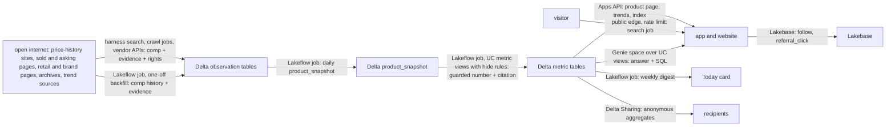

# Market

Status: draft, *agent proposal* except where a line links a decision. Nate's proposal; Ben has not answered. Slug: market. Written 2026-11-14.

Market is what secondhand knows about products and how their markets move, for anyone, including people who never sell. Nate: "Even users who dont expect to use secondhand for selling can still gain so much value from an all in one search of products both on the official markets and second hand stores to see price changes, the ways industries evolve, products release and how hype is established, what fashion trends are out, everything" ([words](../../product/words.md#2026-11-14-nate-a-market-anyone-can-learn-from)).

## What the person does and sees

| Who | Arrives from | Can do | Cannot do |
|---|---|---|---|
| `visitor` (no account) | the website, a shared link, Buy search before sign-in | search; open product pages and trends; tap out with a referral (visitors "can just search, but not sell, they can get linked with our referral", [words](../../product/words.md#2026-11-14-nate-visitors-and-full-users)) | sell, save, follow, ask Genie |
| Full user | Buy search, an item card, Today | the above; `follow` a product, brand, category or search, to "save information the user just wants to learn about and see" ([words](../../product/words.md#2026-11-14-nate-visitors-and-full-users)); ask Genie | |
| Seller or buyer from another feature | the item card's Market block ([insights.md](insights.md)), "Similar for less" ([buy.md](buy.md)), a price range ([price.md](price.md)) | the same product page | |

**The product page**, one per `product`:

| Block | Shows | Built from |
|---|---|---|
| What it is | name, brand, variant, photos, release date, retail price | `comp` price_type `retail`; release databases, brand and retail pages |
| Used price per site | a range per site, sold and asking apart, each labelled | `comp` sold, then asking |
| Supply and speed | for sale now; median days to sell | live `search`; sold comps with `sold_at` |
| Price history | one chart, new against used, from release day where a public series exists; eras mark source changes | observation tables |
| Resale premium | used median over retail, since release | retail and sold comps |
| Cheaper equivalents | similar products with their used range | `score` axis `financial`, similarity |
| Offers | every offer for this product in one list: new, refurbished and used, each with its delivered price, condition, stock and where it ships | [one catalog](#one-catalog) |
| Better official option | the official offer that serves the same purpose, and whether new or used costs less to own | [../determinations/market-insight.md](../determinations/market-insight.md#the-better-official-option-m24-to-m29); shown beside each used result in [buy.md](buy.md#the-better-official-option) |
| Follow | one button; a visitor is asked to sign up | |

Every number is a guarded number; tapping it opens its `citation`: the rows behind it, each with its `evidence` (source link, read time, snapshot). A hidden number says why, in the wordings of [insights.md](insights.md).

## One catalog

*agent proposal*, from Nate's "a suite like shopify, and the better official option" ([words](../../product/words.md#2026-11-14-nate-a-suite-like-shopify-and-the-better-official-option)). One `product` id groups every offer for the same thing: the maker's and authorised retailers' new stock, official and graded refurbished, brand resale, and used listings on every site. The product page is where the catalog lives; [buy.md](buy.md#one-search-across-every-store) is its search and results, and returns the same product id.

| Part | What it does | Built from |
|---|---|---|
| Identity | which offers are the same product | [seeing-the-item card 9](../determinations/seeing-the-item.md#9-which-product-it-is-and-when-identity-is-confirmed) thresholds; product-level match per [M1](../determinations/market-insight.md#m1-same-product) |
| Same-purpose relations | `same_product`, `successor`, `functional_equivalent` | [M24](../determinations/market-insight.md#m24-same-purpose-match) |
| Condition | one scale across new, refurbished and used | [M25](../determinations/market-insight.md#m25-one-condition-scale) |
| Delivered price, stock, ships | price plus shipping plus tax; stock; ships from and to | [M26](../determinations/market-insight.md#m26-delivered-price) |
| Official offers | read on demand from Shopify Catalog (grouped by its product id; prices cached 10 minutes, no standing copy, no redistribution) and Klarna's product feed, plus M2's retailers | `official_offer` |

Best tools for the catalog, not Databricks-bound: Shopify Catalog and Klarna for official offers, the states' published rate tables for a labelled tax estimate (no paid tax service, [Nate](../../product/words.md#2026-11-14-nate-the-search-engine-is-an-api-no-feeds-no-tax-service-tags-on-retouched-photos)), AI Search for similarity; Delta keeps only what each source's `rights` allow.

**Trends**: per category, what is rising and falling over 7 and 30 days, from movement in our observations, each row opening its page.

**Following**: interest, not intent. It never alerts on a new listing; that is a `want` ([buy.md](buy.md)). A follower hears only of a real move:

| Event | Threshold | Delivered |
|---|---|---|
| Used median moved 10% or more over 14 days, at least 10 sold, and past the noise band in [M19](../determinations/market-insight.md#m19-when-a-followed-product-has-moved-enough-to-tell-its-follower) | weekly digest |
| Release or restock | a retail comp with a new date | weekly digest; same day only if turned on |
| Entered the category's top 10 risers | 2 weekly reads running | weekly digest |
| Nothing moved | | no digest |

One digest card in Today, at most weekly, inside the push budget in [insights.md](insights.md), with mute and unfollow on it.

**Visitor to full user**: Follow, Save or Sell opens sign-up; the search, page and tapped follow carry over.

## Design choices

| Choice | Options considered | Picked | Why | What would change it |
|---|---|---|---|---|
| Where history and product data come from | our own snapshots only; licensed sources only; any open-internet source ([market-intelligence.md](../../research/data/nate/market-intelligence.md)) | any source on the open internet, alongside our own snapshots: price-history sites, marketplaces' sold and asking pages, retail and brand pages, archived pages, release databases, trend sources. Each row records its source and `rights` | Nate: "do not limit from only licensd sources, if its open internet, its licenses" ([words](../../product/words.md#2026-11-14-nate-open-source-onto-databricks-and-open-internet-sources)); terms are facts to know ([decisions](../../product/decisions.md#2026-11-14-licences-and-site-terms-are-recorded-as-facts-and-do-not-shape-the-build)) | a public launch, where `rights` are enforced (see Facts to know) |
| Combining sources | pick one per product; one merged series | one series per source and price_type, deduplicated by `fingerprint`; the chart's median is over sold rows, each era named | sources disagree and change format; keeping them apart keeps every point traceable | |
| Trend measure | outside scores (Google Trends, TikTok, Pinterest); our observation movement ([analytics-and-recommendations.md](../../research/data/nate/analytics-and-recommendations.md#6-closing-table-inferred)) | a product's share of its category's sold count, normalised by total observations that week; outside scores shown as context on one product only | outside scores are scaled per query or window and cannot be compared across products | a source publishing absolute volumes |
| Aggregate showcase | a dashboard; an index on Card Ladder's CL50 method ([market-intelligence.md](../../research/data/nate/market-intelligence.md)) | an index per category: mean used value of a fixed basket, rebased to 1,000, eras on source changes, each point recomputable from its `citation`, backfilled from public series | proven aggregates ([words](../../product/words.md#2026-11-14-nate-images-proven-aggregates-and-adaptive-algorithms)) | |
| Listing order | by referral rate; by `score` only ([buyer-side-actions-and-affiliate.md](../../research/watch/nate/buyer-side-actions-and-affiliate.md)) | Results are ordered by the delivered total's place in the guarded fair range, then the match label, then the `score.md` quality axis. Cross-posted copies collapse to the cheapest, with "also on" ([watch dedupe](watch.md#design-choices)). At most 3 rows from one seller in any 20 (starting value). A referral is attached after the order is fixed and never changes it. Buy uses the same statement ([buy](buy.md#design-choices)). | a referral never decides which listing is called best ([words](../../product/words.md#2026-11-14-nate-referrals-and-market-data)) | |
| Placement | trends and a Following shelf in Buy; a Market section in You; a sixth tab | pages open from Buy search and item cards; trends under Buy's search box; a Following shelf beside New matches, Watching and Bought; follow news as one Today card | the bar is fixed at five ([decisions](../../product/decisions.md#2026-11-14-the-bottom-bar-is-today--sell----buy--you)); Buy is where people look at what is for sale | the alternative, a Market section in You, if Ben wants Buy kept to intent to buy |
| Genie | everyone; full users only ([databricks-platform.md](../../research/data/nate/databricks-platform.md)) | full users, over anonymous market views and their own rows; every answer shows SQL and rows | a visitor cannot be scoped; answers can be wrong | measured accuracy above the bar |

## Data flow

## What it reads and writes

| Entity | Writes | Notes |
|---|---|---|
| `product` | new products found by search, with `evidence` | owner per [spec/product.md](../product.md) |
| `comp` | yes, live and backfilled | `evidence` with source and `rights` on every row |
| `product_snapshot` | daily per product, site, price_type | new: n, p25, p50, p75, listed_count, sold_count, table_version |
| `market_metric` | yes | new: a guarded number by metric, subject, as_of |
| `index_point` | yes | new: index_id, basket_version, day, value, era, citation_id |
| `follow` | yes | subject_type `product`, `brand`, `category`, `search`; muted; last_digest_at |
| `referral_click` | yes | visitor_id or user_id, url, site, network, clicked_at; never read by ranking |
| `visitor` | yes | a random cookie id, no profile |
| `score` | axis `trend` for products | owned by `score.md`; reads `financial` |
| `citation` | per guarded number | |

## States

| Thing | States |
|---|---|
| Guarded number | `shown`; `hidden` with hide_reason `too_few`, `stale`, `mixed_types`, `source_gap`, `conflict`, `noise` |
| Product page | `loading`, `ready`, `partial` (missing sites named), `not_found` |
| History chart | `none` (under 3 points on different days), `young` (under 30 days), `ready` |
| `follow` | `active`, `muted`, `removed` |
| Visitor search | `ok`, `rate_limited` with `after_s` |

## Systems underneath

| Piece | Role |
|---|---|
| Delta observation tables, append only | every read and backfilled point, dated, with `evidence`; a citation's `table_versions[]` points here |
| Unity Catalog metric views | one versioned definition per metric; hide rules live in the definition |
| Lakeflow jobs | `market_refresh` (retail, used asking and sold per followed product, including the Serper and Keepa reads), `notify_follow` (the weekly digest and any same-day release), backfill, daily snapshot, index recompute; names per [spec/product.md](../product.md) |
| Genie space over UC views, row filters on `user_id` ([spec/product.md](../product.md)) | full users' questions |
| Delta Sharing | the anonymous dataset ([words](../../product/words.md#2026-11-14-nate-referrals-and-market-data)) |
| Public edge, option A in [spec/product.md](../product.md) | visitor search and rate limits; the public search API (`search`, `product`, `compare`, `history`, `trends` over HTTP and MCP, keys and rate limits per key) is public, as in [buy](buy.md#design-choices) ([Nate](../../product/words.md#2026-11-14-nate-the-search-engine-is-an-api-no-feeds-no-tax-service-tags-on-retouched-photos)); search only, never people's listings |
| AI Search and harness `search` | at most 200 results a query |

**Metrics and hide rules** (from [price.md](price.md) and [market-intelligence.md](../../research/data/nate/market-intelligence.md)):

| Metric | Definition | Hidden when |
|---|---|---|
| Used price | weighted p25, p50, p75 of sold comps per [money.md D1](../determinations/money.md#d1-comparable-set-and-weights) and [D5](../determinations/money.md#d5-fair-value-range-overall-and-per-site); product level per [M3](../determinations/market-insight.md#m3-used-price-per-site-over-time); asking apart, labelled | D1's minimum basis |
| Days to sell | median sold_at minus listed_at | under 5 sold |
| Sell-through | 30-day cohort per [M6](../determinations/market-insight.md#m6-sell-through); formula on tap | M6's hide rule |
| Resale premium | used p50 over retail since release | no retail comp |
| Trend | change in share of category sold count, 7 and 30 days | under 5 per cell |
| Any | | basis older than 14 days (dated, then dropped) |

**Genie** answers "what sold fastest in sneakers this month", "how has this jacket's used price moved since release", "which of my follows moved most". It does not serve visitors, predict a price or see other users' rows; under a metric's floor it says so instead of a number.

**Delta Sharing**: `product_snapshot`, `market_metric`, `index_point` only; no user ids; a cell is shared only under [M20](../determinations/market-insight.md#m20-making-an-anonymous-dataset-safe-to-share)'s contributor rule (10 distinct contributors, none over 50%, complementary suppression); consent per [privacy-and-data.md](../../research/cross-cutting/nate/privacy-and-data.md).

## Contract for the frontend

| Endpoint | Who | Returns |
|---|---|---|
| `POST /v1/search` (SSE) | all | per [spec/product.md](../product.md), with product_id when matched |
| `GET /v1/products/:id` | all | page blocks as guarded numbers |
| `GET /v1/products/:id/history?range=` | all | series per source, eras |
| `GET /v1/trends?category=&window=7d\|30d` | all | ranked rows |
| `GET /v1/index/:id` | all | points and basket |
| `GET /v1/citations/:id` | all | citation and its rows' evidence |
| `POST`, `PATCH`, `DELETE /v1/follows` | user | the follow |
| `GET /v1/out?listing=` | all | 302 with referral; writes `referral_click` |
| `POST /v1/genie` | user | answer, SQL, rows |

Errors: `429 rate_limited` with `after_s`; `401 unauthenticated` with the action to resume.

## Who may act

Visitors and users as in the first table. Jobs write observations, snapshots and metrics and never contact a seller. Nothing lets a referral rate, payout or network change listing order.

## How it fails

| Failure | The person sees | We do |
|---|---|---|
| A site's search fails | that site missing, named | page `partial`; retry next schedule |
| Too few sales | number hidden with reason | asking range stays, labelled |
| Source changes format or disappears | a new era on the chart | `extractor_version` bumps; era recorded |
| Sources disagree | both series, labelled | median over sold rows only |
| Visitor scraping | 429 with a wait | per IP and visitor id 30 searches a minute, 300 a day; repeats served from cache; bot score at the edge; visitors get cached and API results, never a harness run |
| Genie wrong | its SQL and rows | thumbs down joins the evaluation set |

## How we will know it works

| Measure | Bar | Source |
|---|---|---|
| History depth | 80% of followed products show a chart back to release day or 12 months | our own bar, now that public series can be backfilled |
| Trend calls hold | 80% of risers keep rising over the next 30 days | Pinterest Predicts claims "80% accuracy" (2022, *asserted*), [market-intelligence.md](../../research/data/nate/market-intelligence.md) |
| Index reproduces | 100% of points recompute from their citation | CL50 method, same note |
| Numbers cited | 100% of shown numbers open a citation | [words](../../product/words.md#2026-11-14-nate-provable-and-features-for-databricks) |
| Follow retention, visitor conversion | no published figure found; measured 4 weeks, then set | same note |
| Genie | 90% of a 50-question benchmark right | our own bar; no published Genie figure found |

## Facts to know

| Fact | Mark | For a public launch |
|---|---|---|
| Asking prices are not sales; never mixed into a sold range | *inferred* | |
| Outside trend scores are scaled per query or window and cannot be compared across products | *observed* | |
| StockX terms (2026-07-02, s. 27) bar commercial use and public display without consent | *observed* | needs consent, or its rows leave shown numbers |
| PriceCharting: no history in the API, no third-party access, purge when the subscription ends | *observed* | its series cannot be shown or kept |
| WatchCharts licence: no public index, 1 year of history at most, attribution | *observed* | index excludes it; capped and attributed |
| eBay API data kept 6 hours at most, no price modelling | *observed* | eBay API rows expire; harness reads stand |
| Amazon Creators API cache: offers 1 hour, other fields 1 day | *observed* | refetch on those windows |
| KicksDB carries release_date and retail_price, refreshed every 24 hours at most | *observed* | per its licence |
| Sites' own terms (Meta, Poshmark) ban automated collection ([spec/product.md](../product.md)) | *observed* | each source's `rights` enforced per row |
| Archived and other open-web pages carry their own site's terms | *inferred* | `rights` per source, enforced |
| Sell-through has two formulas in circulation; [M6](../determinations/market-insight.md#m6-sell-through) owns the one used | *observed* | |
| eBay Partner Network pays 1.5 to 4% ([buyer-side-actions-and-affiliate.md](../../research/watch/nate/buyer-side-actions-and-affiliate.md)) | *asserted* | network disclosure rules apply |
| Free Edition limits compute for jobs and Genie ([what-databricks-rewards.md](../../research/data/nate/what-databricks-rewards.md)) | *observed* | |

Unmarked links are [market-intelligence.md](../../research/data/nate/market-intelligence.md). Rules that protect people hold regardless: no user id leaves in a share; a recalled product is marked; anything sent out passes a `claim_check`.

## A walk-through that proves it end to end

1. Signed out, search a sneaker: retail, release date, a used range per site.
2. Tap the range: the citation and its sold rows with sources.
3. The chart runs from release day, new against used, eras marked.
4. Tap Follow: sign-up, then the follow exists on the same page.
5. Sneaker trends: the top riser opens its page.
6. Ask Genie "what sold fastest in sneakers this week": SQL and rows.
7. Recompute one index point from its citation in a notebook.
8. On the product page, Offers lists new, refurbished and used together by delivered price; the better official option shows its verdict and its rows.

## Open for Ben and Nate

| Question | Options | Affects |
|---|---|---|
| Placement | Buy; a Market section in You | Buy, You |
| Visitor surface | website; app; both | public edge, onboarding |
| Same-day release alerts by default | off; on | push budget |
| Index baskets | fixed per category; top sold | index |

## Needs from the shared model

- `official_offer` entity (fields in [../determinations/market-insight.md](../determinations/market-insight.md#what-i-need-from-other-areas)) and an `offers` block on `GET /v1/products/:id`.
- `GET /v1/products/:id/history`, `GET /v1/trends`, `GET /v1/index/:id`, `GET /v1/out` and `POST /v1/genie` in [spec/product.md](../product.md)'s endpoint list.
