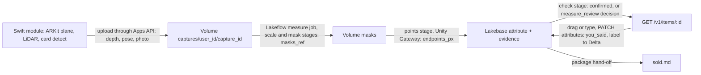

# Measure
Status: draft, second pass, *agent proposal* except where a line links a decision. Slug: measure. Written 2026-11-14. Names follow [product.md](../product.md), which wins where this page differs.

Today a seller lays a tape on a shirt, writes four numbers on a scrap of paper, and still gets "what are the measurements?" from buyers; a furniture seller guesses whether the dresser fits a hatchback. Measure takes the numbers from what [capture](capture.md) already recorded, resolves each one until it is certain, and lets the person fix a point with one drag. "Measuring comes first for clothes" (Ben, [vision](../../product/vision.md)); "for clothes measuring the mechanism is measuring more than anything" (Ben, [words](../../product/words.md#2026-11-14-tools-and-capture)). Measurements are among what Nate says can be made certain ([words](../../product/words.md#2026-11-14-nate-certainty)): they are stated as confirmed, never as a percentage.

## What the person does and sees

Measure has no tab of its own. It runs after capture reaches `judged` and shows on the item card in Sell (and in Buy for an item found or wanted).

| Step | The person | The app |
|---|---|---|
| 1 | Finishes capture. | Lines appear on the flat lay or the scan, each with a value and its word: measured or you said ([copy.md](../../product/copy.md)). |
| 2 | Looks. | A primary value not yet resolved shows a loupe on its worst endpoint, as one `measure_review` card. |
| 3 | Drags an endpoint, or types a tape reading. | Drag recomputes on the phone; a typed number becomes `you_said`. |
| 4 | Taps Looks right. | Every shown value is `confirmed`. |
| 5 | Sees "Fits like M" when a brand chart exists. | Named with its chart, as a fit guide, not a measurement. |

**Where Ben's design makes a person stumble.** His plan shows "estimated" next to numbers it could not resolve and leaves them in the listing. A buyer reads that as "the seller does not know". Here an unresolved primary value asks once (drag, tape, or lay a card) and is then confirmed. **What the backend makes possible that his design does not use:** per-path error measured on our own garments sets each ±, Object Capture poses pick the flattest frame, the product match's published size is a second scale path, and every drag is a label that tunes the point model.

## Design choices

| Choice | Options considered | Picked | Why | What would change it |
|---|---|---|---|---|
| Garment scale without LiDAR | ARKit plane ([measure plan](../../research/measure/ben/build-plan.md)); card or ArUco marker ([garment-measurement-accuracy](../../research/measure/nate/garment-measurement-accuracy.md)); monocular depth ([adaptive-capture](../../research/capture/nate/adaptive-capture.md)); the product's published size | the identified product's published size chart first, with the floor plane as the cross-check; a card or printed marker laid beside the garment is the fallback only when the two disagree or no size chart exists, because it is extra input | a 10 cm marker reached 4.10 to 4.20% (Kowaleczko 2022, *observed*), far under the 12% Ben's plan gave monocular depth; no plane-alone figure exists | the plane test on 30 garments matches the card |
| Garment scale with LiDAR | LiDAR plus keypoints; plane | LiDAR plus keypoints, card as the cross-check | 1.59 to 2.08% relative error, about 8 to 10 mm on 50 cm (Kim 2022, *observed*) | none expected |
| Monocular depth | as scale; as a cross-check only | cross-check only | UniDepthV2-L indoor ARel 6.8%, MoGe-2 Rel 15.7 ([garment-measurement-accuracy](../../research/measure/nate/garment-measurement-accuracy.md)) | a model under 2% indoors |
| How points are placed | geometric pass; a pointing model; the person drags ([measure plan](../../research/measure/ben/build-plan.md)) | geometric pass plus a pointing model run 3 times, then one drag | DeepFashion2 landmark AP is only 0.563, so a model alone is not enough; the person settles what disagrees | point error on 30 garments |
| Rigid items | LiDAR box; Object Capture ([object-capture](../../research/measure/ben/object-capture.md)); published size | LiDAR box or Object Capture, cross-checked with the published size | Luetzenburg: LiDAR about ±1 cm above 10 cm | none expected |
| Build or buy | build; 3DLOOK; Size AI ([garment-measurement-accuracy](../../research/measure/nate/garment-measurement-accuracy.md)) | build, and run a vendor trial on the same garments | 3DLOOK's 1.5 to 2.0 cm is on bodies and vendor-internal; Size AI's 5 and 9 mm are *asserted* | a vendor beats our error on our garments |
| When a value is confirmed | above a confidence; two paths agree; the person confirms | two scale paths agree within the measured per-path error, or the person confirms | Nate's certainty principle; confidence stays internal | none expected |

## What it reads and writes

Reads the `capture` (`depth_ref`, `pose_ref`, `masks_ref`), its `photo` rows, the kind's `requirement` rows with `obtained_by: measured`, and the product match's published dimensions, all from `GET /v1/items/:id`.

Writes one `attribute` per measurement: `unit: mm`, `method`, `{plus_minus_mm, endpoints_px, photo_id}`. Sources: `measured` (a scale path with a cross-check or a confirmation), `label` (a size from the tag), `spec` (a published size), `you_said` (typed, never overwritten). An attribute with no resolved value carries `unknown_reason`.

| `method` | `evidence` written |
|---|---|
| card or marker | `image_region`: the photo, the marker's four corners, and the two measured points |
| LiDAR plus keypoints | `depth`: the depth ref, the two points in pixels and their depth samples |
| plane | `image_region` with the two points and the plane id from `pose_ref` |
| published length | `lookup`: the product page read, plus the `image_region` of the matched edge |
| Object Capture bounds | `depth`: the USDZ ref and the box corners |
| drag or tape | `owner`, with the corrected points or the typed number |

Every `evidence` carries `captured_at` and `extractor_version`. A `package` hand-off goes to sold: `{l_in, w_in, h_in, padding_in, weight_oz?, basis}`.

**Per item class**

| Class | Measured | Path, in order | If unresolved |
|---|---|---|---|
| Tops, outerwear, dresses | pit to pit, length (primary); shoulder, sleeve | LiDAR, published size chart, plane; card only as the fallback; mask and points ([measuring-garments](../../research/measure/ben/measuring-garments.md)) | `measure_review`: drag or "Measure between these two points" |
| Pants, skirts | waist, inseam (primary); rise, thigh, leg opening | same | same |
| Shoes | outsole length and width; size from the tag | LiDAR box, Object Capture bounds | tag size alone (`label`) |
| Bags | L, W, H; strap drop | LiDAR box, Object Capture | two taps on a photo with a card |
| Rigid things, electronics | L, W, H; screen diagonal from the spec | one-frame LiDAR box, Object Capture, two taps | published size (`spec`) |
| Furniture | W, D, H; seat height | LiDAR box from the scan | two taps with the floor plane |
| Small rigid under 10 cm | L, W, H | card or a known length | you said |

Flat garments are weak for LiDAR and small items under 10 cm have no usable depth (adaptive-capture §9, *inferred*), so the card carries scale there.

## How uncertainty is stated

The earlier rule multiplied a fixed 10 or 15 mm by 1, 1.5 or 2.5. That rule had no source; this one uses measured error.

| Rule | Detail |
|---|---|
| Per-path error | each path's error per dimension is measured against tape on our test garments and stored as a guarded number with a `citation` (owned by `score.md`) |
| The ± shown | the cited per-path error for that dimension and class; hidden (`state: hidden`, `hide_reason`) until the test set has a `basis_count` of at least 30 for that path |
| Confirmed | two paths agree within their combined ±, or the person drags, types or taps Looks right |
| Budget | Ben's ±1.3 cm primary and ±2 cm secondary (*inferred*); rigid ±1 cm or 3% |
| Outside budget | `measure_review` asks once; the value is never shown as measured until resolved |

On a 50 cm pit to pit, Kim's LiDAR figure is about 1 cm and Kowaleczko's card figure about 2 cm, so without LiDAR a card alone misses Ben's ±1.3 cm primary budget. The card is therefore the fallback, and a primary value is confirmed when the published size chart and the plane agree, or by the person's drag; the test below decides whether the plane closes that gap.

## States

Measure moves no item state. It runs as the `measure` job while the item is `researching`; stages `scale`, `mask`, `points`, `check`. A `measure_review` decision does not block `review` ([product.md](../product.md) §4); the value stays unconfirmed until it is acted on.

## Systems underneath

| Piece | Does here |
|---|---|
| Swift module | plane, LiDAR box, Object Capture, Vision mask, drag recompute; sends events to JS, writes no log lines ([log/README.md](../../log/README.md)) |
| Lakeflow job `measure` | mask (the phone's mask plus the Object Capture `objectMask`), points (geometric pass plus a pointing model run 3 times through the Unity Gateway), scale cross-check |
| Unity Gateway | bounded point checks on the image path ([decision](../../product/decisions.md#2026-11-14-image-decisions-and-text-decisions-are-separate-and-the-provider-for-each-stays-open)) |
| Lakebase | attributes and evidence; Delta holds drags as labels |
| MLflow 3 | the trace behind "why this number", carrying refs, never images |

The event workspace is a full workspace with GPU serving ([Nate](../../product/words.md#2026-11-14-nate-do-not-limit-the-product-to-fit-databricks)), so SAM 3 there is the cloud segmenter behind the phone's instant mask; the pointing model is a call through the gateway.

## Data flow

## Contract for the frontend

| Call | Body | Returns |
|---|---|---|
| `GET /v1/items/:id` | | item with measurement attributes and evidence |
| `PATCH /v1/items/:id/attributes/:name` | `{endpoints_px}` keeps the method and recomputes; `{value, unit}` sets `you_said` | attribute |
| `POST /v1/decisions/:id/act` | `measure_review`: Looks right, Fix it, Type it | decision |
| `GET /v1/jobs/:id`, `/events` | | stages `scale, mask, points, check` |

Display rounds to 1/4 in or 0.5 cm; the attribute keeps the raw millimetres.

## How measurements feed the rest

| Consumer | What it gets | Rule |
|---|---|---|
| Fit matching (Buy and Sell) | `fits_like`, raw garment measurements | compare with a want's saved measurements within the combined ±. Ben's plan stops at the brand chart; the backend can also match a buyer's own best-fitting garment, measured the same way. |
| Shipping box | dimensions plus class | padding, the smallest mailer or box, billed size ([shipping-and-pickup](../../research/sold/nate/shipping-and-pickup.md)); to [sold](sold.md). Weight is never read from photos: `spec` or `you_said`. |
| Identity checks | dimensions against each candidate's published size | a conflict beyond the combined tolerance rules a candidate out; agreement only keeps it in |
| Listing text | confirmed values | each passes `claim_check` inside `draft` and `post` as backed by its attribute id |

Geometry rules candidates in or out. It never proves authenticity, function or condition: a scan does not show internals, weight, battery or working state, and the word "authentic" is never written ([identify plan](../../research/identify/ben/build-plan.md)).

## Who may act

| Action | Mode |
|---|---|
| Compute and show measurements | auto |
| Put confirmed values into a listing draft | auto |
| Overwrite a you said value | never |
| State a box size to a buyer or site | through sold, inside its limits |

## How it fails

| Failure | The person sees | Recovery |
|---|---|---|
| No scale path | a card prompt | lay a card, or type it |
| Paths disagree beyond their ± | a loupe on the worst point | drag or retake |
| Mask unsure (dark garment on a dark floor) | the outline to adjust | drag the outline |
| Object Capture fails (iPhone 17 Pro, iOS 26.4.2 and 26.5) | box from one frame | two taps |
| Mirror or glass | that face asks | type it |

## How we will know it works

| Claim | Bar | Source |
|---|---|---|
| LiDAR path is accurate | relative error at most 2.08% per dimension | Kim 2022, *observed* |
| Card path is accurate | relative error at most 4.20%; rejected photos at most 76 of 900 (8.4%) | Kowaleczko 2022, *observed* |
| Garment error overall | mean absolute error at most 1.27 cm per primary dimension | Paulauskaite-Taraseviciene 2022, *observed*, scale method unstated |
| Beats the vendor | our error at or under 3DLOOK's 1.5 to 2.0 cm and Size AI on the same garments | vendor trial |
| Plane alone | error against the card on 30 garments, non-LiDAR iPhone; decides the plane's place in the order | no published figure |
| The ± is honest | the tape value inside the shown ± at least 90% of the time | the test set |
| Corrections fall | drag and type rates per class from events, week on week | events |
| Boxes fit | the chosen box against what the seller shipped in | sold |
| Identity checks keep the right product | zero true products ruled out | the test set |

Error is reported in cm per attribute; model self-confidence is never the measure ([product.md](../product.md) §8).

## Facts to know

| Fact | Link, mark |
|---|---|
| LiDAR plus keypoints: 1.59 to 2.08% relative error | [garment-measurement-accuracy](../../research/measure/nate/garment-measurement-accuracy.md), *observed* |
| 10 cm ArUco: 6.36% tops, 4.56% skirts, corrected to 4.10% and 4.20%; no card or A4 figure in mm found | same, *observed* |
| Monocular depth indoors: UniDepthV2-L ARel 6.8%, MoGe-2 Rel 15.7 | same, *observed* |
| Mask plus rules: 1.27 cm blazers, 0.747 dresses, 1.012 skirts | same, *observed* |
| 3DLOOK 1.5 to 2.0 cm on bodies; Size AI 5 and 9 mm | same, vendor-internal and *asserted* |
| No published figure for ARKit plane scale, Object Capture dimensions, or pit to pit alone | same, not found |
| LiDAR about ±1 cm above 10 cm, 20 cm to 2 m | [adaptive-capture](../../research/capture/nate/adaptive-capture.md) §1, *sourced* |
| USPS billed size, padding, carrier and site size limits | [shipping-and-pickup](../../research/sold/nate/shipping-and-pickup.md), *sourced* |

## Demo path

For Ben and Nate to mark.

## Open for Ben and Nate

1. **3D for clothes?** Ben's measure research rejected single-image 3D for clothes for lacking metric scale ([measure plan](../../research/measure/ben/build-plan.md)); his pipeline note reinstates it, scaled to the measured lengths and labelled as a model ([seeing-the-item-pipeline](../../research/cross-cutting/ben/seeing-the-item-pipeline.md)), in line with [it's a demo, so build it](../../product/decisions.md#2026-11-14-its-a-demo-so-build-it). Recommendation: build it, show it as a model, never source a number from it.
2. **How wide is "Fits like"?** Ben recommends about 10 hand-picked brand charts. Recommendation: those charts plus matching against the buyer's own garment. Depends: Buy matching and the want shape.
3. **Who sees the ±?** Recommendation: the seller always; buyers see the confirmed rounded value. Depends: listing copy.
4. **Business.** Confirmed sizes per product could be a paid data set or a fit service; no model is picked.

## Needs from the shared model

- A want field for the buyer's own garment measurements.
- `evidence.region` able to hold two points and a marker's four corners.
- Per-path error as a guarded number with a `citation` from `score.md`.
