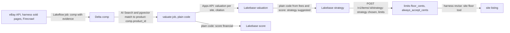

# Price
Status: draft, second pass. Every design line is an *agent proposal* except where a line links a decision. Slug: price. Written 2026-11-14.

Today a seller searches sold listings on two or three sites, guesses a number, forgets fees and shipping, then drops the price at random. Price does that work for them. It gives one calibrated range per site, what they keep on each site, how fast each price sells, and one best plan per site, computed from the listings that site shows now. Feature page: [features/price](../../features/price/README.md). Ben asked "how do you price things in context" ([words](../../product/words.md#2026-11-14-pricing-in-context)). Nate: "we in real time based on similar listings, determine the best marketing strategy for each platform, that is a determined calculation and feature. The user can also influence other marketing strategies, but likely goes for the best option."

## What the person does and sees

| Step | Where | What they see |
|---|---|---|
| 1 | Sell, item in `researching` | The Valuation card fills stage by stage: identified, sales found, range ready. |
| 2 | Valuation card | One range per site, "based on 14 sales, last 90 days" ([copy.md](../../product/copy.md)). A range not yet proven for this kind of item says "not checked yet for this kind of thing" and is drawn wider. Tap a range to see the sales under it, each with its photo, date, and sold or asking. |
| 3 | Valuation card | "You keep" per site after fees, shipping and tax, and "most sell in about 9 days at this price". Sites that do not fit are greyed with one reason ("too big to ship"). |
| 4 | Plan | One best plan per site, preselected: start price, lowest price, the drops as a small step line, title form, photo order, fields to fill, when to post, offers on or off. Tap "why" to see the listings it was computed from. |
| 5 | Plan | **Sell this week** and **Get the most** sit beside it as alternatives (Ben's labels, [MV](../../research/price/ben/what-market-value-is.md)). Every part of a plan can be changed. The lowest-price field and "Always accept $X or more" are prefilled ([decision](../../product/decisions.md#2026-11-14-always-accept-is-offered-at-listing-and-only-unedited-approvals-count)). |
| 6 | Today | Drops show as done events ("Dropped to $52 on Depop"), each with undo. If the comparable set moves, the plan updates and says what moved. |
| 7 | You | Earned, fees and kept per site, worked out from orders ([decision](../../product/decisions.md#2026-11-14-the-you-tab-leads-with-numbers-and-a-by-site-comparison)). |

With too few sales the card says "Not enough sales to price this" and offers one question or a deep search. It never shows a number ([VE](../../research/price/ben/valuation-engine.md)).

## Design choices

| Choice | Options considered | Picked | Why | What would change it |
|---|---|---|---|---|
| Comp sources | eBay only; every open source ([market-intelligence](../../research/data/nate/market-intelligence.md), [comps-sources-live](../../research/price/ben/comps-sources-live.md)) | eBay API and sold pages through the harness, other sites' sold and live pages, Firecrawl, mixed in one model | licences do not shape the build ([decision](../../product/decisions.md#2026-11-14-licences-and-site-terms-are-recorded-as-facts-and-do-not-shape-the-build)); every comp records its rights | public launch enforces rights tags |
| Range method | weighted quantiles; quantile regression; CQR; LLM estimate ([range-calibration](../../research/price/nate/range-calibration.md)) | gradient-boosted quantiles, CQR, Mondrian per category with a parent fallback, an ACI tracker | the one public tool measured holds 75.3% of 81 in a stated 80% range, and categories run from 20 to 70%; per-group calibration is the published fix | backtest coverage per category |
| Predictors | photo quality; photo count; price relative to sold ([quality-and-value-classifiers](../../research/price/nate/quality-and-value-classifiers.md)) | price-to-median-sold ratio with count shrinkage; photo count; condition, drivers, site, age | relative price is the strongest published predictor; photo count is 0.788 against quality 0.032 (WSDM 2014) | feature importance on our own outcomes |
| Days to sell | queue position; survival; cure model ([range-calibration](../../research/price/nate/range-calibration.md), [pricing-in-context](../../research/price/ben/pricing-in-context.md)) | cure model on censored listings, calibrated against Kaplan-Meier | many listings never sell; a plain survival fit overstates the chance of sale | calibration gap in the backtest |
| Plan | fixed percent paths; one slider; a calculation per site from the comparable set ([scoring-and-ranker-inference](../../research/price/nate/scoring-and-ranker-inference.md)) | the calculation below, deterministic, cited, preselected | Nate's definition above | none: decided by Nate's words |
| Floor on the site | our job lowers the price; the site's own tool ([platform-levers](../../research/list/nate/platform-levers.md)) | the site's own tools take the always-accept line, never the floor: Depop auto-respond counters everything below its line at exactly that line, and Poshmark Smart Sell may counter above its minimum; eBay's auto-decline takes `min(floor, 50% of price)`; our `check_due` job elsewhere (*agent proposal* from Ben's [packet 43](../../.agents/team/packets/price/43-platform-levers-and-signals.md), [levers-and-signals](../../research/list/ben/levers-and-signals.md); Ben's agreement not recorded on this wording) | the site acts at once and without a session, and a floor given to a site tool would become the price buyers are countered at | a site tool that counters or accepts below its line |

## What it reads and writes

| Entity | Reads | Writes |
|---|---|---|
| `item`, `attribute`, `product` | identity, condition, size, defects, photo count | nothing |
| `comp` (Delta) | | each observation with `evidence {source_url, read_at, snapshot_ref, fingerprint, extractor_version, rights}`; sold, live or ended; days listed; search position when read from `search` |
| `valuation` | | `per_site[]` of guarded numbers: range, net range, days to sell, each with `citation_id`, `state`, `hide_reason` |
| `score` | quality, visibility and trend axes from `spec/features/score.md` | the financial axis, per plan and site |
| `strategy` | | `suggested` per site, then `chosen`, `running`, `ended` ([product.md](../product.md)) |
| `limits` | | `floor_cents`, `always_accept_cents` per item |
| `citation` | | one per number shown and one per plan |
| `listing`, `offer`, `order` | outcomes for learning and the backtest | `event` per drop, relist and plan change |

Fee table: one row per site and version, `{site, fee_pct, fixed_cents, base: item|item+ship|item+ship+tax, min_cents, valid_from, source_note}` ([fees-and-taxes](../../research/price/nate/fees-and-taxes.md)).

## States

| Move | Trigger |
|---|---|
| item `researching` to `review` | the `valuate` job arrives, with a range or an abstain |
| strategy `suggested` to `chosen` | person confirms a plan (`POST /v1/items/:id/strategy`) |
| strategy `chosen` to `running` | first listing goes live |
| item `live` to `stale` | patience runs out, defined once here: no sale by the plan's median days to sell for its objective (quick 7, balanced 30, max_return 90 days at most) and interest (watchers, likes, offers) below the comparable set's median at the same age; the step taken at each later age is [money D15](../determinations/money.md#d15-markdown-path-stale-and-relist), *agent proposal* |
| item `stale` to `live` | a markdown, relist or new site |
| item `live` or `stale` to `unsold` | the path reaches the floor and ends, or the person ends it; strategy `running` to `ended` |

## Systems underneath

| Piece | Role |
|---|---|
| Lakeflow job `valuate` | stages `identify`, `find_sales`, `adjust`, `range`, `net`, `plans`, each `started, running, arrived, failed` |
| Harness `search` with a sold filter per site, Firecrawl | fetch comps; one job per account session (a lease) |
| AI Search, pgvector and image vectors | match comps to `product` by text and look, backing off from model to family to category |
| Claude Haiku 5.5 | turns comp listing text into comparable facts (condition, drivers, title form) |
| Decisions API and Jev | typed "same product?" per comp ([decision](../../product/decisions.md#2026-11-14-typed-judgements-run-on-both-the-decisions-api-and-jev-and-our-labels-pick)) |
| Claude Opus 5.5 | deep search only, and the plan's words |
| Plain code | adjustment, quantile model, calibration, fees, net, days to sell, the plan calculation, floors, money in cents |
| On-phone comp index | price owns it: recent comps per product in the app, for Glance in appraise |
| Lakeflow job `check_due` | runs drops and relists through the harness where a site has no floor tool, when the item's `next_check_at` is due |

**Range.** `adjusted = sold x condition x drivers x time`. Comps adjusted by more than about 25% are dropped. A LightGBM quantile model (q10, q50, q90) runs over adjusted comps from every site, with a site feature. CQR calibrates it to 80%, per category (crepes `MondrianCategorizer`), falling back to the parent category below about 1/alpha points, which is 10 at 80% (the fallback is *inferred*). An ACI tracker (gamma 0.005) adjusts each group as sales arrive. Display states:

| State | Rule | Shown |
|---|---|---|
| checked | the category's backtest coverage, lower 95% bound, is at least 70% at n of 30 or more | the range |
| not checked yet | below that, parent group used | the parent's wider range, labelled |
| hidden `too_few` | the minimum basis in [money D1](../determinations/money.md#d1-comparable-set-and-weights) | no number |
| hidden `too_wide` | width over the point value | no number |

**You keep.** `net = price - fee(base) - fixed - seller_shipping - processing`. Ben's $16.88 (eBay) and about $18.90 (Depop) on a $20 sale ([pitch-evidence](../../research/cross-cutting/ben/pitch-evidence.md)) hold with no shipping in the fee base. Nate's note puts shipping and tax in the base and gets $16.06 and $18.69 ([fees-and-taxes](../../research/price/nate/fees-and-taxes.md)). The engine uses each site's own base.

**Financial axis** (the `score` row price owns). For item i, site s, plan k with horizon T_k:
`value = P(sold within T_k | p, s) x net_s(p)`, where P comes from the calibrated cure model. The range is the product of P's band and the net range. `citation_id` lists the comp ids. The axis is hidden when the range above is hidden or P is uncalibrated for the group. The other axes are defined in `spec/features/score.md`; product pages are in `spec/features/market.md`.

**Best plan per site** (Nate's definition; plain code; a model only extracts facts and writes words). The comparable set is `C_s`: comps on site s for the same `product_id` and condition grade, live now or sold in the last 90 days, backing off to family. The steps:
1. Ladder: candidate prices `L_s` are the 10th to 90th percentiles of adjusted `C_s` in 5-point steps, rounded to the site's price endings.
2. Speed: for each rung, `P(sold within d | rung, s)` comes from the cure model with the price-to-median ratio as input. With 10 or more comps in the rung, it is shrunk toward that rung's Kaplan-Meier estimate.
3. Path: the start is `argmax over L_s of P(sold within T_k) x net_s(p)`. Each next rung follows at the rung's median days to sell, down to the floor. Expected net `E_k = sum over steps of P(sale in step) x net_s(step price)`.
4. Floor: [money D14](../determinations/money.md#d14-floor-and-always-accept) holds the formula.
5. Listing form: the winners are the top 10 by search position plus the fastest quarter of sold comps. For each feature f (title token order, photo count band, attributes filled, free shipping, weekday and hour posted, offers on), `lift_f = share(winners) - share(C_s)`. A feature is adopted when `lift_f > 0` with a two-proportion test p < 0.05 and at least 10 winners; otherwise the site default holds. A visibility factor from a site's `ranker_model` with probability 0.8 or more replaces the local lift.
6. Other axes: a shown trend axis scales the ladder by its 30-day drift. A shown quality axis enters P through photo count. A hidden axis is left out and the plan says so. There is never a combined score while an axis is hidden.
7. Best: horizon T = 30 days. Sell this week uses T = 7 and Get the most T = 90. The best plan is preselected. Ties go to higher P, then the lower price.

The same inputs (comp snapshot ids, fee table version, `model_version`, `code_version`) give the same plan. The plan is recomputed when the fingerprint of `C_s` changes or at `next_check_at`. The suggestion toward a monthly `goal` is *agent proposal (Open)*: Nate, "There are incentives like money goals for the month, how many sales you've had, tracks progress" ([words](../../product/words.md#2026-11-14-nate-frameworks-and-goals)).

## Data flow

## Contract for the frontend

| Call | Body | Returns |
|---|---|---|
| `POST /v1/valuations` | `{item_id}` | `202 {job_id}`; stage events stream, each with real counts in `found{}` ([product.md §7](../product.md#7-contract-conventions)): sources searched, sales found, sales used after filtering, from `route_call` and `citation` records ([Nate](../../product/words.md#2026-11-14-nate-the-ui-shows-the-work-animation-and-findings-as-they-arrive)); the answer keeps them one tap away as what we considered |
| `GET /v1/items/:id` | | `valuation`, `strategy` per site, each number a guarded number |
| `GET /v1/citations/:id` | | the citation and its basis listings |
| `POST /v1/items/:id/strategy` | `{version, objective, per_site[] edits, floor_cents, always_accept_cents}` | `200 strategy`; `409 stale`; `422 outside_limits` |

Every write sends an `Idempotency-Key`. Ids `val_`, `st_`, `cmp_`, `pr_`.

## Who may act

| Action | Who | Tier |
|---|---|---|
| Run a valuation, compute plans | system | auto |
| Choose or edit a plan, set the floor | person | user |
| Drop the price on the path, above the floor | system | `markdown`: auto, promotable ([decision](../../product/decisions.md#2026-11-14-buyers-are-handled-inside-limits-you-set-then-it-learns)) |
| Any price below the floor | person | `price_below_floor`: ask, never promoted ([decision](../../product/decisions.md#2026-11-14-a-price-below-your-floor-always-asks)) |
| Plan words sent to a site (title form) | system | `claim_check` first; a hold raises `unbacked_claim` |
| Recalled product | nobody | never priced for sale; appraise's recall check sets it |

## How it fails

| Failure | Seen as | Recovery |
|---|---|---|
| A source blocks or times out | the stage shows fewer sales | other sources carry it; the citation lists what ran |
| Too few sales | "Not enough sales to price this" | one question or a deep search |
| Comparable set shifts | plan updates with "prices on Depop moved down 8%" | the person keeps the old plan in one tap |
| Site floor tool rejects a value | event `fell_back` | `check_due` runs the path |
| Fee table out of date | `fee_table_version` older than 30 days flags the net | weekly fee check job |

## How we will know it works

| Bar | Source of the bar | Test |
|---|---|---|
| 80% ranges hold 75% to 85% in every family and price band with enough sales, and overall (starting values, *agent proposal*) | the pass rule in [money.md D6](../determinations/money.md#d6-range-calibration-and-display-state). Underpriced AI's 75.3% of 81: published by the vendor, method not sound, see [the note](../../research/price/nate/published-price-tests-and-their-flaws.md) | rolling-origin backtest by month with a gap; calibrate on the window before; binomial interval per cell; leakage routes 1 to 6 closed ([range-calibration](../../research/price/nate/range-calibration.md)) |
| Median miss of the middle estimate no worse than the better of two baselines: median of recent sold comps, and last sale of the same product (*agent proposal*) | the pass rule in [money.md D5 and D6](../determinations/money.md#d6-range-calibration-and-display-state). FlipTip's $28 on $100 (FlipTip) and ChatGPT $33, Gemini $30, Perplexity $43 (Underpriced AI): published by the vendors, method not sound, see [the note](../../research/price/nate/published-price-tests-and-their-flaws.md) | error distribution on held-out sales, per family and price band, next to both baselines |
| 7 in 10 sale prices inside the range | `spec/features/score.md` | same backtest on our own sales |
| P(sold by d) calibrated within 5 points | Kaplan-Meier with censoring (same note) | calibration plot per horizon |
| Same inputs give the same plan | Nate's definition | replay 100 plans from their citations |
| Best plan nets more than the fixed-percent plan | the first pass | paired outcomes on consenting users' listings through `experiment` |

## Facts to know

| Fact | Mark | Link | At public launch |
|---|---|---|---|
| eBay API licence bans AI training on eBay content and auto-repricing against other sites | *observed* | [product](../product.md), [platform-access](../../research/connect/nate/platform-access.md) | eBay comps leave the model or consent is obtained; rights `may_model` enforced |
| eBay's API licence: displayed listing information at most 6 hours older than eBay's site (other content 24 hours, age shown); no price modelling, AI training or mixing with other sources. A display-freshness rule, not a storage cap | *observed* | [claims validated](../../research/cross-cutting/nate/claims-validated-specs.md) | recorded as a fact; applies only to rows read through eBay's API, which is the last fallback |
| PriceCharting: internal use on a subscription, no public display | *observed* | same note | its numbers are not shown to visitors |
| StockX: no storing, no display; WatchCharts under a bounded licence | *observed* | same note | dropped or licensed |
| Meta bans automated collection without written permission | *observed* | [platform-access](../../research/connect/nate/platform-access.md) | Facebook comps need permission |
| Depop auto-respond: accepts at or above the floor, counters at it, within 60 s | *asserted* | [platform-levers](../../research/list/nate/platform-levers.md) | none |
| Mercari Smart Pricing lowers from start to a floor by demand | *observed* | same note | none |
| Offer floors: Poshmark 10%, eBay 5%, Mercari 10% | *observed* | same note | none |
| Fees, fee bases and shipping rules per site | marks in the note | [fees-and-taxes](../../research/price/nate/fees-and-taxes.md) | none |
| Recalled products may not be sold, including resale online (CPSA s19) | *observed* | [autonomous-features](../../research/cross-cutting/nate/autonomous-features.md) | unchanged: it protects people |
| Account risk differs per site | *observed* | [product](../product.md) | shown per site on every plan |

## Demo path

For Ben and Nate to mark.

1. A jacket in `researching`. The card fills: 14 sales, a range per site, the Depop range labelled "not checked yet".
2. The best Depop plan is preselected. Tap "why" and see the 9 listings it came from.
3. Change the floor below the plan's floor, and the app asks. Confirm, and the site floor tool is set.

## Selling intents

*Agent proposal*, from Ben's ask at 02:46 ([words](../../product/words.md#2026-11-15-the-new-button-gradients-that-carry-state-seller-intents-onboarding-and-build-ready)): "the user can set things like i want to sell but this is my minimum. or i want to do a firesale. or i just want to see if someone would buy it but i want to keep it unless i can get it". Brainstormed twice, by this thread and by a second model given only the personas and the levers; where the two differed is marked below.

### Why the plan needs an intent above the slider

The plan today has one axis: speed against price. `objective` (quick, balanced, max_return), `posture` (0 to 1) and `horizon_days` (7, 30, 90) are three views of it, and the [valuation engine](../engines/valuation.md) says so: "the plan choice and the slider are the same control". Ben's three examples differ on a second axis the model lacks: **what should happen if it does not sell, and whether a sale is wanted at all**. No slider position says "I'd rather keep it". So the person picks an intent first, and the slider stays as the fine adjustment under it (*inferred*; both brainstorms reached this independently).

### Who wants what

Personas from [today research §1](../../research/today/ben/today-wants-alerts-and-clickability.md#1-who-opens-the-app-next-to-what-they-already-use); principles (P) from [user-wants](../../research/cross-cutting/ben/user-wants.md).

| What they want, in their words | Who | The want under it | Covered today by | Missing |
|---|---|---|---|---|
| "Gone by Friday" | clearing out (moving), students | out of the house by a date; money second (P1) | `quick`, horizon 7 | a real date. A horizon is a scoring window, not a deadline: holding cost is near zero until Thursday, then it is the whole item. Needs `gone_by` and a ladder compressed to reach the floor before it |
| "Just get rid of it" (fire sale) | clearing out | no more decisions; any fair taker | `quick`, posture 0 | conflicts with "a price below your floor always asks" ([decision](../../product/decisions.md#2026-11-14-a-price-below-your-floor-always-asks)). Kept intact: a fire sale sets a low floor once, shown with what you'd keep, instead of weakening the rule |
| "Sell it, but not under $X" | everyone | a normal sale with one protected line | `balanced`, floor, the markdown path | nothing: this is the default |
| "Only if I get $X, otherwise I keep it" | attached owners, young fashion sellers | keeping is a fine outcome (P10, loss aversion) | `max_return` with floor X | three breaks: if X is above the top sold price the path has no rung; [D15](../determinations/money.md) walks it to stale and `end_unsold`; the success score calls it at risk. Needs a reserve mode: fixed ask, no markdowns, no stale, ends only when the person says |
| "See what it would fetch" | everyone, flippers most | information, not a sale | appraise, with no listing | a live listing where every offer asks and nothing is accepted for you, with a review date. Not on a site where a buy-now binds the seller and cancelling costs a defect (eBay, Mercari, Poshmark; [money](../determinations/money.md)), so on those it lists with offers only, or stays an appraisal |
| "Donate it if it doesn't sell" | clearing out | an ending chosen up front, so nothing lingers (P1: donate "looks finished, not failed") | `end_unsold`, asked at the end | `fallback` chosen at listing (donate, keep, trade in, relist, ask me), so the end is automatic |
| "Clear the lot" | clearing out, flippers | the pile gone; the total matters, not each price | `bundle_offer`, per-item floors | a batch with one total floor that lets items cross-subsidise; conflicts with "never below any item's floor" in bundles. Open for Ben and Nate |
| "Hold it for the season" | young fashion, flippers | list the coat in October | `list_at` | a visible scheduled state ("lists Oct 1") and the engine's note when waiting pays |
| "At least what I paid, plus a margin" | flippers | profit over cost | `item.cost`, `user.target_profit_cents` | a floor derived from cost. Cost is never asked of someone clearing out (P10); it is offered once a person behaves like a flipper (*second model's point*) |
| "Don't bother me" | clearing out | set once, hear only when it sells (P3) | rules, Always accept | the stale and end steps still ask; fixed by `fallback` and the intents above being answered up front |
| "Not on Facebook" | anyone | friends shouldn't see it | a skipped site in the plan | a person-set skip reason (`skip_reason` holds system reasons only) |

### Five choices, one tap

The Plan sheet opens on these, each showing its consequence from sold data before the person picks ("about 9 days, you keep $41"), never a bare label (P10).

| Choice | Says underneath | Sets | Standing judges it by |
|---|---|---|---|
| **Sell it** (default) | a fair price, soon | `balanced`, posture 0.5, horizon 30, floor suggested from sold prices, Always accept offered, `fallback` ask | on pace against the plan's median days |
| **Gone fast** | by a date, or as soon as possible | `quick`, posture 0.15, optional `gone_by`, the path compressed to reach the floor by the date, Always accept at the floor, pickup sites first, `fallback` chosen now. A fire sale is this with a low floor | will it clear before `gone_by`; a predicted miss is the one alarm worth a push ("won't sell by Friday at $40; $28 would") |
| **Best price** | no rush | `max_return`, posture 0.85, horizon 90, offers on, slow counters, `fallback` ask | interest arriving at this ask |
| **Only at my price** | I'd keep it otherwise | `intent` reserve: ask fixed at their number, `markdown_on` false, no stale, offers below it decline quietly or ask (their pick), `fallback` keep, `review_at` 30 days | distance from the market only: "sold ones top out at $70; yours is $95". Never Slow or Stuck |
| **Just checking** | what would it fetch? | an appraisal by default; or a listing with `accept_mode` ask_all, nothing automatic, `review_at` 14 days, only on sites where an offer does not bind | the answer itself: interest and offers received; no fixes pushed |

Everything else is an adjustment inside a choice, not a sixth choice: the floor, Always accept, the date, the fallback, ship or pickup, sites to skip, sell as a set, cost (flippers only), list later. The default is Sell it, not the middle of a slider, because for the primary person "gone" beats money (P1); the slider still opens at the middle inside Sell it, as Nate asked ([words](../../product/words.md#2026-11-14-nate-the-price-slider-defaults-to-the-middle)). The second model argued the default should lean faster for the primary persona; that is Ben's and Nate's call.

### What changes underneath

| Part | Change |
|---|---|
| `strategy` | add `intent` (`sell`, `fast`, `best`, `reserve`, `check`), `gone_by?` (date), `fallback` (`ask`, `donate`, `keep`, `trade_in`, `relist`), `markdown_on` (bool), `review_at?` |
| `limits` | add `accept_mode` (`auto`, `ask_all`) per item |
| the marketing engine | for `fast` with `gone_by`, the holding cost is a step at the date, not a rate; for `reserve`, no path is built and the item never enters `stale` |
| [money D15](../determinations/money.md) | skips `reserve` and `check`; for the rest, `fallback` answers `end_unsold` without a card unless it is `ask` |
| the success score | `U_best` is the best plan under the chosen intent, not only the posture ([score](score.md#standing-against-the-market)) |
| decision kinds | none new; `end_unsold` is raised only when `fallback` is `ask` |
| the floor rule | unchanged: a price below the floor always asks. Intents set the floor up front; they never cross it |

## Open for Ben and Nate

- Selling intents: may a batch carry one total floor that overrides each item's floor? May "Just checking" create a live listing at all? Is cost ever asked, or only offered to flippers? Should the default lean faster than Sell it for someone clearing out?
- Is the 30-day horizon the right default "best", or should the best plan follow this month's goal when one is set?
- Should visitors see the financial axis on product pages when its range is "not checked yet"?

## Needs from the shared model

- `strategy.per_site[] {site, price_path[], floor_cents, title_form, photo_order[], attributes_to_fill[], list_at, offers_on, citation_id}`: product has one `price_path[]` and `sites[]`.
- `GET /v1/citations/:id` in the endpoint list.
- `unbacked_claim` in the decision kinds.
- `comp.days_listed`, `comp.search_position`, `comp.state` (sold, live, ended).
- Selling intents: `strategy.intent`, `strategy.gone_by`, `strategy.fallback`, `strategy.markdown_on`, `strategy.review_at`, `limits.accept_mode`, and a person-set `skip_reason` value `you_skipped` ([selling intents](#selling-intents)).
