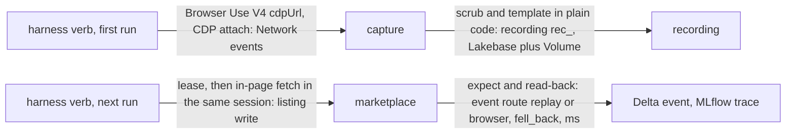

# Replay (recorded calls)
Status: draft, *agent proposal* throughout: replay is the fast path inside each harness, not a layer of its own. Slug: replay. Written 2026-11-14, second pass.

The hassle it removes: when an item sells on Depop, the person needs the Poshmark copy gone in seconds, not after a cloud browser spends minutes clicking. Inside each site's harness, replay records the site's own web calls once, while a browser run does the task, and repeats them in the same signed-in session, so delists, price changes and read-backs are fast and cheap, and the harness drives the browser again the moment a site changes.

The name: [spec/replay.mjs](../replay.mjs) is an unrelated piece in the shared spec, and the old feature page calls this "Replay (Pavlo)" ([features/replay](../../features/replay/README.md)). Ben has his own private replay tool; this spec describes the role the product needs and takes nothing from it.

## What the person does and sees

Replay has no tab and no button. The person sees its effect:

1. In **Sell**, after a sale, the other sites' pills go from Ending to Ended in seconds.
2. In an item's events, one line says how a step ran: "Ran directly", or "Ran in the browser, the site had changed" ([copy](../../product/copy.md)).
3. Nothing in **You > Accounts**: when replay drifts the harness drives the browser, and the account stays `ok`. Only a failure of the verb itself reaches the person ([connect](connect.md)).
4. A live view of a step exists only when it ran in the browser.

## Design choices

| Choice | Options considered | Picked | Why | What would change it |
|---|---|---|---|---|
| How calls are captured | Browser Use V4 run logs; a HAR export; a CDP attach to the session ([cloud-browsers-and-detection §1.1](../../research/replay/nate/cloud-browsers-and-detection.md#11-does-browser-use-cloud-expose-the-network-log-or-har)) | CDP attach: read `cdpUrl` from `GET /api/v4/browsers/{id}`, attach first, then drive the task in that session and record `Network.*` events | V4 has no network log or HAR; CDP events exist only from the moment of attach (observed) | the capture check below failing; then the harness-only path, every verb in the browser |
| Where a replay runs | from our server with copied cookies; inside the same cloud session by in-page `fetch` ([§1.3](../../research/replay/nate/cloud-browsers-and-detection.md#13-replay-relevant-facts)) | in-page `fetch` in the person's own session | cookies never leave the profile; a cookie replayed from another IP fails; Depop's Cloudflare needs `__cf_bm`, which the page holds | none found |
| Which verbs replay | all; only small frequent ones ([crosspost-and-delist](../../research/list/ben/crosspost-and-delist.md#the-sold--delist-pipeline)) | `end`, `revise` (price), `read_stats`, `read_offers`, `read_orders`, `read_inbox`, and the release step of `post` | frequent and time-critical; photo upload and form shape change most | drift rate per verb |
| What a recording holds | the raw capture; a scrubbed template | a template: method, URL with slots, allowed header names, body with slots, the expected status and response shape hash | no cookies, `Authorization`, buyer text or addresses ever stored; Kernel's telemetry shows such headers do appear in captures | none |
| Drift detection | wait for a person to notice; check each call's `expect` and read back | `expect` on every call, then read-back | a call can be accepted and change nothing | none |
| Which provider | Browser Use; Browserbase (Session Logs `GET /v1/sessions/{id}/logs`); Kernel (`POST /browsers/{id}/curl`) ([§1.2](../../research/replay/nate/cloud-browsers-and-detection.md#12-comparison-table)) | Browser Use, decided for every harness ([decisions](../../product/decisions.md#2026-11-14-each-marketplace-gets-its-own-harness-run-on-browser-use-cloud)) | one provider, one profile per account | the capture check failing on Browser Use while another passes |

## Data flow

## Reads and writes with the proof layer

| Entity | Fields |
|---|---|
| `recording` | `id` (`rec_`), site, task (the verb), steps_ref (the template file in a Volume), recorded_at, last_ok_at, fail_count |
| `account` | reads the profile and route; never writes health for a drift |
| `listing` | the same writes the verb makes through any route ([list](list.md)) |
| `job` | stages and result with `{route, fell_back, ms}` |
| `event` | recorded, drift, fallback, each with `trace_id` |

A recording is per site and verb, never per person. Values that differ per call (listing id, price, the CSRF token read from the page) fill slots at run time. Replay writes no fact of its own, so it carries no `evidence`; the read-back that confirms a write is the evidence the listing's event points to. It sends no text a person reads; a replayed `send_message` would pass the same `claim_check` stage inside the verb.

## States

Recordings have no state machine; their fields say enough:

| Condition | Means | What runs |
|---|---|---|
| no recording for the verb | never captured | the browser; capture runs on the next test-account run |
| `last_ok_at` set, `fail_count` 0 | good | replay |
| a drift | `fail_count` up | the browser under the same idempotency key, and a re-record on a test account |
| `fail_count` at 3 | stale | the browser only until a new recording passes |

The listing moves through the same [lifecycle.mjs](../lifecycle.mjs) states whatever the route.

## Harness and systems

| Piece | What it does here |
|---|---|
| Harness per site | owns its recordings; picks replay or browser per verb |
| Browser Use cloud V4 | the session, `cdpUrl`, the saved profile on a stable US IP |
| CDP client | attaches first, records `Network.requestWillBeSent` and responses for the task |
| Scrub and template (plain code) | strips cookies, `Authorization`, personal values; turns ids and prices into slots; hashes response shape |
| Runner | `Runtime.evaluate` of `fetch` in the page; checks each `expect` |
| Lakebase plus a Volume | recording rows plus template files |
| Lakeflow jobs | the daily canary per recording on a test account |
| MLflow | route and fallback as spans in the job's trace |

The lease from [connect](connect.md) holds: replay runs inside the job that holds the account's session, and a busy session returns 409, so a recorder and a verb never share one. Pacing is per account and verb across routes: a replayed Poshmark delist waits like a browser one.

## Contract

No endpoints of its own. Every job and event for an outward verb carries `{route: "api" | "replay" | "browser", fell_back: bool, ms}` ([product.md](../product.md#harnesses)). The item's events show `route` as one line. Live view links come back only when `route` is `browser`.

## Who may act

Replay is a route, not an actor. A replayed verb keeps the mode it had: a delist after a sale stays auto, a first post stays ask, locked kinds stay locked. The policy check runs before the route is picked, so replay cannot widen what is allowed. Recording and canary runs act only on test accounts.

## How it fails

| Failure | Signal | What happens |
|---|---|---|
| Site changed a field or endpoint | status or shape hash differs | drift event; read back first, then the browser under the same idempotency key; `fail_count` up; re-record queued |
| Call accepted, nothing changed | read-back does not match | as above; never a success |
| Challenge or sign-in page | HTML where JSON was expected, or a challenge marker | stop, no retry; the account goes `broken` or `paused` ([connect](connect.md)) |
| Session expired | 401 or 403 | `broken`, a `relink` card; outward verbs wait |
| Session busy | 409 | wait for the lease |
| Browser also fails | harness error | the listing's own failure path in [list](list.md) |
| Capture holds a personal value | the scrub check | recording rejected, never stored |

Read-back before any retry matters most: a delist that reached the site but timed out must not be sent twice ([harness lessons](../../research/cross-cutting/ben/ai-harness-from-repos.md#4-posting-delisting-and-jobs)).

## How we will know it works

| Measure | Bar | Source |
|---|---|---|
| CDP capture on Browser Use V4 | the first build task: attach, run `end` on a test listing, see its calls | [§1.1](../../research/replay/nate/cloud-browsers-and-detection.md#11-does-browser-use-cloud-expose-the-network-log-or-har); fallback is the harness-only path |
| Delist speed | per action, about 1 to 3 s by replay and 1 to 4 min in the browser; the end-to-end bar is [sold.md](sold.md#how-we-will-know-it-works) | asserted in [crosspost-and-delist](../../research/list/ben/crosspost-and-delist.md#the-sold--delist-pipeline); timed replays decide |
| In-page calls only | no replay from outside the session in any trace | MLflow traces |
| Ban risk | no warning on test accounts over weeks of replays | test accounts per site |
| Drift caught | every drift found by `expect` or read-back | events |
| Double actions | none under one idempotency key | read-backs |
| Scrub | no cookie, token or personal value in any recording | the scrub check and `node spec/log.mjs` |

## Facts to know

| Fact | Mark | Source | At public launch |
|---|---|---|---|
| Browser Use V4 has no network log or HAR; `cdpUrl` from `GET /api/v4/browsers/{id}`; CDP events only from attach | observed | [§1.1](../../research/replay/nate/cloud-browsers-and-detection.md#11-does-browser-use-cloud-expose-the-network-log-or-har) | unchanged |
| A busy session returns 409; a profile pairs with a stable IP; a cookie from another IP fails | observed | [§1.3](../../research/replay/nate/cloud-browsers-and-detection.md#13-replay-relevant-facts) | unchanged |
| Detection per site: eBay Akamai, Depop Cloudflare (`__cf_bm`), Mercari Cloudflare, Poshmark Cequence and reCAPTCHA, Facebook Arkose | asserted | [§2](../../research/replay/nate/cloud-browsers-and-detection.md#20-what-the-sources-say-about-detection-layers) | unchanged |
| Ben's plan: the browser explores once, later runs call the site's own endpoints, drift falls back | Ben's note | [crosspost-and-delist](../../research/list/ben/crosspost-and-delist.md#browser-use-cloud-v4-for-posting-and-for-delists-the-replay-layer-cant-do) | unchanged |
| Poshmark, Mercari and eBay terms ban automated means whatever the route | observed | [platform-access §7](../../research/connect/nate/platform-access.md#7-cross-marketplace-comparison-of-terms) | a written allowance per site, or the risk line stays |
| A session kept on the server, which is where App Store 5.1.1(v) applies | inferred | [privacy §9](../../research/cross-cutting/nate/privacy-and-data.md#9-session-tokens-and-cookies-keychain-versus-server-vault) | App Review on a TestFlight build |

Rules that protect people, unchanged: a home address only on the person's tap; no buyer data in any recording; a recalled product is not listed whatever the route; account risk shown per site in [connect](connect.md).

## Open for Ben and Nate

| Question | Recommendation | What depends on it |
|---|---|---|
| Keep recorded replays inside each harness? | yes: one harness per site owns its fast path | whether replay keeps a spec of its own |
| Use Ben's private tool behind this role, or build the role here? | Ben's say; the role and contract hold either way | recorder and runner |

## Needs from the shared model

- product.md says replay is not a layer of its own; this spec stays as the design of the fast path until Ben answers the first question.
- Event names recorded, drift and fallback in [events.json](../events.json).
- Test accounts per site for recording and the daily canary.
