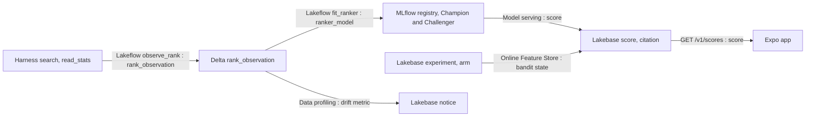

# Score

Status: draft, *agent proposal* except where a line links a decision. Slug: score. Written 2026-11-14.

The engine that scores any item, listing, product or match on four axes, per marketplace: what it nets ([price.md](price.md) owns this), how good the listing is, how well it is likely to show in each site's search, and which way the market is moving. Nate asked for it in [his words](../../product/words.md#2026-11-14-nate-a-general-scoring-feature-and-real-time-algorithms). It learns each site's ranking from what it observes and from tests on consenting sellers' own listings. Every number is measured knowledge with a confidence level, never certainty: a ranker we do not own runs on the site's servers, is personalised and changes without notice. Evidence: [scoring-and-ranker-inference.md](../../research/price/nate/scoring-and-ranker-inference.md).

## What the person does and sees

Scores have no tab of their own. They sit where a decision is made. All copy below is *agent proposal*, written to [copy.md](../../product/copy.md), with no statistics notation.

| Where | What shows | Example words |
|---|---|---|
| Sell, the draft | one row per site, four short lines, the weakest named first | "Depop: likely near the top for this search, from 3 weeks of searches." "Add a photo of the tag: most sold ones have it." |
| Sell, each live listing | the same rows, plus what changed since yesterday | "Showing lower on eBay since Tuesday. We're checking why." |
| Buy, each match | how fairly it is priced and how fast it moves | "Priced below most recent sales." "These sell in about a week." |
| A product page (`spec/features/market.md`) | trend and price movement | "More listed this month, prices flat." |
| You, settings | one switch: "Help test what sells" | "We change one thing on a listing, like the first photo, and tell you each time." |

Steps:
1. The person finishes a draft. The rows appear as each part arrives. A part that is not ready yet says so: "Not enough searches seen yet on Mercari."
2. Each line opens to show what it rests on, for example "from 41 sales in 90 days" or "from 300 searches checked daily since 1 Nov". Nothing else opens.
3. A suggestion, such as "Lead with the front photo", is one tap to apply. It changes the draft only. Posting still goes through [list.md](list.md).
4. If the person has turned on "Help test what sells", the agent may run one variation on a live listing. It is logged and can be undone, it never goes under the lowest you'd take, and the listing shows "Testing a new first photo until Friday."
5. When a site's ranking seems to have changed, every listing on that site shows the notice, and its "likely to show" line is replaced with "Can't say right now."

## Design choices

All rows are *agent proposal*.

| Choice | Options considered | Picked | Why | What would change it |
|---|---|---|---|---|
| How axes combine | one weighted score; four separate axes; expected value only ([scoring note](../../research/price/nate/scoring-and-ranker-inference.md)) | four separate axes per site; whether a combined "worth listing here" line exists is open ([product §9](../product.md), "may the axes combine into one score"), and if allowed it shows only when all four are shown | no source gives axis weights; a combined number would hide which part is weak | Ben and Nate's answer, then a measured weight fit against our own sell-through |
| Stand-in for a site's ranker | correlational factor studies; a pointwise model; a pairwise or Plackett-Luce learning-to-rank model with a posterior per factor ([ranking-algorithms.md](../../research/list/nate/ranking-algorithms.md), [scoring note](../../research/price/nate/scoring-and-ranker-inference.md)) | Plackett-Luce on observed orderings per site and category, with a probability and an effect size per factor | only the rank is visible; a posterior gives the range people see | held-out agreement that never beats the control-pair floor |
| What counts as a real difference | any rank change; a control-pair noise floor ([observing-rank-and-performance.md](../../research/list/nate/observing-rank-and-performance.md)) | two identical queries run side by side set the floor; a difference below it is not evidence | ranking is personalised and noisy | none; this is the floor for every visibility claim |
| Experiment design | randomised parallel tests; before and after on one listing; matched pairs across sellers ([scoring note](../../research/price/nate/scoring-and-ranker-inference.md)) | matched pairs where items match; before and after otherwise, labelled as such; one change at a time | eBay revise allows title, photos and a lower price but no split test; one-of-a-kind items interfere | a site that offers split tests to sellers |
| Adaptive allocation | fixed A/B; Thompson sampling; meta-pricing with a shared prior ([scoring note](../../research/price/nate/scoring-and-ranker-inference.md)) | Thompson sampling with a prior pooled across sellers and categories | items sell once, so per-listing learning starts cold; Thompson measured better than passive learning live | the pooled prior failing to beat the current arm in replay |
| Change detection | site announcements; a fixed query panel per site; model drift alone ([market-intelligence.md](../../research/data/nate/market-intelligence.md), [scoring note](../../research/price/nate/scoring-and-ranker-inference.md)) | a fixed panel with daily Kendall tau against our own baseline, plus the stand-in's held-out agreement, plus Databricks data profiling drift | Semrush and MozCast work this way; three signals together cut false alarms | a site publishing ranking changes |
| Quality axis | photo score only; completeness against each site's fields; title against buyer searches ([photo-score.md](../../research/studio/ben/photo-score.md), [quality-and-value-classifiers.md](../../research/price/nate/quality-and-value-classifiers.md)) | all three, each its own line, worded as a fix ("add a tag photo"), never as a size of effect on sale | each is a separate fix the person can make; the measured effects are small: image quality's odds ratio of sale is 1.17 (shoes) and 1.25 (handbags), and views predicted sale better; photo count's 0.788 is a correlation with resale profit, not with sale probability ([open-facts-money-and-markets.md](../../research/price/nate/open-facts-money-and-markets.md)) | our own sales showing a larger effect on sale, measured by the experiments below |

## Fast, credible, dynamic, transparent

Nate's requirement: "It needs to be fast, credible and dynamic, yet transparent". The best plan per site is a calculation, and the person can still pick another one. The plan itself is specified in [price.md](price.md); score supplies the axes it reads. Each quality below is a requirement with a test. *agent proposal*.

| Quality | Requirement | Test |
|---|---|---|
| Fast | the comparable set, its features, the Champion stand-in and bandit state are kept ready per item kind and site, so scoring and a plan are arithmetic on data in hand. The person-facing step (draft rows, match line, plan) returns in under 1 second. Panel runs, refits, comparable refresh and experiment reads run in the background on Lakeflow | p95 of `GET /v1/scores` under 1 s on a warm store; no model fit or outside fetch on that path |
| Credible | every score rests on real listings it can show; ranges are calibrated against held-back sales; a thin basis hides the line (States) | the bars in "How we will know it works"; a hidden line never shows a number |
| Dynamic | scores recompute when the comparable set moves (a new sale or listing in the set), experiments shift allocation, and a ranker change is detected and announced | a new comp in the set emits `score.change` within one background cycle; the notice appears on every affected listing |
| Transparent | the choosing is plain code, not a model's say; each score and plan opens into the listings and the calculation behind it; the same inputs give the same result | recompute from the `citation` gives the same value; two runs on the same inputs match exactly |

## What it reads and writes

| Reads | From |
|---|---|
| `valuation`, plans, net | [price.md](price.md) |
| `item`, `attribute`, `photo` with `evidence` | identify and capture |
| `listing`, `listing.interest {views?, watchers?, likes?}`, `limits.floor_cents` | [list.md](list.md) |
| `comp` with `evidence.rights` | [data.md](data.md) |
| search result orderings | harness `search` |
| the seller's own analytics | harness `read_stats` (eBay Sell Analytics getTrafficReport; elsewhere none confirmed) |
| `requirement` rows (what each site asks for) | capture registry |

| Writes | Shape |
|---|---|
| `score` | `{subject_type, subject_id, axis, site?, value, range, citation_id, state: shown \| hidden, hide_reason, model_version}` |
| `citation` | `{metric, filters, table_versions[], definition_version, code_version, computed_at, basis_ids[], param_versions{}, model_version}` |
| `rank_observation` | one query, one site, one time: ordered listing ids with `evidence` |
| `ranker_model` | one site and category: factors with probability and effect size, held-out agreement, noise floor, alias |
| `experiment`, `arm` | the variation, the listings, exposures, outcome, design label `matched_pair \| before_after` |
| notices | a ranker change per site, raised to every affected listing |

## States

| Thing | States |
|---|---|
| `score.state` | shown, hidden (`hide_reason`: `too_few`, `interval_too_wide`, `gate_failed`, `below_noise_floor`, `panel_stale`, `ranker_changed`, `series_too_short`, `axis_hidden`) |
| `ranker_model` alias | Challenger, Champion, retired |
| `experiment` | the strategy states: suggested, chosen, running, ended |
| scoring `job` | queued, running, done, failed; stages started, running, arrived, failed |

Hide rules, one per axis:

| Axis | Range from | Basis shown | Hidden when |
|---|---|---|---|
| Financial | [price.md](price.md) | its sales count and window | price.md abstains: below the minimum basis in [money D1](../determinations/money.md#d1-comparable-set-and-weights) and [D5](../determinations/money.md#d5-fair-value-range-overall-and-per-site) |
| Quality | classifier probability with Mondrian coverage | which fields were present | the gate fails |
| Visibility | posterior interval on rank or impression share | panel size, days observed, noise floor | held-out agreement not above the floor, panel older than a day, or a change notice up |
| Trend | change point or drift flag with run length | window and detector | series shorter than burn-in, or a change notice up for that site |

### The success score (agent proposal, answered by Nate)

Nate, 2026-11-14 ([words](../../product/words.md#2026-11-14-nate-the-system-runs-the-storefront-learns-the-person-and-scores-every-listing-with-one-success-score)): "The system scores each listing a user has, which our UI is planned to use color indication as a helpful way of showing its projected performance, combing all engines and calculations we perform into a unified success score". This answers "may the axes combine into one score": yes. Ben's agreement is not recorded, and the colours and how they are drawn are Ben's.

| Part | How |
|---|---|
| What it is | one number per listing, 0 to 100: the projected performance of this listing as it stands, against the best this item could do |
| The calculation | `U_now / U_best`, scaled to 100. `U` is the marketing engine's objective: the chance of sale within the horizon ([money D10](../determinations/money.md#d10-chance-of-sale-within-a-period-at-a-price)) times what the person keeps ([D9](../determinations/money.md#d9-what-you-keep-per-site)) less holding cost. `U_now` uses the listing's own price, photos, title, fields, site and age. `U_best` is the same item under the best plan the engines can find at the person's [posture](../engines/valuation.md) |
| What feeds it | every engine: valuation (price against sold comps, top listings and official prices), photo (quality and the site's set), the marketing engine (title, fields, site, timing), demand and trend (the forecast), platform analytics (how this site does for items like this), trust and account health, and the listing's own results so far (views, likes, offers) |
| Bands | four, by score: strong, on track, needs attention, at risk. The cut points are `param` rows, refit so each band's actual sale rate differs from its neighbours'. Colour shows the band and is never the only signal: the band's word is always there |
| On tap | the four axes, then the one change that would raise the score most, with the points it is worth ("Lower to $44: +12", "Add a photo of the tag: +6") and a button that does it where the autonomy setting allows |
| Over time | recomputed on each event on the listing and hourly; a drop across a band is a `listing_stale` or `value_moved` notice |
| Hidden when | any axis it needs is hidden for thin basis, after the gather request has run; then the band shows as "still learning" with what is being gathered |
| Proof | on the fixed set and on our own listings, listings in a higher band sell more often and sooner than those in a lower one, with the measured rates shown; a score change that an action predicted is compared with what happened |

For the whole storefront, the same score is averaged by expected keep per site and overall, and opens to the listings pulling it down ([insights](insights.md)).

**Learning the person.** The system also learns how this person sells and buys, so it acts as their agent and not a generic one: their posture choices, which suggestions they take or undo, the offers they accept or refuse against what the policy proposed, how fast they ship, what they keep and what they sell, and their words in notes. These are `param` rows scoped to the person (prior: the market-wide value), read by the negotiation, marketing and recommendation engines. The person can see each one and reset it.

### Standing against the market

*Agent proposal*, from Ben's ask to "assess the standing of our listing against other listings and take into account the market listing" ([words](../../product/words.md#2026-11-15-the-new-button-gradients-that-carry-state-seller-intents-onboarding-and-build-ready)). The success score above compares a listing with the best this item could do. Standing is what the person reads: where the listing sits among the others like it, what that means for them, and the one thing they control.

**What a seller wants to know** (*inferred* from [user-wants](../../research/cross-cutting/ben/user-wants.md) P1 to P3): will it sell, about when, and is anything in my control holding it back. Not a market report.

| Comparison | Meaningful because | Source |
|---|---|---|
| Price place among live listings of the same product, condition and site: "3rd cheapest of 14" | it is what a buyer sorting by price sees | `comp` asking, same `product_id`, match label exact or likely same model; `strategy.scores.position` |
| Price against recent sold prices: "sold ones went for $38 to $52" | sold sets value; asks never do | [money D5](../determinations/money.md#d5-fair-value-range-overall-and-per-site) |
| Interest against listings of the same age: views, likes, offers | separates a price problem from a visibility problem, as D15 does | `listing_stat`, peers from `comp` |
| Age against typical days to sell: "listed 6 days; these usually take 11" | tells the person whether to wait | [M7](../determinations/market-insight.md#m7-days-to-sell) |
| Photos and missing fields, only as a fix: "add a photo of the tag" | the score's best next change | the success score's on-tap line |

Not shown: a bare 0 to 100, percentiles, the band name alone, other sellers' names or ratings (the person cannot change them this week), rank across sites (different buyers), promoted listings as competition, retail beside the suggestion (P10), a standalone "lower your price" nudge (P4), and any comparison while comps are too few (it says "still learning").

**One line, in this order: place, outlook, the fix.** "Cheapest of 9 like it. Should sell this week." / "Priced above 11 of 14. Likely 3 or more weeks at $60." / "Fewer views than similar listings. A clearer first photo would help." Place is always a count, never a percentile.

**Judged against the intent** ([price](price.md#selling-intents)):

| Intent | Good means | Says nothing when |
|---|---|---|
| Sell it | on pace against the plan's median days | on pace |
| Gone fast | will clear before `gone_by` | never: a predicted miss is the one alarm |
| Best price | interest is arriving at this ask | no sale yet inside the horizon |
| Only at my price | how far the market is from their number | always quiet; never Slow or Stuck |
| Just checking | the interest and offers received | no fixes pushed |

So `U_best` in the success score is the best plan *under the chosen intent*, and a reserve or checking listing never takes the needs attention or at risk band. The standing words shown on tiles (Hot, On pace, Slow, Stuck, Still learning) and how they map to the bands are in [pages §3](../pages.md#3-what-every-card-and-tile-tells).

Contract (*agent proposal*, asked of Nate in [packet 47](../../.agents/team/packets/team/47-what-the-pages-need-from-the-backend.md)): each listing carries `standing {word, place {rank, of, basis: price|interest}, outlook {days_lo, days_hi}, fix? {change, points, action_id}, citation_id, state, hide_reason?}`, recomputed with the score and sent on `score.change`.

## Axes

Each axis shares its figures with the [analytics suite](insights.md#analytics-suite-agent-proposal), so a listing's line and the You tab never disagree.

| Axis | Figure it shares | Owner of the method |
|---|---|---|
| Financial | could earn, price range, slow movers, sell-down | [money D5](../determinations/money.md#d5-fair-value-range-overall-and-per-site), [D10](../determinations/money.md#d10-chance-of-sale-within-a-period-at-a-price), [D22](../determinations/money.md#d22-could-earn-across-live-items) |
| Quality | the funnel's fix lines and the stale notice | [listing D10](../determinations/listing-and-marketing.md#d10-listing-quality-and-its-fixes), [D15](../determinations/listing-and-marketing.md#d15-interest-against-plan) |
| Visibility | the funnel's views by site, promotion against result, the traffic anomaly | [listing D13](../determinations/listing-and-marketing.md#d13-predicted-visibility-per-site), [D18](../determinations/listing-and-marketing.md#d18-promoted-listing), [D24](../determinations/listing-and-marketing.md#d24-whether-a-site-changed-its-ranking) |
| Trend | sell-through, days to sell, cohorts | [market M6](../determinations/market-insight.md#m6-sell-through), [M7](../determinations/market-insight.md#m7-days-to-sell) |

## Systems underneath

| Piece | Job |
|---|---|
| Lakeflow job `observe_rank` | runs the fixed query panel per site and category daily through the harness `search` verb, writes `rank_observation` to Delta |
| Feature pipelines over the evidence ledger | listing features (photo count and quality, fields present, title terms, price against comps, age) |
| Lakeflow job `fit_ranker` | refits Plackett-Luce per site and category, logs to MLflow 3, registers as Challenger, held as a `param` of family `model_ref`; promotes to Champion only when held-out agreement beats the Champion by more than the bootstrap noise and clears the floor ([data](data.md#real-time-weights-agent-proposal)) |
| MLflow experiments | one run per `experiment`, arms as child runs, exposures and outcomes as metrics |
| Bandit state | each arm's outcome rate is a Beta `param`, updated in the transaction that records the outcome ([data](data.md#real-time-weights-agent-proposal)) |
| Data profiling | drift on features and on predictions, between windows and against a baseline; rank drift (Kendall tau) needs a custom metric, as data profiling has no ranking metric ([settled](../../research/data/nate/open-items-settled-databricks.md) row 6) |
| Model serving | scoring endpoint read by the Apps API |
| `param_fold` for field importance (*agent proposal*) | nightly or weekly, computes each field's three importance effects (match, value, rank) per node by [fields-by-kind F2](../determinations/fields-by-kind.md); the value effect reads [money D2](../determinations/money.md#d2-condition-variant-completeness-and-size-adjustment)'s per-field adjustment, the rank effect reads `fit_ranker`'s attributions; writes each `importance` as a challenger `param`, promoted by backtest, with a person's approval as the guard ([data](data.md#real-time-weights-agent-proposal)); this is the `requirement_fold` challenger's update path |
| Re-plan | after any fit, test result or notice, re-score each listing and set its `next_check_at` to now |

## Data flow

## Contract for the frontend

All *agent proposal*; the endpoints are under Needs.

| Call | Returns |
|---|---|
| `GET /v1/scores?subject_type=&subject_id=` | the scores for one subject, all sites and axes, each a guarded number with its plain words |
| `GET /v1/scores/:id/basis` | the citation and its basis, rendered as one line ("from 41 sales in 90 days") |
| `GET /v1/sites/:site/ranker` | the current notice, if any, and the panel's age |
| `POST /v1/experiments/consent` | turns "Help test what sells" on or off |
| `GET /v1/stream` | `score.change` when a score's value or state changes; `decision.open` for a test that needs a yes |

Errors use `{code, message, failed_step, retry}`. A hidden score returns its `hide_reason`, and the app shows the plain words for it, never a blank.

## Who may act

| Act | Who |
|---|---|
| See scores | the owner on their items and listings; anyone, including a `visitor`, on a match or product page (financial and trend only) |
| Join tests | the owner, opt in, revocable at any time; leaving ends running arms and restores the listing |
| A variation on a live listing | the agent, inside the person's limits, logged and undoable; a price arm never goes under `limits.floor_cents`, and anything else follows `price_below_floor` (ask, never promoted) |
| A change to title or photos as a test arm | `agent_revision` (ask, promotable) |
| Promote a model | `fit_ranker` code, never a person by hand |

Exploration is capped at a share of a person's live listings and a share of each listing's days, with a fallback to the current arm and a ramp cap per day.

## How it fails

| Failure | What happens |
|---|---|
| A site changes its ranking | three signals agree, then a notice goes out: visibility and trend for that site hide, tests on that site pause, the Challenger is refit |
| A false alarm | the notice clears once panel agreement returns to baseline for 3 days; the cost is a hidden line, never a wrong one |
| A panel query is blocked or stale | that site's visibility hides with `panel_stale`; others continue |
| Too few exposures in a test | the test ends with no claim; the person sees "Not enough views to tell" |
| A test arm loses money | the bandit moves exposure away; the floor holds regardless |
| A suggestion claims too much | it passes a `claim_check`; a held one becomes `unbacked_claim` and is not shown |
| Personalised results differ per buyer | the claim is about the panel's logged-out view, and the basis line says so |

## How we will know it works

| Measure | Bar | Source |
|---|---|---|
| Financial range | 7 in 10 sale prices inside the range | [price.md](price.md) |
| Visibility | held-out rank agreement above the control-pair noise floor, per site and category; below it, the line stays hidden | [observing-rank-and-performance.md](../../research/list/nate/observing-rank-and-performance.md) |
| Panel size | at least hundreds of queries per site for a daily signal; MozCast launched on 1,000 keywords | [scoring note](../../research/price/nate/scoring-and-ranker-inference.md) |
| Test power | a click-through move from 2% to 3% needs about 3,800 impressions per arm; a sale rate from 5% to 7.5% needs about 1,500 listings per arm, so results pool across sellers or are read as a posterior | same note, *inferred* arithmetic |
| Allocation | beats passive learning, as Thompson sampling did in five weeks live (Ganti et al., arXiv 1802.03050) | same note |
| Quality | each fix line shows an effect on sale in our own tests at least as large as the published odds ratio of 1.17 to 1.25 for image quality; below it, the line says "may help" | [open-facts-money-and-markets.md](../../research/price/nate/open-facts-money-and-markets.md), [coverage](../coverage.md) row "Is the photo good enough?" |
| Time to sale | any "sells in about" line beats AUC 0.6 at one week, the published figure for a cure model on 98,258 Mercari listings (arXiv 2605.07087); until then it is a range from comparable sales, never a prediction | [open-facts-money-and-markets.md](../../research/price/nate/open-facts-money-and-markets.md) |

Model self-confidence is never the measure ([product.md](../product.md)).

## Facts to know

| Fact | Mark and link | For a public launch |
|---|---|---|
| eBay revise allows title, photos and a lower price; no seller split test exists on eBay or Etsy | *observed*, https://www.ebay.com/help/selling/listings/revising-listing?id=4356 | none |
| Own-listing analytics come from eBay Sell Analytics getTrafficReport; no route confirmed for Depop, Poshmark, Mercari or Facebook | [scoring note](../../research/price/nate/scoring-and-ranker-inference.md) | none |
| eBay content never gets `train` or `cross_site_price` | [product.md](../product.md) | the stand-in for eBay trains only on our own observations of order, not on eBay content fields |
| Collecting result pages for the panel is outside some sites' terms; this is recorded, not a limit ([decision](../../product/decisions.md#2026-11-14-licences-and-site-terms-are-recorded-as-facts-and-do-not-shape-the-build)) | [ranking-algorithms.md](../../research/list/nate/ranking-algorithms.md) | the `evidence.rights` tags are enforced and the panel runs only where they allow |
| eBay publishes no sell-through formula; ours is [market M6](../determinations/market-insight.md#m6-sell-through)'s, stated in the citation's `definition_version` | *observed* help page, [open-facts-money-and-markets.md](../../research/price/nate/open-facts-money-and-markets.md) | none |
| Any open-internet source may feed the evidence ledger (marketplace pages, price-history sites, retail and brand pages, archives, trend sources); each observation carries its source and `rights` tags | Nate's sources rule, 2026-11-14 | each source's terms are enforced through the same tags |
| Factor studies in search ranking are correlational | *asserted*, scoring note | none |
| Databricks data profiling detects drift between windows or against a baseline | *observed*, https://docs.databricks.com/aws/en/data-governance/unity-catalog/data-quality-monitoring/data-profiling/ | none |
| Online Feature Store on Lakebase; MLflow aliases; serving up to 300,000 QPS per endpoint, 16 MB payload | *observed*, [databricks-platform.md](../../research/data/nate/databricks-platform.md) | none |
| No published Databricks bandit example | scoring note, not found | none |
| Taking a marketplace app apart would not reveal ranking, which runs on its servers | [agent note in words](../../product/words.md#2026-11-14-nate-a-general-scoring-feature-and-real-time-algorithms) | none; not proposed |
| A test on a real account carries risk to that account per site | [product.md](../product.md) | shown per site before the person opts in |

Each score must never claim: that a factor weight is the site's real weight; a causal effect from rank correlation; that one site's finding holds on another; a visibility line while a notice is up or the panel is stale; a combined line before Ben and Nate allow one ([product §9](../product.md)) or while any axis is hidden; a sale probability with no comparables; that a before-and-after test was randomised.

## Demo path

*agent proposal*: one run that shows every part of the engine on real data, with every step in the event log.

1. A finished draft scores on every connected site; the rows arrive one by one, and a site without enough searches says so.
2. One line opens to its basis ("from 41 sales in 90 days") and its `citation` recomputes to the same value.
3. A quality fix is applied in one tap and the draft rows change.
4. A seller who opted in sees a live test start ("Testing a new first photo until Friday"), logged and undoable, never under the floor.
5. A recorded panel shift is replayed: the three signals agree, the `ranker_changed` notice goes up on every affected listing, and visibility reads "Can't say right now" until it clears.
6. The You tab shows the same figures the lines rest on ([Axes](#axes)).

For Ben and Nate to mark.

## Open for Ben and Nate

- Should tests on live listings be on for everyone by default, with an easy off, or off until a person turns them on? The spec assumes off (opt in).
- How much of a person's listings may be in a test at once: one in ten, or more?
- Should visitors see the visibility line on product pages, or only owners?

## Needs from the shared model

- Entities: `rank_observation`, `experiment`, `arm` (with `design: matched_pair | before_after`), `notice` (a ranker change per site); `score` and `ranker_model` as in the frame.
- ID prefixes: `sc_` (score), `rk_` (ranker_model), `ro_` (rank_observation), `ex_` (experiment), `arm_`.
- Job kinds: `observe_rank`, `fit_ranker`, `score`, `run_experiment`.
- Decision kind: `join_experiment` (ask, never promoted), and a notice kind `ranker_changed`.
- Endpoints: `GET /v1/scores`, `GET /v1/scores/:id/basis`, `GET /v1/sites/:site/ranker`, `POST /v1/experiments/consent`.
- Stream event `score.change`; a field `user.experiments_consent`.
- `hide_reason` values as listed in States.
- `listing.standing` as in [Standing against the market](#standing-against-the-market), and `U_best` read under `strategy.intent`.
