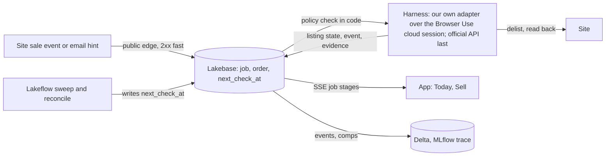

# Sold
Status: draft, *agent proposal* except where a line links a decision. Slug: sold. Raised to the canon 2026-11-14. Names, states, kinds and endpoints follow [product.md](../product.md); the sold row of [coverage.md](../coverage.md) says detection routes were researched and the email route was missing until today.

Scope: from "a buyer paid" to "done". The hassle today: the seller sells on one site, forgets the other four, a second buyer pays, and each site runs its own clocks for shipping, claims and payout. This feature detects the sale, takes the other listings down, watches every clock, and asks only when money or an address is involved.

## What the person does and sees
Lives in **Today** ([today.md](./today.md)), **Sell** (the item's pill) and **You > By site**.

1. Sale lands: a Today card "Sold on Depop. Taking it down elsewhere." The item pill turns Sold. Other tiles show Delisting, then gone. A tile still buyable after 5 min turns red: "Try again / Open on Poshmark / Mark unavailable" ([crosspost-and-delist](../../research/list/ben/crosspost-and-delist.md); the bar is owned [below](#how-we-will-know-it-works); the order of take-downs is in [card 13](../determinations/managing-and-buyers.md#13-which-listings-come-down-in-what-order-and-when-a-failed-delist-turns-red)).
2. Shipping: one `ship_by` card "Ship by Fri" with the site's label, box and weight from the measurements and the nearest drop-off. Buying the label is a `buy_label` ask, with insurance offered when the sale price is above the carrier's cover ([card 10](../determinations/managing-and-buyers.md#10-which-label-and-box)). With several orders to ship, one card "Print 4 labels" buys the unbought ones in one approval and prints them as one PDF in pick-list order.
   Pick list: each sold item shows where it is (`item.location.label`, set on the item page or by scanning its shelf label), and Today's pick list groups the day's sales by place so one walk collects them ([card 23](../determinations/managing-and-buyers.md#23-where-an-item-is-and-the-pick-list)). Any item's page prints its shelf label (a code that opens the item, plus `seller_sku`), one at a time or as a sheet. A free carrier pickup is requested only on the person's tap, since it puts a carrier at a home address ([autonomous D1](../../research/cross-cutting/nate/autonomous-features.md)). Or pickup: the booked slot at the saved spot ([messages.md](./messages.md)).
3. After handover: delivered, then "Money arrives Tue" (claim window), then a `leave_review` ask with a drafted review, then Done.
4. A return, claim or cancel arrives as a Today card at the top with its deadline and the evidence bundle ready. The person taps the answer.
5. Double sale: a `double_sale` card names both buyers' sites, what cancelling each costs, and which order we suggest cancelling.
6. Year end: You shows the year's sales, fees, shipping, cost basis and gain, per site and in total, with each site's 1099-K figure beside ours where the person adds it, exportable as CSV and PDF ([money D26](../determinations/money.md#d26-year-end-tax-summary)). It is a record for the person or their preparer, not tax advice.

Ben's design shows red only after a failure and names no cancel cost; the backend can count every clock and price each cancel, so the cards say both.

## Design choices
*Agent proposal* as a section. Options link their research.

| Choice | Options considered | Picked | Why | What would change it |
|---|---|---|---|---|
| Detection route | official events; sale email; cloud poll; phone notification listener ([email note](../../research/sold/nate/email-and-notification-detection.md)); person-paced | per site, table under Systems: the signed-in harness on each site first, email the fallback ([Nate](../../product/words.md#2026-11-14-nate-sale-emails-the-expo-account-where-routes-are-hosted-and-a-buy-page-shaped-by-your-style)) | eBay and Depop push; Poshmark and Mercari have none, so the harness polls about every 2 min; email only wakes the poll | the sample shows email slower than the poll |
| Email route | Gmail read-only OAuth; forwarding filter; no email ([email note](../../research/sold/nate/email-and-notification-detection.md), [autonomous E1](../../research/cross-cutting/nate/autonomous-features.md)) | connect's `email` account (read-only), forwarding filter as fallback, a hint only | mail can be spoofed, so the site is read before a sale counts | launch verification cost (Open 1) |
| Hold before payment | do nothing; pause (hide); delist ([crosspost-and-delist](../../research/list/ben/crosspost-and-delist.md)) | pause while unpaid, delist on `paid` | delisting an unpaid offer loses the sale if the buyer walks | no pause path on a site: the person decides, as on Facebook |
| Red threshold | 3 min and 6 min (Ben's two notes, [crosspost](../../research/list/ben/crosspost-and-delist.md), [build plan](../../research/cross-cutting/ben/build-plan-posting-messages-ui.md)); one value | one value, 5 min from the sale read, every site | clears a 2 min poll plus pacing, inside the [bar](#how-we-will-know-it-works) | By site p95 after real sales |
| Double-sale order | earlier paid; later paid; cheaper cancel ([trust-returns-disputes](../../research/sold/nate/trust-returns-disputes.md)) | suggest the later-paid order; flag when cancelling the earlier one costs less; the person taps | the first buyer paid first; cost shown per site | a site's cancel cost proves higher |
| Dispute evidence | person searches photos; agent writes from memory; assembled bundle from capture ([item-card.md](./item-card.md)) | bundle from the item card's capture | proof is what was shown at listing time | a site ignores seller photos |
| Delist mode | ask each time; `auto` ([tiers](../../product/decisions.md#2026-11-14-automation-runs-in-tiers-that-learn)) | `auto`, logged, undoable | reversible, and a late delist is the cost | a wrong delist in replay |
| Label purchase ([suite map](../../research/cross-cutting/nate/shopify-suite-map.md)) | the site's own label only; our own carrier account through a label API (EasyPost or Shippo class, *inferred*); both | the site's prepaid label where the site issues one (Poshmark, Mercari, Depop, eBay); a label API for Facebook, meetups turned shipping and eBay when cheaper | Shopify buys and prints labels in the admin, up to 250 at once, with insurance up to $200 (observed at [shopify.com/shipping](https://www.shopify.com/shipping)); a site label keeps the site's protection | a site label proves dearer than its own carrier rate |
| Batch print | one label per card; one batch for every `to_ship` order | one batch, ordered by the pick list, 4 by 6 in or letter | a seller ships several a day; one print run is the Shopify pattern | the person prints one at a time in practice |
| Where an item is | none; a typed place; a bin model with codes | a typed `location.label` with a printable shelf label | a small seller keeps a closet or bins; the field can carry a bin code without a second model | sellers with stock over a few hundred items |

## Data flow

Writes: `order` (unique on site + external id), `job`, `listing` only after read-back, `event` with an `operation_id`, `decision` only if the person is needed.

## What it reads and writes
| Entity | Reads | Writes |
|---|---|---|
| `order` | site order id, `price_cents`, `fees_cents`, `shipping_cents`, `payout_cents`, buyer handle id, state, clocks (`ship_by`, `respond_by`, `claim_until`, `release_at`) | creates, moves state |
| `listing`, `conversation`, `want` | external ids, state, `next_check_at` | `next_check_at` to now on any sale event; hold; `delist` jobs; `delistOk` only from read-back |
| `item` | measurements, box, weight, capture, disclosed flaws, `location`, `seller_sku`, `quantity` | state `sold`, `handed_over`, `done`, `returned`, `disputed` |
| `limits` | pickup hours, saved spot, floor, ship or pickup | none |
| `appointment` | slot, spot | proposed, booked, done, no_show, cancelled |
| `event` | all | one line per action, ids only, each carrying `evidence` |
| `decision` | open cards | the kinds under Contract |

Proof layer: each fact written (sale price, tracking, delivered) carries `evidence` (source, `read_at`, `snapshot_ref`). Each number shown (payout date, cancel cost, delist speed) is a guarded number with `basis_count`, `as_of` and a `citation`; below its sample size it is hidden. Anything sent out (a claim reply, a cancel reason) passes `claim_check`; a held output becomes an `unbacked_claim` decision.

## States
Order states from product §4. Triggers:

| Move | Trigger |
|---|---|
| none to `paid`, `to_ship` or `pickup_booked` | a paid order read back from the site (never "disappeared", never an unpaid offer) |
| `to_ship` to `shipped`; `pickup_booked` to `handed_over` | carrier acceptance scan; buyer code scanned or the person's tap |
| `shipped` to `delivered` to `claim_window` | carrier delivered, then at once; length per site |
| `claim_window` to `released` | no case by the window's end, or the site reports payout |
| any to `cancelled` | seller or buyer cancel, no-show, ship-by lapse |
| `delivered` or `claim_window` to `return_open`, `dispute_open` | buyer opens one |
| `return_open` or `dispute_open` to `refunded` | site refunds |

Item: `live` to `sold` on the first paid order; `done` on `released`; `returned` or `disputed` while a case is open. A cancelled sale returns the item to `live` and relists the others, never on Poshmark. Listing states are from [lifecycle.mjs](../lifecycle.mjs), unchanged. A paid buyer beats dibs in code, not as a decision: the dibs buyer gets an automatic message and a place in the queue.

## Systems underneath
Agent runtime, one loop and two triggers: an event or schedule becomes one `job` with an idempotency key; the policy check runs in code; the harness (`read_orders`, `end`, `relist`, `send_message`, per-site capability table) acts through our own adapter over the person's signed-in session (an official API only as the last fallback), reads back and logs. A lease keeps one job per account session, paced per site.

| Piece | Job here |
|---|---|
| Thin public edge (*agent proposal*, [vision](../../product/vision.md), front door) | receives webhooks and forwarded mail, 2xx in under 1 s |
| Lakebase, SSE | order, job, clocks, decisions; job stages stream to the app |
| Lakeflow | `check_due` order polls at the tiers in [card 15](../determinations/managing-and-buyers.md#15-when-to-check-again), the nightly `reconcile` ([connect](./connect.md#read-back-and-reconcile)), clock timers; Harness acts per site |
| Label API | rates, buys and voids labels with insurance where the site issues none (*agent proposal*; a label API such as EasyPost or Shippo, picked by rate and carrier cover, not by where the backend runs) |
| Gmail | connect's `email` account, read-only, a hint |
| Delta, MLflow | `sold_to_all_down_ms` per site; one trace per job, shown as "why?" |

Detection per site (*agent proposal*, delays from the [email note](../../research/sold/nate/email-and-notification-detection.md)):

| Site | Route | Expected delay |
|---|---|---|
| eBay | `ORDER_CONFIRMATION` notification fires `poll_orders` now; `getOrders` backstop (a sold listing can stay Active at quantity 0) | seconds |
| Depop | webhooks `order.new`, `order.update`, `order.refund`; order id is the dedupe key | seconds |
| Poshmark | sale email ("... just sold to ... on Poshmark!", *asserted*) sets `next_check_at` to now; cloud-session sold-page poll about every 2 min | about 2 min (*inferred*) |
| Mercari | SMS opt-in or poll; no subject lines found | about 2 min (*inferred*) |
| Facebook | sold status is not emailed; the person marks sold, or an order-page watch | person-paced |

Delist: one job per listing, key `delist:{item}:{site}`; cancel in-flight post or revise jobs first; backoff 5 s, 15 s, 45 s, 2 min, then the cloud browser; Poshmark paced 2 to 5 s per action (*inferred*), open offer voided first; counts only after read-back.

## Contract for the frontend
REST under `/v1`, prefixed ids, money `{amount_cents, currency}`, ISO 8601 UTC.
- `GET /v1/orders?item_id=` and `GET /v1/orders/:id`: `{id, item_id, site, state, price_cents, fees_cents, shipping_cents, payout_cents, clocks:{ship_by, respond_by, claim_until, release_at}, listing_ids[], evidence:{capture_id, flaw_ids[], tracking_ref}}`.
- `POST /v1/orders/:id/ship {insure_cents?}` returns a job `label`, stages `rate`, `buy`, `upload_tracking`, streamed at `GET /v1/jobs/:id/events`. Errors `{code, message, failed_step, retry}`. In [product §7](../product.md).
- `POST /v1/orders/labels {order_ids[], layout}` buys the unbought labels as one `buy_label` decision and returns one PDF in pick-list order; `GET /v1/orders/pick-list` returns the day's rows grouped by `location.label`. Both asked under Needs.
- Jobs: `label`, `poll_orders`; linked `delist`, `reconcile`. Decision kinds linked: `book_pickup` (messages).
- Decisions owned here: `ship_by`, `buy_label`, `cancel_sale` (carries `cancel_reason`), `no_show`, `double_sale`, `refund` (locked), `return_claim`, `claim_reply`, `dispute`, `leave_review`. Owned elsewhere: `delist_after_sale`, `failed_delist` ([list.md](./list.md)), `book_pickup`, `pickup_outside_hours`, `share_address` (messages), `relink`, `site_warning` ([connect.md](./connect.md)).
- Answer at `POST /v1/decisions/:id/act` (409 when stale: a card open when the item sells becomes "Sold on Depop" with Decline only). Undo at `POST /v1/events/:id/undo` (409 `site_no_undo`).

## Who may act
| Action | Mode |
|---|---|
| Delist after a sale, retry, void own open offer | `auto`, logged ([decision](../../product/decisions.md#2026-11-14-buyers-are-handled-inside-limits-you-set-then-it-learns)) |
| Book a pickup in the person's hours at the saved spot | `auto`, can cancel ([decision](../../product/decisions.md#2026-11-14-the-agent-books-pickups-inside-your-hours)) |
| `buy_label`, `leave_review` | `ask`, promotable after 3 unedited approvals |
| `ship_by`, `cancel_sale`, `no_show`, `double_sale`, `return_claim`, `claim_reply`, `dispute` | `ask` |
| Home address, refunds and payment, a price below the floor, moving a deal off-site | `locked`: always the person |

The policy check runs in code before any executor. `price_below_floor` and `pickup_outside_hours` are never promoted ([tiers](../../product/decisions.md#2026-11-14-automation-runs-in-tiers-that-learn)).

## How it fails
| Failure | What they see | Recovery |
|---|---|---|
| Event late, missing or duplicated | nothing, or one sale | unique key; sweep and `reconcile` find it |
| Delist fails | red tile after 5 min | backoff, browser, then `failed_delist` |
| Second buyer pays | `double_sale`, never silent | person picks; the other is cancelled by their tap |
| Login expired | `relink` card | that site pauses, others continue |
| Ship-by near | card at 24 h and 4 h | `label` job |
| Pickup no-show | `no_show` card | rebook, next in line, relist; sale stays open |
| Email spoofed or wrong | nothing | email never proves a sale; the site read does |
| Claim reply has an unbacked line | `unbacked_claim` card | the line is dropped or the person supplies evidence |

Account risk per site: a late delist that ends in a Poshmark cancellation counts toward its 3% rolling 90 day seller-cancellation rate, with a 24 hour restriction then a 14 day suspension (*observed* in trade articles, the count *inferred*). Poshmark's By site row shows it.

### Double sale: cost of the cancelled order
| Site | Cost | Mark |
|---|---|---|
| eBay | transaction defect if the reason is "out of stock" | *inferred* ([trust](../../research/sold/nate/trust-returns-disputes.md)) |
| Mercari | up to 5%, max $25 | *inferred* |
| Poshmark | none found; counts toward the 3% rate | *inferred* |
| Depop, Facebook | none found | not found |

### Dispute evidence
On `return_open` or `dispute_open` a `claim_reply` decision is raised with one bundle assembled one bundle from the item card ([item-card.md](./item-card.md)): the capture frames, each disclosed flaw with its image region, the listing text at sale time, the tracking ref and the delivery scan. Each line carries its `evidence`. Weight and size are guarded numbers with a `citation`. The reply draft passes `claim_check`. It never claims what no capture settles: authenticity, whether it works, hidden condition.

## How we will know it works
Bar, *observed*: the leading crosslister documents a 10 min sale poll (Vendoo, BETA, needs the computer on with Vendoo open in a browser tab, [help.vendoo.co](https://help.vendoo.co/en/articles/8047348-sale-detection-auto-delist), 2026-10-07; see [teardown](../../research/cross-cutting/nate/crosslister-teardown.md)). Others publish 15 or 30 min (*asserted*). We beat it with one bar, owned here (*agent proposal*, [assessment §6](../assessment.md#6-delist-after-a-sale-the-costliest-error)): from the sale known to delisted on every other site, `sold_to_all_down_ms` p95 under 2 min, with the 5 min red threshold above as the red line, and no device left on. The `delist` jobs are the first jobs a sale event creates and have no agent step; the hold at the first committed signal is reversed when the order is cancelled. Every other file links here for the number. By design this holds for eBay and Depop; Poshmark and Mercari rest on the poll and Facebook is person-paced, so the test decides.

| Claim | Check |
|---|---|
| p95 under 2 min, red at 5 min | `sold_to_all_down_ms` p95 per site pair over 5 real or seeded sales on each pair |
| Email hint is worth keeping | send-to-arrival on about 20 sample emails per site; drop the hint where median exceeds the poll |
| No sale unpaid or duplicated | replay through [replay.mjs](../replay.mjs): invariants hold |
| Nothing silent | every `double_sale`, failed delist and cancel has a card within one poll |
| Clocks right | ship-by and claim clocks match the table on three orders per site |
| Logs clean | no message text, addresses or tokens ([logging](../../.agents/team/packets/team/5-logging.md), `node spec/log.mjs <file>`) |

## Facts to know
Marks as in the notes; "Launch" says what changes publicly.

| Fact | Mark | Source |
|---|---|---|
| Vendoo polls every 10 min; Flyp 15, Nifty within 15, Treecat 30; Treecat says every tool polls | observed (Vendoo), asserted (others) | [teardown](../../research/cross-cutting/nate/crosslister-teardown.md) |
| No tool offers real-time, device-independent delist, or warns before a missed delist becomes a Poshmark cancellation | observed | [teardown](../../research/cross-cutting/nate/crosslister-teardown.md) |
| Gmail push: latency not published, 1 event per second per user, renewal at least every 7 days; the earlier "10 to 30 s" figure has no support | observed | [email note](../../research/sold/nate/email-and-notification-detection.md) |
| `gmail.readonly` and `gmail.metadata` are restricted scopes: verification and an annual CASA assessment ($540 to $1,800 for Tier 2, "as of 2024"). Launch: a public app needs this; the build can use test users | observed, price asserted | [email note](../../research/sold/nate/email-and-notification-detection.md) |
| A forwarding filter needs no OAuth but can be spoofed | observed | [email note](../../research/sold/nate/email-and-notification-detection.md) |
| Depop: webhooks, no sale email found; Facebook: sold not emailed; Mercari US: SMS opt-in; Poshmark body fields not found; Android listener has no iOS route | observed, not found | [email note](../../research/sold/nate/email-and-notification-detection.md) |
| eBay: 3 business days seller response; buyer-cancel 3 calendar days vs 3 business days | observed, conflict | [trust](../../research/sold/nate/trust-returns-disputes.md) |
| Mercari: 72 h after delivery, ship in 3 business days. Poshmark: 72 hours vs 3 days to open a case; ship in 7 days; label cap 15 lb, overweight deduction from 2026-10-26 | observed, unresolved | [trust](../../research/sold/nate/trust-returns-disputes.md), [shipping](../../research/sold/nate/shipping-and-pickup.md) |
| Facebook: ship in 7 vs 3 days, claim 7 vs 45 days (*asserted*). Depop: ship or add tracking within 10 days (Depop US, confirmed); 48 h to answer; "Other" shipping closes 2026-10-28; vacation mode still requires sold orders to ship | observed, conflict | [trust](../../research/sold/nate/trust-returns-disputes.md), [levers](../../research/list/nate/platform-levers.md) |
| Poshmark: items from $500 go to Posh Authenticate; if not approved the order is cancelled and the item cannot be relisted | observed | [levers](../../research/list/nate/platform-levers.md) |
| USPS divisor 139 from 2026-07-12; USPS carrier pickup is free for Priority, Express and Ground Advantage; Web Tools retired 2026-01-25 | observed | [shipping](../../research/sold/nate/shipping-and-pickup.md), [autonomous D1](../../research/cross-cutting/nate/autonomous-features.md) |
| Shopify buys and prints up to 250 labels at once with insurance up to $200, and prints SKU and inventory labels | observed | [shopify.com/shipping](https://www.shopify.com/shipping), [suite map](../../research/cross-cutting/nate/shopify-suite-map.md) |
| Item-not-as-described is judged on listing text and photos at sale time; ship-by clocks start at different events per site | inferred | [trust](../../research/sold/nate/trust-returns-disputes.md), [shipping](../../research/sold/nate/shipping-and-pickup.md) |

Rules that hold: home address only on the person's tap; buyers' personal data stays out of logs; recalled products are not relisted after a cancel; account risk is shown per site.

## Open for Ben and Nate
1. **Email scope at launch.** Gmail read-only needs verification and an annual CASA assessment; the forwarding filter avoids it and can be spoofed. Recommendation: build on the filter plus test users, decide the scope before a public launch. Depends on the sample test.
2. **Conflicting clocks** (eBay cancel days, Facebook 3 vs 7, Depop 10 vs 11, Poshmark 72 h vs 3 days). Recommendation: use the shorter one until a real order proves otherwise.
3. **Email bodies.** Whether Poshmark and Mercari mail carries an order id and price is not found; sample mail settles it.
4. **Business model.** A label fee, a cancel-cost protector or a payout advance could earn here. None is picked.

## Needs from the shared model
- Order clock fields and a per-site clock table.
- Invariants (*agent proposal*, [lifecycle.mjs](../lifecycle.mjs) untouched): `committed` hold; `delistOk` only from read-back; undetected `paid` plus `reconcile`; `saleCancelled` relists the others; unique `(site, order_id)`; claim evidence present when a case opens.
- `LISTING_STATES` lacks `postUnknown`, `needsReauth` and per-site health; order states and `ship_by`, pickup, return actions are not in `lifecycle.mjs` ([spec/README](../README.md)).
- connect adds an `email` account row; the sold decision kinds are in [events.json](../events.json).
- product.md §7: add `POST /v1/orders/:id/ship {insure_cents?}`, `POST /v1/orders/labels {order_ids[], layout}` and `GET /v1/orders/pick-list`; `order` gains `label {carrier, tracking_ref, insured_cents?, batch_id?}`.
