# Studio photos
Status: draft, second pass. Everything here is *agent proposal* except where a line links a decision or a quote. Slug: studio. Names follow [product.md](../product.md). Written 2026-11-14.

Rule it follows: Ben, "it shouldnt change the environment or lie. it should touch up" ([words](../../product/words.md#2026-11-14-photos-touch-up-never-change-the-environment)). Studio makes the person's own photos look better. It never makes a different photo.

Design in one line: cut the item out, keep its own pixels byte for byte, clean only the surround, paste the item back. The only route that keeps the item's pixels by construction ([editing-alternatives](../../research/studio/nate/editing-alternatives.md) section 7, *inferred* there, checked here by the test below).

## What the person does and sees
Lives in the item's review step, after capture, before listing. Studio works on the real frames the capture session picked ([scan-to-images](../../research/capture/nate/scan-to-images.md) section e), never on new shots. It never blocks the item state ([product.md](../product.md) item states).

1. The real photos show at once and are usable straight away. A strip of stages shows the work.
2. Each photo has an improved version beside it with a before/after slider. The item is the same pixels; the floor, wall or bed is the same place, tidied.
3. One line per photo says what changed: "straightened", "color set to the tag", "light evened", "lint removed". Each line passes a `claim_check` against the edit record, so nothing is claimed that was not done.
4. Chips mark what was kept: logo, tag, each flaw. Tapping one shows original and result side by side.
5. A choice per photo: **Use improved**, **Use real**, **Redo**. The real photo is one tap away and never deleted.
6. Flaw photos and close-ups are never touched. They go in the listing as shot.
7. If a check blocked the result, it is not offered. The person sees the real photo and a short reason.
8. At listing, any photo still improving is posted as the real one (`kept_real`). Listing never waits.

## What an edit may and may not do
| Allowed | Never |
|---|---|
| Crop, straighten, rotate upright | Hide wear, fading, stains, pilling, scuffs, damage |
| Exposure and white balance toward the true color (the surround and the whole frame, scored against the tag) | Change the item's color or material look |
| Clean the surround: remove a stray cord or lint, even out the wall or floor, soften a harsh shadow | Change the environment, add a scene, restage, add a pose nobody photographed |
| Redact private information (a name, an address, a face) | Invent parts, accessories or completeness; add text, badges or watermarks |

The item's own pixels are inside the mask and are copied from the original. Relaxing creases changes those pixels, so it is not a touch-up (settled below). Nate's list agrees: cropping, cleanup, exposure that preserves appearance and redaction are fine; hiding wear, changing color, inventing accessories and misrepresenting completeness are not ([trust and returns](../../research/sold/nate/trust-returns-disputes.md) section 5).

## Design choices
| Choice | Options considered | Picked | Why | What would change it |
|---|---|---|---|---|
| How the item stays real | whole-image redraw by Seedream or Nano Banana ([editing-alternatives](../../research/studio/nate/editing-alternatives.md) sections 3, 5; [seedream](../../research/studio/ben/seedream-relighting.md)); instruction editor with no mask; mask edit (Flux Fill, gpt-image); cut-out plus paste-back | Cut-out plus paste-back | Only route that keeps pixels by construction. Gpt-image treats the mask as a hint, Flux Fill's black region is unverified, Gemini preserves "by instruction" | The bake-off below: a redraw route that passes the same pixel test and looks better |
| Who makes the mask | SAM 3, BiRefNet (MIT), InSPyReNet (MIT), BRIA (non-commercial weights), Photoroom cut-out ([editing-alternatives](../../research/studio/nate/editing-alternatives.md) sections 1, 7; [scan-to-images](../../research/capture/nate/scan-to-images.md) section f) | BiRefNet first, SAM 3 on edge failures | Open, cheap, no per-call price; SAM 3 reported mask AP 48.8 against 38.5 (*asserted*) | Edge errors on glass, fur or hair on the 20-item test |
| What fills the surround | deterministic tidy (blur, shadow lift, no model); Photoroom `ai.soft` shadow; Seedream or IC-Light background relight | Deterministic first; one model pass for the surround only, never the item | Ben's no-model tweaks already score photos ([photo-score](../../research/studio/ben/photo-score.md)); relight models change foreground values by design | The test shows people prefer model surrounds and the background check holds |
| Does the check block or rank | block every miss; rank and explain only | Block when a flaw vanished, the tag text changed or any item pixel differs; otherwise rank and explain | Those three are the lies; surround taste is a ranking | Thresholds scored against people (below) |
| Is relaxing creases a touch-up | offer a "pressed" level; never | Never. Creases are the item's pixels; pressing them hides wear | Nate: never hide wear; Ben's plan left it open | Ben says otherwise: then a separate off-by-default pick with flaw boxes protected |
| How many photos | polish few; show many real | Real frames count first, polish second | Photo count matters far more than quality on resale; quality odds ratios are 1.17 to 1.25 ([classifiers](../../research/price/nate/quality-and-value-classifiers.md) section 3) | A sell-through test on a person's own listings |
| Presets (studio, garage, house) | offer; drop | Drop, per the newest rule | The newest quote forbids changing the environment | Ben's call, listed under Open |

## Data flow

```mermaid
flowchart LR
  A["Lakebase photo: frames picked by capture"] -->|"FastAPI on Apps starts job studio"| B["Lakeflow worker: BiRefNet mask, color.py"]
  B -->|"surround edit, optional model call via harness"| C["Unity Catalog volume: render file"]
  C -->|"gate: color, structure, boxes, OCR; plain code"| D["Lakebase photo (use improved), event studio.render_checked"]
  D -->|"MLflow 3 trace, claim_check on edit lines"| E["Lakebase decision studio_approve"]
  E -->|"POST /v1/decisions/:id/act"| F["Lakebase photo use, Delta label row"]
```

Consistent with [product.md](../product.md) section 10: ids are logged, never image content or tag text.

## What it reads and writes
| Entity | Reads | Writes |
|---|---|---|
| `capture`, `photo` | the frames capture chose, tag shot, close-ups, confirmed flaw boxes | a new `photo` (role `studio`, `use` `improved`, `parent_photo_ids` = the original). An original is never changed |
| `attribute` | logo and tag boxes (source `label`), flaws (`you_said`, `measured`) | none. A `you_said` flaw is never overwritten |
| `job` (kind `studio`) | n/a | stages and `result` |
| render record (new) | n/a | per render: source photo id, level, model, seed, edit list, check numbers, outcome, choice |
| `event` | n/a | `studio.started`, `studio.render_checked`, `studio.render_failed`, `studio.chosen` |

Proof layer, all *agent proposal*:
- Each render carries `evidence` `{kind: image_region, ref: original photo id, region: the item mask, captured_at, extractor_version}`. It links the result to its original, and the mask is stored as a file.
- Each check number the app shows is a guarded number `{value, basis_count, as_of, citation_id, state, hide_reason}`. The citation names the gate version and the pair of photos, so the number can be recomputed. A number with no calibration (see Open) is `hidden` with `hide_reason: uncalibrated`.
- The "what changed" lines and the reason for a rejection pass a `claim_check` (backed by the edit record). A held line becomes a decision of kind `unbacked_claim`.

Files: originals and renders in a Unity Catalog volume, one folder per item and capture. Render records in a Delta table, the source for retuning thresholds.

## States
| Photo version | Move | Trigger |
|---|---|---|
| `original` | exists from capture | capture |
| `improving` | job starts | capture complete |
| `ready` | no blocking miss | gate |
| `kept_real` | blocked twice, still improving at listing, or the person chose real | gate, listing or person |
| `chosen` | person taps Use improved | decision |

## The check
Each result is compared with its original after alignment, cheapest first ([build-plan 4.4](../../research/studio/ben/build-plan.md)).

| Check | Effect on a miss |
|---|---|
| Item pixels equal inside the mask (byte compare) | blocks. Should never fire by design; it guards the paste |
| Tag text same (OCR diff) | blocks |
| Protected boxes (logos, each flaw) still match | blocks. A vanished flaw is a hard reject, never shown |
| Alignment, color (CIEDE2000), structure per tile | ranks and explains |
| Background matches the original (new check from Ben's rule) | ranks and explains |
| Edge halo around the mask | ranks and explains |
| Image-decision predicates on paired crops, `render_same_item` | ranks; the provider is open ([decisions](../../product/decisions.md), D-L6) |

On a block the person is told which photo and why. Thresholds are uncalibrated (three items, six renders: [prototype](../../research/studio/ben/prototype/README.md), [renders](../../research/studio/ben/renders/README.md)).

## Photo order and sites
The evidence photo (true-color real front) is first on every site, then approved renders, then real close-ups and flaws. The `list` feature owns the final order ([list.md](list.md)); studio supplies the set and a per-site default. Account risk shown per site: eBay and Etsy have the strictest photo rules, so the person sees "one real photo stays first" on those two.

## Contract for the frontend
- `POST /v1/items/:id/studio` returns a job `{id, kind: "studio", stages, result?}`; stream at `GET /v1/jobs/:id/events` (SSE).
- Stages: `uploaded, color_fixed, rendering, checking, repairing, ready, failed`. States `started, running, arrived, failed`.
- `result`: `[{photo_id, render_id, level, edits, checks: [guarded number], outcome, evidence}]`.
- Decision kind `studio_approve`, options `use_improved`, `use_real`, `redo`; `suggested` is `use_improved` only when nothing blocked. Answered at `POST /v1/decisions/:id/act`.
- Errors: `{code, message, failed_step, retry}`.

## Who may act
| Action | Mode |
|---|---|
| Run the improvement job | auto |
| Put an improved photo in a listing | ask; promotable after 3 unedited approvals ([product.md](../product.md) decision kinds); the real evidence photo always stays |
| Redo | auto, within a retry cap |
| Remove a real photo from a listing | locked, person only |

## How it fails
| Failure | Person sees | Recovery |
|---|---|---|
| Blocked result | real photo plus the reason | retry once, repair by blending real pixels back (2 rounds), then keep real |
| Flaw vanished | nothing offered | hard reject, logged |
| No color anchor | "color not checked" | deterministic exposure only |
| Mask fails (glass, fur, thin straps) | slider and a question | person decides |
| Model host down | real photos, job `failed` with `retry` | backoff; listing proceeds with real |

## How we will know it works
| Bar | Source | Check |
|---|---|---|
| Item pixels identical inside the mask in 20 of 20 items (the best raw editor kept product detail 28 to 29% of the time, *observed*; the cut-out route must beat that by construction) | [Photoroom benchmark, 2026-07-06](../../research/studio/nate/editing-alternatives.md) section 0; tests flat-lay generation, not cleanup, so it is the nearest published figure, not an equal one | Byte compare on the 20-item set |
| Vanished flaws caught at 95% or better | this spec (*agent proposal*); no published figure | Paint out known flaws on 20 to 30 items |
| Median CIEDE2000 on the item under the bar | [prototype](../../research/studio/ben/prototype/README.md) | Score real photo A against real photo B of the same item to set the bar |
| Bake-off: Seedream, Nano Banana, Flux Fill, Kontext, cut-out plus paste-back, no-model tweaks, same 20 items, judged blind by people | [coverage](../coverage.md) | Decides the surround filler |
| Every render has a record row with the person's choice | this spec | Delta count |

## Facts to know
| Fact | Mark | For a public launch |
|---|---|---|
| eBay bans photos that misrepresent the item; no text, border or watermark; 500 px minimum ([build-plan](../../research/studio/ben/build-plan.md)) | observed | the same rule applies; the per-site note stays on the card |
| eBay has no published AI disclosure rule and allows AI-edited photos, but expects real photos of used goods ([trust and returns](../../research/sold/nate/trust-returns-disputes.md) section 5) | asserted, secondary | re-check the policy page, text unopened |
| Etsy wants one unaltered photo of the real item ([build-plan](../../research/studio/ben/build-plan.md)) | asserted, page unopened | open the page; the first-photo rule already covers it |
| Depop: use photos you took yourself; sources disagree on generated images. Poshmark, Mercari, Facebook: no official rule found ([trust and returns](../../research/sold/nate/trust-returns-disputes.md) section 5) | asserted | confirm each before enforcement; Ben's platform notes may cover them |
| Gemini output carries a SynthID watermark ([editing-alternatives](../../research/studio/nate/editing-alternatives.md) section 5) | observed | none; a challenger would add an invisible mark |
| Seedream 5.5 has not been run; no host offers a mask for it; `watermark` defaults to true, send false ([seedream](../../research/studio/ben/seedream-relighting.md)) | observed | none |
| Weights licences: BiRefNet, InSPyReNet MIT; IC-Light Apache-2.0; BRIA RMBG-2.0 non-commercial ([editing-alternatives](../../research/studio/nate/editing-alternatives.md) section 7) | observed | BRIA needs a commercial licence; the others pass |
| An edited photo that looks better than the item can make a normal sale a not-as-described case ([trust and returns](../../research/sold/nate/trust-returns-disputes.md)) | inferred | same |

Rules that protect people still hold: private details are redacted, not shared; a recalled product is not listed.

## Open for Ben and Nate
1. **Presets versus touch-up.** Earlier, Ben: "the user can choose to light it in a studio, in a garage, in a house" ([words](../../product/words.md#2026-11-14-tools-and-capture)). Newest, Ben: "it shouldnt change the environment or lie. it should touch up" ([words](../../product/words.md#2026-11-14-photos-touch-up-never-change-the-environment)). This spec follows the newest and drops presets. Is that what Ben means?
2. **A "styled" label in the app** when an improved photo is used. Recommendation: always label, never in the pixels.
3. **Cost.** Per-render model calls are paid; free, included or paid is a business choice.

Settled here as *agent proposal*, not left open: creases are not a touch-up; the check blocks on a vanished flaw, a changed tag or a changed item pixel, and ranks the rest.

## Needs from the shared model
- A render record (or fields on `photo`) with edit list, mask ref, check numbers, seed, model and choice.
- The `studio` job kind, the `studio_approve` kind and `studio.*` events in [product.md](../product.md).
- A photo-order-per-site table owned by `list`.
- Links to `market.md` and `score.md` once they exist, for photo count as a score axis.
