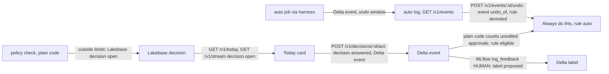

# Today
Status: draft, second pass. Every section is *agent proposal* except where a line links a decision. Slug: today. Names follow [product.md](../product.md). Written 2026-11-14.

The hassle: a seller on five sites gets offers, questions, pickups and sale emails from five apps, each with its own alerts, and still cannot tell what needs them now ([user-wants.md](../../research/cross-cutting/ben/user-wants.md)). Today is the first tab ([decision](../../product/decisions.md#2026-11-14-the-bottom-bar-is-today--sell----buy--you)): one list of the things only the person can decide, in the order they expire, each answerable in one tap, and one line for everything the agent already did, with undo.

## What the person does and sees

| Step | What happens |
|---|---|
| 1. Open | The list of open decisions, soonest deadline first. Each card: photo, one sentence, the number that matters, the deadline, the full action set. Empty: "Nothing needs you" and the handled line. |
| 2. Answer | One tap acts. The card shows the step running (`job.stage`), then leaves; a failure stays with what failed and a retry. |
| 3. Edit | Any suggested action opens prefilled (a counter amount, a reply). An edited answer works but does not count toward promotion. |
| 4. Always do this | Offered on promotable kinds after 3 unedited approvals ([decision](../../product/decisions.md#2026-11-14-automation-runs-in-tiers-that-learn)). Never on a locked kind, `price_below_floor`, `pickup_outside_hours`, `buy_offer` or `unbacked_claim`. |
| 5. Handled line | "Handled 14 things today" opens the auto log: every auto action with why, time and Undo while allowed. |
| 6. Held replies | A card per `unbacked_claim`: the draft with the unbacked claim marked, the reason, and Send without it, Edit, It's true, Don't send. |
| 7. Rule expiring | A rule unused for 14 days gets one card: "Still accept $40 or more on the jacket?" with Keep it and Let it lapse. |
| 8. Alerts | A push only for a card whose deadline is within an hour; everything else waits for the batch. A sale and a watched item under the person's price push at once ([decision](../../product/decisions.md#2026-11-15-a-sale-and-a-watched-item-under-your-price-notify-at-once)); the rest of the levels are in [notifications.md](../notifications.md). |
| 9. Notices | Cards that ask nothing, among them `value_moved` and `demand_rose` on an item the person owns ([market](market.md#one-catalog)); one tap opens the item, one dismisses (*agent proposal*). |

Goal progress is a You number ([insights.md](insights.md)), never a card. Dibs, lost dibs and watch duplicates are not cards.

## Design choices

| Choice | Options considered | Picked | Why | What would change it |
|---|---|---|---|---|
| Order | by value; by deadline; a learned rank ([structure-references.md](../../research/today/ben/structure-references.md), [generative-ui.md](../../research/today/ben/generative-ui.md)) | deadline first, then money at stake, then age | a missed offer is the loss sellers name; no study ranks seller tasks | the test: missed deadlines and time to tap per order, over two weeks of use |
| What becomes a card | every event; only what is outside limits ([handled-by-default.md](../../research/messages/nate/handled-by-default.md)) | only the decision kinds of [§5](../product.md#decision-kinds-the-complete-list) | everything inside limits is already done | none |
| Alert cadence | each event; hourly; batched ([seller-metrics-and-notifications.md](../../research/today/nate/seller-metrics-and-notifications.md)) | Time Sensitive push only when a deadline is within 1 h; the rest in up to 3 batches a day | Fitz et al. 2019: 3 batches a day beat hourly and none; Apple reserves Time Sensitive for the next hour | opt-outs or missed deadlines above the bars below |
| Several offers on one item | a card each; one card | one `accept_offer` card per item listing every open offer, best you-keep first | answering one changes the others | none |
| Undo | a timer on the card; the log ([product.md Undo](../product.md#undo)) | the log, for as long as the site allows, else 24 h | a card timer hides undo after it closes | none |
| Card copy | generated per card; templates per kind ([copy.md](../../product/copy.md)) | a template per kind, the model fills only names and quotes | numbers must be guarded; templates pass copy-lint | none |

## The cards

Every number on a card is a guarded number with a `citation_id`; a hidden one shows "not enough sales yet" (`hide_reason`). Every text the card sends out passes `claim_check` ([messages.md](messages.md)). One list, by owner, from [product.md §5](../product.md#decision-kinds-the-complete-list):

| Owner | Kind | Payload | Actions |
|---|---|---|---|
| list | `first_post` | item, sites, price | Post, Edit, Not now |
| list | `agent_revision` | before and after, why | Use it, Keep mine |
| list | `relist` | site, days live | Relist, Not now (never Poshmark) |
| list | `failed_post`, `failed_delist` | site, failed step | Retry, Do it myself |
| list | `site_changed_listing` | field, before and after | Keep site's, Put mine back |
| list | `bulk_action` | the action, each listing's before and after and keep, the ones left out and why ([list.md](list.md#changing-many-listings-at-once)) | Do all, Untick some, Cancel |
| price | `end_unsold` | days live, the floor reached, the other routes ([money D15](../determinations/money.md#d15-markdown-path-stale-and-relist), [D19](../determinations/money.md#d19-sell-trade-in-donate-or-keep)) | End it, Bundle, Trade in or donate, Keep it up |
| messages | `reply_other` | question, draft | Send, Edit, Not now, Always do this |
| messages | `accept_offer` | offers, asking, you keep, expires | Accept, Counter $X, Decline, Always accept $X or more |
| messages | `scam_warning` | reason | Block buyer, Reply with safety line, Ignore |
| messages | `move_off_site` | request | Decline |
| messages | `pickup_outside_hours` | time, your hours | Accept, Offer my hours, Decline |
| messages | `share_address` | appointment | Share address, Keep the spot |
| messages | `unbacked_claim` | draft, claims with reason | Send without it, Edit, It's true, Don't send |
| price | `markdown` | new price, range, days live | Lower it, Keep price |
| price | `price_below_floor` | offer, lowest you'd take | Accept, Counter at lowest, Decline |
| identify | `clarify` | the question, choices | the choices, Not sure |
| identify | `identity_claim` | claim, evidence | Confirm, Remove |
| capture | `retake`, `missing_shot` | view needed | Take it, Skip |
| capture | `confirm_flaw` | photo region | Yes, No |
| capture | `approve_groups`, `category_unsure` | groups or candidates | Approve, Fix |
| measure | `measure_review` | numbers on the photo | Looks right, Fix |
| studio | `studio_approve` | improved and real | Use improved, Use real, Redo |
| sold | `ship_by` | buyer, deadline | Ship, Get a label |
| sold | `buy_label` | carrier, cost, insurance offered, labels for the other orders due today | Buy label, Buy all due today, Choose another |
| sold | `cancel_sale` | reason choices | Cancel with reason, Keep sale |
| sold | `no_show` | appointment | Rebook, Next in line, Relist |
| sold | `double_sale` | both orders | Keep first, Keep second |
| sold | `refund` | amount | Refund, Reply first |
| sold | `return_claim`, `claim_reply`, `dispute` | claim, evidence | Accept, Reply, Send evidence |
| sold | `leave_review` | buyer | Leave review, Skip |
| connect | `relink` | site | Reconnect |
| connect | `site_warning` | site, risk to the account | Pause site, Keep going |
| connect | `merge_items` | two items | Merge, Keep apart |
| buy | `buy_offer` | listing, amount, total | Send offer, Change, Skip |
| buy | `offer_over_ceiling`, `seller_counter` | amount, your max | Raise, Counter, Walk away |
| buy | `did_you_buy` | listing | Yes, No |
| buy | `replace_after_sale` | similar listings | Watch these, Stop |
| buy | `save_match` | listing | Save, Skip (never Poshmark likes) |
| buy | `complete_purchase` | listing, total | Open on site |
| data | `rule_expiring` | rule, last used | Keep it, Let it lapse |

Auto kinds (`answer_fact` once promoted, `counter_offer`, `decline_offer`, `offer_to_watchers`, `book_pickup`, `delist_after_sale`, `push_my_edit`) appear as cards only when their rule is in `ask`, else as log rows. Locked kinds take the person's tap every time. Exact action labels go through copy-lint and Ben's writing rules; owners may rename them.

With two or more orders to pack, Today shows one pick list card above the `ship_by` cards: each order's item photo, `location.label`, box and label state, in shelf order, with Print labels and Print pick list ([managing-and-buyers card 23](../determinations/managing-and-buyers.md#23-where-an-item-is-and-the-pick-list), [sold.md](sold.md)). It is a view, not a decision kind. *agent proposal*

## Automations, read as trigger, condition, action

*agent proposal*, from Nate's "a suite like shopify, and the better official option" ([words.md](../../product/words.md)). Shopify Flow shows automations as trigger, condition, action ([shopify-suite-map §7](../../research/cross-cutting/nate/shopify-suite-map.md#7-flow-automation), *observed*). Here that is a way to read the existing `rule` and `limits`, not a second rule system:

| Part | What it is here | Where it lives |
|---|---|---|
| When (trigger) | an event (an offer, a message, a sale, a site warning) or a `check_due` sweep reaching an age ([managing-and-buyers card 15](../determinations/managing-and-buyers.md#15-when-to-check-again)) | the decision kind's source event |
| If (condition) | the person's `limits` (`floor_cents`, `always_accept_cents`, `pickup_windows`, `ask_every_time`) and the rule's `scope` (one item, a category, a site, everything) | `limits`, `rule.scope` |
| Then (action) | the decision kind's action, for example accept, counter, markdown, relist, share | `rule.kind` |
| Mode | asks, or does it and logs it | `rule.state` |

You lists every rule in this form, for example "When an offer comes in, if it is $40 or more on the jacket, accept it. Does it and tells you." Editing the If changes `limits`; the When and Then are fixed by the kind. A person can start a rule here as well as from Always do this; it starts in `ask` unless the kind is promotable and the person picks does it, and locked kinds cannot be made. The stale steps in [money D15](../determinations/money.md#d15-markdown-path-stale-and-relist) and the levers in [listing D26](../determinations/listing-and-marketing.md#d26-engagement-levers-the-agent-runs-on-its-own) are rules in this same form.

## The auto log

One source: `GET /v1/events?item_id=&cursor=` with `actor` `auto`. Each row: what, item photo, why (the rule or limit), time, and Undo while `undo.allowed` and before `undo.until`. Undo calls `POST /v1/events/:id/undo`; `409 site_no_undo` turns the button into "Can't undo on Depop" with what to do instead. A sent message and an accepted offer show no Undo. Any undo demotes the rule that did it, and an undone accept pauses that rule ([product.md §4](../product.md#4-states)).

## States

Decision `open, acting, answered, failed, expired, superseded`; rule `ask, eligible, auto, expired, demoted`; job stages `started, running, arrived, failed` ([product.md §4](../product.md#4-states)). A card whose item or offer changed returns `409 stale` and is replaced in place.

## Contract for the frontend

From [product.md §7](../product.md#7-contract-conventions):

| Call | Use |
|---|---|
| `GET /v1/today` | open decisions in order, with counts |
| `POST /v1/decisions/:id/act` | `{option_id, signature, version, edit?}` with `Idempotency-Key`; returns `{decision, event_id, job?}` ([act](../product.md#decisions-and-the-act-endpoint)) |
| `GET /v1/events`, `POST /v1/events/:id/undo` | the log and why |
| `GET /v1/rules`, `POST /v1/rules {from_decision_id}`, `DELETE /v1/rules/:id` | Always do this, Keep it, Let it lapse; `403 locked` |
| `GET /v1/stream` | `decision.open`, `decision.answer`, `decision.close`, `job.stage`; polling `GET /v1/today` must work alone |

The signature is valid 15 minutes; an expired one refetches the card. The policy check reruns on act; `422 outside_limits` shows what moved.

## How it fails

| Failure | What the person sees | Recovery |
|---|---|---|
| Stream drops (untested through the Apps proxy) | nothing; the list polls | poll every 30 s while open |
| Act on a changed card | the new card in its place | `409 stale` |
| Job fails | card stays: "Couldn't post on Mercari: login expired" | retry, or the `relink` card |
| App asleep | "Waking up" | `503 waking`, retry after |
| Deadline passes | card leaves as `expired`; the log says what the site did | none |
| Undo past the site's limit | "Can't undo" and the way to fix it by hand | `409 site_no_undo` |

## How we will know it works

| Claim | Bar | Source |
|---|---|---|
| Nothing is done outside limits | zero auto actions outside limits | [product.md §8](../product.md#8-cross-cutting-requirements) |
| Alerts do not drive opt-out | non-urgent pushes at most 3 a day | Fitz et al. 2019; the top opt-out reason is "too frequently" (Airship 2026), [seller-metrics-and-notifications.md](../../research/today/nate/seller-metrics-and-notifications.md) |
| Time Sensitive is honest | only for deadlines within 1 h | Apple HIG, same note |
| The order works | under 5% of offers expire unanswered while the app was opened that day | test decides; no published figure |
| Cards are quick | median time from open to tap (`card_ms`) under 5 s for one-tap kinds | test decides |
| Suggestions are right | unedited approval rate per kind rising week on week | labels |

## Data flow

## Facts to know

| Fact | Source, mark | For a public launch |
|---|---|---|
| 3 batches a day beat hourly and none (Fitz et al. 2019, CHB 101:84-94) | [seller-metrics-and-notifications.md](../../research/today/nate/seller-metrics-and-notifications.md), asserted | |
| Time Sensitive is for events within the hour, never marketing (Apple HIG) | same note, observed | App Store review checks it |
| Depop stats arrive the next day | same note, observed | |
| Poshmark offers last 24 h; Depop offers last 24 h | [platform-levers.md](../../research/list/nate/platform-levers.md), observed; Depop's 24 h from [levers-and-signals](../../research/list/ben/levers-and-signals.md), correcting the 14 days | |
| Undo limits differ per site; Poshmark cannot relist | [product.md Undo](../product.md#undo) | |
| SSE through the Apps proxy is untested | [product.md §7](../product.md#jobs-and-the-event-stream) | |
| Risk to a real account is shown per site (`site_warning`) | [platform-access.md](../../research/connect/nate/platform-access.md) | binds now |
| A home address is shared only on the person's tap (`share_address`, locked) | [decision](../../product/decisions.md#2026-11-14-the-agent-books-pickups-inside-your-hours) | binds now |

## Demo path

For Ben and Nate to mark.

## Open for Ben and Nate

1. **Which alerts can the person switch off?** `user.notification_pref` exists; no rule says which kinds may be turned off. Recommendation: every batch alert can be; Time Sensitive ones only per kind, with the cost shown.
2. **Batch times.** Recommendation: 9:00, 13:00, 19:00 local, moved by when the person opens the app.
3. **How much a followed price must move before it alerts** (open in [product.md §9](../product.md#9-open-for-ben-and-nate), shared with `spec/features/market.md`). Recommendation there: outside the guarded range, at most one a day per follow; here it joins the batch, never Time Sensitive.

## Needs from the shared model

- `unbacked_claim` in [product.md §5](../product.md#decision-kinds-the-complete-list).
- A notification rule beside `user.notification_pref`: which kinds push, which batch.
- A log line for `message.new` in [events.json](../events.json).
- Notice kinds `value_moved` and `demand_rose` beside `ranker_changed` in [product.md](../product.md) (*agent proposal*).
- `bulk_action` and `end_unsold` are in [product.md §5](../product.md#decision-kinds-the-complete-list).
- Creating a rule without a past decision: `POST /v1/rules {kind, scope, limits}` beside `{from_decision_id}`, and the trigger and condition text on `GET /v1/rules`.
