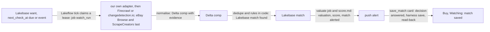

# Watch and alerts
Status: draft, second pass. Every design line is *agent proposal* except where it links a decision. Slug: watch. Written 2026-11-14.

The hassle: a person who wants a used thing at a fair price refreshes five apps and sets saved searches that each use their own filters. They get the same couch alerted three times and still miss the good one. Watch lets them say once what they want and the most they would pay. Then they hear about one real match, once, with how long ago each site was checked.

Watch owns `want` and `match`, the `watch_run` job, and `POST /v1/matches/:id/act` ([product.md §2](../product.md#2-the-map)). Buy ([buy.md](buy.md)) shows the matches and acts on them. Product pages, price history and follows belong to `market.md`. A follow is interest and never alerts on a new listing; a want is intent to buy.

## What the person does and sees

Watch lives in the Buy tab on the Watching shelf ([decision](../../product/decisions.md#2026-11-14-the-buy-tab-mirrors-sell-with-shelves)). Alerts arrive as Today cards and notifications. Only full users can watch; a visitor who taps Watch is asked to sign up, and the search carries over ([words](../../product/words.md#2026-11-14-nate-visitors-and-full-users)).

| Step | The person | They see |
|---|---|---|
| 1 | Types, photographs or pastes a link in the Buy search box ([words](../../product/words.md#2026-11-14-search-box)). | The product identified first, then live results ([buy.md](buy.md)), and a Watch button. |
| 2 | Taps Watch. Assist marks only the inputs that change which listings match, and stops by its stop rule ([assist](assist.md), [card 9](../determinations/asking-and-intent.md#9-when-inputs-leave-and-when-to-stop)): size, condition floor, ship or pickup radius, variant. | Chips prefilled from the search and their profile. Each is stated plainly as confirmed (read from a label, measured) or marked "you said". |
| 3 | Drags a two-thumb price range over the sold prices ("around $60" opens at $50 to $70), delivered. The top thumb is `max_total_cents`, the one ceiling for alerts; the bottom one only ranks (a suspiciously cheap one is flagged, not hidden). | The sold prices as dots on the track and the guarded fair range ("from 41 sales in 90 days"). |
| 4 | Leaves. | The want on Watching, with "checked 4 min ago" per site; a site that is behind says so. |
| 5 | Gets an alert. | One card per physical item: photo, delivered total, site, "also on", why it fits, the match's score axes from `score.md` and its guarded fair range, Open on site. |
| 6 | Taps "Not the same" or "Not for me" on a card. | The card goes; the answer becomes a label. |
| 7 | Pauses or ends the want, or sets quiet hours. | Alerts during quiet hours arrive as one digest. |

**Building a want by touch** (Ben, 05:20: "i want a brewers jersey and i want it around a price. i can adjust my range etc. i can say shipped or pickup or both etc. color. the dynamic ui is really helpful here", [words](../../product/words.md#2026-11-15-a-want-built-by-touch-that-runs-while-you-are-away)). The words become chips through [assist](assist.md), each chip a widget from its catalog, and only the chips that change which listings match appear:

| The person says or taps | Chip | Widget | Default |
|---|---|---|---|
| "Brewers jersey" | what it is: product or kind, with variants (home, away, City Connect, a player) | candidate chips with photos | the kind, any variant |
| "around $60" | price | `RangeSlider` (58) over the sold dots | 20% either side of the number |
| "shipped or pickup or both" | how it gets to me | three-way toggle Ship, Pickup, Both; pickup shows a radius on a map | Both, 15 miles |
| "blue" | colour | `ColourSwatches` (61) from the colours the listings actually come in | any |
| size | size | `SizePicker` (60), or the measurements of a jersey they own | from the style profile |
| condition | how worn | four chips, new with tags to fair | good or better |
| sites | where to look | the five logos plus official stores | all |

Every chip can be changed later from the want, and a change re-runs the search at once. A word the parser cannot place stays as plain text in the want and is matched as words.

**While the person is away.** The want is a background job with a visible state: "Looking on 5 sites", then per site "checked 4 min ago", "Facebook: behind". The first full pass shows "Found 12 so far" as results arrive, and the person can close the app at any point. Matches come back as cards in Today and New matches, one per physical item, with a push only for one under the price they set. Coming back shows what is new since they last looked, at the top of the want.

For clothes, fit is measured. The person picks a garment they own and like (captured on the Sell side, or entered once). A listing fits when its stated measurements are within tolerance of that garment, not only when the size label matches ([analytics note §5](../../research/data/nate/analytics-and-recommendations.md#5-recommendations-how-marketplaces-personalise-and-cold-start), *asserted*). A listing with no measurements shows "size only".

Following the certainty principle, a card states what the listing confirms (identity, variant, size, measurements, visible condition) as fact. It gives price as a range and says "not stated" for anything hidden.

New matches holds unseen matches across all wants. Watching holds the wants themselves. A want is also created when the person sells something they will need to replace (`replace_after_sale`, [buy.md](buy.md)).

## Design choices

| Choice | Options considered | Picked | Why | What would change it |
|---|---|---|---|---|
| Speed promise | "within the hour" ([decision](../../product/decisions.md#2026-11-14-the-buy-tab-mirrors-sell-with-shelves)); the field's 1 to 10 minutes ([new-listing-detection §8](../../research/watch/nate/new-listing-detection.md#8-consumer-alert-apps-stated-speed)); per-site "checked N min ago" | Per-site "checked N min ago", aiming at p95 of 10 min on eBay and Facebook. **Challenge to D-L88, for Ben**: drop "within the hour" from the card. | Field tools state 47 s to 10 min (*asserted*). An hour is slower than the field, and a fixed promise hides a site that is behind. | Ben keeps the promise; or the measured p95 for a site is over 60 min, which turns that site to "daily". |
| Trigger | Fixed Lakeflow schedule only ([decision](../../product/decisions.md#2026-11-14-watch-alerts-run-on-firecrawl-the-ebay-api-and-a-facebook-search-api)); the agent runtime, "one loop, two triggers" ([words](../../product/words.md#2026-11-14-nate-innovate-without-overcomplicating-and-the-agent-framework)) | Agent runtime. Each want has `next_check_at`, set from its state (new and hot: 5 min; old and quiet: 60 min). A site push, a price-drop signal or "check now" sets it to now. Lakeflow ticks and claims due wants. | Events fire first and the schedule is the floor, at the same cost cap. | The runtime adds lag over a plain Lakeflow job in the seeded test. |
| Cadence against the finders (*agent proposal*) | ThriftX re-runs watches daily, hourly for ThredUp and eBay on paid plans (*asserted*); Gem crawls once a day (*asserted*) ([search teardown §1, §3](../../research/watch/nate/teardown-search-and-similar-finders.md#1-thriftx), [parity](../parity.md#cross-marketplace-search-and-similar-item-finders)) | The `next_check_at` floor above (5 to 60 min, starting values) on every plan, with events first; a listing already seen is not fetched again, so a repeat check of a quiet site costs nothing new | A daily or hourly re-run misses the first buyer window; the floor is the same cost cap for everyone (*inferred*). | The per-site p95 rule in Speed promise. |
| Monitor per site | Firecrawl monitor, changedetection.io, Apify, own scrapers, Exa ([new-listing-detection §3, §7, §4](../../research/watch/nate/new-listing-detection.md#7-changedetectionio-browse-ai-visualping), [monitor-alternatives](../../research/watch/ben/monitor-alternatives.md), [exa-empirical](../../research/watch/ben/exa-empirical.md)) | Our own adapter per site first; then, for public reads, Firecrawl **or** changedetection.io, chosen by a one-week trial; eBay Browse `sort=newlyListed` and ScrapeCreators for Facebook are last-fallback routes, measured like the rest; Exa for the long tail only. | Firecrawl is the decision. changedetection.io is $8.99 a month for 5,000 URLs at about 5 min with Chrome (*observed*), while one Firecrawl URL at 5 min uses 8,640 credits a month (*inferred*). That cost gap is worth a trial. | The trial: cost per want-month, p95 lag per site, and the share of checks that get past bot checks (no figure found for either). |
| Dedupe | Product cluster plus price band plus photo hash; text only; image vectors ([fanout §dedupe](../../research/watch/ben/fanout-and-watch-loop.md#dedupe-of-cross-listed-items)) | Block by product cluster and price band, then a perceptual photo hash. A stock photo shared by sellers counts as no evidence. The cheapest copy is shown, with "also on". | Cross-posted items share photos. Unsure pairs stay separate (two cards beat one wrong merge), and "Not the same" labels train the band. | Precision on real cross-posted pairs below 0.95. |
| Alert rule | Model score; plain rule; deal score ([fanout §ranking](../../research/watch/ben/fanout-and-watch-loop.md#ranking-against-fair-value)) | In code: `total <= max_total_cents AND fits AND live AND match exact or likely_same_model`, re-read just before sending. One alert per (want, cluster). A re-alert only when the total drops below the last alerted total. With no ceiling (`alert: available`), every new live match. | Rules are checkable, and the person set the ceiling. The deal score orders the digest and never gates an alert until the price backtest decides it ([coverage](../coverage.md)). | The price backtest shows the deal score predicts a good buy. |
| Text and image match | Decisions API, Jev, our labels ([decision](../../product/decisions.md#2026-11-14-typed-judgements-run-on-both-the-decisions-api-and-jev-and-our-labels-pick), [image decision](../../product/decisions.md#2026-11-14-image-decisions-and-text-decisions-are-separate-and-the-provider-for-each-stays-open)) | Rules filter first. Only uncertain listings go to a model, at most 20 per request, cached by want, listing and evidence ([harness lessons](../../research/cross-cutting/ben/ai-harness-from-repos.md#2-decision-questions-the-jev-lessons)). | Most listings fail on price or size, which costs nothing. | Labels show the rules dropping true matches. |

## What it reads and writes

| Entity | Fields used here |
|---|---|
| `want` | state, text, product_id?, fit {attributes, garment measurements}, `max_total_cents?`, sites[], schedule {every_min}, `next_check_at`, alert (`available`, `under`) ([§3](../product.md#3-the-data-model)) |
| `match` | state, want_id?, source (`want`), site, url, price_cents, seen_at, valuation_id? |
| `comp` | every listing read is a comp with `evidence {source_url, read_at, snapshot_ref, fingerprint, extractor_version, rights}` |
| `attribute` (on a match) | size, measurements, condition read from the listing, each with `evidence {kind: label_text or image_region, ref, captured_at, extractor_version}` |
| `valuation`, `score` | read: the fair range per site and the match's axes, each a guarded number with `citation_id` |
| `item` | read only, as the fit reference garment |
| `job` | kind `watch_run`, idempotency key `(want_id, site, next_check_at)` |
| `event` | `want.created`, `watch.ran`, `match.found`, `match.alerted`, `match.labelled`; ids only |

Watch sends nothing to a seller, so it runs no `claim_check`. Alert copy uses only backed attributes and guarded numbers.

## States

| Thing | States | Moves on |
|---|---|---|
| want | `active`, `paused`, `ended` ([§4](../product.md#4-states)) | the person taps; a match `bought` ends it |
| match | `found`, `alerted`, `saved`, `asked`, `offered`, `bought`, `dismissed`, `gone` | watch_run sets found, alerted and gone; buy sets saved, asked, offered and bought; the person dismisses |
| `watch_run` job | stages `claim`, `fetch`, `normalise`, `dedupe`, `score`, `alert`, each `started, running, arrived, failed` | `next_check_at` due, or an event |

## Data flow

This follows [§10 want to match](../product.md#want-to-match-to-saved-listing). The added hops are the comp write and the `next_check_at` claim.

## Systems underneath

| Piece | Does here |
|---|---|
| Agent runtime | One job per (want group, site), with an idempotency key. The policy runs in code, and runs are paced per site. Identical wants share one query. A seen set keyed on `(site, site_id)`; the first run seeds silently ([watch loop](../../research/watch/ben/fanout-and-watch-loop.md#the-watch-loop)). |
| Lakeflow | The tick that claims due wants. A slow run delays the next, so long site reads are split per site ([§6](../product.md#databricks-pieces)). |
| Lakebase, Delta | `want`, `match` and seen sets in Lakebase; comps and events in Delta. |
| AI Search | Similar-item retrieval for photo wants and for dedupe candidates. |
| MLflow 3 | A trace per run; "why this alert?" opens it. |

## Contract for the frontend

| Call | Shape |
|---|---|
| `POST /v1/wants` | `{text?, product_id?, fit, max_total_cents?, sites?, alert}` returns `{want}`; anything unsettled opens `clarify` decisions through [assist](assist.md), never a question list of its own |
| `GET /v1/wants/:id/matches?state=` | matches with delivered total, `also_on:[{site, url, total}]`, `fit {method: measured or label, delta_cm?}`, score axes and fair range as guarded numbers |
| `POST /v1/matches/:id/act` | `{action: dismiss, save, not_same, bought}`; save opens `save_match`, and bought creates the purchase order ([buy.md](buy.md)) |
| `GET /v1/wants` | each want with `checked {site: at}` and `behind[]`; a site enters `behind[]` on the page monitor's `monitor.behind` event and leaves on `monitor.recovered` ([spec/product.md](../product.md)) |
| `GET /v1/stream` | `match.alerted`, `want.checked {site, at, behind}` |

Errors follow [§7](../product.md#errors): `{code, message, failed_step, retry}`. A site that is behind is a `502 site_failed` on that site's check and shows as "Facebook: behind". It is never shown as raw text.

## Who may act

| Action | Mode |
|---|---|
| Reading sites and listings | `auto`, read only |
| Sending an alert | `auto`, inside the want's ceiling and fit |
| Saving on the site | `save_match`, ask, promotable, never Poshmark likes ([§5](../product.md#decision-kinds-the-complete-list)) |
| A seller above the ceiling | `offer_over_ceiling`, ask |
| Offering, asking a seller | `buy_offer`, ask every time ([buy.md](buy.md)) |
| Completing a purchase | `complete_purchase`, locked |

## How it fails

| Failure | The person sees | Recovery |
|---|---|---|
| A site route breaks (a doc id changes, a bot check) | "Facebook: behind" on the want | The fallback route; an alert to us after 2 missed checks |
| Sold before the alert | nothing; the re-read drops it | `gone`; if it was saved, `did_you_buy` |
| The same item on two sites | one card, "also on" | dedupe; a wrong merge undone by "Not the same" |
| Too many matches | a digest, not 30 pushes | batching per want |
| Local listing with no shipping | "pickup, 3 km" instead of a total | shipping marked not known |
| Too few sales for a fair range | "not enough sales yet" in place of the range | the guarded number is hidden with its `hide_reason` |

## How we will know it works

| Claim | Bar | Check |
|---|---|---|
| Alerts are fast | p95 of 10 min or less on eBay and Facebook, the Basic tier of the field (Flipify 10 min; Swoopa 47 s average; [new-listing-detection §8](../../research/watch/nate/new-listing-detection.md#8-consumer-alert-apps-stated-speed), *asserted*). Other sites: p95 measured and shown, with no promise. | Seed a real listing per site, then measure `match.alerted.at` minus the time it first appeared in the site's own search. Facebook hides new listings for a few minutes ([§6](../../research/watch/nate/new-listing-detection.md#6-facebooks-delay-before-a-listing-is-visible), *asserted*). 20 real wants over a week. |
| One alert per item | Dedupe precision of 0.95 or more on real cross-posted pairs; under 2% of alert pairs labelled the same item | about 50 labelled pairs from the seeded set |
| Matches are right | precision of 0.9 or more on 50 hand-labelled alerts | labels |
| Monitor choice | the cheaper of Firecrawl and changedetection.io at equal p95 and bot-check success | the one-week trial |
| Fit | share of clothes bought from alerts and kept, not returned for fit | "Bought" follow-up |

## Facts to know

- Sites' own saved-search alerts are slow: Depop is weekly (*observed*), eBay's frequency is not stated (third parties say a daily digest, *asserted*), and none has an API ([§1](../../research/watch/nate/new-listing-detection.md#1-each-sites-own-saved-search-alerts)).
- eBay Browse allows 5,000 calls a day (*asserted*), and production needs a Growth Check. The Notification API has no new-listing topic ([§2](../../research/watch/nate/new-listing-detection.md#2-ebay-browse-api-and-notification-api), *observed*). For a public launch, eBay's API licence on keeping and mixing eBay data is enforced through `rights` tags ([comps-sources-live](../../research/price/ben/comps-sources-live.md)).
- Firecrawl monitors run every 5 min at the fastest and are billed per scrape (*observed*). The free 1,000 credits cover under a day of one URL ([§3](../../research/watch/nate/new-listing-detection.md#3-firecrawl-monitor)). For a public launch, nothing changes beyond cost.
- ScrapeCreators for Facebook costs $1.88 per 1,000 calls, about $16 a month per query at 5 min, and returned 24 listings in 1.32 s in one earlier note (the timing is not on the vendor page; the price is confirmed, [claims validated](../../research/cross-cutting/nate/claims-validated-sites-and-rivals.md); *asserted*, [§5](../../research/watch/nate/new-listing-detection.md#5-scrapecreators-facebook-marketplace-endpoint)). For a public launch, Meta's Automated Data Collection Terms apply to the vendor's route ([§6 harnesses](../product.md#harnesses)).
- Apify actors are priced per event; the pricing page shows examples of $1 to $2.30 per 1,000, and no success rate is published ([claims validated](../../research/cross-cutting/nate/claims-validated-sites-and-rivals.md)). Each actor's own page sets its price, and our router measures success itself (*observed* for the pricing page, [§4](../../research/watch/nate/new-listing-detection.md#4-apify-actors-per-result-from-the-actor-pages-freshness-not-stated)). Freshness is not stated.
- Exa has no Facebook listings, few eBay ones and nothing under 7 days old, and many of its results are already sold ([exa-empirical](../../research/watch/ben/exa-empirical.md), *observed*).
- Not found: whether Firecrawl or changedetection.io get past each site's bot checks.
- Rules that protect people: watch reads with no login wherever a site allows. Where a site needs the person's session, the risk to that real account is shown per site at connect ([connect.md](connect.md)). A want never stores a home address; the pickup radius is set from a point the person taps. A recalled product is never alerted.
- Licences and terms are recorded and do not shape the build ([decision](../../product/decisions.md#2026-11-14-licences-and-site-terms-are-recorded-as-facts-and-do-not-shape-the-build)).

## Open for Ben and Nate

| Question | Recommendation | Depends on it |
|---|---|---|
| Challenge to D-L88, for Ben: is "within the hour" the card's promise? | Show "checked N min ago" per site and promise nothing fixed. Aim at p95 of 10 min on eBay and Facebook. | card copy, check cost |
| Business model: is a faster check the paid tier? | not picked; it rides on the general earning question ([§9](../product.md#9-open-for-ben-and-nate)) | schedule cost |

## Needs from the shared model

- `want.schedule` holds quiet hours, and the want links a fit reference: an owned `item`'s measured attributes, or a stored garment measurement set.
- The `watch_run` stages above, with `claim` added for the runtime.
- `match` needs `cluster_id` and `alerted_total` for dedupe and re-alerts.
- The harness verb sets in product.md §6 and in the agent runtime frame differ (`save` is in both). Only one should exist.
