# secondhand: the shared product model

Status: draft. Written 2026-11-14, second and third passes the same day. Every line is *agent proposal* unless it links a decision in [decisions.md](../product/decisions.md) or [vision.md](../product/vision.md) Decided. This page is the one source of names and shapes: every feature spec in [features/](features/) uses these entity names, states, decision kinds, job kinds and contract rules. A name a feature needs and this page lacks goes under that feature's "Needs from the shared model" until it lands here (§11).

## 1. What it is for

| | |
|---|---|
| Who | Someone clearing their own things, who also buys used; resellers can use it but do not shape the design ([decisions](../product/decisions.md#2026-11-14-the-first-person-we-build-for-is-someone-clearing-their-own-things)). |
| The hassle today | Photographing, measuring, looking up what it is and what it sold for, writing a listing per site, answering the same questions, haggling, keeping five sites in sync, delisting after a sale, arranging pickups, chasing returns. A $20 item rarely earns back that time, so it sits in a closet. |
| What they stop doing | Scan the item once and get one measured record of it. Pick a selling plan. The app lists it, answers buyers inside the limits they set, takes it down everywhere when it sells, and books the pickup inside their hours. |
| What they control | The limits: the lowest they'd take, ship or pickup, pickup hours, saved spot, and a most-to-pay per want. Anything outside them waits as a card in Today. Address, payment, refunds and a price below the floor are always theirs ([decisions](../product/decisions.md#2026-11-14-buyers-are-handled-inside-limits-you-set-then-it-learns)). |
| What they know | What an item is worth on each site, from real sales with dates; why the agent did each thing (the "why?" timeline); what they earned and could earn; how a market moves, even for someone who never sells ([words](../product/words.md#2026-11-14-nate-a-market-anyone-can-learn-from)). |
| How the two sides feed each other | One engine identifies and values an item whether you own it or want it ([decisions](../product/decisions.md#2026-11-14-selling-comes-first-buying-is-a-full-side)). Every sale and every watched listing becomes a comp. A bought item becomes "Sell this" with its cost known. What you sell tells Buy your sizes and taste. |
| What it is not | No storefront and no payments: buyers pay on the marketplace ([words](../product/words.md#2026-11-14-nate-store-and-buying)). |

## 2. The map

The decided bar is Today · Sell · ＋ · Buy · You ([decisions](../product/decisions.md#2026-11-14-the-bottom-bar-is-today--sell----buy--you)); the "Where the person meets it" column below names the behaviour a person reaches, not a settled layout, since Ben's screen design is still open (*agent proposal*). Every feature is in scope ([decisions](../product/decisions.md#2026-11-14-keep-every-feature-in-scope)). An entity listed here has its owner table in that feature; others read it.

| Slug | Where the person meets it | Owns | Spec |
|---|---|---|---|
| today | Today | `decision` (the open-decisions query and cards), `GET /v1/today` | [features/today.md](features/today.md) |
| connect | First launch, You > Accounts | `user`, `account` (sites and the `email` account), the `import` and `unlink` jobs, purchase import | [features/connect.md](features/connect.md) |
| item-card | The item screen, from Sell | `item`, `attribute` | [features/item-card.md](features/item-card.md) |
| capture | ＋ Sell this, the camera | `capture`, `photo` | [features/capture.md](features/capture.md) |
| measure | Inside capture | writes `attribute` (source `measured`) and the package | [features/measure.md](features/measure.md) |
| identify | Inside capture, after the scan | `product`, the candidate list | [features/identify.md](features/identify.md) |
| studio | The item screen, photos | writes `photo` (role studio, real photos kept) | [features/studio.md](features/studio.md) |
| price | The item screen, price and plan | `comp`, `valuation`, `strategy`, the `stale` state, the on-phone comp index | [features/price.md](features/price.md) |
| appraise | ＋ What's it worth, Buy camera and link field | no table: a `valuation` keyed by a capture or a URL (the appraisal) | [features/appraise.md](features/appraise.md) |
| list | Sell, the drafting area | `listing` | [features/list.md](features/list.md) |
| replay | Not seen: inside each harness | `recording` (*agent proposal* inside the harness, §6) | [features/replay.md](features/replay.md) |
| sold | Sell's Sold shelf, Today ship-by cards | `order`, `appointment`, `sale_receipt`, no-shows, the dibs queue, returns and disputes | [features/sold.md](features/sold.md) |
| messages | The chat icon with a count | `conversation`, `message`, `offer`; pickup booking and the address | [features/messages.md](features/messages.md) |
| watch | Buy: New matches, Watching | `want`, `match` | [features/watch.md](features/watch.md) |
| data | You > By site, the "why?" timeline | `job`, `event`, `rule`, `limits`, `label`, idempotency, the delete request | [features/data.md](features/data.md) |
| buy | Buy: search, For you, Bought | no table: `order` with kind purchase, `offer` outgoing, `match` saved, `owned` items | [features/buy.md](features/buy.md) |
| insights | You: earned, could earn, by site, goals | `goal` (*agent proposal*, Nate's); ledger numbers are derived ([decisions](../product/decisions.md#2026-11-14-the-you-tab-leads-with-numbers-and-a-by-site-comparison)) | [features/insights.md](features/insights.md) |
| market | Buy search and product pages, for full users and visitors ([words](../product/words.md#2026-11-14-nate-a-market-anyone-can-learn-from)) | product pages, price history across retail and used markets, release hype, trends, `follow`, `visitor`, `referral_click`, visitor search, `retail_offer`, `price_point`, `held_for_review`, the public API (§6), `GET /v1/products/:id` | [features/market.md](features/market.md) |
| score | Every number on an item, listing, product or match | `score`, `ranker_model`, `experiment`, `arm`, change detection, the `citation` writer ([words](../product/words.md#2026-11-14-nate-a-general-scoring-feature-and-real-time-algorithms)) | [features/score.md](features/score.md) |
| assist | Buy search prompt, capture gaps, Sell and Market prompts | `intent`, the span fields on a `clarify` decision, the `assist` job | [features/assist.md](features/assist.md) |

`rule` and `limits` sit with data because Today, messages, sold, price and buy all enforce them; You > Automation and You > Pickups are their screens. `requirement` sits with capture (the session reads it) and `claim_check` with data (every outgoing path calls it). `kind` and `category_map` sit with identify (*agent proposal*, inferred from [fields-by-kind](determinations/fields-by-kind.md)); `route_table`, `route_call`, `route_truth`, `param` and the information engines sit with data.

How each number is computed lives in [determinations/](determinations/), one card per number: [seeing the item](determinations/seeing-the-item.md), [money](determinations/money.md), [listing and marketing](determinations/listing-and-marketing.md), [managing and buyers](determinations/managing-and-buyers.md), [market insight](determinations/market-insight.md), [asking and intent](determinations/asking-and-intent.md), [capture shots](determinations/capture-shots.md), [fields by kind](determinations/fields-by-kind.md). This page names things; a card says how they are worked out.

| Other spec files | What it holds |
|---|---|
| [parity.md](parity.md) | parity with the tools that exist: search, price data, registries and routers, crosslisting, catalogs |
| [../docs/how-it-works/](../docs/how-it-works/README.md) | plain-words explanations for readers outside the build |

## 3. The data model

Every row carries `id` (prefixed, §7), `user_id`, `created_at`, `updated_at` and `version` (integer, bumped on each write). Storage: L is Lakebase (Postgres, operational truth, synced to Delta), D is Delta, V is a Unity Catalog volume. Money is `{amount_cents, currency}` everywhere; a field named `*_cents` below is that shape.

| Entity | Key fields (type) | Owner | Store | Readers | Primitive |
|---|---|---|---|---|---|
| `user` | email_ref (hash), locale, currency, timezone, disclosure_pref, target_profit_cents?, notification_pref[] {event_kind, channel, on}, experiments_consent (bool, default false), tutorial_seen (bool, default false; set by `PATCH /v1/me`, [capture](features/capture.md#what-it-reads-and-writes)) (*agent proposal*) | connect | L | all | none (identity) |
| `account` | site (`ebay`, `facebook`, `depop`, `poshmark`, `mercari`, `offerup`, `grailed`, `email`), route (`harness`, `search_only`, `email`), health (`ok`, `expiring`, `broken`, `paused`), capabilities (§6, per site), linked_at, token_ref (vault key, never the token), export_mark (`none`, `site_required`, `retouched`; read only by the export step that writes the file this site receives, [photo engine](engines/photo.md) step 7; its default is [studio](features/studio.md) Open 5) (*agent proposal*) | connect | L | list, messages, sold, watch, buy | Account (configuration) |
| `storefront_snapshot` | account_id, site, as_of, shop {followers?, following?, rating?, review_count?, active_count, sold_count, joined_at?}, totals {views?, likes?, saves?, offers?, orders, gross_cents, kept_cents?} over window_days, per_listing_ref (the `read_stats` rows of the same sweep), fields_missing[] (what this site does not show), source (`harness`), citation_id | insights | D (history), latest in L | insights, platform analytics, score, today | new, *agent proposal* ([Nate](../product/words.md#2026-11-14-nate-the-kernel-covers-platform-specifics-and-storefront-analytics-and-runs-only-what-each-person-linked)): what each linked storefront reports about itself, read by the kernel verb `read_storefront` on the watcher sweep and kept per person and site. A row exists only for an account the person linked |
| `item` | state (§4), product_id?, title, category, cost?, origin (`capture`, `purchase`, `import`, `folder`), kept_reason?, location {label, place?}, quantity (int, 1 by default), group_id?, seller_sku?, note_source? (`typed`, `spoken`), note? (the person's free note, typed or said before the listing is generated; [capture](features/capture.md) step 7a, *agent proposal*), missing_fields[] (derived, never stored) | item-card | L | all | **Item** |
| `product` | brand, model, variant, gtin?, mpn?, category, spec (json), embedding_ref, predecessor_id? (the previous generation in the same family, [M16](determinations/market-insight.md#m16-how-new-retail-releases-relate-to-used-supply-and-price)), family_id? (groups product rows that differ only in `variant`), merged_into? (set when two product rows prove to be one; every reader follows it) ([identity engine](engines/identity.md)) (*agent proposal*) | identify | L, mirrored to D | identify, price, watch, appraise | new: one catalogue identity many items and comps resolve to, so a sale of one item prices the next |
| `capture` | item_id?, state (§4), mode (`shots`, `scan`, `talk`), confirm_mode (`tap`, `auto`; in `auto` a proposal at or past the auto-accept bound (0.95; for the type, suggest.py's 0.9 top and 0.5 lead) is accepted and marked `auto_accepted`, never for a field whose `confirm` is `always` (condition, function, authenticity) ([capture engine §11](engines/capture.md#2-the-plan), *agent proposal*)) and auto_accepted (bool), purpose (`sell`, `appraise`, `find`; *agent proposal*, [packet 47](../.agents/team/packets/team/47-what-the-pages-need-from-the-backend.md)), pieces? (int; two or more make a bundle), device {has_lidar (bool: scene depth), object_capture (bool: ObjectCaptureSession.isSupported and no session failure this capture; LiDAR alone is not a working scan, [capture tech docs](../research/capture/nate/capture-tech-docs-2026-11.md))}, plan (derived, never stored: process with step states, fields with states (`known`, `proposed`, `waiting`, `missing`, `unobtainable`, `refused`; the item card uses the same six), questions[], complete per site, status `shooting`, `asking`, `done`) ([capture engine §11](engines/capture.md#2-the-plan), *agent proposal*), process steps may also carry seconds, frames and measured_to (*agent proposal*), coverage {needed[], kept[]}, depth_ref?, pose_ref?, masks_ref?, read_text_ref?, kept_raw (bool), type? and suggested_type? (each a `kind family` value; the pick sets `type` and `item.category`), process[] {step, kind (`instant`, `series`, `scan`), role, needs_lidar} ([capture engine](engines/capture.md#1-what-it-decides)) (*agent proposal*) | capture | L, files V | measure, identify, studio | part of Item: one session, and the item picks the mode ([decisions](../product/decisions.md#2026-11-14-capture-is-one-session-and-the-item-picks-the-mode)) |
| `photo` | capture_id, role (`front`, `back`, `tag`, `care_label`, `fabric`, `detail`, `side`, `inside`, `sole`, `flaw`, `spin`, `screenshot`, `studio`), file_ref, parent_photo_ids[], exif_stripped (bool), use (`real`, `improved`), ai_marked (bool, the in-app mark; any export tag is separate, §9 J11), step? (the `capture.process[]` step it was taken in), quality {score (0 to 100), parts{}, style, cover_ok} ([capture engine](engines/capture.md), [photo engine](engines/photo.md)) (*agent proposal*), route may be `raw` for an untouched photo, export_tag (the IPTC DigitalSourceType URI, or null for a photo the person took; *agent proposal*) | capture | L, files V | studio, list, identify | part of Item |
| `attribute` | item_id, name, value (json, or null when unknown), unit?, source, confidence (0..1, internal; never shown as a percentage, §8 certainty), evidence[] (`evidence` shape, below; includes the identity anchor), method, at, confirmed (bool), unknown_reason? | item-card | L | all | part of Item; a row per fact so each carries provenance |
| `job` | kind (§4), item_id?, stages[] {name, state, started_at, ended_at}, state, result?, error?, trace_id, account_id?, event_id?, idempotency_key (unique per user), paused? (`account_stale`); kinds added (*agent proposal*): `answer_offer`, `make_offer`, `sweep` (the signed-in watcher sweep), `relink` | data | L | all | **Job** |
| `comp` | product_id?, cluster_id? (one physical listing across sites and relists), site, price_cents, price_type (`asking`, `sold`, `retail`), best_offer_accepted? (bool; true means the shown price is the ask, not what was paid), observed_at (last read), first_seen_at, listed_at_source?, ended_at?, ended_reason? (`sold`, `ended`), sold_at? (equals ended_at when ended_reason is `sold`), price_history[] {at, price_cents}, phash[], condition, url_ref, evidence (`evidence` shape for a comp, with `rights`), source_route, lot_parts[]? (the product_id of each piece in a lot comp; a lot never enters a single product's sold range), seller_ref_hash (the seller handle, stored only hashed) ([identity engine](engines/identity.md)) (*agent proposal*) | price | D | price, appraise, watch, insights, market, score | **Comp**; a typed view of `observation` (kinds `price` and `listing`) |
| `valuation` | one of item_id, match_id, capture_id or url_ref; per_site[] {site, low, high, basis_count, as_of, dates}, level (1 an exact live market, 2 adjusted similar sales, 3 a research guess), drivers[], max_pay_cents? with max_pay_citation_id? (its basis, [D17](determinations/money.md#d17-most-a-buyer-should-pay)), verdict?, check?, job_id | price | L (current), D (history) | item-card, appraise, list, buy, today | **Valuation**; an appraisal is a valuation with no item_id, carrying verdict, max_pay and the one check to make. The [valuation engine](engines/valuation.md)'s `valuation` is this row |
| `strategy` | item_id, site, state (§4), verdict (`list`, `skip`), skip_reason? (`site_bars_category`, `recall_or_legal_flag`, `not_connected`, `fit_avoid`, `negative_value`), objective (`quick`, `balanced`, `max_return`, the one set of names everywhere), price_path[] {at, price_cents}, floor_cents, horizon_days (7, 30, 90), offers_on (bool), list_at, title_form, photo_order[] (the per-site photo plan: slots[] {photo_id, version_id, slot, crop {x, y, w, h}, export_px, reason}, dropped[] {photo_id, reason}, route_offers[] {photo_id, level, n, cost, value, reason}, [photo engine](engines/photo.md), *agent proposal*), attributes_to_fill[], category_id, shipping {mode (`buyer_pays`, `free`, `pickup`, `either`; the handover), ship_cents, price_includes_ship}, promotion {on, rate?, lift_lb?}, standing {offers_to_likers {on, discount, cooldown_days}, refresh {on, interval_days?}, relist {allowed, false on Poshmark}, bundle {on, max_discount}}, scores {e_net_cents, p_sale {d7, d30, d90}, tts_days [lo, hi], position [lo, hi], utility_cents}, alternatives[] {candidate_id, objective, e_net_cents, p_sale_d30, tts_days}, comp_set {ids[], as_of, fingerprint}, citation_id, param_versions {name: version} (also in the citation), preselected (bool), chosen_at?; one row per site, which is list.md's `per_site[]` and [marketing-engine](marketing-engine.md)'s `site_plan`, so a skipped site is a row with its reason; one row per site, which is list.md's `per_site[]` | price | L | list, messages, sold | new: a determined calculation, one best plan per platform computed in plain code from that platform's comparable listings now, preselected, with the other objectives selectable; recomputed when the comparable set changes; "fast, credible and dynamic, yet transparent", so the person-facing step is under 1 s at the 95th percentile ([score.md](features/score.md)) and the plan shows its basis ([words](../product/words.md#2026-11-14-nate-the-best-strategy-per-platform-computed)); markdowns and counters follow the chosen path ([fees-and-taxes.md](../research/price/nate/fees-and-taxes.md) for net) |
| `listing` | item_id, site, state (`LISTING_STATES`), price_cents, url, external_ids[] {id, url, from, to}, sku, draft {title, body, photo_ids[]}, posture (0 to 1, from priced to go to hard to negotiate; quick, balanced and max_return are the points 0.15, 0.5 and 0.85; it opens at 0.5, Nate's answer; it lives on the listing only; [the price slider](engines/valuation.md), *agent proposal*), overrides (json, per site), interest {views?, watchers?, likes?}, posted_at, last_read_back_at, next_check_at (§6 runtime) | list | L | all | **Listing** |
| `conversation` | site, site_thread_id, item_id?, listing_id or match_id, buyer_ref_hash, role (`sell`, `buy`), intent_last, state (§4), last_read_at, next_check_at | messages | L | today, sold, buy | **Conversation** |
| `message` | conversation_id, actor (`user`, `auto`, `counterpart`), sent_at, site_message_id, intent, facets[] (including `possible_scam`, `dispute`), text_ref (body held encrypted, never logged) | messages | L | messages | part of Conversation |
| `offer` | conversation_id or listing_id, direction (`in`, `out`), amount_cents, you_keep_cents (derived, after fees), state (§4), expires_at | messages | L | price, sold, buy | part of Conversation; its own row because offers have states and limits act on them |
| `order` | kind (`sale`, `purchase`), item_id, listing_id?, match_id?, site, state (§4), price_cents, fees_cents, shipping_cents, payout_cents?, money lines[] {kind (incl. `promotion_spend`), amount_cents, source (`site_report`, `computed`, `estimated`)}, label? {carrier, tracking_ref, insured_cents?, batch_id?}, clocks (ship_by?, respond_by?, claim_until?, release_at?, each from the site's own rule, [sold.md](features/sold.md)), external_order_id; unique (site, external_order_id) | sold | L | insights, today, buy | new: the money and handover the ledger is derived from |
| `sale_receipt` | site, external_order_id (unique with site), source (`email`, `poll`, `api`), received_at, raw_ref | sold | L | sold, data | new: the raw proof of a sale, so one sale never makes two orders |
| `decision` | kind (§5; added, *agent proposal*: `confirm_trade`, always ask, never promoted to a rule; `note_conflict`, when the free note contradicts a held fact), item_id?, options[] {id, label, signature, image_url?, evidence[]}, suggested (option id, or null when span.mode is `blank`), allow_other?, wait?, span? (`span` shape, below), widget?, widget_props?, deadline, why, state (§4), answered? {option_id, answered_at, edited, card_ms, opened_detail} | today | L | all | **Decision** |
| `rule` | kind, scope (`all` or item_id), state (§4), unedited_approvals (int), promoted_at?, last_used_at? | data | L | all executors | **Rule** |
| `limits` | per item: floor_cents, always_accept_cents?; per user: handover, pickup_windows[], saved_spot_ref, ask_every_time (bool) | data | L | messages, sold, price, buy | part of Rule |
| `want` | state (§4), text, product_id?, intent_id?, fit {attributes, garment measurements}, max_total_cents?, sites[], schedule {every_min}, next_check_at, alert (`available`, `under`) | watch | L | buy, today | **Want** (with Watch): intent to buy, never a `follow` |
| `match` | state (§4), want_id?, source (`want`, `search`, `for_you`), label (`match label`, below), site, url, price_cents, seen_at, valuation_id? | watch | L, history D | buy, today, price | part of Want |
| `appointment` | order_id, kind (`pickup`, `ship_by`), window {start, end}, place_ref, calendar_ref?, state (§4) | sold | L | today, messages | **Appointment** |
| `goal` | month, target_cents, target_sales?, progress (derived) | insights | L | today, you | new: Nate's monthly goal (*agent proposal*, vision.md Proposed) |
| `event` | item_id?, actor (`user`, `auto`, `site`), action, why, observed_at, effective_at, operation_id, trace_id, undo {allowed, until}, undo_of?, route? (`api`, `replay`, `browser`), fell_back?, ms?, source? (the `event.received` enum in [events.json](events.json)), site?, account_id?, payload_ref?, dedupe_key? (unique per user_id and dedupe_key); kinds beyond [protocol-and-adapters 3.6](engines/protocol-and-adapters.md): `order.updated`, `account_relinked`, and `app.list`, `app.delist`, `app.relist`, `app.delete`, `app.reprice`, `app.offer`, `app.message`, `app.confirm` (*agent proposal*) | data | D, written through the logger | data, insights, today | the one log and the one "why?" source ([5-logging.md](../.agents/team/packets/team/5-logging.md)) |
| `label` | subject (decision_id, message_id or attribute id), kind (`owner_statement`, `observed`, `verified_correction`, `specialist`), value, state (§4) | data | L, D | data, every typed judgement | new: what a tap or a correction teaches, kept apart from the decision it came from |
| `recording` | site, task, steps_ref, recorded_at, last_ok_at, fail_count | replay | L, files V | the harness for that site | new, *agent proposal*: a site action recorded once in the harness and replayed as its fast path. Ben's word "recipe" (`rcp_`) is the same thing; `rec_` stands |
| `citation` | metric, filters, table_versions[] (Delta version n, read back with `VERSION AS OF n`, [settled](../research/data/nate/open-items-settled-databricks.md)), definition_version, code_version, param_versions{} (param name to version, so "Why this price?" can say "Mercari sales weighted 1.0, fitted on 214 sales, v37"), model_version, computed_at, basis_ids[], basis_hash (SHA-256 of the sorted basis ids and prices, [M21](determinations/market-insight.md#m21-the-citation-attached-to-every-published-number)) | score | D | every screen that shows a number | new: enough to recompute a number as of its date ([words](../product/words.md#2026-11-14-nate-provable-and-features-for-databricks)) |
| `score` | subject_type (`item`, `listing`, `product`, `match`), subject_id, axis (`financial`, `quality`, `visibility`, `trend`), site?, value, range, citation_id, state (`shown`, `hidden`), hide_reason?, model_version | score | L (current), D (history) | item-card, price, list, market, watch, insights | new: one scored axis, a guarded number ([words](../product/words.md#2026-11-14-nate-a-general-scoring-feature-and-real-time-algorithms)) |
| `ranker_model` | site, category, factors[] {name, p_helps, effect, range}, noise_floor, panel_as_of, change_flag (bool), model_version | score | D, UC model registry | score, list, price | new: the learned stand-in for one site's ranking per category; never the site's real weights |
| `experiment` | site, category, factor (including `site_set`, a site held back to test the site pick, [platform analytics](engines/platform-analytics.md), *agent proposal*), arms[], state (§4), started_at, ended_at?, budget {listings, price_floor_kept} | score | L (live), D (results) | score, list | new: a controlled variation on consenting users' own listings |
| `arm` | experiment_id, design (`matched_pair`, `before_after`), variant (json), listing_ids[], exposures, outcome {impressions?, views, watchers, sold, days_to_sell}, posterior | score | L, D | score | part of experiment; a `before_after` arm is labelled as such and never called randomised |
| `rank_observation` | site, category, query, observed_at, listing_ids[] (in order), evidence (comp shape) | score | D | score | new: one query on one site at one time; a typed view of `observation` (kind `rank`) |
| `observation` | kind (`listing`, `stats`, `price`, `rank`, `fact`, `trend`, `retail`, `rule`), site?, product_id?, subject_ref (a listing id, url_ref or query), observed_at, payload (json), evidence (`evidence` shape), source_route, retention_class, rights_mode | data | D, append-only; snapshots on V | price, score, market, identify, insights, watch, buy | new, *agent proposal*: the one general row that every protocol read (`read_listings`, `read_stats`, `search`) and every information-engine find writes ([data-use](data-use.md)). `comp` and `rank_observation` are typed views over it with their own parsed columns, kept as the names readers use; nothing is stored twice |
| `notice` | kind (`ranker_changed`, `listing_stale`, `anomaly`, `value_moved`, `demand_rose`), site, category?, opened_at, cleared_at?, signals[] | score | L | score, list, price, today | new: raised to every affected listing |
| `product_snapshot` | product_id, site, price_type, day, n, p25, p50, p75, listed_count, sold_count, table_version | market | D | market, price, score | new: daily per product, site and price type |
| `market_metric` | metric, subject_type, subject_id, as_of, a guarded number | market | D, served from L | market, insights | new |
| `index_point` | index_id, basket_version, day, value, era, citation_id | market | D | market | new |
| `requirement` | item_kind (a `kind` id), node, field, type, values_or_unit, role, site_names {site: name, max_length, required}, importance {match, value, rank {site}} (each `high`, `medium`, `low`), fill_ladder[] (rungs `label`, `measured`, `seen`, `lookup`, `derived` (from the type, the class or the profile), `asked`, each with its route and its min_conf; replaces obtained_by), dimension_class (`flat_garment`, `footwear`, `bag`, `small_hard`, `medium_hard`, `large_bulky`, `soft_goods`, `set_bundle`), confirm (`auto`, `tap`, `always`), per_piece (bool), ask {kind (`pick_one`, `pick_many`, `number_with_unit`, `yes_no`, `text`, `shot`), words} ([capture engine §11](engines/capture.md#2-the-plan), *agent proposal*), views_needed[], seconds (measured per shot), effort (2 a still at hand, 3 with a handling step, 3 a typed value), priority (derived: the highest of the three importances), version | capture | D (versioned), read into L | capture, measure, identify, list, score, assist | new: one row of the capture requirements registry; the session asks only for what is still missing ([fields by kind](determinations/fields-by-kind.md), [capture shots](determinations/capture-shots.md)). The rows for the 14 families follow each type's process in [capture](features/capture.md#the-process-for-each-type) and the [capture engine](engines/capture.md); they are linked there, not copied here (*agent proposal*) |
| `kind` | parent_id?, family (`kind family`, below), shopify_gid, google_id?, version | identify (*inferred*) | D (versioned), read into L | capture, list, price, market | new: one node of the item taxonomy; Shopify's product taxonomy is the spine (open, §9) |
| `category_map` | kind_id, site, marketplace?, site_category, version | identify (*inferred*) | D (versioned), read into L | list | new: where a kind goes on each site; a site not mapped falls back to [listing D7](determinations/listing-and-marketing.md#d7-category-placement) |
| `claim_check` | subject (message_id draft, listing draft), claims[] {text, state (`backed`, `unbacked`, `contradicted`: the claim denies or conflicts with a held fact, for example "not wool" against the fact wool; it holds the draft like an unbacked one and the decision's why names the fact; *agent proposal*, engines lead 2026-11-15), attribute_id or evidence_ref?}, verdict (`pass`, `hold`, `abstain`), checker_version | data | L, D | messages, list, today | new: the evidence gate on anything leaving the system ([words](../product/words.md#2026-11-14-nate-a-safety-layer-and-a-framework-like-flue)) |
| `visitor` | session_ref (no account, no `user_id`), first_seen_at, rate_bucket, referral_ref | market | edge, L (counts only) | market | new: searches and opens product pages; cannot sell or save ([words](../product/words.md#2026-11-14-nate-visitors-and-full-users)) |
| `follow` | target (`product_id`, brand, category or query), variant?, channel, opt_in_at, first_seen_price_cents?, first_seen_at, last_notified_at?, muted_at? | market | L | market, today, insights | new: interest to learn and be told, distinct from a `want` |
| `referral_click` | visitor_id or user_id, product_id?, site, url, referral_tag, clicked_at | market | D | market, insights | new: a link-out that carries a referral ([words](../product/words.md#2026-11-14-nate-referrals-and-market-data)) |
| `param` | name, scope {kind?, site?, segment?, person?, state?} (a person-scoped read falls back to the same scope without the person, then the prior, never to another person's row), family (`scalar`, `beta`, `normal`, `gamma`, `model_ref`), value_or_hyperparams (json), prior, version, fitted_on_ids_hash, n_eff, metric, guard_lo, guard_hi, status (`champion`, `challenger`, `retired`), frozen (bool, set by a site change flag) | data | L (live), history D | every reader of a weight or threshold | new, *agent proposal*, replaces `thresholds`: every learned weight, threshold and interval a determination card names; the card's number is the prior, a new scope starts at it with n_eff 0 (§6 real-time weights). assist starts `assist_span_open` 0.8, `assist_preselect_margin` 0.2, `assist_value_floor` 0.15 as priors ([asking-and-intent](determinations/asking-and-intent.md)); the marketing engine starts `holding_cost_balanced` 0.002 and `holding_cost_quick` 0.01 of the fair-value midpoint per day (`max_return` 0), `p_min_quick` 0.6 and `p_min_balanced` 0.4, and `vis_exponent` 0.5 ([marketing-engine](marketing-engine.md) §3.4). Also param rows (*agent proposal*): the identity engine's three match-label thresholds (start 0.85, 0.70, 0.50) and `q_kind` ([identity engine](engines/identity.md)), and `site_effect.sale` and `site_effect.price`, scoped to site, category and person ([platform analytics](engines/platform-analytics.md)) |
| `style_profile` | facets[] {name (brand, category, size, colour, era, price_band), weight, from (`sold`, `kept`, `saved`, `followed`, `bought`, `edited`), pinned (bool: an edited weight that learning never changes), removed_at? (only later events count toward its return; [recommendation and style](engines/recommendation-and-style.md), *agent proposal*)}, edited_at? | buy | L | buy, market, today | new, *agent proposal*: one per person, learned from what they sell, keep, save, follow and buy; feeds recommendations and Buy shelves; every facet shows where it came from and can be edited or removed; never reorders by referral |
| `release_event` | product_id, store, kind (`release`, `restock`), date, source_rank | market | D | market, score | new, *agent proposal*: a retail release or restock, for [M16](determinations/market-insight.md#m16-how-new-retail-releases-relate-to-used-supply-and-price) |
| `intent` | owner_ref (user or visitor), surface, job_id, want_id?, slots {use, for_whom, budget, size, compatibility[], deadline, condition_tolerance, keep_for (months)}, each slot a provenance value | assist | L | buy, watch, market, price | new, *agent proposal*: what a person is after, parsed from their words ([assist](features/assist.md)) |
| `retail_offer` | product_id, relation (`same_product`, `successor`, `functional_equivalent`), seller_kind, condition, price_cents, shipping_cents, tax_cents, delivery_min_days, delivery_max_days, stock, ships_from, ships_to, warranty_months, returns_days, source, fetched_at, rights | market | D, Shopify rows kept 10 minutes at most | buy, market, price | new, *agent proposal*: a new, refurbished or brand-resale offer from an official seller. Named `retail_offer` so it is never read as `offer`, a price offer between people (was `official_offer`) |
| `price_point` | product_id, site, band, at, value_cents or gap, definition_version | market | D | market, price, score | new, *agent proposal*: a change-only series per product, site and band ([M3](determinations/market-insight.md#m3-used-price-per-site-over-time)) |
| `held_for_review` | comp_id, product_id, reason, held_at, state (`held`, `accepted`, `dropped`, `entered_half_weight` after 14 days) | market | D | market | new, *agent proposal*: an odd sale kept out of the index until reviewed ([M14](determinations/market-insight.md#m14-a-category-price-index) step 6); state names *inferred* |
| `route_table` | route_id (reverse-DNS, e.g. `com.ebay.browse.sold`), layer (`site_protocol` for the five marketplaces, `engine` for an information gatherer, §6), site, need (a harness verb or `sold`, `asking`, `retail`, `trend`, `identify`), returns, kind (`adapter` (our own, through the person's signed-in session), `fetch` (Firecrawl, jev-ultrafast), `official_api`, `treg_direct`, `treg_routed`, `other_vendor`), recipe_ref? and fixture_ref? (for an adapter), unit_cost, success (a `param` of family beta, updated per call), p50_ms, p95_ms, completeness (share of the need's fields it returns), account_risk (`low`, `medium`, `high`, shown per site), breaker (`closed`, `open`, `half_open`), freshness, coverage, rights, right_90d, seed_source, state (`active`, `demoted`, `dropped`, `kill`), input_schema, output_schema, auth (`API_KEY`, `OAUTH2`, `NO_AUTH`, `BASIC`, `session`), version (each version kept as history: a reviewed rule change, which only reorders, or the kill switch) | data | L, history D | every harness, price, market, watch | new, *agent proposal*: one row per (site, need, route) ([data](features/data.md#source-registry-and-router-agent-proposal)); absorbs `route_rule_version` |
| `route_call` | call_id, route_id, tags {person, job, need}, verdict (incl. `no_route`), fell_back, ms, cost_micro, overhead_micro | data | D | data, insights | new, *agent proposal*: one routed call; the daily stats are a Lakeflow rollup of it, not an entity (was `route_day_stat`) |
| `route_truth` | route_id, checked_at, agreed (within the [D5](determinations/money.md#d5-fair-value-range-overall-and-per-site) range), basis | data | D | data | new, *agent proposal*: the nightly check behind `right_90d`; fields besides route_id *inferred* |
| `adapter_release` | site, verb, version, status (`candidate`, `live`, `retired`, `rolled_back`), gate {fixture, live_read, round_trip, forbidden_controls}, canary_calls, released_at | replay | L, history D | the router (only `live` and `candidate` rows serve) | new (*agent proposal*): one adapter version and its release gate ([protocol and adapters](engines/protocol-and-adapters.md)) |
| `session_lease` | account_id, job_id, taken_at, expires_at (a TTL) | connect | L | every harness | new (*agent proposal*): one job drives an account's session at a time; taken with `FOR UPDATE SKIP LOCKED`, a busy lease answers 409, and a write holds it through its read-back ([protocol and adapters](engines/protocol-and-adapters.md)) |
| `offer_outcome` | conversation_id (the engine's thread_id), item_id, site, round, side, offer, ask, counter, response (`accepted`, `countered`, `declined`, `expired`, `walked`), final_price, ms_to_response | messages | D | negotiation, price | new (*agent proposal*): one offer round, pooled across accounts with no buyer identity ([negotiation](engines/negotiation.md)) |
| `family_band` | product family_id or category, condition, p10, p90 (weighted, adjusted sold prices over 90 days), count, as_of | price | L (warm) | valuation | new (*agent proposal*): the rough band answered in under 2 s, refreshed when a sale lands in the family ([valuation engine](engines/valuation.md)) |
| `forecast` | subject, horizon_weeks, metric, p10, p50, p90, basis_count, param_versions, model_version, as_of, resolved_value? | market | D | market, score | new (*agent proposal*), prefix `fc_`: a forecast kept so it is later scored against what happened ([demand and trend](engines/demand-and-trend.md)) |
| `trust_signal` | one of conversation_id (the engine's thread_id), appointment_id, listing_id or account_id; message_id?, signal, present (bool), evidence_span, extractor (`code`, `model`), model_version, confidence, at | messages | D | trust, messages | new (*agent proposal*): one sign read in a thread or listing ([trust](engines/trust.md)) |
| `trust_label` | subject_id, kind (`scam`, `no_show`, `dispute`, `not_authentic`, `challenge`), value (0 or 1), weight, source, observed_at, resolved_at | messages | D | trust | new (*agent proposal*): an outcome a trust signal is scored against ([trust](engines/trust.md)) |
| `script_print` | print (a salted 64-bit SimHash of a normalised buyer message, no text), distinct sellers and buyers that received it in the last 7 days | messages | L | trust | new (*agent proposal*): the same script sent by many buyers to many sellers; a lookup under 10 ms ([trust](engines/trust.md)) |
| `for_you_cache` | recipient?, shelf[] (ids in order, each with its reason), built_at | buy | L | buy, today | new (*agent proposal*): the cached For you shelf per person and recipient; opens under 200 ms and is rebuilt in the background when stale ([recommendation and style](engines/recommendation-and-style.md)). `for_you` stays a `match.source` value |
| `listing_stat` | listing_id, site, day, stages {name: count} (the stages the site defines) | insights | D | insights, list, score | new (*agent proposal*): a typed view of `observation` kind `stats`, like `comp` ([platform analytics](engines/platform-analytics.md)) |
| `answer` | kind (`question kind`, below), slots{}, protocol_version, facts[] {name, value or range {low, high}, unit, guarded (a `guarded number`), sources[] (`evidence`)}, found {sources_searched, results_found, results_used, dropped_by_reason{}, sites{}}, searched[] {route_id, query, outcome (`hit`, `empty`, `blocked`, `timeout`, `over_budget`), ms}, stage (`first`, `late`, `settled`, `gathering`), ms {first, settled, gathered?}, gather? {request_id, deadline, steps_done[]} | data | L, history D | every surface that asks a question | new (*agent proposal*): one answer of the [intelligence API](engines/intelligence-api.md), streamed as `answer.partial`, `answer.settled`, `answer.late` and `gather.update` |
| `question_protocol` | kind, version, slots_schema, facts_schema, targets[] {target_id, route_need {layer, verb}, query_template, extractor_id, deadline_ms, budget {calls, cents}, feeds[]}, budget {first_ms, settled_ms, cents}, stop_rule, calculation_id, freshness {fact: seconds}, gather {deadline_s, steps[]} | data | D (versioned), read into L | the intelligence API | new (*agent proposal*): one plan per question kind; target order, deadline_ms and extractor_id are `param` rows, the rest is reviewed and never written automatically ([intelligence API](engines/intelligence-api.md)) |
| `protocol_candidate` | text, top_kinds, answer_id | data | D | data | new (*agent proposal*): a question no protocol fitted; clustered weekly, and a person reviews a cluster into a new `question_protocol` ([intelligence API](engines/intelligence-api.md)) |
| `gather_request` | product, claim, deadline (a `param` starting at 120 s) | data | L | the intelligence API | new (*agent proposal*): a fact that would hide for `too_few`, `stale`, `source_gap` or `noise` gathers in a background job, emitting `gather.update` ([intelligence API](engines/intelligence-api.md#35-gathering-more)) |
| `extractor_schema` | template_key, schema, version, missing_field_rate | data | D, read into L | the extraction ladder | new (*agent proposal*): a page template's schema, so a known template is read with no model ([intelligence API](engines/intelligence-api.md)) |
| `swarm_result` | product_id, identity, comps, demand, risk, per_site {site: {winners[], terms[], photo_rules, rules, fees, blocked?}} | list | L | the marketing engine | new (*agent proposal*): the `listing_swarm` specialists' typed results; a blocked site is never planned ([intelligence API](engines/intelligence-api.md)) |

Added for every row that can hold both real and made-up data (*agent proposal*, asked by the Databricks lead 2026-11-15): `observation`, `evidence`, `citation`, `guarded_number`, `claim_check`, `decision`, `event`, `job` and `storefront_snapshot` each carry `data`, one of `synthetic`, `example`, `dataset:<name>`, `live:<site>`, `captured` (the person's own camera, the phone's reads of those frames, and what they said in a capture: real, but not from a site; [capture engine §11](engines/capture.md#2-the-plan)), set by whoever writes the row and never changed. A row without it is never counted or shown as real. In Delta it is `data STRING NOT NULL`. It exists so a figure from the example set or a released dataset cannot appear beside a live one unlabelled ([databricks build](databricks-build.md)).

Ledger numbers (earned, fees, kept, could earn) are queries over `order`, `event`, `strategy` and `valuation`, never stored ([primitives.md](../product/primitives.md)). Ben's `action_log` is `event where action is an item.action`.

Ben's comp names map in (*agent proposal*): price_basis `sold` is price_type `sold`, `ask` is `asking`, `sold_at_list` is `sold` with best_offer_accepted false, and `model` is not an observation but a valuation at level 3; last_checked_at is observed_at; first_seen_at, phash[], best_offer_accepted and price_history keep their names.

### Sub-shapes

| Shape | Fields | Owner | Note |
|---|---|---|---|
| attribute `source` | `measured`, `label`, `inferred`, `spec`, `you_said`, `marketplace` | item-card | a `you_said` value is never overwritten by a model. Older words map in: Ben's seen to `inferred`, read_from_tag to `label`, matched to `spec` or `marketplace`; capture's tag to `label`, estimated to `inferred` |
| unknown value | value null, confidence 0, unknown_reason (`not_visible`, `not_read`, `conflict`, `not_asked`) | item-card | counted in missing_fields; never guessed into a listing |
| flaw | attribute `flaw.<n>`, value {kind, where, severity}, evidence the flaw photo | capture proposes, item-card stores | a flaw is removed only by the person (identity_claim, §5) |
| measurement | attribute with unit `mm`, method, plus {plus_minus_mm, endpoints_px, photo_id} | measure | |
| package | attribute `package`, value {l_in, w_in, h_in, padding_in, weight_oz?, basis} | measure | feeds labels and shipping cost |
| cost | item.cost {amount_cents, currency, date, source (`purchase`, `bought_it`, `you_said`)} | item-card | never asked for: shown as a choice when known, never a question ([user-wants.md](../research/cross-cutting/ben/user-wants.md)) |
| candidate | job.result.candidates[] {product_id?, title, match (`match label`), score, evidence[], source_route (a route_id), rights}, up to 5 | identify | |
| match label | `exact`, `likely_same_model`, `same_family_other_variant`, `comparable`, `unresolved` | identify | the one set, on candidate.match and match.label; thresholds in [seeing the item](determinations/seeing-the-item.md) card 9 |
| kind family | `apparel`, `shoes`, `bags`, `jewellery_watches`, `furniture`, `lighting_home`, `electronics`, `appliances_tools`, `media`, `cards_collectibles`, `toys_lego`, `bikes_sports`, `baby_gear`, `other` | identify | the one list. Capture shots' kinds map in: clothing to apparel; watches and jewellery to jewellery_watches; phones and laptops, and small electronics, to electronics; home goods, decor and lighting to lighting_home; books and media to media; trading cards to cards_collectibles; toys and sets to toys_lego; tools to appliances_tools; the rest by name. bikes_sports and baby_gear have no shot plan yet and use other's (*inferred*) |
| question kind | `price_now`, `sold_history`, `retail_price`, `identify`, `listings_matching`, `available_now`, `product_reviews`, `seller_reviews`, `site_rules`, `trend`, `used_vs_official`, `listing_swarm`, `my_analytics`, `general` | data | the one list, on `answer.kind` and `question_protocol.kind`; slots, targets and budgets per kind are in the [intelligence API](engines/intelligence-api.md) (*agent proposal*) |
| span | {id, key, start, end, text, surface, mode (`guess`, `blank`), mark (`pending`, `guessed`, `kept`, `changed`, `said`, `dropped`, `blank`, `filled`, `stale`, `left`), kind (`word`, `goal`, `focus`, `context`, `voice`), why (`scaffolding`, `disambiguation`, `interpretation`, `association`, `reference`), template, scope (`message`, `conversation`), fact_type, slot? or requirement_id?, assumption_event_id?, seen_at?, opened, dwell_ms} | assist | on a `clarify` decision; `requirement_id` is the one link to capture's `requirement` registry ([assist](features/assist.md#contract-for-the-frontend)) |
| offer_view | {condition, seller_kind, delivered_cents, delivery_min_days, delivery_max_days, stock, ships_from, ships_to} | buy | one row of a search result, from a listing or a `retail_offer`; delivered includes a labelled tax estimate |
| `evidence`, attribute | {kind (`image_region`, `depth`, `label_text`, `lookup`, `owner`), ref, region?, captured_at, extractor_version} | item-card | what a fact rests on; `owner` is the person's own statement |
| `evidence`, comp | {source_url, read_at, snapshot_ref, fingerprint, extractor_version, rights} | price | `snapshot_ref` points at the stored page in V so the read can be replayed |
| `rights` | tags `may_store`, `may_model`, `may_show`, `may_share`, `ttl` | price | set per source from its terms, as facts. Hackathon build: recorded, not enforced. Public launch: the same tags are enforced ([decisions](../product/decisions.md#2026-11-14-licences-and-site-terms-are-recorded-as-facts-and-do-not-shape-the-build)). Replaces `permitted_uses`. Every stored row also carries `retention_class` (`device`, `transient` deleted after its step, `thread`, `order`, `item_audit`, `source_ttl`, `history`) and `rights_mode` (`own_scope` trains only that person's scope, `opt_in_shared`, `aggregate_only`, `public`, `internal`, `never_kept`), one value per kind of data as [data-use](data-use.md) lists it; a zero-row scan by user id checks deletion |
| guarded number | {value or range, basis_count, as_of, citation_id, basis_level (which step of the fallback order served it: `variant`, `product`, `family`, `kind`, `prior`, or the engine's own named levels; *agent proposal*, engines lead 2026-11-15), state (`shown`, `hidden`, `not_found`: a fact, not an error, carrying searched[]), hide_reason? (`too_few`, `too_wide`, `stale`, `mixed_types`, `source_gap`, `conflict`, `noise`)} | score | every number the app shows; a hidden one says why and what would show it. `too_few` is the one spelling (not `too_few_sales`); `too_wide` is a range wider than its own middle value ([money D5](determinations/money.md#d5-fair-value-range-overall-and-per-site)) |

## 4. States

Every state machine lives here; a feature may add a transition, never a state name.

| Entity | States | Note |
|---|---|---|
| item | capturing, researching, review, live, stale, sold, handed_over, done, unsold, kept, returned, disputed, failed, owned | stored; the Sell pill is derived (below) |
| capture | framing, shooting, uploading, judging, judged | capture ends at judged; research jobs start from there |
| listing | `LISTING_STATES` in [lifecycle.mjs](lifecycle.mjs): none, posting, live, postFailed, delisting, delisted, delistFailed | verifying is the read-back inside posting and delisting, not a state; postUnknown is posting with no read-back yet, resolved by reconcile |
| order | paid, pickup_booked, to_ship, shipped, delivered, handed_over, claim_window, released, cancelled, return_open, dispute_open, refunded | a purchase uses the same states from the buyer's side |
| offer | open, countered, accepted, declined, expired, withdrawn | an accepted outgoing offer binds the buyer on eBay (asserted) |
| appointment | proposed, booked, done, no_show, cancelled | |
| decision | open, acting, answered, failed, expired, superseded | events.json `decision.close` reasons `stale` and `replaced` both land on superseded, `expired` on expired |
| rule | ask, eligible, auto, expired, demoted | eligible after 3 unedited approvals; expired after 14 days unused, announced by a rule_expiring card; any undo demotes, and an undo pauses an accept rule |
| strategy | suggested, chosen, running, ended | |
| want | active, paused, ended | |
| match | found, alerted, saved, asked, offered, bought, dismissed, gone | |
| job | queued, running, done, failed | stage states: started, running, arrived, planned, failed. `planned` (*agent proposal*, integration lead 2026-11-15, after the security audit found a dry plan recorded as arrived): a write that was planned dry and not sent; the site is unchanged, nothing that depends on the write having happened may proceed, and the person is asked. These are the [events.json](events.json) names, so stream, log and screen use one set |
| label | proposed, in_use, retired | |
| conversation | open, closed, blocked | |
| experiment | suggested, chosen, running, ended | ended carries a reason: result reached, price floor or exploration budget reached, or a `ranker_changed` notice on the site |
| notice | open, cleared | cleared once panel agreement is back at baseline for 3 days ([score.md](features/score.md)) |
| follow | active, muted, ended | |
| claim_check | the verdict is the state: pass, hold, abstain | a hold opens an `unbacked_claim` decision; abstain sends nothing and logs why |
| guarded number, score | shown, hidden, not_found | hidden always carries hide_reason |
| delete request | the `delete_user` job: queued is requested, then running, done, failed | |

### Item

The Sell pill: Researching is `researching`, Review is `review`, Offer $X is an open `accept_offer` decision, Ship by is a booked `ship_by` appointment, Slow is `stale`, then [itemPill](lifecycle.mjs) for Failed, Sold and Live, with its priority Failed over Sold over Live over Review. [spec/README.md](README.md) holds the derivation; this mapping only names the inputs.

| From | To | Trigger | Actor |
|---|---|---|---|
| (new) | capturing | ＋ Sell this, or a folder drop | user |
| (new) | owned | Bought it, a did_you_buy yes, or a purchase from connect's `import` (sets cost and makes an order of kind purchase) | user or auto |
| owned | capturing | Sell this | user |
| capturing | researching | capture reaches judged | auto |
| researching | review | `measure`, `identify` and `valuate` have arrived; `studio` never blocks | auto |
| researching | failed | a research stage failed | auto |
| failed | researching | retry | user |
| review | live | first listing reaches `live` | site |
| live | stale | time offered passes the strategy's patience with interest below plan (price owns this) | auto |
| stale | live | markdown, relist or new site | auto or user |
| live, stale | sold | a sale on any listing | site |
| live, stale | unsold | strategy reaches the floor and ends, or the user ends it | auto or user |
| any before sold | kept | withdrawn, donated or gifted | user |
| sold | handed_over | order reaches `delivered` or `handed_over` | site or user |
| handed_over | done | order reaches `released` | site |
| handed_over, done | returned | return received | site |
| handed_over | disputed | order reaches `dispute_open` | site |
| disputed | done or returned | ruling | site |
| returned, unsold | review | relist chosen | user |

### Listing additions (*agent proposal*, to model in lifecycle.mjs as a build task)

| Action | From | To | Actor | Note |
|---|---|---|---|---|
| offerIn | live | live | site | opens an `offer` |
| counter | live | live | auto inside limits, else user | never below `floor_cents` |
| acceptOffer | live | live (sale pending) | auto at or above `always_accept_cents` ([decisions](../product/decisions.md#2026-11-14-accepting-offers-at-or-above-a-set-amount-can-be-promoted-per-item)), else user | the site then reports the sale |
| declineOffer | live | live | auto when a counter at the floor is refused | |
| offerToWatchers | live | live | auto inside limits | eBay, Depop only (§6) |
| bookPickup | sale | sale | auto inside `pickup_windows` at the saved spot ([decisions](../product/decisions.md#2026-11-14-the-agent-books-pickups-inside-your-hours)) | outside the windows, away from the spot, or with ask_every_time it is a pickup_outside_hours card |
| relist | delisted | posting | user, auto if promoted | appends a new external id; never on Poshmark (delete-and-repost is banned, §6) |

A sale sets a hold on every other listing of the item at once; `delistOk` is recorded only from a read-back. lifecycle.mjs lists `pickupTime` in `NEVER_ALONE`; under §5 a pickup inside the windows is auto and outside them is ask and never promoted, so moving `pickupTime` from `NEVER_ALONE` to `NEVER_PROMOTED` is a build task in that file.

### Order

| From | To | Trigger | Actor |
|---|---|---|---|
| (new) | paid | site reports payment, or a `sale_receipt` arrives | site |
| (new) | pickup_booked | local cash deal booked; payment happens at handover | auto or user |
| paid | to_ship or pickup_booked | handover chosen by strategy or buyer | auto |
| to_ship | shipped | tracking scanned | site |
| shipped | delivered | carrier | site |
| pickup_booked | handed_over | the user taps Handed over | user |
| pickup_booked | pickup_booked | no-show: rebook, next in line, or relist (sold's no_show card) | user |
| delivered, handed_over | claim_window | at once; `claim_until` per site | auto |
| claim_window | released | `release_at` passes, payout | site |
| paid, to_ship, pickup_booked | cancelled | buyer or seller cancels (cancel_sale carries the reason) | site or user |
| claim_window | return_open | buyer requests a return | site |
| claim_window, return_open | dispute_open | buyer escalates | site |
| return_open, dispute_open | refunded | the user approves, or the site rules | user or site |
| return_open, dispute_open | released | declined or ruled for the seller | site |

The buy-to-sell path, one way: a purchase order starts at `paid` after the person completes the purchase on the site (locked), or arrives through connect's `import`, or from a did_you_buy yes. Each creates an `owned` item with `cost` set. "Sell this" on that item moves it to capturing. Returns and disputes follow [trust-returns-disputes.md](../research/sold/nate/trust-returns-disputes.md).

Dibs: a paid buyer beats a dibs (code, not a decision); the dibs buyer gets an automatic message and a place in sold's queue.

### Job kinds

| Area | Kinds |
|---|---|
| capture | `capture_judge` (stages received, judged), `defect_propose`, `folder_group` |
| item research | `measure`, `identify`, `studio`, `valuate` (appraise uses valuate) |
| list | `draft`, `post` (relist uses post), `delist` (deterministic, no agent step, the first kind built), `share` (the engagement levers, [listing D26](determinations/listing-and-marketing.md#d26-engagement-levers-the-agent-runs-on-its-own)), `promote_spend` (proposes and runs paid promotion inside the approved budget), `end_unsold` (the unsold end: relist, lower, donate or keep, as a decision) |
| messages | `send_message`, `poll_inbox` |
| sold | `label` (stages rate, buy, upload_tracking), `poll_orders` |
| watch, buy | `watch_run`, `search` (stages identify, fanout, rank) |
| assist | `assist` (stages parsed, linked, proposed) |
| insights | `poll_stats` (runs the harness `read_stats` verb for the funnel) |
| data, scheduled | `route_probe` (hourly, writes route health), `adapter_author` (writes or repairs a site adapter and its fixture test, started on `no_route` or when a route's measured success drops), `param_fold` (nightly or weekly, writes `param` challengers and promotes by backtest, §6 real-time weights) |
| connect | `import` {listings, purchases}, `unlink` |
| scheduled | `reconcile` (deterministic, no agent step), `check_due` (one per row whose `next_check_at` has passed, §6 runtime) |
| score | `observe_rank` (the fixed query panel per site and category, daily, through the harness `search` verb, writes `rank_observation`), `fit_ranker` (refits `ranker_model`, registers a Challenger, promotes to Champion only when held-out agreement beats the Champion and the floor), `score` (recomputes a subject's axes when its comparable set moves), `run_experiment` (allocates and reads arms), the `requirement` order is a `param` challenger written by `param_fold`; a person's approval is its promotion guard |
| market | `market_refresh` (retail, used asking and sold per followed product), `notify_follow` |
| data | `export_user`, `delete_user` |

`claim_check` is a stage, not a kind: it runs inside `send_message`, `post` and `draft` before anything leaves (§10).

## 5. Who may act

Modes are `auto`, `ask` and `locked`; `locked` is what [events.json](events.json) calls `never_alone`, and an `ask` card carries tier `ask`. The policy check is plain code that runs before any executor ([decisions](../product/decisions.md#2026-11-14-automation-runs-in-tiers-that-learn)). Promotion: 3 unedited approvals of the same kind (and item, for per-item kinds) offer "Always do this" ([decisions](../product/decisions.md#2026-11-14-always-accept-is-offered-at-listing-and-only-unedited-approvals-count)). Never promoted: every locked kind, plus `price_below_floor` and `pickup_outside_hours`; this matches `NEVER_PROMOTED` in [lifecycle.mjs](lifecycle.mjs) (address is share_address, pickupTime is pickup_outside_hours, payment is refund and complete_purchase, priceBelowFloor is price_below_floor).

### Decision kinds (the complete list)

| Kind | Owner | Mode | Promotable | Replaces | Note |
|---|---|---|---|---|---|
| first_post | list | ask | yes | | §9, first row |
| agent_revision | list | ask | yes | edit_listing, draft_ready | the agent wants to change a draft or live listing |
| relist | list | ask | yes, never on Poshmark | | |
| delist_after_sale | list | auto | n/a | | paced on Poshmark |
| failed_post | list | ask | no | | retry, edit or skip the site |
| failed_delist | list | ask | no | | the item may still show as for sale |
| site_changed_listing | list | ask | no | | the read-back differs from ours |
| push_my_edit | item-card | auto | n/a | | the person's edit goes to every live listing |
| answer_fact | messages | ask | yes, per kind of question | | the answer uses only confirmed attributes; a draft the person approves until promoted ([decision](../product/decisions.md#2026-11-15-replies-to-buyers-start-as-drafts-the-person-approves)) |
| reply_other | messages | ask | yes | reply_draft | |
| counter_offer | messages | auto inside limits | yes | | at or above the floor, on the strategy path |
| accept_offer | messages | auto at or above always_accept, else ask | yes, per item | | |
| decline_offer | messages | auto | yes | | below the floor, answered with a counter at it |
| offer_to_watchers | messages | auto inside limits | yes | | eBay, Depop |
| bundle_offer | messages | auto inside limits | yes | | *agent proposal*: one buyer takes several items at [D19](determinations/listing-and-marketing.md#d19-bundle-discount)'s discount, never below any item's floor; Depop, Poshmark, eBay combined shipping |
| scam_warning | messages | ask | no | | a `possible_scam` facet |
| move_off_site | messages | locked | no | | the agent may refuse a buyer's request to leave the site |
| book_pickup | messages | auto inside the windows at the saved spot | n/a | | ([decisions](../product/decisions.md#2026-11-14-pickups-use-your-windows-and-a-saved-meetup-spot)) |
| pickup_outside_hours | messages | ask | never | | outside the windows or away from the saved spot |
| share_address | messages | locked | no | | the home address |
| markdown | price | auto above the floor, on the path | yes | markdown_suggested | |
| price_below_floor | price | ask | never | price_below_lowest, below_floor | ([decisions](../product/decisions.md#2026-11-14-a-price-below-your-floor-always-asks)); screen copy "lowest you'd take" |
| clarify | identify, assist, capture, list | ask | no | clarifying_question | the one way of asking (*agent proposal*): `clarify(slot, candidates[], value_of_information)`, raised by [asking-and-intent](determinations/asking-and-intent.md), [fields-by-kind](determinations/fields-by-kind.md) and [seeing-the-item card 17](determinations/seeing-the-item.md); one ranker orders open asks by value of information under the asking cap; carries a `span` when assist raises it ([assist](features/assist.md)); a `blank` span sets `wait` and no suggestion |
| identity_claim | identify | locked | no | | counterfeit, function, or removing a flaw |
| retake, missing_shot, confirm_flaw, approve_groups, category_unsure | capture | ask | no | | |
| measure_review | measure | ask | no | | |
| studio_approve | studio | ask | yes | | options use_improved, use_real, redo, fix_texture |
| ship_by | sold | ask | n/a | | the reminder card |
| buy_label | sold | ask | yes | | |
| cancel_sale | sold | ask | no | cancellation | carries cancel_reason |
| no_show | sold | ask | no | | rebook, next in line, relist |
| double_sale | sold | ask | no | | two sales of one item |
| refund | sold | locked | no | | |
| return_claim, claim_reply, dispute | sold | ask | no | | |
| leave_review | sold | ask | yes | | |
| relink | connect | ask | no | | an account is `broken` (needsReauth) |
| site_warning | connect | ask | no | | a site warned or limited the account |
| merge_items | connect | ask | no | same_item | an import matches an item we hold |
| buy_offer | buy | ask, every time | no | offer_to_seller | §9 |
| offer_over_ceiling | buy | ask | no | | a seller's price is above max_total |
| seller_counter | buy | ask | no | | |
| did_you_buy | buy | ask | no | | a saved match went gone |
| replace_after_sale | buy | ask | no | | the person sold a thing they use |
| save_match | buy | ask | yes, never Poshmark likes | match | saves, likes or carts on the site |
| complete_purchase | buy | locked | no | | |
| rule_expiring | data | ask | no | | |
| unbacked_claim | data | ask | no | | a `claim_check` held an outgoing message (messages, a sold claim reply or cancel reason), a listing (list) or a studio caption (studio): options are send without the claim, edit, or confirm the fact (which writes an attribute with `owner` evidence). It can also be raised from a `blank` span; it then carries the action's deadline, and at the deadline the message or listing goes out without the claim |
| join_experiment | score | ask | never | | a test on the person's own listings inside their floor; the standing switch is `user.experiments_consent` ([words](../product/words.md#2026-11-14-nate-a-general-scoring-feature-and-real-time-algorithms)) |
| digest | market | auto | n/a | | the weekly card for a person's follows; it commits nothing |
| promote_spend | list | ask | never | | *agent proposal*: paid promotion on a listing, at the break-even rate from [D18](determinations/listing-and-marketing.md#d18-promoted-listing); with no promotion budget set it is listed as a lever, never suggested |
| bulk_action | list | ask | no (*inferred*) | | one decision for a change set across listings ([list](features/list.md#changing-many-listings-at-once)): Do all, Untick some, Cancel |
| end_unsold | price | ask | no | | the end of the markdown path ([money D15](determinations/money.md#d15-markdown-path-stale-and-relist)); promotable *inferred* as no |

Notices are cards that ask nothing and commit nothing, so they are not decision kinds and carry no mode. Kinds: `ranker_changed` (score: a site's ranking seems to have changed; visibility and trend for that site hide on every affected listing until it clears), `listing_stale` and `anomaly` (insights), `value_moved` and `demand_rose` on an item the person owns ([market](features/market.md#one-catalog)).

Promotion counts only marks the person saw (a money mark or a claim mark, `span.seen_at` set); an unseen default is never an approval.

Not kinds: goal progress (a You number), dibs and lost dibs (code and an automatic message, §4), watch dedupe (internal to `watch_run`). Nothing on the buy side that commits the person is automatic.

### Undo

`POST /v1/events/:id/undo` works while `undo.allowed` and before `undo.until` (the site's own limit, else 24 hours); otherwise `409 site_no_undo`. An undo is an event with `undo_of` and demotes the rule that acted.

| Action | Undo |
|---|---|
| a sent message, an accepted offer | none |
| a markdown or price change | restores the price |
| a post | delists |
| a delist | relists, never on Poshmark |
| a booked pickup | cancels it, with a message to the buyer |
| save_match, a pushed edit, an attribute correction | reverts it |

Every outward action carries an `operation_id` (its idempotency key), is confirmed by reading the site back, and is undone where the site allows. `reconcile` compares our state with each site on a schedule.

### Visitors and full users

A person can be a full user or use visitor search without an account ([words](../product/words.md#2026-11-14-nate-visitors-and-full-users)).

| Action | Visitor | Full user |
|---|---|---|
| Search products and listings across sites, open a product page | yes, rate limited at the edge | yes |
| See guarded numbers (price history, sold range, trend) | yes, the same hide rules | yes |
| Open a listing on a site | yes, through a link-out with a referral, writing `referral_click` | yes, with a referral |
| Follow, want, save, sell, offer, message | no: each shows "Sign up to …" | yes |
| Their own data | none stored but counts per `visitor` session | everything in §3 |

### Licences, terms and the rules that protect people

Licences and site terms are facts recorded for a public launch, not limits on the design ([decisions](../product/decisions.md#2026-11-14-licences-and-site-terms-are-recorded-as-facts-and-do-not-shape-the-build), [words](../product/words.md#2026-11-14-nate-licences-do-not-constrain-the-build)). Each is a `rights` tag (§3) and a fact in the feature's "Facts to know" with what changes at launch. The rules that protect people are unchanged and are code, not tags:

| Rule | Where it holds |
|---|---|
| A home address goes out only on the person's tap | `share_address`, locked |
| Buyers' personal data is handled as in [privacy-and-data.md](../research/cross-cutting/nate/privacy-and-data.md) | §8 data classes; `buyer_ref_hash` |
| A recalled product is not listed | capture's `requirement` legal flags; `post` refuses |
| The risk to a real marketplace account is shown per site | connect's account screen; the harness capability table (§6) |

## 6. Systems

### Databricks pieces

The decision is Databricks for the whole backend with a hybrid fallback after 2 hours ([decisions](../product/decisions.md#2026-11-14-databricks-runs-the-whole-backend-with-a-hybrid-fallback)). Facts below come from [databricks-platform.md](../research/data/nate/databricks-platform.md), observed in docs unless marked.

| Piece | Job here | Fact and limit | Risk | Test first |
|---|---|---|---|---|
| Apps (FastAPI) | the `/v1` API, policy check, executors' front | Node 22 and Python 3.11; external callers need an `/api/` route, CAN USE and an OAuth bearer; SIGTERM gives 15 s; 100 apps per workspace; timeout and SSE undocumented; an app accepts only members of the same Databricks account, with no public or anonymous mode ([settled](../research/data/nate/open-items-settled-databricks.md) row 4) | phone, visitors and webhooks cannot reach it directly | federated token from the phone; unauthenticated webhook; SSE and long requests through the proxy |
| Lakebase | operational truth, pgvector 0.8 | GA, PG 17; scale to zero (60 s to 7 d), wake of a few hundred ms, pools and prepared statements lost; OAuth tokens 1 h, checked at login, not with PgBouncer; 0.5 CU allows 105 connections; LISTEN/NOTIFY lost on scale to zero | cold wake drops pools; RLS keys on a Databricks identity | wake with a pool; RLS with one service principal |
| Synced tables, CDF | Lakebase to Delta for analysis | Continuous sync 15 s minimum, about 150 rows/s/CU; CDF from PG to Delta is Public Preview | lag on By site numbers | sync and CDF latency |
| Volumes | capture files | Files API PUT up to 5 GiB; no presigned volume upload ([settled](../research/data/nate/open-items-settled-databricks.md) row 27) | phone uploads go through our endpoint or a cloud-storage presigned URL | 20 uploads timed |
| Delta | comps, events, labels, traces, evaluation sets | Unity Catalog governed | none known | row filters per user |
| Lakeflow jobs | polling orders, inboxes, watches; reconcile | scheduled, table-update and file-arrival triggers (file arrival is best effort, about every minute); one active run per job; Lakebase has no pg_cron or pgmq, so schedules are Jobs ([settled](../research/data/nate/open-items-settled-databricks.md) rows 16, 26) | a slow run delays the next | watch every 5 to 10 minutes ([decisions](../product/decisions.md#2026-11-14-watch-alerts-run-on-firecrawl-the-ebay-api-and-a-facebook-search-api)) under load |
| Agent Bricks or a custom agent on Apps | investigate, draft listings, read messages, propose decisions | DurableAgentServer gives idempotent invocations, crash recovery and persistent state; idempotency is per invocation, so an irreversible tool keeps its own key ([settled](../research/data/nate/open-items-settled-databricks.md) row 24); memory on Lakebase; Knowledge Assistant and Supervisor are Legacy, Supervisor API end of life 2026-09-30 | do not build on Legacy pieces | one agent run end to end with a trace |
| Unity Gateway | every model call | GA with budgets, fallbacks, guardrails; Sonnet 5.5, Opus 5.5, Haiku 5.5 and Fable 5.2 are served; rate limits (ITPM/OTPM/RPH) are 1M/100k/360k for Sonnet and Opus 5.5 and 200k/20k/360k for Haiku 5.5; image input on Haiku 5.5, Haiku 4.5, Sonnet 5, Sonnet 4.6, Sonnet 4.5, Fable 5.1 and 5.2 and the Opus family, while Sonnet 5.5 and Fable 5 are text only ([settled](../research/data/nate/open-items-settled-databricks.md) rows 19, 20, 22); Seedream not listed | studio provider outside the gateway | model availability on our workspace |
| AI Search | product and comp retrieval, similar items | no image-native index, but it indexes precomputed embeddings ([settled](../research/data/nate/open-items-settled-databricks.md) row 28); hybrid returns at most 200; dimension up to 4096 | none: image vectors from a GPU endpoint go in as self-managed embeddings | AI Search with self-managed image vectors, pgvector as the alternative |
| MLflow 3 | a trace per job, labels, evaluation | traces in UC Delta; 200 traces/s ingestion; a trace over 25 MB unreadable; `log_feedback` takes HUMAN, LLM_JUDGE, CODE, but not on traces stored in Unity Catalog tables, so a tap is stored as a `label` row in Delta that links the trace id ([databricks.md](databricks.md)); prompt registry Beta | big image payloads in traces | trace volume at real load |
| Genie | questions over items and sales | per the decision; Genie Agents take no custom tools | scoping to one user | a user-scoped space over metric views |
| Zerobus | dropped, kept in reserve: the Lakebase change feed already ingests ([data](features/data.md)) | at-least-once delivery | duplicate events, if it returns | dedupe on `operation_id` and event id; returns only when event volume passes the feed's limits |
| GPU model serving | segmentation, image vectors, specialist vision, used wherever it serves the product | the event gives a full workspace ([words](../product/words.md#2026-11-14-nate-answers-on-the-databricks-file-the-workspace-and-feature-pages)); nothing is shrunk to fit Free Edition, whose limits stay as facts in [databricks.md](databricks.md) §8 | cost per endpoint is Ben and Nate's call | `serving-endpoints list` for the image models |

Confirmed for this pass (*observed*), and binding on every feature:

| Fact | What it forces |
|---|---|
| An app accepts only members of the same Databricks account ([settled](../research/data/nate/open-items-settled-databricks.md) row 4) | phones, visitors and webhooks come through the public edge (option A below), unless the hosting probe (§9) finds a way |
| The official database plugin gives no per-user row isolation | isolation is ours: `SET LOCAL app.user_id` and policies (Tenant isolation) |
| Synced tables into Lakebase are read-only and carry no catalog row filters | a synced table is filtered by `user_id` in our query, never trusted to filter itself |
| Lakebase tokens last 1 h | the API refreshes before expiry; long jobs reconnect |
| Zerobus is at-least-once (dropped, in reserve) | if it returns, every consumer dedupes |
| Genie Agents take no custom tools | Genie answers questions; actions go through the `/v1` API |

### Front door (Open, §9)

Hosting (*agent proposal*): on Databricks if the hosting probe (§9) passes; otherwise the Next.js site is the edge (option A), holding no data but visitor counts.

| Option | How | Holds if | Cost |
|---|---|---|---|
| A. Thin public edge | A small public service signs users in, serves unauthenticated visitor search (rate limited per `visitor` session and per IP), receives signed marketplace pushes (signature checked before anything runs), issues upload targets, and forwards to the Apps API with a service identity and the user id | Apps cannot take a phone token or an unauthenticated webhook (confirmed: same Databricks account only, [settled](../research/data/nate/open-items-settled-databricks.md) row 4); the Next.js site is this edge | one more service, holding no data but visitor counts |
| B. Apps direct | The phone sends a federated token (RFC 8693, about 1 h, no refresh token); webhooks hit `/api/` | the tests above pass, including a webhook without Databricks auth | none, if it works |

Webhooks likely need the edge either way, because sites do not send a Databricks token. If Lakebase or Apps fails the 2 hour test, the hybrid fallback moves the app and its database off Databricks and keeps comps, valuation, traces, evaluation and Genie on it.

### Tenant isolation

- The API acts as one service principal. Every table carries `user_id`. Every transaction runs `SET LOCAL app.user_id`, and row security policies compare `user_id` with that setting, so a missed `where` still returns nothing (inferred; test it, since Lakebase RLS keys on `current_user` and the official database plugin gives no per-user row isolation).
- Delta tables get Unity Catalog row filters on `user_id`; Genie runs over those filtered views.
- Volume paths are `captures/<user_id>/<capture_id>/`, written only by the API.
- Agents receive the user's rows through the API, never a database connection.

### Secrets and marketplace sessions

| Thing | Where it lives | Who reads it |
|---|---|---|
| eBay OAuth refresh token | server vault (a Databricks secret scope), referenced by `account.token_ref` | the eBay harness only |
| Site sessions | server vault, by `token_ref`; the person signs in once through a one-time link to the site's real login in a page we host ([engines/protocol-and-adapters.md §3.6](engines/protocol-and-adapters.md#36-how-every-event-reaches-the-system-agent-proposal)) | the harness for that site, in our own hosted browser |
| Saved passwords, opt-in, off by default | server vault, by `token_ref`; every read audited; one tap deletes it ([Nate](../product/words.md#2026-11-14-nate-passwords-are-kept-opt-in-as-encrypted-secrets-we-cannot-see)) | the sign-in job only |
| The app's own session | device Keychain | the phone |
| Other passwords | never held unless the person turns on the saved password above; never for eBay (its licence bans storing user IDs and passwords) | nobody |

Tension: Keychain `WhenUnlockedThisDeviceOnly` cannot be read while the phone is locked, but agents run on the server at any hour. Holding marketplace sessions server-side resolves it and raises the stakes of the vault ([privacy-and-data.md](../research/cross-cutting/nate/privacy-and-data.md)). Tokens and cookies never enter a prompt or a log.

### Harnesses

What the two decisions fixed:

| Decision | Fixed |
|---|---|
| [A harness per marketplace](../product/decisions.md#2026-11-14-each-marketplace-gets-its-own-harness-run-on-browser-use-cloud) ([words](../product/words.md#2026-11-14-a-harness-per-app)) | one harness per app, acting in the user's own signed-in session after the user's tap; Nate later moved the hosting to our own browsers, with no browser vendor ([Nate](../product/words.md#2026-11-14-nate-host-all-engines-ourselves-and-can-the-persons-own-device-do-the-work)); it replaces separate per-site integrations and a separate replay layer |
| [Build it](../product/decisions.md#2026-11-14-its-a-demo-so-build-it) ([words](../product/words.md#2026-11-14-demo-not-production)) | eBay gets a harness too, with its API used inside the harness only where faster or more reliable; research does not drop an idea for being risky or against a site's terms, it states the rule |

Every harness has one set of verbs on every site: `post, revise, end, relist, read_listings, read_inbox, send_message, read_offers, answer_offer, make_offer, read_orders, read_stats, search, save`. `read_listings` reads the seller's own live listings on a site (*agent proposal*). `make_offer` is the buyer-side verb (an offer on someone else's listing); it runs only from a `buy_offer` decision, which is `ask` every time and never promoted. Job kinds map onto them: `post` runs `post`, `revise` and `relist`; `delist` runs `end`; `poll_inbox` runs `read_inbox`; `poll_orders` runs `read_orders`; `observe_rank` uses `search`; `fit_ranker`, `score` and `run_experiment` read `read_stats`; `watch_run` and `search` use `search` and `save`; `import` runs `read_listings` for listings and `read_orders` for purchases. An offer to watchers is `answer_offer` with no incoming offer (*agent proposal*). A missing capability becomes a one-tap handoff that opens the site. The person meets any harness only through its result. Facts are from [platform-access.md](../research/connect/nate/platform-access.md), observed unless marked.

#### The harness protocol

The harness is our own protocol, and it is the primary route for every site and every verb, reads and writes. Nate set the direction ([words](../product/words.md#2026-11-14-nate-our-own-protocol-official-apis-last), [words](../product/words.md#2026-11-14-nate-our-own-harness-over-official-apis-and-opencli)); the design below is an *agent proposal* (Ben not yet asked). It covers anything the product needs from a site: every field a signed-in person can see and every action they can take, not only what an API exposes (accepted offer prices, full sold history, likes, watchers, the inbox). The pattern is adopted from jackwener/opencli (Apache-2.0, *observed*: [databricks.md](databricks.md) Appendix B); the runtime is ours.

| Part | Rule |
|---|---|
| Call | `harness.call(site, verb, args)`, one of the 14 verbs above, with `operation_id` for a write |
| Response | `{ok: true, data, meta}` or `{ok: false, error: {code, message, hint}, meta}`; `meta` is `{route_id, adapter_version, ms, fell_back, observation_ids[]}` |
| Error codes | `auth_expired` (raises `account_stale`; hint: one tap to re-link), `not_found`, `rate_limited` (hint: retry after), `page_changed` (starts `adapter_author`), `blocked` (a captcha or check the person must pass), `policy_refused` (the §5 check said no), `outcome_unknown` (a write interrupted; reconcile settles it), `no_route` |
| Routes, in order | 1. our own adapter for that site and verb, over the person's signed-in session; 2. our fetch engine (Firecrawl, jev-ultrafast) for public reads; 3. last fallback, the site's official API or an outside aggregator (treg), used only when ours cannot be made to work for that verb. Every route is measured on success, speed, cost and completeness and recorded in `route_call` |
| Adapter | deterministic commands, one per site and verb, authored once from a recon of the page and its network calls; a row of `route_table` with its recipe and fixture |
| Adapter manifest | `{site, verb, version, input_schema, output_schema, fields[], session (`signed_in`, `public`), pace, fixture_ref, recorded_at}` |
| Fixture test | each adapter ships a recorded page and network capture with the expected JSON; it must pass before the adapter goes live and again nightly against a live read on the test account; a field missing from the output fails it |
| Browser primitives | `open, inspect, click, fill, extract, network` cover a page with no adapter yet; an agent uses them to write the adapter (`adapter_author` job) |
| Self-repair | `page_changed`, or a route's measured success falling below its guard, starts `adapter_author`: recon, new version, fixture test, then live; the old version stays until the new one passes |
| Versioning | adapters are semver'd; a run records `adapter_version`; a failed new version rolls back to the last passing one |
| Session | the person signs in once on the site's real login in a page we host, or eBay by OAuth; the session runs in the phone's web view while the app is open, in our own hosted headless browser (a container on our compute, one steady address per account) otherwise, as plain requests with the session's cookies where the site allows, or in an optional extension ([engines/protocol-and-adapters.md §3.8](engines/protocol-and-adapters.md#38-our-own-api-run-in-the-cloud-what-we-take-from-apify-agent-proposal), [Nate](../product/words.md#2026-11-14-nate-host-all-engines-ourselves-and-can-the-persons-own-device-do-the-work)); no browser vendor and no paid fetcher ([Nate](../product/words.md#2026-11-14-nate-we-do-not-pay-for-apify-priced-tools-prove-it-can-be-done-and-ours-is-free)) |
| Pacing and lease | one job drives an account's session at a time (the lease, runtime below); each site has its own pace (requests per minute, quiet hours) in the adapter manifest |
| Evidence | every read writes an `observation` (a page snapshot with a fingerprint) and a `route_call`; every write is read back |
| Protections | account risk shown per site in connect; locked actions stay locked (§5); the §5 policy check runs in code before any outward verb |

The tests that prove each adapter: its fixture test passes; a live read on the test account matches the fixture's fields; for a write, post then read back then end on the test account; and the router test in [databricks.md](databricks.md) §9 (30% injected failures demote a route within 20 calls and recover within 1 h). The recorded fast path (`recording`, replay's spec) is the adapter's recipe, not a layer of its own; its events (recorded, drift, fallback) go into events.json as a build task.

| Site | Route (own adapter first in every cell; an API named in a cell is the last fallback and a fact on record) | `post`, `revise`, `end`, `relist` | `read_listings` | `read_orders` | `read_inbox`, `send_message` | `read_offers`, `answer_offer` | `make_offer` | `read_stats`, `search`, `save` | Terms on record (facts, §5 licences; `rights` enforced at public launch) |
|---|---|---|---|---|---|---|---|---|---|
| eBay | own adapter; Inventory, Trading and Browse APIs as last fallback | Inventory and Offer APIs (unique SKU; relist makes a new item id); end by withdrawOffer or EndItem (asserted) | Inventory API reads; Trading GetMyeBaySelling (asserted) | Fulfillment plus Notification topics | Message API, Trading member messages | GetBestOffers, RespondToBestOffer; offers to watchers through Negotiation | harness (a Best Offer binds the buyer if accepted, asserted) | Browse; Marketplace Insights restricted | User Agreement §3: LLM bots and buy-for-me agents may not order without human review. The live page's current version is effective 2026-06-28 for users under a prior version; the previous amendment took effect for all users on 2026-02-20, the date Ben's note cites (observed, [open facts, marketplaces #1](../research/connect/nate/open-facts-marketplaces.md)); whether the clause was already in the February text is not found. API licence: no AI training on eBay content, no Restricted API output in non-eBay AI without consent, no auto-repricing against other sites, account deletion notices handled. At launch: eBay comps carry `may_model: false` until consent |
| Facebook Marketplace | harness, our hosted browser with a US address | harness | harness | harness | harness | none found | harness (a message to the seller) | own adapter; no paid search API ([Nate](../product/words.md#2026-11-14-nate-we-do-not-pay-for-apify-priced-tools-prove-it-can-be-done-and-ours-is-free) replaces the paid part of [decisions](../product/decisions.md#2026-11-14-watch-alerts-run-on-firecrawl-the-ebay-api-and-a-facebook-search-api)) | partner API is EU and EEA only and links out; Meta's Automated Data Collection Terms ban automated collection without written permission |
| Depop | own adapter over the signed-in session; no partner access, so the session is the API ([Nate](../product/words.md#2026-11-14-nate-no-depop-partner-access-so-build-an-ai-driven-workaround), [engines/protocol-and-adapters.md §3.7](engines/protocol-and-adapters.md#37-depop-without-partner-access-agent-proposal)) | harness | harness | harness; signed-in watchers stand in for webhooks | harness | harness, including offers to likers | harness | likes and bag counts | partner access gated and not granted to us; API terms ban scraping unless authorised; 200 per 10 s create limit |
| Poshmark | own adapter, paced | harness | harness | harness; the public listing page as the frequent check | harness | harness | harness | harness | ToS bans automated collection; guidelines ban automation, including delete-and-repost, likes, shares and follows; mass suspensions in Nov 2025, lifted within 24 h (asserted) |
| Mercari | own adapter | harness | harness | harness; the public listing page as the frequent check | harness | harness | harness | harness | in the set ([decisions](../product/decisions.md#2026-11-14-mercari-stays-in-the-platform-set)); no public API (asserted); bots and scrapers banned; may suspend and hold funds |
| OfferUp, Grailed | own adapter for search and price | posting planned, not built ([words](../product/words.md#2026-11-14-grailed-and-offerup-posting-planned-not-built)) | n/a | n/a | n/a | n/a | n/a (a link-out) | own adapter; then our fetch engine; no paid fetcher | the set is decided ([decisions](../product/decisions.md#2026-11-14-the-platform-list-is-set)) |

Sale detection (*agent proposal*, from the [handoff](../.agents/team/packets/team/45-handoff-to-the-build-session.md); Ben's agreement not recorded): for Poshmark and Mercari the public listing page, fetched every 1 to 2 minutes with no session, is the frequent check, and a sold mark starts sold's `poll_orders`, whose signed-in read confirms. Depop and every site with no push run signed-in watchers (1 to 2 min hot, 15 min live, hourly quiet). eBay's signed push is checked by its signature; whether it is used as a trigger is open ([open questions](open-questions.md)). Sale email is not used, and the `email` site and route in §2 are left for the data model's owner to remove.

The write verbs, which never run on a live account without the release gate and the person's go (*agent proposal*, from the kernel): `post`, `revise`, `end`, `relist`, `send_message`, `answer_offer`, `make_offer`, `save`. `needs_session` is declared on the manifest per verb and per field, not returned as an error code.

Added for the kernel (*agent proposal*, same words of Nate): the read verb `read_storefront` (the shop's own figures, stored as `storefront_snapshot`); a platform profile per site that the manifest carries as data (which verbs the site has, its listing fields and limits, its clocks and rules from [sites.mjs](sites.mjs) and Ben's platform notes, which stats it shows), so a verb a site lacks answers `no_route` with the reason; and the linked-accounts rule: the pool, the watchers, the sweeps and every account job run only for `account` rows the person linked with stored sign-in state, and nothing is launched or scheduled for a site they did not link. Public market reads need no link.

### The agent runtime (*agent proposal*)

One loop, two triggers ([words](../product/words.md#2026-11-14-nate-innovate-without-overcomplicating-and-the-agent-framework)):

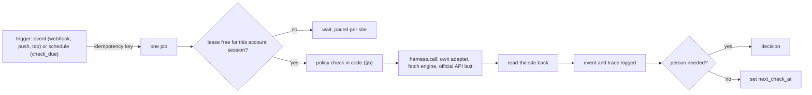

| Part | Rule |
|---|---|
| Job | every trigger becomes one `job` row with an idempotency key; a repeat trigger joins the running job; workers pull rows with `FOR UPDATE SKIP LOCKED` (no pg_cron or pgmq on Lakebase, [settled](../research/data/nate/open-items-settled-databricks.md)) |
| Agent step | each kind runs one durable agent step whose tools are the 14 verbs plus guarded writes; `delist` and `reconcile` are deterministic and get none |
| Lease | one job drives an account's session at a time; a second job for the same account waits; each site has its own pace (requests per minute, quiet hours) set in the adapter manifest |
| `next_check_at` | one column, set from state by one hazard tuner whose priors are the `param` rows below, set to now by any event; `check_due` picks rows whose time has passed |
| Policy | the §5 check runs in code before every outward verb; a model never decides it |
| Trace | one MLflow trace per job, tagged with `route`, `fell_back`, `ms` |
| Marketplace write | every outward verb that changes a site (`post`, `revise`, `end`, `relist`, `send_message`, `answer_offer`, `make_offer`, `save`) runs as a durable step keyed by an `operation_id` in Lakebase, then a read-back. An interrupted ordinary tool call settles as outcome-unknown and is never re-run blind; reconcile reads the site to settle it ([flue-agent-harness.md](../research/cross-cutting/nate/flue-agent-harness.md)) |

| Row state | Next check (hazard priors in `param`, tuned by what changes) |
|---|---|
| listing with a pending offer, or conversation awaiting our reply | minutes |
| conversation awaiting the buyer | 15 to 60 min |
| live listing with recent views or watchers | 1 to 2 h |
| quiet listing | 6 to 24 h |
| want with matches that moved in price | 5 to 10 min (the watch decision) |
| want with no movement | hours |
| any event on the row | now |

Framework, open (§9), facts from [flue-agent-harness.md](../research/cross-cutting/nate/flue-agent-harness.md) (*observed*): Flue in TypeScript, with Lakebase through `@databricks/lakebase` and MLflow traces, where the store is ours and the Lakebase, MLflow and browser adapters are ours to write and keep; or Databricks' own Python agent server (DurableAgentServer), which gives idempotent invocation ids, ordered sessions and heartbeat recovery with no app code, in Python only, on a Databricks-managed store that is not the product's Lakebase project ([words](../product/words.md#2026-11-14-nate-a-safety-layer-and-a-framework-like-flue)). What decides it: which holds a cloud browser session through a slow site for minutes and resumes after a restart; which writes one MLflow trace per job without glue; and which lets the harness verbs and `claim_check` be plain code tools. The lean (J2, *agent proposal*) is DBOS on Lakebase: durable steps in the product's own Postgres, the same `job` rows and `operation_id` keys; a one-site trial against each option on `read_inbox` then `send_message` settles it.

### Source router (*agent proposal*)

Every outside read goes through `route_table` and writes a `route_call` ([data](features/data.md#source-registry-and-router-agent-proposal)).

| Rule | Value |
|---|---|
| Order | own adapter, then the fetch engine, then an official API or aggregator ([words](../product/words.md#2026-11-14-nate-our-own-protocol-official-apis-last)); within a kind, cost per useful result |
| Learning | each call updates its route's `success` Beta `param` in the same transaction; a breaker opens after 3 straight failures ([data](features/data.md#source-registry-and-router-agent-proposal)) |
| Exploration | a `param` share of reads (prior 5%, capped per day on paid routes) tries another eligible route, so `route_truth` stays current |
| Ceilings | cost and latency per call, as `param` rows |
| Recovery | a retry by `call_id` costs nothing |
| Provider error | no cost recorded; no fallback on any other 4xx |
| Health | `GET /v1/sources/health` (§7); `route_probe` keeps it fresh |

### Real-time weights (*agent proposal*)

Every weight, threshold, prior and hide rule is a `param` row (§3), read through a 60 s cache and updated from observed outcomes, never hardcoded ([words](../product/words.md#2026-11-14-nate-a-general-scoring-feature-and-real-time-algorithms)). Data owns the registry ([data](features/data.md#real-time-weights-agent-proposal)); each determinations card names which of its values are `param` rows and which stay fixed.

| Step | Rule |
|---|---|
| Sources | three, each an `observation` with evidence and a weight for how sure its outcome is: every listing the protocol reads on a site and what changed when it was read again (price or rank change, sold mark, a disappearance, never a sale in a price or a comp (market-insight M3), entering only the money D10 hazard as a fractional sale weighted by P(sold | vanished, site, kind, age), learned on sites that show sold marks and held at 0 on Facebook until a hand-checked sample sets it), giving outcomes at market volume from day one; what platforms and industries publish (ranking statements, fees, retail and brand data, price history, trends), gathered by the information engines; our own users' outcomes, the most exact rows, which calibrate the rest. Learning does not wait for our users ([words](../product/words.md#2026-11-14-nate-the-engine-learns-from-the-whole-market-not-only-our-users), [marketing-engine §3](marketing-engine.md)) |
| Read | through a 60 s cache; a scope with little data reads its parent scope (partial pooling) |
| Update | conjugate, in the same transaction as the outcome event that informs it (a sale, a market listing's change, a reply, a route call, a label), scaled by the observation's weight, with a forgetting factor of about 30 days |
| Fold | `param_fold` runs nightly or weekly from Delta and writes challengers for what a conjugate update cannot hold (comp weights, ranker features) |
| Promote | a challenger replaces the champion when its backtest beats it by more than the bootstrap noise; a person's approval stays the guard where the card asks for one |
| Explain | every `citation` carries `param_versions{}` and `model_version` |
| Guard | comp weights move at most ±50% from their prior; Beta means stay in [0.02, 0.98]; a move over 2 SE raises a drift `anomaly`; a site's layout change (adapter version bump) sets `frozen` on that site's rows until its fixtures pass |
| Roll back | one UPDATE sets the previous version back to `champion` |

Fixed and never learned: fees, site minimum offer discounts, title and photo limits, locked actions, recall and legal flags, the floor the person set, never relisting on Poshmark, and never inferring condition, size or authenticity ([marketing-engine](marketing-engine.md) §3.4). A check fails on a numeric literal in a scoring path that is not one of these.

### Information engines (*agent proposal*)

Two layers sit under one registry, `route_table` ([words](../product/words.md#2026-11-14-nate-search-and-information-engines-beside-the-protocol)): the site protocol (the harness above) for the five marketplaces, reads and writes; and information engines for everything else on the open web that market research needs: retail and brand pages, price history, reviews, forums, release and trend sources, archives.

| Part | Rule |
|---|---|
| Gatherer | a pipeline that takes a question or a product, fans out to its sources in parallel, de-duplicates (the same item on several pages collapses to one), and writes each find as an `observation` with `evidence` and a `route_call` |
| Built on | Firecrawl for search, crawl and extract; treg for the long tail of data providers; each a `route_table` row with `layer: engine`, measured like any route |
| Reference | ThriftX shows how a gatherer is built: fan-out across sources, a scraping proxy, the same item collapsed ([settled](../research/watch/nate/open-items-settled-sites-and-rivals.md)). It is a reference, not a site we read |
| Deadline | every fan-out has one; results stream to the job's events as they arrive; a source that misses the deadline is recorded as late, not waited on |
| Standing index | what was already gathered is kept; a repeat question is answered from it at once and only a live delta is fetched (sources whose `next_check_at` has passed) |
| Storage | change only: a page whose fingerprint has not changed writes no new snapshot, only a `seen_at` |
| Budgets | per source: calls per minute and cost per answer, as `param` rows; a source over budget is skipped and named in "What we considered" |

Time budgets (§8): a research answer shows its first cited findings within 3 s and settles within 20 s (`answer.settled`), and any wider gather continues after that as a background job (`gather_request`, [intelligence-api](engines/intelligence-api.md#35-gathering-more)); a repeat question answers from the standing index in under 1 s with its live delta within 5 s; a search meets the search row in §8.

### Public API (*agent proposal* on the shape; public by Nate's [words](../product/words.md#2026-11-14-nate-the-search-engine-is-an-api-no-feeds-no-tax-service-tags-on-retouched-photos))

| Item | Value |
|---|---|
| Tools | `search`, `product`, `compare`, `history`, `trends`: the §7 endpoints, also as MCP tools and described in `llms.txt` |
| Edge | keys and rate limits at the front door |
| Rows served | only rows where `rights.may_share` holds |
| Never served | people's listings: no feeds, secondhand is not a storefront |

### The proof layer (*agent proposal*)

Every fact carries `evidence`, every number shown is a guarded number with a `citation`, and everything sent out passes a `claim_check` ([words](../product/words.md#2026-11-14-nate-provable-and-features-for-databricks)). [databricks.md](databricks.md) calls these an assertion, an observation and a manifest; this spec's names win.

| Layer | What it does | Where it lives on Databricks |
|---|---|---|
| Collection | every attribute and comp written with `evidence`; every page read kept as a snapshot with a fingerprint | Volumes (snapshots, capture files), Delta (comps, attributes history), Zerobus or jobs for ingestion |
| Analysis | numbers computed from defined metrics; `ranker_model`, `score` and the axes fitted; drift and change detected | metric views, Lakeflow jobs, MLflow (runs, champion and challenger aliases), UC model registry, data profiling |
| Governance | `rights` tags carried with each row; history kept so any number can be recomputed as of its date | Unity Catalog tags and lineage; table history retention raised above the 7 day default, or append-only snapshots |
| Output | a guarded number with `citation_id` reaches the phone; hidden numbers say why; `claim_check` gates messages and listings | Lakebase (current guarded numbers, `claim_check` rows), the `/v1` API, MLflow traces |

Guard rules: a number whose basis is thin (`too_few`, `stale`, `source_gap` or `noise`) first starts a `gather_request` to the intelligence engine, which widens the search as a background job; meanwhile the number is still given, from the next step of its fallback order ([intelligence-api §3.5](engines/intelligence-api.md#35-gathering-more)). **The system always answers** ([Nate](../product/words.md#2026-11-15-nate-the-system-always-prices-with-fallbacks-and-its-power-is-what-it-weighs-in-real-time); *agent proposal* in its detail, engines lead 2026-11-15): every engine that shows a number has a stated fallback order, and for a price it is variant, product, family, kind, then the prior ([valuation §3](engines/valuation.md)). The levels blend rather than switch, each weighted by its own evidence, the range widens by that level's measured misses, and the answer names its `basis_level`. Below [money D1](determinations/money.md#d1-comparable-set-and-weights)'s basis (`n_eff` of 6, a `param`, and 2 sold in 90 days; the range itself is [D5](determinations/money.md#d5-fair-value-range-overall-and-per-site)) the range comes from the next level, named, with the sales shown beside it. `too_few` and `too_wide` are then notes on a shown number, not reasons to hide it. A number is `hidden` only when no level can state it honestly (`source_gap` or `conflict`). A threshold decides only whether the system acts without asking, is read on evidence pooled from the parent scope where a scope is thin, and never makes the system wait for a count to fill. Once shown, 5 to 9 low, 10 to 29 medium, 30 or more high; a series older than 2 weeks is dropped ([databricks.md](databricks.md)); an asking range on fewer than 6 listings is hidden ([market-intelligence.md](../research/data/nate/market-intelligence.md)). The kill test: recompute 20 shown numbers from their citations a week later and match them exactly.

Sources: any source on the open internet may be used for this build (marketplace pages, price-history sites, retail and brand pages, archived pages, trend sources); each observation records its source and `rights` tags in its `evidence`, and a source's terms are listed as facts ([words](../product/words.md#2026-11-14-nate-open-source-onto-databricks-and-open-internet-sources)).

Where `claim_check` runs, facts from [evidence-gate.md](../research/messages/nate/evidence-gate.md) (*observed*): a Unity Gateway service policy on a model service evaluates the whole response before it returns, so it is the release-time hook; service policies are Beta behind a preview opt-in, and their built-in judges are non-deterministic. No platform feature checks an output's claims against catalog tables (lineage is table and column level), so the claim split and the match to attribute and evidence ids are our code. MLflow judges run on stored traces after the response is sent: they audit the gate, they do not hold anything.

### Model allocation

Image judgements and text judgements are separate parts of the harness, and the provider for each stays open ([decisions](../product/decisions.md#2026-11-14-image-decisions-and-text-decisions-are-separate-and-the-provider-for-each-stays-open)). Each starts where the [typed judgements decision](../product/decisions.md#2026-11-14-typed-judgements-run-on-both-the-decisions-api-and-jev-and-our-labels-pick) puts it, and labels from taps pick what stays.

| Side | Judgement | Starts on | Note |
|---|---|---|---|
| Image | shot accepted, view missing, defect present, tag readable | OpenAI Decisions API | typed yes, no or score |
| Image | masks, read text, depth and pose | specialist vision models | outputs are `capture` refs |
| Image | identity by look | image vectors from a GPU endpoint | indexed in AI Search as self-managed embeddings ([settled](../research/data/nate/open-items-settled-databricks.md) row 28) |
| Image | studio relight | Seedream 5.5 | not on the gateway; real photos always kept; provider open |
| Image | talk mode | a live video model | shares the shot list ([decisions](../product/decisions.md#2026-11-14-capture-opens-on-the-guided-shot-list-talk-mode-is-one-tap-away)) |
| Text | buyer message intent, scam risk, does a listing match a want | Jev beside a Decisions API run | Jev untested here; labels pick |
| Text | investigate an item | Claude Opus 5.5 | through the gateway |
| Image and text | listing copy written from the photos | Claude Haiku 5.5, Sonnet 5 or Opus 5.5 | these take image input; Sonnet 5.5 is text only ([settled](../research/data/nate/open-items-settled-databricks.md) row 19) |
| Text | reply drafts | Claude Sonnet 5.5 or Haiku 5.5 | in the seller's voice; a reply whose intent is `other` drafts on Sonnet 5.5 |
| Text | routing, short classification | Claude Haiku 5.5 | |
| Code | money, units, limits, permissions, state changes, fees | plain code | never a model |

## 7. Contract conventions

The frame's shapes are binding: ids `it_`, `ls_`, `job_`, `dec_`, `ord_`, `want_` (this page adds `q_` (a capture question, `q_<capture_id>_<field or step>`), `cap_`, `ph_`, `att_`, `pr_`, `cmp_`, `val_`, `st_`, `cv_`, `msg_`, `of_`, `ru_`, `mt_`, `ap_`, `gl_`, `ev_`, `rec_`, `acc_`, `lb_`, `sr_`, and for the proof layer, score and market `ci_`, `sc_`, `rk_`, `ro_`, `ex_`, `arm_`, `nt_`, `rq_`, `cc_`, `vi_`, `fo_`, `rc_`, `ps_`, `mm_`, `ip_`, and for assist `in_` (intent), *agent proposal*); [log/example.mjs](../log/example.mjs) writes `jb_` and moves to `job_`. Money `{amount_cents, currency}`; ISO 8601 UTC times; provenance `{value, unit?, source, confidence, evidence[], confirmed}`; range `{low, high, basis_count, as_of, per_site}`, worded per [copy.md](../product/copy.md); a shown number wraps either in the guarded number shape (§3), so it also carries `citation_id`, `state` and `hide_reason`.

### Requests

| Rule | Shape |
|---|---|
| Auth | `Authorization: Bearer <token>` from the front door (§6). The API derives `user_id`; a client never sends it. Endpoints marked "visitor allowed" take no token: the edge assigns a `visitor` session and rate limits it. |
| Idempotency | `Idempotency-Key` on every POST that creates or acts. The same key and body return the stored response for 24 h; the same key with a different body is `409 idempotency_mismatch`. Outward site actions use the key as `operation_id`. |
| Versions | Every resource has `version`. A write sends it; a stale one is `409 stale` with the current resource. |
| Pagination | `?cursor=&limit=` (limit at most 100). Response `{data: [...], next_cursor}`; `null` when done. Order is newest first unless named. |
| Tracing | `X-Request-Id` in and out; responses include `trace_id` where a job ran. |

### Resources

| Endpoint | Does |
|---|---|
| `POST /v1/captures`, `POST /v1/captures/:id/photos`, `PATCH /v1/captures/:id {type}`, `POST /v1/captures/:id/finish`, `GET /v1/captures/:id` | open a session (returns the suggested type, the picker order and `process[]`), get upload targets, change the type (*agent proposal*), finish (returns the research jobs), read a capture with its derived `plan` |
| `GET /v1/items`, `GET /v1/items/:id`, `PATCH /v1/items/:id` | items by state; the full item card; edit title, location, quantity, cost |
| `PATCH /v1/items/:id/attributes/:name` | the person corrects a fact (stored as `you_said`, confirmed) or unpins it (`confirmed: false`, logs `attribute.unpinned`) |
| `POST /v1/items/:id/sell` | "Sell this" on an owned item |
| `POST /v1/valuations` | value an item, a capture or an outside URL; returns a `valuate` job |
| `POST /v1/items/:id/strategy` | pick a strategy and set limits |
| `POST /v1/items/:id/listings` | post to sites; returns a `post` job; the first post opens a decision unless promoted |
| `GET /v1/today` | Today: open decisions in order, with counts |
| `GET /v1/decisions?state=open`, `POST /v1/decisions/:id/act` | answer one |
| `GET /v1/conversations`, `GET /v1/conversations/:id/messages`, `POST /v1/conversations/:id/messages` | messages; a person's own reply |
| `GET /v1/orders`, `POST /v1/orders` (kind purchase: Bought it), `GET /v1/appointments`, `POST /v1/orders/:id/handed-over` | sales, purchases, pickups and ship-by |
| `POST /v1/orders/:id/ship {insure_cents?}`, `POST /v1/orders/labels {order_ids[], layout}`, `GET /v1/orders/pick-list` | buy one label (fills `order.label`); a batch of labels on one sheet; what to pull and pack today |
| `GET /v1/records?tax_year=&format=csv|pdf` | the tax report: sales, costs and fees for the year; tax shown is a labelled estimate (§8) |
| `GET`, `PUT /v1/limits`; `GET /v1/rules`; `POST /v1/rules {from_decision_id}` or `{kind, scope, limits}`; `DELETE /v1/rules/:id` | You > Automation and You > Pickups; one rule system, read as when, if, then; a locked kind returns `403 locked` |
| `GET /v1/events?item_id=&cursor=`, `POST /v1/events/:id/undo` | the one source for the log and the "why?" timeline: `{event_id, item_id, action, actor, at, why, trace_id, undo: {allowed, until}}`; there is no `/why`, `/v1/log` or `/v1/actions` |
| `POST /v1/wants`, `GET /v1/wants`, `GET /v1/wants/:id`, `PATCH /v1/wants/:id {state, text, fit, max_total_cents, sites, schedule, alert}`, `GET /v1/wants/:id/matches`, `POST /v1/matches/:id/act {action: dismiss, save, not_same, bought}` | Buy: create, read, pause, end and edit a want; its matches. `GET /v1/wants` carries checked {site: at} and behind[] (sites whose monitor is late) |
| `POST /v1/assist {surface, text, item_id?, want_id?, capture_id?, context_ref?}` | the assistant reads a sentence; returns `202 {id, kind, state, stages[]}` for an `assist` job ([assist](features/assist.md#contract-for-the-frontend)) |
| `POST /v1/search {text?, photo_id? or upload, url?, filters?, like?, assist_job_id?, answers[]?}` | search across sites by text, a photo or a link (a photo cannot ride a GET); `filters {condition[], seller_kind[], ships_to?, ships_from?, max_delivered_cents?, in_stock_only?}`; a visitor's span answers come as `answers[] {span_id, option_id, signature, edit?}`; batches are `{product, results[] (offer_view), official[] (retail_offer), sites_pending[]}`; returns results or a `search` job; a visitor may call it without a token through the edge, rate limited (`429 rate_limited`) |
| `POST /v1/compare {url or match_id}` | one listing against the product's other offers; visitor allowed |
| `GET /v1/products/:id` | a product page: identity, price history across retail and used markets, hype and trend, each a guarded number, and an `offers` block (`offer_view` rows); visitor allowed |
| `GET /v1/products/:id/history?range=`, `GET /v1/trends?category=&window=7d\|30d`, `GET /v1/index/:id` | price history, trends by category, an index; visitor allowed ([market](features/market.md)) |
| `GET /v1/out?listing=` | the one referral link-out (it replaces `POST /v1/referrals/click`): writes `referral_click`, returns `302` to the site URL with its referral tag; visitor allowed |
| `POST /v1/genie` | full users only: a question in words; returns the answer, its SQL and rows |
| `GET /v1/sources/health?site=&need=` | each route's health from `route_truth` (§6 Source router) |
| `POST /v1/follows`, `GET /v1/follows`, `PATCH /v1/follows/:id {muted}`, `DELETE /v1/follows/:id` | follows; full users only |
| `GET /v1/scores?subject_type=&subject_id=` | the `score` rows per axis and site, each a guarded number, hidden ones with `hide_reason`; p95 under 1 s on a warm store ([score.md](features/score.md)) |
| `GET /v1/scores/:id/basis` | the citation and its basis as one line ("from 41 sales in 90 days") |
| `GET /v1/sites/:site/ranker` | the open `notice` for a site, if any, and the panel's age |
| `GET /v1/citations/:id` | what a number rests on: metric, filters, table versions, basis ids |
| `GET /v1/experiments`, `POST /v1/experiments/consent {on}` | experiments a person's listings are in; the consent switch sets `user.experiments_consent`; joining one test is a `join_experiment` decision |
| `POST /v1/accounts`, `GET /v1/accounts`, `POST /v1/accounts/:id/import`, `DELETE /v1/accounts/:id` | connect a site (returns an eBay OAuth URL or a one-time sign-in link to a page we host); health; `import` and `unlink` jobs |
| `GET /v1/insights`, `PUT /v1/goals/:month` | You numbers, By site, goals; insights adds `funnel[], stale[], profit_by[], pnl, slow_movers[], sell_down, cohorts[], reliability[], anomalies[], promotion[]` ([insights](features/insights.md)) |
| `PATCH /v1/me {onboarding_step?, notification_pref[]?, push_token?, tutorial_seen?}`, `POST /v1/me/export`, `DELETE /v1/me` | mark the capture tutorial seen (*agent proposal*); `export_user` and `delete_user` jobs |
| `POST /v1/auth/apple {identity_token, nonce, name?}`, `POST /v1/auth/google {id_token}`, `POST /v1/auth/email/start {email}` (202), `POST /v1/auth/email/verify {email, code}`, `POST /v1/auth/refresh {refresh_token}`, `POST /v1/auth/signout` | app sign-in (*agent proposal*, [packet 47](../.agents/team/packets/team/47-what-the-pages-need-from-the-backend.md)); returns `{access_token, refresh_token, expires_at, created, user {id, auth_methods[], onboarding}}`; no token taken except signout. Shapes: [examples](examples/) |
| `POST /v1/auth/link/apple`, `POST /v1/auth/link/google`, `POST /v1/auth/link/email` | add a second sign-in method; returns `auth_methods[]` (*agent proposal*) |
| `GET /v1/routes` | the manifest: for each endpoint, its method, whether it needs a session, and whether it answers from its engine or from its example, so the app's client knows what is real (*agent proposal*) |
| `GET /v1/me` | the user plus `auth_methods[] {provider, linked_at}`, `onboarding {done_steps[], finished_at?, next_step?}`, `last_open_at` (*agent proposal*) |
| `GET`, `PATCH /v1/me/style` | the `style_profile`; PATCH takes `facets[] {name, value, weight?, pinned?, remove?}` and sets `from: edited` (*agent proposal*) |
| `GET /v1/items/:id/plan-choices` | each of the five `plan_choice` values with `objective`, `days {lo, hi}`, `you_keep_cents` and a citation, plus `sold_by_site[]` ranges (*agent proposal*) |
| `GET /v1/accounts/:id/import-preview` | the site's listings before import: `{external_id, title, price_cents, photo_url, state, matches_item_id?}` (*agent proposal*) |
| `POST /v1/captures/:id/talk` | a realtime talk-mode session: `{transport, client_secret (ephemeral), expires_at, session_url, first_line}` (*agent proposal*) |
| `GET /v1/jobs/:id`, `GET /v1/jobs/:id/events` | one job |
| `GET /v1/stream` | one SSE stream per signed-in user: `decision.open`, `decision.answer`, `decision.close`, `state.change`, `message.new`, `job.state`, `job.stage`, `score.change` (a score's value or state changed) |

Fields the pages need, added 2026-11-14 (*agent proposal*, [packet 47](../.agents/team/packets/team/47-what-the-pages-need-from-the-backend.md); shapes in [examples](examples/)): `user` gains `last_open_at`, `onboarding {done_steps[], finished_at?}` (steps `signed_in`, `sites_picked`, `sites_linked`, `imported`, `email`, `pickups`, `notifications`), `push_token_ref` and `auth_methods[]`. `limits` per item gains `plan_choice` (`sell`, `fast`, `best`, `reserve`, `check`), `gone_by?`, `fallback` (`ask`, `donate`, `keep`, `trade_in`, `relist`; relist never on Poshmark), `markdown_on`, `review_at?`, `accept_mode` (`auto`, `ask_all`). `listing` gains `market_standing {word (hot, on_pace, slow, stuck, still_learning, waiting_for_price), place {rank, of, basis}, outlook {days_lo, days_hi}, fix? {change, points, action_id}, citation_id, state}`, sent on `score.change`. `decision` gains `group_key`, `group_rank`, `group_form` (`batch`, `queue`). `GET /v1/today` gains `headline {kind, value?, label, sub, citation_id, state}`, kind one of `earned_week`, `earned_month`, `kept_since_last_open`, `on_its_way`, `goal`, `could_earn`, `worth`, `watching`, `next_setup_step`, `none`. `GET /v1/items` rows gain `needs_you {count, top_kind}`. A push carries `{kind, decision_id?, item_id?, path}`. `GET /v1/jobs/:id/events` is open to a visitor for their own search job. New id prefixes: `usr_`, `opt_`, `act_`, `sp_`, `vis_`, and `fc_`. The decision kind for a stale account stays `relink`; `account_stale` is the event that raises it.

### Jobs and the event stream

A long call returns `202` with `{id, kind, state, stages:[{name, state, started_at, ended_at}], result?}` at once. `GET /v1/jobs/:id/events` streams SSE frames carrying events.json `job.state` and `job.stage` payloads, each with an `id` so `Last-Event-ID` resumes; a heartbeat comment every 15 s. `GET /v1/jobs/:id` returns the same shape for polling, every 2 s. Every stage carries `found{}` (*agent proposal*): real counts of what the stage considered, as `{sources_searched, results_found, results_used, dropped_by_reason{}, sites{}}` with only the counts that stage has, built from `route_call` and `citation` rows, never estimated; each `job.stage` event streams the counts as they grow, and the frontend shows them one tap from the result as "What we considered". How the counts move on screen is Ben's. Job states and stage states are the §4 names, the same in stream, log and [frontend-standard.md](../product/frontend-standard.md). `message.new` and `score.change` are stream-only today. Build tasks for [events.json](events.json): log lines for `message.new` and `score.change`; `studio.*` events from [studio.md](features/studio.md); `double_sale`, `claim_reply` and the `cancel_reason` field from [sold.md](features/sold.md). SSE through the Apps proxy is untested, so polling must always work.
The identify and valuate job streams also send one `fact.found` frame per attribute while the camera is open, `{job_id, capture_id, attribute {name, value, source, unknown_reason?}}`, a null value with its reason for a fact that could not be found, and the comp count as it grows on `job.stage` (*agent proposal*, [packet 47](../.agents/team/packets/team/47-what-the-pages-need-from-the-backend.md) 6b). The intelligence engine adds `answer.partial`, `answer.settled`, `answer.late` and `gather.update`, each carrying the whole `answer` ([intelligence-api](engines/intelligence-api.md)).

Watch has two event layers (*agent proposal*, from [Ben's plan](../.agents/team/packets/price/21-pricing-search-watch-plan.md)). The page monitor emits `listing.new`, `price.drop`, `listing.gone`, `monitor.behind` and `monitor.recovered`: what changed on a site's pages, before any matching. Above it, watch emits `watch.ran`, `match.found` and `match.alerted`, which are about a person's want. `monitor.behind` adds its site to behind[] on `GET /v1/wants`, and `monitor.recovered` removes it. The monitor events go into events.json as a build task.

Assist has one event set (*agent proposal*, [assist](features/assist.md#contract-for-the-frontend)), into events.json as a build task: `assist.parsed`, `assist.assumed`, `assist.answered`, `assist.left`, `assist.defined`, `assist.scored`, `assist.dropped`, `assist.blank`, `assist.filled`, `assist.stale`. Its thresholds are `param` rows (§3).

### Decisions and the act endpoint

`POST /v1/decisions/:id/act` takes `{option_id, signature, version, edit?}`. The signature is an HMAC over decision id, option id, version and user, valid 15 minutes. It returns `{decision, event_id, job?}`; the decision is `acting` while its job runs, then `answered` or `failed`. An `edit` marks the answer edited, so it does not count toward promotion. A decision whose item or offer changed returns `409 stale` with its replacement. The policy check reruns on act, so a signed option cannot outlive a lowered limit.

### Errors

`{code, message, failed_step, retry}`, with `retry` as `{by: "auto" | "user" | "none", after_s?}`. `message` is for logs; the app words failures per [copy.md](../product/copy.md).

| HTTP | code | When |
|---|---|---|
| 400 | `invalid` | bad shape |
| 401 | `unauthenticated` | no or expired token |
| 403 | `locked` | a locked kind attempted without the person's tap, or promoted |
| 404 | `not_found` | not this user's, or gone |
| 409 | `stale`, `idempotency_mismatch`, `site_no_undo` | version or key conflict; undo past the site's limit |
| 422 | `outside_limits` | an action the policy check refused |
| 429 | `rate_limited` | ours or a site's; `after_s` set |
| 502 | `site_failed` | the site refused or did not read back |
| 503 | `waking` | before this process has served its first request: Lakebase or a job is starting; retry by auto |
| 503 | `unavailable` | after the first request: a dependency or the handler failed; retry by auto |

## 8. Cross-cutting requirements

| Area | Requirement |
|---|---|
| Logging | One logger in [log/](../log/README.md); [events.json](events.json) is the contract; a new event goes into it and `log/example.mjs` first; the Swift module sends events to JS; logs carry ids, never message text, addresses, tokens or payment details ([5-logging.md](../.agents/team/packets/team/5-logging.md)). Capture's events (started, mode_picked, shot_kept, view_asked, talk_started, talk_fell_back, uploaded, finished) go in as a build task. |
| Data classes | Highest: marketplace tokens and cookies. High: home address, raw room photos and scans (deleted after cutouts unless kept), buyer name and address (short cache, deleted when the order closes or on an eBay deletion notice), buyer message text (kept for a set retention period, then deleted). Medium: saved spot, pickup hours, buyer reference hash, traces (short retention, scanned for text). Low: prices, item facts. Listing photos have EXIF stripped; raw GPS stays on the device ([privacy-and-data.md](../research/cross-cutting/nate/privacy-and-data.md) §12). |
| Personal inference | An inferred size or taste is personal data: shown in You and editable ([analytics-and-recommendations.md](../research/data/nate/analytics-and-recommendations.md)). |
| Disclosure | California's bot disclosure law (asserted) and buyer trust both point to disclosure; a seller is liable for the agent's promises (Air Canada ruling, asserted). The choice is Open (§9). Agents never promise anything a limit does not allow. |
| Certainty (*agent proposal*, the lead's reading of [words](../product/words.md#2026-11-14-nate-certainty)) | Certain wherever more information can make it so: identity, variant, size, measurements and visible condition are resolved (read the label, search, one more view, one tap) and then stated plainly as confirmed, never shown as a percentage; capture's `requirement` rows say what is still missing. Honest about what no capture can settle: what it will sell for and how fast (a range), authenticity, whether it works, hidden condition, and what a marketplace will do. |
| Proof | Every fact carries `evidence`; every number shown is a guarded number with a `citation`; anything sent out passes a `claim_check` (§6 proof layer). |
| Safety screening | Before anything leaves, `claim_check` splits the text into claims and holds any claim no attribute or evidence backs (decision `unbacked_claim`). Before any reply: buyer and page text is data, never instruction; off-site payment, overpayment, code and label requests are flagged as scam risk and become decisions; listings are screened for each site's prohibited items; studio edits may clean up, never hide wear, change colour or add accessories. |
| Evaluation | A real-item set of household things across clothes, shoes, electronics, furniture and small goods, each with a tape measure, the tag read by hand, and its eventual sale price. Measured: identify exact-match rate; measurement error in cm per attribute; share of sold prices inside the shown range; time from ＋ to live; edit rate on drafts and replies; Jev against the Decisions API on labelled messages; delist delay after a sale; reconcile mismatches per day; any auto action outside limits (the bar is zero). Model self-confidence is never the measure. |
| Honest analytics | "Based on N sales from <dates>"; "Asking prices of N live listings"; "N people are watching"; "Sold N days after you listed it". Below money D1's minimum basis, show the sales, not a range; under 6 live listings, no asking range (§6 guard rules). Asking sits above sold, and sold-only data has survivorship bias. Sites that hide sold data give only listings we saw disappear, which undercounts. Never sum sites as if complete. Own-listing views only where the site gives them (eBay). Closed marketplaces have no search volume; proxies are watchers, likes, sell-through and in-app saved searches. |
| Sell-through | One definition, owned by [M6](determinations/market-insight.md#m6-sell-through) (*agent proposal*): of the listing clusters first seen 60 to 31 days ago, the share sold within 30 days of first seen, over eBay, Poshmark, Mercari and Depop (Facebook excluded); hidden as `too_few` under 10 clusters and as `source_gap` under 2 of those 4 sites; in the first 60 days the stock form sold/(sold+active) is shown, labelled as such. A card that needs sell-through reads this one (§9) |
| Shared market data | Before any aggregate leaves a person's account, the [M20](determinations/market-insight.md#m20-making-an-anonymous-dataset-safe-to-share) contributor rule, starting values: no person ids, handles, urls or photos; at least 10 distinct contributors per cell; a cell where one contributor makes over 50% is dropped; complementary suppression so a dropped cell cannot be derived; counts rounded to 5; time no finer than a week under 50 contributors |
| Tax | No paid tax service ([words](../product/words.md#2026-11-14-nate-the-search-engine-is-an-api-no-feeds-no-tax-service-tags-on-retouched-photos)): a delivered price shows tax as a labelled estimate; the rate is a placeholder (§9) |
| Speed (*agent proposal*) | First value: a rough band within 2 s of the first photo, the Check within 10 s, identify p50 at most 9 s. Search: p95 3 s to the first batch, 10 s to the last site, under 1 s from the warm index, highlights within 1.5 s. Draft: scores p95 1 s; D1 recomputes at most once a minute while editing. Reply: within 60 s, offers by rule. Product page: p95 1.5 s from the snapshot, the live delta within 5 s. Research answer: first cited findings within 3 s, complete within 20 s (§6 information engines). Delist: p95 under 2 min, red at 5 min, a pre-emptive hold on every other site the moment a sale is seen; delist is the first job built |
| Approximate or exact | Approximate is shown and labelled for: first value, search order, time to sell (a range until `n_eff` reaches 6), measurements (with ±). Never approximate: an automatic counter or accept, condition, size or authenticity (J20), delist |
| Account risk | Every automated action on a person's account shows that site's account risk; sharing and offers to likers run at the pace the engine finds best ([listing D26](determinations/listing-and-marketing.md#d26-engagement-levers-the-agent-runs-on-its-own)); automation on real accounts may be left out of the demonstration (Nate, same words) |

## 9. Open for Ben and Nate

| Question | Ben | Nate | Recommendation (*agent proposal*) | Depends on it |
|---|---|---|---|---|
| The harness decision says outward actions run "after the user's tap"; the newer decisions let buyers be handled inside limits and pickups be booked inside hours without one. Does "after the user's tap" now mean only the first post and the locked kinds? | the harness decision, then the newer [buyers](../product/decisions.md#2026-11-14-buyers-are-handled-inside-limits-you-set-then-it-learns) and [pickups](../product/decisions.md#2026-11-14-the-agent-books-pickups-inside-your-hours) decisions | the same decisions | the newer decisions govern; this page is written that way | list, messages, sold, replay |
| A harness acts on a person's real account, and the risk is shown per site (§5). What pace per site, and does each site need its own opt in? | not answered | Nate's proposal: "we build one" where a site has none ([words](../product/words.md#2026-11-14-nate-frameworks-and-goals)) | opt in per site with the risk shown; pacing per site in the lease; the first post asks on Poshmark and Mercari | list, messages, sold, connect |
| Buy offers: the agent sends them, or asks each time? | not answered | picked "Also negotiate for me" inside a ceiling ([words](../product/words.md#2026-11-14-nate-store-and-buying)) | ask every time until Ben answers; an eBay Best Offer binds (asserted) and eBay bans buy-for-me agents without human review | buy, watch |
| Save or like on the site when a match is saved? | not answered | yes, cart or like per site ([words](../product/words.md#2026-11-14-nate-store-and-buying)) | ask; Poshmark's guidelines ban automated likes, so its account risk is shown before a like | buy, watch |
| Dibs against paid | not answered | not answered | paid wins; the dibs buyer is told at once and kept next in line | sold, messages |
| Monthly goals | not answered | Nate's proposal ([words](../product/words.md#2026-11-14-nate-frameworks-and-goals)) | keep in insights as a proposal | insights, today |
| Visitors who search without an account and are linked out | not answered | Nate's proposal ([words](../product/words.md#2026-11-14-nate-visitors-and-full-users)) | build it as market's visitor search behind the edge | market, front door |
| A general scoring feature (financial, quality, each site's algorithm, trends) | not answered | Nate's proposal ([words](../product/words.md#2026-11-14-nate-a-general-scoring-feature-and-real-time-algorithms)) | build it as score; show an axis only when its guard passes | score, price, list |
| A market anyone can learn from | not answered | Nate's proposal ([words](../product/words.md#2026-11-14-nate-a-market-anyone-can-learn-from)) | build it as market, with guarded numbers | market |
| Nate's other proposals not yet answered by Ben: private store, For you and save-sync | not answered | Nate's proposal (vision.md Proposed) | keep them in the specs as proposals | buy, connect |
| Studio photos and honesty | not answered | not answered | always keep the real photos alongside | studio, list |
| Tell buyers an assistant is answering? | not answered | not answered | natural voice, a short note on the first automatic message, honest if asked ([handled-by-default.md](../research/messages/nate/handled-by-default.md)) | messages, legal exposure |
| The front door | not answered | the event gives a full workspace ([words](../product/words.md#2026-11-14-nate-answers-on-the-databricks-file-the-workspace-and-feature-pages)); the search engine is a public API ([words](../product/words.md#2026-11-14-nate-the-search-engine-is-an-api-no-feeds-no-tax-service-tags-on-retouched-photos)) | the hosting probe: test option B on the real workspace; if it fails, the Next.js site is the edge (option A), which also carries the public API's keys and rate limits (§6) | everything that calls the API |
| Is the search engine's API public? | not answered | answered yes: "We will make the out perfroming industry and product search engine an available to call api." ([words](../product/words.md#2026-11-14-nate-the-search-engine-is-an-api-no-feeds-no-tax-service-tags-on-retouched-photos)) | §6 Public API | market, buy, front door |
| Do people's listings go out as feeds to assistants? | not answered | answered no: "we dont serve what we have placed on secondhand, as secondhand inst a storefront" (same words) | no feed; the API serves search only | market, buy, list |
| A paid tax service (Avalara or TaxJar)? | not answered | answered no: "We do not pay for a tax service" (same words) | a labelled estimate (§8) | buy, sold, insights |
| J11 in [open-questions.md](open-questions.md): is an AI tag written into or onto an exported photo? | "dont say it was made with ai. track on our end but for demo purposes we want it to just work before tinkering. worst case scenario is everything works beautifully but we cant post because we added an ai tag." ([words](../product/words.md#2026-11-14-no-ai-tag-on-exported-photos-track-it-on-our-end)) | "Ai tags on photos retouched, but not on ones taken." ([words](../product/words.md#2026-11-14-nate-the-search-engine-is-an-api-no-feeds-no-tax-service-tags-on-retouched-photos)) | not resolved here; `photo.ai_marked` tracks it in the app either way; studio Open 5 | studio, list |
| J12 in [open-questions.md](open-questions.md): retouch by default per site, or only when the person picks it? | no verbatim quote found; his packets set a per-site default level ([platform fit](../.agents/team/packets/list/31-platform-fit.md), [studio plan](../.agents/team/packets/studio/30-studio-build-plan.md)) | "make retouch a user select feature during the process of creating the listings" ([words](../product/words.md#2026-11-14-nate-the-best-way-to-take-every-photo-tags-delayed-retouch-chosen-by-the-person)) | not resolved here; studio Open 6, [studio](features/studio.md#retouch-chosen-by-the-person) | studio, list |
| Expo holds only if capture is fully possible in it? | Expo with a Swift camera module ([decisions](../product/decisions.md#2026-11-14-the-app-is-an-expo-app-with-a-native-swift-camera-module)) | Expo if every capture feature works as it would natively ([words](../product/words.md#2026-11-14-nate-expo-if-capture-is-fully-possible)) | Expo stands; the camera module test on object capture and LiDAR settles it | capture, measure |
| Which `rights` tags are enforced at a public launch, and by what (a UC tag policy, a query guard, both)? | not answered | licences do not shape the build ([words](../product/words.md#2026-11-14-nate-licences-do-not-constrain-the-build)) | record tags now on every comp; enforce through `guarded_query` plus UC tags at launch | price, market, score, data |
| Where marketplace sessions live (Keychain or server) | not answered | not answered | server vault, run in our own hosted browsers, with the stakes stated (answered by Nate: [words](../product/words.md#2026-11-14-nate-host-all-engines-ourselves-and-can-the-persons-own-device-do-the-work)) | connect, security |
| Is Sonnet on our gateway? | settled at source: Sonnet 5.5 is served, text only ([settled](../research/data/nate/open-items-settled-databricks.md) rows 19, 20) | | photo drafts on Haiku 5.5, Sonnet 5 or Opus 5.5; text on Sonnet 5.5 (§6 model allocation) | list, messages, appraise |
| How does secondhand earn (a fee, a subscription, a referral, paid data)? | not answered | Nate's proposal: buy-side referrals, and anonymous market data ([words](../product/words.md#2026-11-14-nate-referrals-and-market-data)) | your call; market data needs the privacy rules in §8 | pricing screens, data use, terms |
| The agent framework: Databricks' long-running agent server or a framework like Flue | not answered | Nate's proposal: "similar to flue perhaps" ([words](../product/words.md#2026-11-14-nate-a-safety-layer-and-a-framework-like-flue)) | lean DBOS on Lakebase (J2); trial on one site (§6 runtime) | the runtime, every harness |
| Score weights: may the axes combine into one score, and with what weights? | not answered | not answered | combine only when every axis is shown; weights per person's goal, shown | score, list, price |
| Visitor rate limits | not answered | not answered | per session and per IP at the edge; numbers set by load test | market, front door |
| The floor for a follow notification (how much a price must move) | not answered | not answered | a move outside the guarded range, at most one a day per follow | market, today |
| Experiment consent: per experiment, or once per person within a price floor | not answered | not answered | once per person: the standing switch `user.experiments_consent`, then each test a `join_experiment` decision (ask, never promoted), with the floor and budget shown | score, list |
| Table history kept for recompute: raise retention or keep append-only snapshots | not answered | not answered | append-only snapshots for comps and guarded numbers; the kill test in §6 decides | data, score, market |
| Sell-through: a 30-day cohort ([M6](determinations/market-insight.md#m6-sell-through)) or 90-day sold/(sold+active) ([D23](determinations/money.md#d23-sell-through-and-share-of-asking)) | not answered | not answered | M6, with the stock form as its labelled fallback (§8) | market, insights, price, score |
| Earned auto: 3 unedited approvals of one kind (§5), or 3 of 3 spanning at least 2 items ([card 18](determinations/managing-and-buyers.md#18-whether-an-action-kind-has-earned-auto)) | not answered | not answered | 3 of 3 across at least 2 items for kinds that are not per item, so one item's quirks do not earn a rule | data, today |
| A buyer's purpose and constraints captured for a search, and a used listing compared against a new official brand-sold option ([words](../product/words.md#2026-11-14-nate-a-suite-like-shopify-and-the-better-official-option)) | not answered | the request itself | now named: `intent` (assist) and `retail_offer` (§3); `POST /v1/compare` (§7) | watch, buy, market, assist |
| Shopify's product taxonomy as the spine for every kind (J19) | not answered | not answered | yes ([fields-by-kind](determinations/fields-by-kind.md)) | identify, capture, list |
| May an inferred value of medium importance go into a site's structured fields (J20)? | not answered | not answered | yes for search fields, never for condition, size or authenticity | list, identify |
| Several things sold together: one card for the lot or one per piece (J21)? | not answered | not answered | one card for the lot, pieces as parts | capture, price |
| Exploration traffic on paid routes (J22) | not answered | not answered | yes, a `param` share capped per day (§6 Source router) | data |
| Product page order: buy's shared order or score alone (J23)? | not answered | not answered | the same rule as search | market, buy |
| Poshmark share pace | not answered | "It can share and send offers however much is best." ([words](../product/words.md#2026-11-14-nate-the-search-engine-is-an-api-no-feeds-no-tax-service-tags-on-retouched-photos)) | the engine's pace, with the account risk shown (§8) | list, connect |
| The 7% tax placeholder | not answered | no paid service (same words) | keep it labelled as an estimate until a per-state table exists | buy, sold |
| Care label and fabric close-ups: conditional or always? | not answered | not answered | conditional on kind (inferred from [capture-shots](determinations/capture-shots.md); Ben's call) | capture |
| `clarify` is the one way of asking (§5, P5); assist catalog rows 54 to 67 against A2UI; visitors stored as counts only; inline marks or chips | not answered | not answered | as [assist](features/assist.md#contract-for-the-frontend) proposes; a bar tests marks against chips | assist, buy, market |
| May the score axes combine into one number? | not answered | not answered | four separate axes per site; a combined line only as expected net with its chance of sale ([score](features/score.md)) | score, price, market |
| May message text be kept in traces? | not answered | not answered | no: ids only, because traces have no per-trace delete ([data-use](data-use.md)) | messages, data |
| May shared models train on people's labels? | not answered | not answered | only with each person's opt-in, revocable; otherwise a label trains that person's scope | data, identify, messages |
| May consenting people's statistics be pooled? | not answered | not answered | yes, as aggregates above money D1's basis, opt-in, eBay rows never | score, market, insights |

## 10. Data flows

Each hop names the technology and the entity it writes ([words](../product/words.md#2026-11-14-nate-validate-breadth-and-an-auditable-spec)).

### Capture to item card

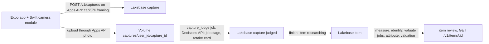

### Identify to confirmed identity

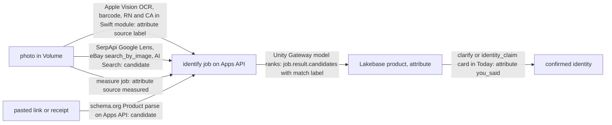

The first four routes run in parallel. Gates 0.90, 0.85 and 0.5 are Ben's; timeouts Lens 4 s, eBay 3 s and a 15 s cap are *agent proposal* ([typed judgements decision](../product/decisions.md#2026-11-14-typed-judgements-run-on-both-the-decisions-api-and-jev-and-our-labels-pick)).

### Price and strategy

```mermaid
flowchart LR
  S["eBay API, harness sold pages, Firecrawl"] -->|"Lakeflow job: comp"| C["Delta comp"]
  C -->|"AI Search and pgvector match to product: comp.product_id"| V["valuate job, plain code"]
  V -->|"Apps API: valuation per site"| L["Lakebase valuation"]
  L -->|"plain code per site from that site's comps and fees: strategy suggested, best preselected"| T["Lakebase strategy"]
  T -->|"POST /v1/items/:id/strategy: strategy chosen, limits"| U["limits floor_cents, always_accept_cents"]
```

### List across sites

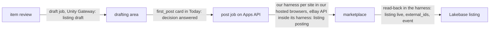

### Buyer message to auto reply or decision

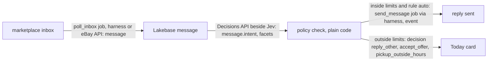

### Sale to delist, handover, payout and ledger

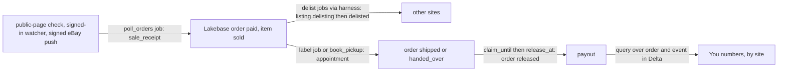

### Want to match to saved listing

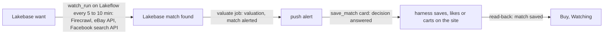

The interval is the [watch alerts decision](../product/decisions.md#2026-11-14-watch-alerts-run-on-firecrawl-the-ebay-api-and-a-facebook-search-api).

### Learning loop: tap to label to changed param

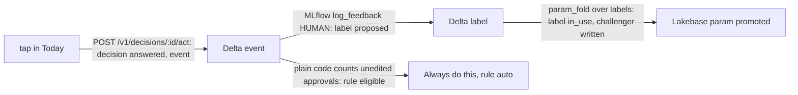

A threshold `param` is promoted only when the labelled set clears its bar: 0.98 precision and 0.95 recall for an automatic reply class (*agent proposal*, [features/data.md](features/data.md), [features/messages.md](features/messages.md); method in [messages-and-offers.md](../research/messages/ben/messages-and-offers.md)).

### Scoring loop: observe, fit, experiment, detect change, re-plan (*agent proposal*)

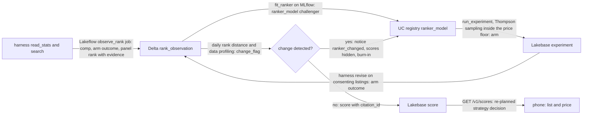

Methods and sample sizes are in [scoring-and-ranker-inference.md](../research/price/nate/scoring-and-ranker-inference.md): a sale rate from 5% to 7.5% needs about 1,500 listings per arm; a click rate from 2% to 3% about 3,800 impressions per arm. A visibility score never claims to be the site's real weights.

### Evidence gate on an outgoing message

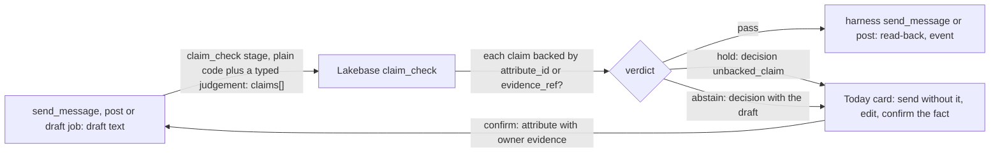

### Visitor search to a referral link-out

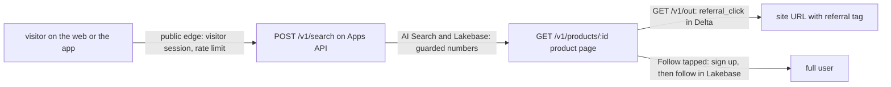

### Research question to a cited answer (*agent proposal*)

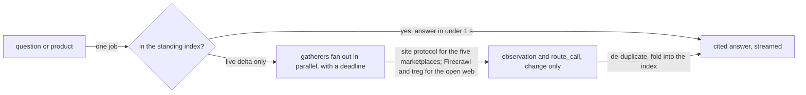

## 11. How to change this spec

A spec Ben and Nate can audit ([words](../product/words.md#2026-11-14-nate-validate-breadth-and-an-auditable-spec)).

| Change | Where it goes | Who |
|---|---|---|
| A name, state, kind, job kind, endpoint or shape | this page first, then the features that use it | any agent, marked *agent proposal* |
| A method, weight, threshold or hide rule | its card in [determinations/](determinations/), its value a `param` row; a new name it needs comes here first | any agent, marked *agent proposal* |
| A name a feature needs that this page lacks | that feature's "Needs from the shared model", until it lands here | the feature's agent |
| A tool that already does part of a feature, and how ours compares | [parity.md](parity.md); a name it needs comes here first | any agent, marked *agent proposal* |
| How a feature works, in plain words for readers outside the build | [../docs/how-it-works/](../docs/how-it-works/README.md), after the name or card it explains has changed here or in determinations | any agent |
| A design choice inside a feature | that feature's "Design choices" table: the options, the one picked, why, and what would change it | the feature's agent |
| What each research claim and each quote in words.md is covered by | the coverage audit, `spec/coverage.md`, one row per claim or quote with the spec section that covers it, or "not covered" | any agent |
| A line moving to Decided | [decisions.md](../product/decisions.md) | only Ben or Nate |
| A conflict between Ben's and Nate's research | both stated, each with its link, and a row under §9 | any agent |

