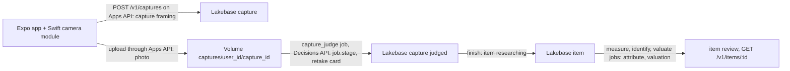
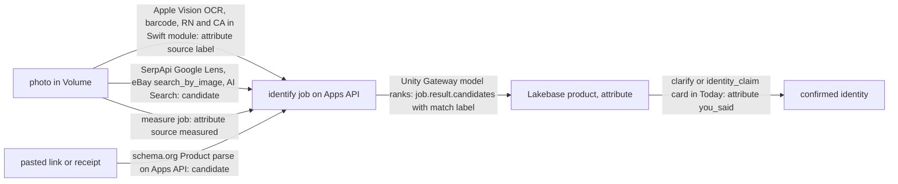
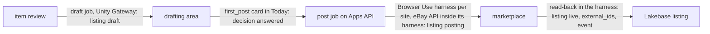
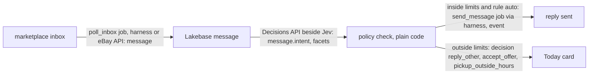
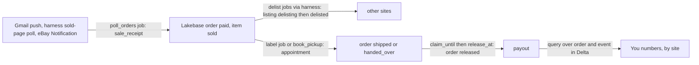
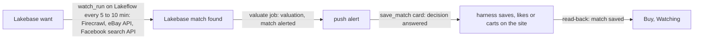
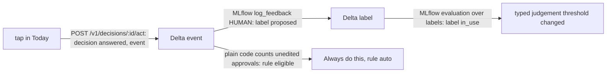

# secondhand: the shared product model

Status: draft. Written 2026-11-14, second pass the same day. Every line is *agent proposal* unless it links a decision in [decisions.md](../product/decisions.md) or [vision.md](../product/vision.md) Decided. This page is the one source of names and shapes: every feature spec in [features/](features/) uses these entity names, states, decision kinds, job kinds and contract rules. A name a feature needs and this page lacks goes under that feature's "Needs from the shared model" until it lands here (§11).

## 1. What it is for

| | |
|---|---|
| Who | Someone clearing their own things, who also buys used; resellers can use it but do not shape the design ([decisions](../product/decisions.md#2026-11-14-the-first-person-we-build-for-is-someone-clearing-their-own-things)). |
| The hassle today | Photographing, measuring, looking up what it is and what it sold for, writing a listing per site, answering the same questions, haggling, keeping five sites in sync, delisting after a sale, arranging pickups, chasing returns. A $20 item rarely earns back that time, so it sits in a closet. |
| What they stop doing | Scan the item once and get one measured record of it. Pick a selling plan. The app lists it, answers buyers inside the limits they set, takes it down everywhere when it sells, and books the pickup inside their hours. |
| What they control | The limits: the lowest they'd take, ship or pickup, pickup hours, saved spot, and a most-to-pay per want. Anything outside them waits as a card in Today. Address, payment, refunds and a price below the floor are always theirs ([decisions](../product/decisions.md#2026-11-14-buyers-are-handled-inside-limits-you-set-then-it-learns)). |
| What they know | What an item is worth on each site, from real sales with dates; why the agent did each thing (the "why?" timeline); what they earned and could earn; how a market moves, even for someone who never sells ([words](../product/words.md#2026-11-14-nate-a-market-anyone-can-learn-from)). |
| How the two sides feed each other | One engine identifies and values an item whether you own it or want it ([decisions](../product/decisions.md#2026-11-14-selling-comes-first-buying-is-a-full-side)). Every sale and every watched listing becomes a comp. A bought item becomes "Sell this" with its cost known. What you sell tells Buy your sizes and taste. |
| What it is not | No storefront and no payments: buyers pay on the marketplace ([words](../product/words.md#2026-11-14-nate-store-and-buying)). |

## 2. The map

Tabs follow the decided bar: Today · Sell · ＋ · Buy · You ([decisions](../product/decisions.md#2026-11-14-the-bottom-bar-is-today--sell----buy--you)). Every feature is in scope ([decisions](../product/decisions.md#2026-11-14-keep-every-feature-in-scope)). An entity listed here has its owner table in that feature; others read it.

| Slug | Where the person meets it | Owns | Spec |
|---|---|---|---|
| today | Today | `decision` (the open-decisions query and cards), `GET /v1/today` | [features/today.md](features/today.md) |
| connect | First launch, You > Accounts | `user`, `account` (sites and the `email` account), the `import` and `unlink` jobs, purchase import | [features/connect.md](features/connect.md) |
| item-card | The item screen, from Sell | `item`, `attribute` | [features/item-card.md](features/item-card.md) |
| capture | ＋ Sell this, the camera | `capture`, `photo` | [features/capture.md](features/capture.md) |
| measure | Inside capture | writes `attribute` (source `measured`) and the package | [features/measure.md](features/measure.md) |
| identify | Inside capture, after the scan | `product`, the candidate list | [features/identify.md](features/identify.md) |
| studio | The item screen, photos | writes `photo` (role studio, real photos kept) | [features/studio.md](features/studio.md) |
| price | The item screen, price and plan | `comp`, `valuation`, `strategy`, the `stale` state, the on-phone comp index | [features/price.md](features/price.md) |
| appraise | ＋ What's it worth, Buy camera and link field | no table: a `valuation` keyed by a capture or a URL (the appraisal) | [features/appraise.md](features/appraise.md) |
| list | Sell, the drafting area | `listing` | [features/list.md](features/list.md) |
| replay | Not seen: inside each harness | `recording` (*agent proposal* inside the harness, §6) | [features/replay.md](features/replay.md) |
| sold | Sell's Sold shelf, Today ship-by cards | `order`, `appointment`, `sale_receipt`, no-shows, the dibs queue, returns and disputes | [features/sold.md](features/sold.md) |
| messages | The chat icon with a count | `conversation`, `message`, `offer`; pickup booking and the address | [features/messages.md](features/messages.md) |
| watch | Buy: New matches, Watching | `want`, `match` | [features/watch.md](features/watch.md) |
| data | You > By site, the "why?" timeline | `job`, `event`, `rule`, `limits`, `label`, idempotency, the delete request | [features/data.md](features/data.md) |
| buy | Buy: search, For you, Bought | no table: `order` with kind purchase, `offer` outgoing, `match` saved, `owned` items | [features/buy.md](features/buy.md) |
| insights | You: earned, could earn, by site, goals | `goal` (*agent proposal*, Nate's); ledger numbers are derived ([decisions](../product/decisions.md#2026-11-14-the-you-tab-leads-with-numbers-and-a-by-site-comparison)) | [features/insights.md](features/insights.md) |

`rule` and `limits` sit with data because Today, messages, sold, price and buy all enforce them; You > Automation and You > Pickups are their screens.

## 3. The data model

Every row carries `id` (prefixed, §7), `user_id`, `created_at`, `updated_at` and `version` (integer, bumped on each write). Storage: L is Lakebase (Postgres, operational truth, synced to Delta), D is Delta, V is a Unity Catalog volume. Money is `{amount_cents, currency}` everywhere; a field named `*_cents` below is that shape.

| Entity | Key fields (type) | Owner | Store | Readers | Primitive |
|---|---|---|---|---|---|
| `user` | email_ref (hash), locale, currency, timezone, disclosure_pref, target_profit_cents?, notification_pref[] {event_kind, channel, on} | connect | L | all | none (identity) |
| `account` | site (`ebay`, `facebook`, `depop`, `poshmark`, `mercari`, `offerup`, `grailed`, `email`), route (`harness`, `search_only`, `email`), health (`ok`, `expiring`, `broken`, `paused`), capabilities (§6, per site), linked_at, token_ref (vault key, never the token) | connect | L | list, messages, sold, watch, buy | Account (configuration) |
| `item` | state (§4), product_id?, title, category, cost?, origin (`capture`, `purchase`, `import`, `folder`), kept_reason?, location {label, place?}, quantity (int, 1 by default), group_id?, seller_sku?, missing_fields[] (derived, never stored) | item-card | L | all | **Item** |
| `product` | brand, model, variant, gtin?, mpn?, category, spec (json), embedding_ref | identify | L, mirrored to D | identify, price, watch, appraise | new: one catalogue identity many items and comps resolve to, so a sale of one item prices the next |
| `capture` | item_id?, state (§4), mode (`shots`, `scan`, `talk`), coverage {needed[], kept[]}, depth_ref?, pose_ref?, masks_ref?, read_text_ref?, kept_raw (bool) | capture | L, files V | measure, identify, studio | part of Item: one session, and the item picks the mode ([decisions](../product/decisions.md#2026-11-14-capture-is-one-session-and-the-item-picks-the-mode)) |
| `photo` | capture_id, role (`front`, `back`, `tag`, `fabric`, `flaw`, `spin`, `studio`), file_ref, parent_photo_ids[], exif_stripped (bool), use (`real`, `improved`) | capture | L, files V | studio, list, identify | part of Item |
| `attribute` | item_id, name, value (json, or null when unknown), unit?, source, confidence (0..1), evidence[] (photo, comp or capture ids, including the identity anchor), method, at, confirmed (bool), unknown_reason? | item-card | L | all | part of Item; a row per fact so each carries provenance |
| `job` | kind (§4), item_id?, stages[] {name, state, started_at, ended_at}, state, result?, error?, trace_id | data | L | all | **Job** |
| `comp` | product_id?, site, price_cents, price_type (`asking`, `sold`, `retail`), observed_at, sold_at?, condition, url_ref, permitted_uses[], source_route | price | D | price, appraise, watch, insights | **Comp** |
| `valuation` | one of item_id, match_id, capture_id or url_ref; per_site[] {site, low, high, basis_count, as_of, dates}, drivers[], max_pay_cents?, verdict?, check?, job_id | price | L (current), D (history) | item-card, appraise, list, buy, today | **Valuation**; an appraisal is a valuation with no item_id, carrying verdict, max_pay and the one check to make |
| `strategy` | item_id, state (§4), objective (`quick`, `balanced`, `max_return`), price_path[] {at, price_cents}, sites[], handover (`ship`, `pickup`, `either`), follow_ups[], chosen_at? | price | L | list, messages, sold | new: the plan the user picks from a few, so markdowns and counters follow one written path ([fees-and-taxes.md](../research/price/nate/fees-and-taxes.md) for net) |
| `listing` | item_id, site, state (`LISTING_STATES`), price_cents, url, external_ids[] {id, url, from, to}, sku, draft {title, body, photo_ids[]}, overrides (json, per site), interest {views?, watchers?, likes?}, posted_at, last_read_back_at | list | L | all | **Listing** |
| `conversation` | site, site_thread_id, item_id?, listing_id or match_id, buyer_ref_hash, role (`sell`, `buy`), intent_last, state (§4), last_read_at | messages | L | today, sold, buy | **Conversation** |
| `message` | conversation_id, actor (`user`, `auto`, `counterpart`), sent_at, site_message_id, intent, facets[] (including `possible_scam`, `dispute`), text_ref (body held encrypted, never logged) | messages | L | messages | part of Conversation |
| `offer` | conversation_id or listing_id, direction (`in`, `out`), amount_cents, you_keep_cents (derived, after fees), state (§4), expires_at | messages | L | price, sold, buy | part of Conversation; its own row because offers have states and limits act on them |
| `order` | kind (`sale`, `purchase`), item_id, listing_id?, match_id?, site, state (§4), price_cents, fees_cents, shipping_cents, payout_cents?, ship_by?, respond_by?, claim_until?, release_at?, external_order_id; unique (site, external_order_id) | sold | L | insights, today, buy | new: the money and handover the ledger is derived from |
| `sale_receipt` | site, external_order_id (unique with site), source (`email`, `poll`, `api`), received_at, raw_ref | sold | L | sold, data | new: the raw proof of a sale, so one sale never makes two orders |
| `decision` | kind (§5), item_id?, options[] {id, label, signature}, suggested, deadline, why, state (§4), answered? {option_id, answered_at, edited, card_ms, opened_detail} | today | L | all | **Decision** |
| `rule` | kind, scope (`all` or item_id), state (§4), unedited_approvals (int), promoted_at?, last_used_at? | data | L | all executors | **Rule** |
| `limits` | per item: floor_cents, always_accept_cents?; per user: handover, pickup_windows[], saved_spot_ref, ask_every_time (bool) | data | L | messages, sold, price, buy | part of Rule |
| `want` | state (§4), text, product_id?, fit {attributes, garment measurements}, max_total_cents?, sites[], schedule {every_min}, alert (`available`, `under`) | watch | L | buy, today | **Want** (with Watch) |
| `match` | state (§4), want_id?, source (`want`, `search`, `for_you`), site, url, price_cents, seen_at, valuation_id? | watch | L, history D | buy, today, price | part of Want |
| `appointment` | order_id, kind (`pickup`, `ship_by`), window {start, end}, place_ref, calendar_ref?, state (§4) | sold | L | today, messages | **Appointment** |
| `goal` | month, target_cents, target_sales?, progress (derived) | insights | L | today, you | new: Nate's monthly goal (*agent proposal*, vision.md Proposed) |
| `event` | item_id?, actor (`user`, `auto`, `site`), action, why, observed_at, effective_at, operation_id, trace_id, undo {allowed, until}, undo_of?, route? (`api`, `replay`, `browser`), fell_back?, ms? | data | D, written through the logger | data, insights, today | the one log and the one "why?" source ([5-logging.md](../.agents/team/packets/team/5-logging.md)) |
| `label` | subject (decision_id, message_id or attribute id), kind (`owner_statement`, `observed`, `verified_correction`, `specialist`), value, state (§4) | data | L, D | data, every typed judgement | new: what a tap or a correction teaches, kept apart from the decision it came from |
| `recording` | site, task, steps_ref, recorded_at, last_ok_at, fail_count | replay | L, files V | the harness for that site | new, *agent proposal*: a site action recorded once in the harness and replayed as its fast path. Ben's word "recipe" (`rcp_`) is the same thing; `rec_` stands |

Ledger numbers (earned, fees, kept, could earn) are queries over `order`, `event`, `strategy` and `valuation`, never stored ([primitives.md](../product/primitives.md)). Ben's `action_log` is `event where action is an item.action`.

### Sub-shapes

| Shape | Fields | Owner | Note |
|---|---|---|---|
| attribute `source` | `measured`, `label`, `inferred`, `spec`, `you_said`, `marketplace` | item-card | a `you_said` value is never overwritten by a model. Older words map in: Ben's seen to `inferred`, read_from_tag to `label`, matched to `spec` or `marketplace`; capture's tag to `label`, estimated to `inferred` |
| unknown value | value null, confidence 0, unknown_reason (`not_visible`, `not_read`, `conflict`, `not_asked`) | item-card | counted in missing_fields; never guessed into a listing |
| flaw | attribute `flaw.<n>`, value {kind, where, severity}, evidence the flaw photo | capture proposes, item-card stores | a flaw is removed only by the person (identity_claim, §5) |
| measurement | attribute with unit `mm`, method, plus {plus_minus_mm, endpoints_px, photo_id} | measure | |
| package | attribute `package`, value {l_in, w_in, h_in, padding_in, weight_oz?, basis} | measure | feeds labels and shipping cost |
| cost | item.cost {amount_cents, currency, date, source (`purchase`, `bought_it`, `you_said`)} | item-card | never asked for: shown as a choice when known, never a question ([user-wants.md](../research/cross-cutting/ben/user-wants.md)) |
| candidate | job.result.candidates[] {product_id?, title, match, score, evidence[], source_route, permitted_uses[]}, up to 5 | identify | match is one of `exact`, `likely_same_model`, `same_family_other_variant`, `comparable`, `unresolved` |
| permitted_uses | list of `display`, `price`, `train`, `cross_site_price` | price | set per source from its terms; eBay content never gets `train` or `cross_site_price` (§6) |

## 4. States

Every state machine lives here; a feature may add a transition, never a state name.

| Entity | States | Note |
|---|---|---|
| item | capturing, researching, review, live, stale, sold, handed_over, done, unsold, kept, returned, disputed, failed, owned | stored; the Sell pill is derived (below) |
| capture | framing, shooting, uploading, judging, judged | capture ends at judged; research jobs start from there |
| listing | `LISTING_STATES` in [lifecycle.mjs](lifecycle.mjs): none, posting, live, postFailed, delisting, delisted, delistFailed | verifying is the read-back inside posting and delisting, not a state; postUnknown is posting with no read-back yet, resolved by reconcile |
| order | paid, pickup_booked, to_ship, shipped, delivered, handed_over, claim_window, released, cancelled, return_open, dispute_open, refunded | a purchase uses the same states from the buyer's side |
| offer | open, countered, accepted, declined, expired, withdrawn | an accepted outgoing offer binds the buyer on eBay (asserted) |
| appointment | proposed, booked, done, no_show, cancelled | |
| decision | open, acting, answered, failed, expired, superseded | events.json `decision.close` reasons `stale` and `replaced` both land on superseded, `expired` on expired |
| rule | ask, eligible, auto, expired, demoted | eligible after 3 unedited approvals; expired after 14 days unused, announced by a rule_expiring card; any undo demotes, and an undo pauses an accept rule |
| strategy | suggested, chosen, running, ended | |
| want | active, paused, ended | |
| match | found, alerted, saved, asked, offered, bought, dismissed, gone | |
| job | queued, running, done, failed | stage states: started, running, arrived, failed. These are the [events.json](events.json) names, so stream, log and screen use one set |
| label | proposed, in_use, retired | |
| conversation | open, closed, blocked | |
| delete request | the `delete_user` job: queued is requested, then running, done, failed | |

### Item

The Sell pill: Researching is `researching`, Review is `review`, Offer $X is an open `accept_offer` decision, Ship by is a booked `ship_by` appointment, Slow is `stale`, then [itemPill](lifecycle.mjs) for Failed, Sold and Live, with its priority Failed over Sold over Live over Review. [spec/README.md](README.md) holds the derivation; this mapping only names the inputs.

| From | To | Trigger | Actor |
|---|---|---|---|
| (new) | capturing | ＋ Sell this, or a folder drop | user |
| (new) | owned | Bought it, a did_you_buy yes, or a purchase from connect's `import` (sets cost and makes an order of kind purchase) | user or auto |
| owned | capturing | Sell this | user |
| capturing | researching | capture reaches judged | auto |
| researching | review | `measure`, `identify` and `valuate` have arrived; `studio` never blocks | auto |
| researching | failed | a research stage failed | auto |
| failed | researching | retry | user |
| review | live | first listing reaches `live` | site |
| live | stale | time offered passes the strategy's patience with interest below plan (price owns this) | auto |
| stale | live | markdown, relist or new site | auto or user |
| live, stale | sold | a sale on any listing | site |
| live, stale | unsold | strategy reaches the floor and ends, or the user ends it | auto or user |
| any before sold | kept | withdrawn, donated or gifted | user |
| sold | handed_over | order reaches `delivered` or `handed_over` | site or user |
| handed_over | done | order reaches `released` | site |
| handed_over, done | returned | return received | site |
| handed_over | disputed | order reaches `dispute_open` | site |
| disputed | done or returned | ruling | site |
| returned, unsold | review | relist chosen | user |

### Listing additions (*agent proposal*, to model in lifecycle.mjs as a build task)

| Action | From | To | Actor | Note |
|---|---|---|---|---|
| offerIn | live | live | site | opens an `offer` |
| counter | live | live | auto inside limits, else user | never below `floor_cents` |
| acceptOffer | live | live (sale pending) | auto at or above `always_accept_cents` ([decisions](../product/decisions.md#2026-11-14-accepting-offers-at-or-above-a-set-amount-can-be-promoted-per-item)), else user | the site then reports the sale |
| declineOffer | live | live | auto when a counter at the floor is refused | |
| offerToWatchers | live | live | auto inside limits | eBay, Depop only (§6) |
| bookPickup | sale | sale | auto inside `pickup_windows` at the saved spot ([decisions](../product/decisions.md#2026-11-14-the-agent-books-pickups-inside-your-hours)) | outside the windows, away from the spot, or with ask_every_time it is a pickup_outside_hours card |
| relist | delisted | posting | user, auto if promoted | appends a new external id; never on Poshmark (delete-and-repost is banned, §6) |

A sale sets a hold on every other listing of the item at once; `delistOk` is recorded only from a read-back. lifecycle.mjs lists `pickupTime` in `NEVER_ALONE`; under §5 a pickup inside the windows is auto and outside them is ask and never promoted, so moving `pickupTime` from `NEVER_ALONE` to `NEVER_PROMOTED` is a build task in that file.

### Order

| From | To | Trigger | Actor |
|---|---|---|---|
| (new) | paid | site reports payment, or a `sale_receipt` arrives | site |
| (new) | pickup_booked | local cash deal booked; payment happens at handover | auto or user |
| paid | to_ship or pickup_booked | handover chosen by strategy or buyer | auto |
| to_ship | shipped | tracking scanned | site |
| shipped | delivered | carrier | site |
| pickup_booked | handed_over | the user taps Handed over | user |
| pickup_booked | pickup_booked | no-show: rebook, next in line, or relist (sold's no_show card) | user |
| delivered, handed_over | claim_window | at once; `claim_until` per site | auto |
| claim_window | released | `release_at` passes, payout | site |
| paid, to_ship, pickup_booked | cancelled | buyer or seller cancels (cancel_sale carries the reason) | site or user |
| claim_window | return_open | buyer requests a return | site |
| claim_window, return_open | dispute_open | buyer escalates | site |
| return_open, dispute_open | refunded | the user approves, or the site rules | user or site |
| return_open, dispute_open | released | declined or ruled for the seller | site |

The buy-to-sell path, one way: a purchase order starts at `paid` after the person completes the purchase on the site (locked), or arrives through connect's `import`, or from a did_you_buy yes. Each creates an `owned` item with `cost` set. "Sell this" on that item moves it to capturing. Returns and disputes follow [trust-returns-disputes.md](../research/sold/nate/trust-returns-disputes.md).

Dibs: a paid buyer beats a dibs (code, not a decision); the dibs buyer gets an automatic message and a place in sold's queue.

### Job kinds

| Area | Kinds |
|---|---|
| capture | `capture_judge` (stages received, judged), `defect_propose`, `folder_group` |
| item research | `measure`, `identify`, `studio`, `valuate` (appraise uses valuate) |
| list | `draft`, `post` (relist uses post), `delist` |
| messages | `send_message`, `poll_inbox` |
| sold | `label`, `poll_orders` |
| watch, buy | `watch_run`, `search` |
| connect | `import` {listings, purchases}, `unlink` |
| scheduled | `reconcile` |
| data | `export_user`, `delete_user` |

## 5. Who may act

Modes are `auto`, `ask` and `locked`; `locked` is what [events.json](events.json) calls `never_alone`, and an `ask` card carries tier `ask`. The policy check is plain code that runs before any executor ([decisions](../product/decisions.md#2026-11-14-automation-runs-in-tiers-that-learn)). Promotion: 3 unedited approvals of the same kind (and item, for per-item kinds) offer "Always do this" ([decisions](../product/decisions.md#2026-11-14-always-accept-is-offered-at-listing-and-only-unedited-approvals-count)). Never promoted: every locked kind, plus `price_below_floor` and `pickup_outside_hours`; this matches `NEVER_PROMOTED` in [lifecycle.mjs](lifecycle.mjs) (address is share_address, pickupTime is pickup_outside_hours, payment is refund and complete_purchase, priceBelowFloor is price_below_floor).

### Decision kinds (the complete list)

| Kind | Owner | Mode | Promotable | Replaces | Note |
|---|---|---|---|---|---|
| first_post | list | ask | yes | | §9, first row |
| agent_revision | list | ask | yes | edit_listing, draft_ready | the agent wants to change a draft or live listing |
| relist | list | ask | yes, never on Poshmark | | |
| delist_after_sale | list | auto | n/a | | paced on Poshmark |
| failed_post | list | ask | no | | retry, edit or skip the site |
| failed_delist | list | ask | no | | the item may still show as for sale |
| site_changed_listing | list | ask | no | | the read-back differs from ours |
| push_my_edit | item-card | auto | n/a | | the person's edit goes to every live listing |
| answer_fact | messages | auto | n/a | | the answer uses only confirmed attributes |
| reply_other | messages | ask | yes | reply_draft | |
| counter_offer | messages | auto inside limits | yes | | at or above the floor, on the strategy path |
| accept_offer | messages | auto at or above always_accept, else ask | yes, per item | | |
| decline_offer | messages | auto | yes | | below the floor, answered with a counter at it |
| offer_to_watchers | messages | auto inside limits | yes | | eBay, Depop |
| scam_warning | messages | ask | no | | a `possible_scam` facet |
| move_off_site | messages | locked | no | | the agent may refuse a buyer's request to leave the site |
| book_pickup | messages | auto inside the windows at the saved spot | n/a | | ([decisions](../product/decisions.md#2026-11-14-pickups-use-your-windows-and-a-saved-meetup-spot)) |
| pickup_outside_hours | messages | ask | never | | outside the windows or away from the saved spot |
| share_address | messages | locked | no | | the home address |
| markdown | price | auto above the floor, on the path | yes | markdown_suggested | |
| price_below_floor | price | ask | never | price_below_lowest, below_floor | ([decisions](../product/decisions.md#2026-11-14-a-price-below-your-floor-always-asks)); screen copy "lowest you'd take" |
| clarify | identify | ask | no | clarifying_question | |
| identity_claim | identify | locked | no | | counterfeit, function, or removing a flaw |
| retake, missing_shot, confirm_flaw, approve_groups, category_unsure | capture | ask | no | | |
| measure_review | measure | ask | no | | |
| studio_approve | studio | ask | yes | | options use_improved, use_real, redo |
| ship_by | sold | ask | n/a | | the reminder card |
| buy_label | sold | ask | yes | | |
| cancel_sale | sold | ask | no | cancellation | carries cancel_reason |
| no_show | sold | ask | no | | rebook, next in line, relist |
| double_sale | sold | ask | no | | two sales of one item |
| refund | sold | locked | no | | |
| return_claim, claim_reply, dispute | sold | ask | no | | |
| leave_review | sold | ask | yes | | |
| relink | connect | ask | no | | an account is `broken` (needsReauth) |
| site_warning | connect | ask | no | | a site warned or limited the account |
| merge_items | connect | ask | no | same_item | an import matches an item we hold |
| buy_offer | buy | ask, every time | no | offer_to_seller | §9 |
| offer_over_ceiling | buy | ask | no | | a seller's price is above max_total |
| seller_counter | buy | ask | no | | |
| did_you_buy | buy | ask | no | | a saved match went gone |
| replace_after_sale | buy | ask | no | | the person sold a thing they use |
| save_match | buy | ask | yes, never Poshmark likes | match | saves, likes or carts on the site |
| complete_purchase | buy | locked | no | | |
| rule_expiring | data | ask | no | | |

Not kinds: goal progress (a You number), dibs and lost dibs (code and an automatic message, §4), watch dedupe (internal to `watch_run`). Nothing on the buy side that commits the person is automatic.

### Undo

`POST /v1/events/:id/undo` works while `undo.allowed` and before `undo.until` (the site's own limit, else 24 hours); otherwise `409 site_no_undo`. An undo is an event with `undo_of` and demotes the rule that acted.

| Action | Undo |
|---|---|
| a sent message, an accepted offer | none |
| a markdown or price change | restores the price |
| a post | delists |
| a delist | relists, never on Poshmark |
| a booked pickup | cancels it, with a message to the buyer |
| save_match, a pushed edit, an attribute correction | reverts it |

Every outward action carries an `operation_id` (its idempotency key), is confirmed by reading the site back, and is undone where the site allows. `reconcile` compares our state with each site on a schedule.

## 6. Systems

### Databricks pieces

The decision is Databricks for the whole backend with a hybrid fallback after 2 hours ([decisions](../product/decisions.md#2026-11-14-databricks-runs-the-whole-backend-with-a-hybrid-fallback)). Facts below come from [databricks-platform.md](../research/data/nate/databricks-platform.md), observed in docs unless marked.

| Piece | Job here | Fact and limit | Risk | Test first |
|---|---|---|---|---|
| Apps (FastAPI) | the `/v1` API, policy check, executors' front | Node 22 and Python 3.11; external callers need an `/api/` route, CAN USE and an OAuth bearer; SIGTERM gives 15 s; 100 apps per workspace; timeout and SSE undocumented | phone and webhooks may not reach it; a forum report says unauthenticated calls get a 302 (asserted) | federated token from the phone; unauthenticated webhook; SSE and long requests through the proxy |
| Lakebase | operational truth, pgvector 0.8 | GA, PG 17; scale to zero (60 s to 7 d), wake of a few hundred ms, pools and prepared statements lost; OAuth tokens 1 h, checked at login, not with PgBouncer; 0.5 CU allows 105 connections; LISTEN/NOTIFY lost on scale to zero | cold wake drops pools; RLS keys on a Databricks identity | wake with a pool; RLS with one service principal |
| Synced tables, CDF | Lakebase to Delta for analysis | Continuous sync 15 s minimum, about 150 rows/s/CU; CDF from PG to Delta is Public Preview | lag on By site numbers | sync and CDF latency |
| Volumes | capture files | Files API PUT up to 5 GiB; no presigned URLs | phone upload needs a proxy or a token | signed or proxied upload |
| Delta | comps, events, labels, traces, evaluation sets | Unity Catalog governed | none known | row filters per user |
| Lakeflow jobs | polling orders, inboxes, watches; reconcile | scheduled, table-update and file-arrival triggers; one active run per job | a slow run delays the next | watch every 5 to 10 minutes ([decisions](../product/decisions.md#2026-11-14-watch-alerts-run-on-firecrawl-the-ebay-api-and-a-facebook-search-api)) under load |
| Agent Bricks or a custom agent on Apps | investigate, draft listings, read messages, propose decisions | DurableAgentServer for background work; memory on Lakebase; Knowledge Assistant and Supervisor are Legacy, Supervisor API end of life 2026-09-30 | do not build on Legacy pieces | one agent run end to end with a trace |
| Unity Gateway | every model call | GA with budgets, fallbacks, guardrails; release notes name Opus 5.5, Haiku 5.5 and Fable, plus GPT and Gemini models; Sonnet is not named; Seedream not listed; no rate limits documented | studio provider outside the gateway | model availability on our workspace |
| AI Search | product and comp retrieval, similar items | no image embeddings; hybrid returns at most 200; dimension up to 4096 | image vectors are self-managed | pgvector or Delta vectors for photos |
| MLflow 3 | a trace per job, labels, evaluation | traces in UC Delta; 200 traces/s ingestion; a trace over 25 MB unreadable; `log_feedback` takes HUMAN, LLM_JUDGE, CODE; prompt registry Beta | big image payloads in traces | trace volume at real load |
| Genie | questions over items and sales | per the decision | scoping to one user | a user-scoped space |
| Free Edition (if that is the workspace) | n/a | 3 apps that stop after 24 h, 1 Lakebase project, 5 concurrent tasks, no Direct Vector Access, non-commercial | fails a product that runs all day | which edition we have |

### Front door (Open, §9)

| Option | How | Holds if | Cost |
|---|---|---|---|
| A. Thin public edge | A small public service signs users in, receives marketplace webhooks and Gmail push, issues upload targets, and forwards to the Apps API with a service identity and the user id | Apps cannot take a phone token or an unauthenticated webhook | one more service, holding no data |
| B. Apps direct | The phone sends a federated token (RFC 8693, about 1 h, no refresh token); webhooks hit `/api/` | the tests above pass, including a webhook without Databricks auth | none, if it works |

Webhooks likely need the edge either way, because sites do not send a Databricks token. If Lakebase or Apps fails the 2 hour test, the hybrid fallback moves the app and its database off Databricks and keeps comps, valuation, traces, evaluation and Genie on it.

### Tenant isolation

- The API acts as one service principal. Every table carries `user_id`. Every transaction runs `SET LOCAL app.user_id`, and row security policies compare `user_id` with that setting, so a missed `where` still returns nothing (inferred; test it, since Lakebase RLS keys on `current_user`).
- Delta tables get Unity Catalog row filters on `user_id`; Genie runs over those filtered views.
- Volume paths are `captures/<user_id>/<capture_id>/`, written only by the API.
- Agents receive the user's rows through the API, never a database connection.

### Secrets and marketplace sessions

| Thing | Where it lives | Who reads it |
|---|---|---|
| eBay OAuth refresh token | server vault (a Databricks secret scope), referenced by `account.token_ref` | the eBay harness only |
| Depop partner OAuth, when granted | server vault | the Depop harness only |
| Gmail OAuth, read-only, for sale email | server vault | sold's `poll_orders` only |
| Browser sessions | the cloud browser's saved profile; the user signs in inside it, we never see or store the password ([decisions](../product/decisions.md#2026-11-14-each-marketplace-gets-its-own-harness-run-on-browser-use-cloud)) | the harness for that site |
| The app's own session | device Keychain | the phone |
| Passwords | never held (the eBay licence also bans storing user IDs and passwords) | nobody |

Tension: Keychain `WhenUnlockedThisDeviceOnly` cannot be read while the phone is locked, but agents run on the server at any hour. Holding marketplace sessions server-side resolves it and raises the stakes of the vault ([privacy-and-data.md](../research/cross-cutting/nate/privacy-and-data.md)). Tokens and cookies never enter a prompt or a log.

### Harnesses

What the two decisions fixed:

| Decision | Fixed |
|---|---|
| [A harness per marketplace](../product/decisions.md#2026-11-14-each-marketplace-gets-its-own-harness-run-on-browser-use-cloud) ([words](../product/words.md#2026-11-14-a-harness-per-app)) | one harness per app, run on Browser Use cloud, acting in the user's own signed-in session after the user's tap; it replaces separate per-site integrations and a separate replay layer |
| [Build it](../product/decisions.md#2026-11-14-its-a-demo-so-build-it) ([words](../product/words.md#2026-11-14-demo-not-production)) | eBay gets a harness too, with its API used inside the harness only where faster or more reliable; research does not drop an idea for being risky or against a site's terms, it states the rule |

Every harness exposes one operation set: `post, edit, delist, read_listing, list_orders, read_inbox, send_message, list_offers, respond_offer, offer_watchers, save, search, read_sold`. Each returns a capability table; a missing capability becomes a one-tap handoff that opens the site. Each outward run writes `route` (`api`, `replay`, `browser`), `fell_back` and `ms` on its event. The recorded fast path (`recording`, replay's spec) is an *agent proposal* inside the harness, with test accounts per site, not a layer of its own; its events (recorded, drift, fallback) go into events.json as a build task. The person meets any harness only through its result. Facts are from [platform-access.md](../research/connect/nate/platform-access.md), observed unless marked.

| Site | Route | Post, edit, delist | Orders | Messages | Offers | Search, sold data | Rule that bites |
|---|---|---|---|---|---|---|---|
| eBay | harness, API inside | Inventory and Offer APIs (unique SKU; relist makes a new item id); end by withdrawOffer or EndItem (asserted) | Fulfillment plus Notification topics | Message API, Trading member messages | GetBestOffers, RespondToBestOffer; offers to watchers through Negotiation | Browse; Marketplace Insights restricted | User Agreement bans LLM bots and buy-for-me agents ordering without human review (effective 2026-06-28 on the live page; Ben's note says 2026-02-20); API licence bans AI training on eBay content, Restricted API output in non-eBay AI without consent, and auto-repricing against other sites; must handle account deletion notices |
| Facebook Marketplace | harness, cloud browser in the US | harness | harness | harness | none found | ScrapeCreators for search (decision) | partner API is EU and EEA only and links out; Meta's Automated Data Collection Terms ban automated collection without written permission |
| Depop | harness, partner API inside if granted | products CRUD, mark as sold | orders plus webhooks | none in the API | send offer to likers; no list-offers | likes and bag counts | partner access gated (email first); API terms ban scraping unless authorised; 200 per 10 s create limit |
| Poshmark | harness, paced | harness | harness; sale email | harness | harness | harness | ToS bans automated collection; guidelines ban automation, including delete-and-repost, likes, shares and follows; mass suspensions in Nov 2025, lifted within 24 h (asserted) |
| Mercari | harness | harness | harness; sale email | harness | harness | harness | in the set ([decisions](../product/decisions.md#2026-11-14-mercari-stays-in-the-platform-set)); no public API (asserted); bots and scrapers banned; may suspend and hold funds |
| OfferUp, Grailed | search and price only | posting planned, not built ([words](../product/words.md#2026-11-14-grailed-and-offerup-posting-planned-not-built)) | n/a | n/a | n/a | Firecrawl monitor, Exa, our scrapers, Apify fallback | the set is decided ([decisions](../product/decisions.md#2026-11-14-the-platform-list-is-set)) |

Sale email: connect holds an `email` account (Gmail OAuth, read-only); sold's `poll_orders` reads Poshmark and Mercari sale email from Gmail push and also polls each sold page through the harness every 1 to 2 minutes (inferred). Without it, connect's health line reads "email not connected: sale detection off for Poshmark and Mercari" and the sold-page poll carries detection alone.

### Model allocation

Image judgements and text judgements are separate parts of the harness, and the provider for each stays open ([decisions](../product/decisions.md#2026-11-14-image-decisions-and-text-decisions-are-separate-and-the-provider-for-each-stays-open)). Each starts where the [typed judgements decision](../product/decisions.md#2026-11-14-typed-judgements-run-on-both-the-decisions-api-and-jev-and-our-labels-pick) puts it, and labels from taps pick what stays.

| Side | Judgement | Starts on | Note |
|---|---|---|---|
| Image | shot accepted, view missing, defect present, tag readable | OpenAI Decisions API | typed yes, no or score |
| Image | masks, read text, depth and pose | specialist vision models | outputs are `capture` refs |
| Image | identity by look | self-managed image vectors | AI Search has no image embeddings |
| Image | studio relight | Seedream 5.5 | not on the gateway; real photos always kept; provider open |
| Image | talk mode | a live video model | shares the shot list ([decisions](../product/decisions.md#2026-11-14-capture-opens-on-the-guided-shot-list-talk-mode-is-one-tap-away)) |
| Text | buyer message intent, scam risk, does a listing match a want | Jev beside a Decisions API run | Jev untested here; labels pick |
| Text | investigate an item | Claude Opus 5.5 | through the gateway |
| Text | listing copy, reply drafts | Claude Opus 5.5 or Haiku 5.5 | in the seller's voice; Sonnet is under §9 |
| Text | routing, short classification | Claude Haiku 5.5 | |
| Code | money, units, limits, permissions, state changes, fees | plain code | never a model |

## 7. Contract conventions

The frame's shapes are binding: ids `it_`, `ls_`, `job_`, `dec_`, `ord_`, `want_` (this page adds `cap_`, `ph_`, `att_`, `pr_`, `cmp_`, `val_`, `st_`, `cv_`, `msg_`, `of_`, `ru_`, `mt_`, `ap_`, `gl_`, `ev_`, `rec_`, `acc_`, `lb_`, `sr_`); [log/example.mjs](../log/example.mjs) writes `jb_` and moves to `job_`. Money `{amount_cents, currency}`; ISO 8601 UTC times; provenance `{value, unit?, source, confidence, evidence[], confirmed}`; range `{low, high, basis_count, as_of, per_site}`, worded per [copy.md](../product/copy.md).

### Requests

| Rule | Shape |
|---|---|
| Auth | `Authorization: Bearer <token>` from the front door (§6). The API derives `user_id`; a client never sends it. |
| Idempotency | `Idempotency-Key` on every POST that creates or acts. The same key and body return the stored response for 24 h; the same key with a different body is `409 idempotency_mismatch`. Outward site actions use the key as `operation_id`. |
| Versions | Every resource has `version`. A write sends it; a stale one is `409 stale` with the current resource. |
| Pagination | `?cursor=&limit=` (limit at most 100). Response `{data: [...], next_cursor}`; `null` when done. Order is newest first unless named. |
| Tracing | `X-Request-Id` in and out; responses include `trace_id` where a job ran. |

### Resources

| Endpoint | Does |
|---|---|
| `POST /v1/captures`, `POST /v1/captures/:id/photos`, `POST /v1/captures/:id/finish` | open a session, get upload targets, finish (returns the research jobs) |
| `GET /v1/items`, `GET /v1/items/:id`, `PATCH /v1/items/:id` | items by state; the full item card; edit title, location, quantity, cost |
| `PATCH /v1/items/:id/attributes/:name` | the person corrects a fact (stored as `you_said`, confirmed) or unpins it (`confirmed: false`, logs `attribute.unpinned`) |
| `POST /v1/items/:id/sell` | "Sell this" on an owned item |
| `POST /v1/valuations` | value an item, a capture or an outside URL; returns a `valuate` job |
| `POST /v1/items/:id/strategy` | pick a strategy and set limits |
| `POST /v1/items/:id/listings` | post to sites; returns a `post` job; the first post opens a decision unless promoted |
| `GET /v1/today` | Today: open decisions in order, with counts |
| `GET /v1/decisions?state=open`, `POST /v1/decisions/:id/act` | answer one |
| `GET /v1/conversations`, `GET /v1/conversations/:id/messages`, `POST /v1/conversations/:id/messages` | messages; a person's own reply |
| `GET /v1/orders`, `POST /v1/orders` (kind purchase: Bought it), `GET /v1/appointments`, `POST /v1/orders/:id/handed-over` | sales, purchases, pickups and ship-by |
| `GET`, `PUT /v1/limits`; `GET /v1/rules`; `POST /v1/rules {from_decision_id}`; `DELETE /v1/rules/:id` | You > Automation and You > Pickups; a locked kind returns `403 locked` |
| `GET /v1/events?item_id=&cursor=`, `POST /v1/events/:id/undo` | the one source for the log and the "why?" timeline: `{event_id, item_id, action, actor, at, why, trace_id, undo: {allowed, until}}`; there is no `/why`, `/v1/log` or `/v1/actions` |
| `POST /v1/wants`, `GET /v1/wants/:id/matches`, `POST /v1/matches/:id/act {action: dismiss, save, not_same, bought}`, `GET /v1/search?q=` | Buy |
| `POST /v1/accounts`, `GET /v1/accounts`, `POST /v1/accounts/:id/import`, `DELETE /v1/accounts/:id` | connect a site or email (returns an OAuth URL or a browser sign-in session); health; `import` and `unlink` jobs |
| `GET /v1/insights`, `PUT /v1/goals/:month` | You numbers, By site, goals |
| `POST /v1/me/export`, `DELETE /v1/me` | `export_user` and `delete_user` jobs |
| `GET /v1/jobs/:id`, `GET /v1/jobs/:id/events` | one job |
| `GET /v1/stream` | one SSE stream per signed-in user: `decision.open`, `decision.answer`, `decision.close`, `state.change`, `message.new`, `job.state`, `job.stage` |

### Jobs and the event stream

A long call returns `202` with `{id, kind, state, stages:[{name, state, started_at, ended_at}], result?}` at once. `GET /v1/jobs/:id/events` streams SSE frames carrying events.json `job.state` and `job.stage` payloads, each with an `id` so `Last-Event-ID` resumes; a heartbeat comment every 15 s. `GET /v1/jobs/:id` returns the same shape for polling, every 2 s. Job states and stage states are the §4 names, the same in stream, log and [frontend-standard.md](../product/frontend-standard.md). `message.new` is stream-only today; a log line for it goes into events.json as a build task. SSE through the Apps proxy is untested, so polling must always work.

### Decisions and the act endpoint

`POST /v1/decisions/:id/act` takes `{option_id, signature, version, edit?}`. The signature is an HMAC over decision id, option id, version and user, valid 15 minutes. It returns `{decision, event_id, job?}`; the decision is `acting` while its job runs, then `answered` or `failed`. An `edit` marks the answer edited, so it does not count toward promotion. A decision whose item or offer changed returns `409 stale` with its replacement. The policy check reruns on act, so a signed option cannot outlive a lowered limit.

### Errors

`{code, message, failed_step, retry}`, with `retry` as `{by: "auto" | "user" | "none", after_s?}`. `message` is for logs; the app words failures per [copy.md](../product/copy.md).

| HTTP | code | When |
|---|---|---|
| 400 | `invalid` | bad shape |
| 401 | `unauthenticated` | no or expired token |
| 403 | `locked` | a locked kind attempted without the person's tap, or promoted |
| 404 | `not_found` | not this user's, or gone |
| 409 | `stale`, `idempotency_mismatch`, `site_no_undo` | version or key conflict; undo past the site's limit |
| 422 | `outside_limits` | an action the policy check refused |
| 429 | `rate_limited` | ours or a site's; `after_s` set |
| 502 | `site_failed` | the site refused or did not read back |
| 503 | `waking` | Lakebase or a job is starting; retry by auto |

## 8. Cross-cutting requirements

| Area | Requirement |
|---|---|
| Logging | One logger in [log/](../log/README.md); [events.json](events.json) is the contract; a new event goes into it and `log/example.mjs` first; the Swift module sends events to JS; logs carry ids, never message text, addresses, tokens or payment details ([5-logging.md](../.agents/team/packets/team/5-logging.md)). Capture's events (started, mode_picked, shot_kept, view_asked, talk_started, talk_fell_back, uploaded, finished) go in as a build task. |
| Data classes | Highest: marketplace tokens and cookies. High: home address, raw room photos and scans (deleted after cutouts unless kept), buyer name and address (short cache, deleted when the order closes or on an eBay deletion notice), buyer message text (kept for a set retention period, then deleted). Medium: saved spot, pickup hours, buyer reference hash, traces (short retention, scanned for text). Low: prices, item facts. Listing photos have EXIF stripped; raw GPS stays on the device ([privacy-and-data.md](../research/cross-cutting/nate/privacy-and-data.md) §12). |
| Personal inference | An inferred size or taste is personal data: shown in You and editable ([analytics-and-recommendations.md](../research/data/nate/analytics-and-recommendations.md)). |
| Disclosure | California's bot disclosure law (asserted) and buyer trust both point to disclosure; a seller is liable for the agent's promises (Air Canada ruling, asserted). The choice is Open (§9). Agents never promise anything a limit does not allow. |
| Safety screening | Before any reply: buyer and page text is data, never instruction; off-site payment, overpayment, code and label requests are flagged as scam risk and become decisions; listings are screened for each site's prohibited items; studio edits may clean up, never hide wear, change colour or add accessories. |
| Evaluation | A real-item set of household things across clothes, shoes, electronics, furniture and small goods, each with a tape measure, the tag read by hand, and its eventual sale price. Measured: identify exact-match rate; measurement error in cm per attribute; share of sold prices inside the shown range; time from ＋ to live; edit rate on drafts and replies; Jev against the Decisions API on labelled messages; delist delay after a sale; reconcile mismatches per day; any auto action outside limits (the bar is zero). Model self-confidence is never the measure. |
| Honest analytics | "Based on N sales from <dates>"; "Asking prices of N live listings"; "N people are watching"; "Sold N days after you listed it". Under about 6 sales, show the sales, not a range. Asking sits above sold, and sold-only data has survivorship bias. Sites that hide sold data give only listings we saw disappear, which undercounts. Never sum sites as if complete. Own-listing views only where the site gives them (eBay). Closed marketplaces have no search volume; proxies are watchers, likes, sell-through (defined on screen) and in-app saved searches. |

## 9. Open for Ben and Nate

| Question | Ben | Nate | Recommendation (*agent proposal*) | Depends on it |
|---|---|---|---|---|
| The harness decision says outward actions run "after the user's tap"; the newer decisions let buyers be handled inside limits and pickups be booked inside hours without one. Does "after the user's tap" now mean only the first post and the locked kinds? | the harness decision, then the newer [buyers](../product/decisions.md#2026-11-14-buyers-are-handled-inside-limits-you-set-then-it-learns) and [pickups](../product/decisions.md#2026-11-14-the-agent-books-pickups-inside-your-hours) decisions | the same decisions | the newer decisions govern; this page is written that way | list, messages, sold, replay |
| Acting through a harness can get accounts banned (Poshmark, Mercari, eBay rules in §6). How fast, and opt in per site? | not answered | "we build one" where a site has none ([words](../product/words.md#2026-11-14-nate-frameworks-and-goals)) | opt in per site with the rule shown; pacing per site; the first post asks on Poshmark and Mercari | list, messages, sold, connect |
| Buy offers: the agent sends them, or asks each time? | not answered | picked "Also negotiate for me" inside a ceiling ([words](../product/words.md#2026-11-14-nate-store-and-buying)) | ask every time until Ben answers; an eBay Best Offer binds (asserted) and eBay bans buy-for-me agents without human review | buy, watch |
| Save or like on the site when a match is saved? | not answered | yes, cart or like per site ([words](../product/words.md#2026-11-14-nate-store-and-buying)) | ask, and never Poshmark likes, which its guidelines ban | buy, watch |
| Dibs against paid | not answered | not answered | paid wins; the dibs buyer is told at once and kept next in line | sold, messages |
| Monthly goals | not answered | proposed (vision.md Proposed) | keep in insights as a proposal | insights, today |
| Nate's other proposals not yet answered by Ben: private store, For you and save-sync | not answered | proposed (vision.md Proposed) | keep them in the specs as proposals | buy, connect |
| Studio photos and honesty | not answered | not answered | always keep the real photos alongside | studio, list |
| Tell buyers an assistant is answering? | not answered | not answered | natural voice, a short note on the first automatic message, honest if asked ([handled-by-default.md](../research/messages/nate/handled-by-default.md)) | messages, legal exposure |
| The front door | not answered | not answered | test option B on the real workspace; keep A ready | everything that calls the API |
| Expo holds only if capture is fully possible in it? | Expo with a Swift camera module ([decisions](../product/decisions.md#2026-11-14-the-app-is-an-expo-app-with-a-native-swift-camera-module)) | Expo if every capture feature works as it would natively ([words](../product/words.md#2026-11-14-nate-expo-if-capture-is-fully-possible)) | Expo stands; the camera module test on object capture and LiDAR settles it | capture, measure |
| How price may use eBay data, given the licence bans AI use of Restricted API output and auto-repricing against other sites | not answered | not answered | keep eBay data out of cross-site repricing (`permitted_uses`); use it for eBay prices and display | price, appraise |
| Where marketplace sessions live (Keychain or server) | not answered | not answered | server vault and cloud browser profile, with the stakes stated | connect, security |
| Is Sonnet on our gateway? Release notes name Opus 5.5, Haiku 5.5 and Fable, not Sonnet | not answered | not answered | draft on Haiku, investigate on Opus; test Sonnet on the workspace | list, messages, appraise |
| How does secondhand earn (a fee, a subscription, a referral, paid data)? | not answered | buy-side referrals, and anonymous market data ([words](../product/words.md#2026-11-14-nate-referrals-and-market-data)) | your call; market data needs the privacy rules in §8 | pricing screens, data use, terms |
## 10. Data flows

Each hop names the technology and the entity it writes ([words](../product/words.md#2026-11-14-nate-validate-breadth-and-an-auditable-spec)).

### Capture to item card

### Identify to confirmed identity

The first four routes run in parallel. Gates 0.90, 0.85 and 0.5 are Ben's; timeouts Lens 4 s, eBay 3 s and a 15 s cap are *agent proposal* ([typed judgements decision](../product/decisions.md#2026-11-14-typed-judgements-run-on-both-the-decisions-api-and-jev-and-our-labels-pick)).

### Price and strategy

```mermaid
flowchart LR
  S["eBay API, harness sold pages, Firecrawl"] -->|"Lakeflow job: comp"| C["Delta comp"]
  C -->|"AI Search and pgvector match to product: comp.product_id"| V["valuate job, plain code"]
  V -->|"Apps API: valuation per site"| L["Lakebase valuation"]
  L -->|"plain code from fees: strategy suggested"| T["Lakebase strategy"]
  T -->|"POST /v1/items/:id/strategy: strategy chosen, limits"| U["limits floor_cents, always_accept_cents"]
```

### List across sites

### Buyer message to auto reply or decision

### Sale to delist, handover, payout and ledger

### Want to match to saved listing

The interval is the [watch alerts decision](../product/decisions.md#2026-11-14-watch-alerts-run-on-firecrawl-the-ebay-api-and-a-facebook-search-api).

### Learning loop: tap to label to changed threshold

A threshold changes only when the labelled set clears its bar: 0.98 precision and 0.95 recall for an automatic reply class (*agent proposal*, [features/data.md](features/data.md), [features/messages.md](features/messages.md); method in [messages-and-offers.md](../research/messages/ben/messages-and-offers.md)).

## 11. How to change this spec

A spec Ben and Nate can audit ([words](../product/words.md#2026-11-14-nate-validate-breadth-and-an-auditable-spec)).

| Change | Where it goes | Who |
|---|---|---|
| A name, state, kind, job kind, endpoint or shape | this page first, then the features that use it | any agent, marked *agent proposal* |
| A name a feature needs that this page lacks | that feature's "Needs from the shared model", until it lands here | the feature's agent |
| A design choice inside a feature | that feature's "Design choices" table: the options, the one picked, why, and what would change it | the feature's agent |
| What each research claim and each quote in words.md is covered by | the coverage audit, `spec/coverage.md`, one row per claim or quote with the spec section that covers it, or "not covered" | any agent |
| A line moving to Decided | [decisions.md](../product/decisions.md) | only Ben or Nate |
| A conflict between Ben's and Nate's research | both stated, each with its link, and a row under §9 | any agent |

